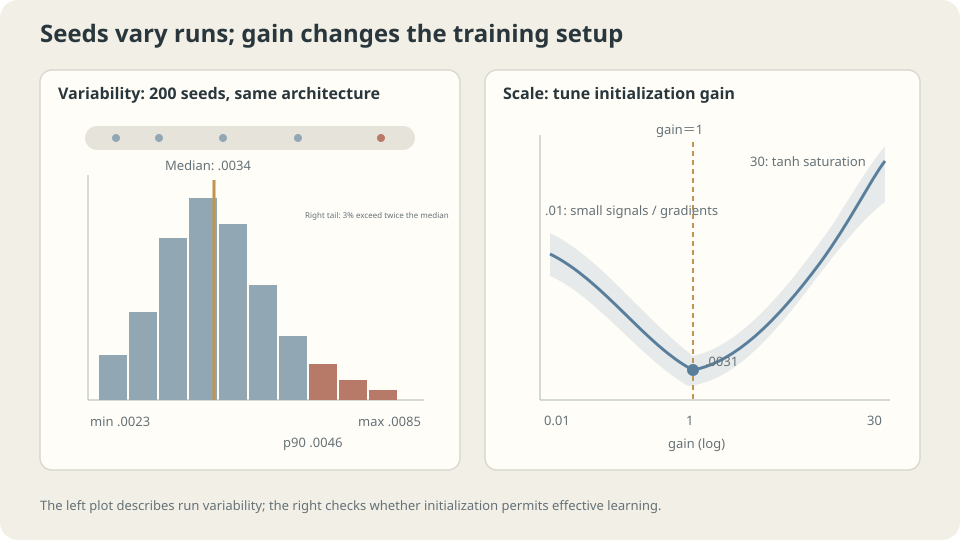

import Objectives from '../../../components/Objectives.astro';
import Ask from '../../../components/Ask.astro';
import Prereq from '../../../components/Prereq.astro';
import Question from '../../../components/Question.astro';
import Answer from '../../../components/Answer.astro';
import QuizBlock from '../../../components/QuizBlock.astro';
import Option from '../../../components/Option.astro';
import Explanation from '../../../components/Explanation.astro';
import VizPlan from '../../../components/VizPlan.astro';
import Remark from '../../../components/Remark.astro';
import Bridge from '../../../components/Bridge.astro';
import UsedBy from '../../../components/UsedBy.astro';
import Ref from '../../../components/Ref.astro';

# One Map, Different Starting Points: Loss Landscapes and Initialization

<Objectives title="After reading, you can">
- Measure repeated-run loss variation without inferring the number or connectivity of minima.
- Compare initialization scales using activation, gradient, and update statistics.
- Explain depth-dependent Jacobian products and qualify residual-path guarantees.
</Objectives>

<Prereq items={frontmatter.prereqs} />

## One map and different trailheads

Quadratic calculations clarified rate, momentum, and spectral filtering. A general network loss need not be one bowl: could changing the starting point alter the destination?

Linear squared loss is convex, with uniqueness only under suitable rank conditions. Nonlinear networks generally lack convexity guarantees. Initialization can influence both finite-time destinations and initial signal propagation.

In practice, the same program with another seed can give another score.

How large is that variation? Rather than attributing every difference to local minima, measure repeated-run outcomes and separately test initialization scale.

<Ask>
Do different starts produce similar useful outcomes?<br />
How much do finite-run scores vary?<br />
Which initialization settings affect signal propagation?
</Ask>

<Question label="Discussion" id="Q1">
Which convex guarantee is lost, and why is initialization more than merely a random point?

<Answer summary="Show the reasoning">
For a differentiable convex objective, a stationary point is globally minimizing. Without convexity, zero gradient can also occur at saddles or other stationary structures. Local derivative information no longer supplies that global conclusion.

At a nonzero gradient and sufficient smoothness, sufficiently small steps still decrease loss locally. That does not prove global optimality or finite-time convergence.

Initialization affects at least three things:

1. The subsequent trajectory and finite-budget result.
2. Initial activation and gradient magnitudes; too-small or saturating scales can impede useful updates.
3. Layerwise gradient transmission, determined by products of weight and activation Jacobians.

An initialization **gain**, scaling a baseline variance, is therefore a training choice worth checking rather than an invisible implementation detail.
</Answer>
</Question>

## Variation and scale are separate measurements

**Seed variation** describes repeated outcomes at the same chosen configuration. It informs reporting and method comparisons, developed in <Ref to="ml-seeds-and-reporting" mode="title"/>.

**Scale** concerns initial weights and signals. Fan-aware initialization aims to preserve useful signal magnitudes under approximate assumptions. Glorot and He rules use related but activation-dependent variance choices [1,2]; gain here multiplies a specified baseline.

Measure variation with repeated runs. Inspect scale with initial activation, backward-gradient, and actual update statistics, often before long training.



*Seed uncertainty and signal-propagation scale need different diagnostics.*

## Does depth make gradients vanish?

Backpropagation multiplies layer Jacobians:

$$
\nabla_{h_0}L=J_1^\top J_2^\top\cdots J_D^\top\nabla_{h_D}L,
\qquad J_\ell=\operatorname{diag}(\sigma'(z_\ell))W_\ell.
$$

For $h_\ell=\sigma(W_\ell h_{\ell-1}+b_\ell)$, $J_\ell$ describes input sensitivity. Parameter gradients also involve the corresponding layer input. If relevant directional amplification is approximately $c$ per layer, the product can behave like $c^D$:

- $c<1$ can produce vanishing gradients.
- $c>1$ can produce exploding gradients.
- $c\approx1$ may preserve scale, but matrix directions and singular-value distributions remain relevant.

Weight scales and activation derivatives both influence these factors. Fan-aware variance rules address approximate propagation statistics, not a guarantee that every directional Jacobian product remains near one.

> **Depth accumulates multiplicative effects; initialization adjusts the factors rather than removing depth.**

A first-to-last gradient ratio alone is insufficient. Record absolute magnitudes too: both gradients can shrink together while their ratio stays stable.

<Remark label="Caution" summary="Residual connections change the Jacobian, not every guarantee">
A residual block has Jacobian $I+J_F$. The identity branch offers direct transmission, but the whole matrix can still shrink or cancel directions. A residual connection alone does not guarantee nonvanishing gradients.

Unscaled branches can also accumulate large activations or gradients. The experiment below shows a strongly growing gradient ratio with depth in one residual setup, not a general proof that all residual networks explode.

Possible designs include scaled branches, learned initially small residual weights, and normalization. Their appropriate scaling depends on architecture and assumptions. Residual connections and normalization are useful together in many systems, but neither must universally accompany the other. See <Ref to="ml-unet" mode="title"/>.
</Remark>

## Diagnose scale before selecting lucky runs

Inspect layer activation standard deviations, absolute gradient norms, ratios, and update magnitudes on a representative initial batch. Compare reasonable initialization and rate choices while preserving the task's useful signals.

Use several seeds to characterize outcomes rather than selecting the luckiest score. Report the specified summary and uncertainty; the number of repetitions should match variability and resources.

The examples concern small tanh networks and mostly training loss. Their variability need not match test-risk variability or larger architectures. Changing optimizer, depth, or width changes the experiment; no universal ordering follows from these tables.

## Measure variability, gain, and depth

The recorded model has sizes $1\to32\to32\to1$, tanh hidden activations, and 4000 Adam updates at rate 0.01 on thirty toy examples.

**Two hundred initializations:**

```python
# Experiment-driver sketch. `mlp` denotes the helper interface described below;
# its implementation is not included in this note.
import numpy as np
import mlp
from ml_toy import toy_1d
x,y = toy_1d(n=30,seed=0)
X = x[:,None]
fin = []
for s in range(200):
    P = mlp.init([1,32,32,1],gain=1.,rng=np.random.default_rng(s))
    P,L = mlp.adam_train(P,X,y,T=4000,eta=.01)
    fin.append(L)
fin = np.array(fin)
print('min, median, p90, max:',fin.min(),np.median(fin),np.percentile(fin,90),fin.max())
print('fraction above twice median:',(fin>2*np.median(fin)).mean())
```

```
minimum .0023, median .0034, 90th percentile .0046, maximum .0085
fraction above twice median: 3.0%
```

The displayed training outcomes vary, with most runs within a moderate range and a smaller poor tail. This quantifies this experiment rather than proving every run reaches an equivalent basin.

A percentile-to-median ratio is not a significance threshold. Compare repeated or paired method differences directly and evaluate generalization separately.

These are finite-update losses, not verified local minimum values. Their distribution cannot establish the count or connectivity of minima in parameter space.

**Gain sweep:** repeat twelve seeds per gain and compare finite-budget outcomes:

```
gain   median final MSE   worst
.01    .0064             .0135
.1     .0057             .0059
1      .0031             .0061
3      .0066             .0089
10     .0108             .0133
30     .0156             .0523
```

Gain one performs best among these tested settings. Very small weights can weaken useful propagation, and large tanh preactivations can saturate. Confirm mechanisms with activation and gradient measurements rather than inferring them exclusively from final losses.

This scan is less catastrophic than the earlier oversized-rate quadratic example, but that comparison concerns different settings. A poor scale need not produce an explicit software error.

**Depth:** measure the initial first-to-last parameter-gradient norm ratio across eight seeds:

```
tanh, width 32, no residuals:
depth   gain=.5   gain=1   gain=2
2       .161      .164     .190
8       .175      .226     .441
16      .187      .228     .799
32      .186      .219     7.63
```

The gain-0.5 and gain-one ratios are fairly stable here. Absolute norms could still change together, so these ratios alone cannot rule out vanishing gradients.

Gain two yields a much larger ratio at depth thirty-two than depth two. It demonstrates interaction between scale and depth, not that one of them is irrelevant.

> **A stable ratio is not a proof of stable absolute gradients.**

**Add unscaled residual branches:**

```
block: h_next = h + tanh(W h)
depth   no residual   residual
2       .164          .226
4       .193          .520
8       .226          1.36
16      .228          13.0
32      .219          328
```

The ratio grows strongly for this unscaled construction. The identity-plus-branch product differs from the plain-chain product; actual activation and gradient norms are still needed to diagnose absolute explosion.

This motivates checking branch scaling and normalization in a concrete architecture. It does not establish that every residual design explodes or that normalization is always required.

<Remark label="Supplement" summary="The NumPy helper interface used by the experiment">
The experiment's helper contract includes `init(sizes, gain, rng)` with gain/fan-in-aware weights, `grads(P, X, y, skip)` with tanh derivatives and optional identity-branch contributions, and `adam_train(P, X, y, T, eta)` using bias-corrected Adam. This describes the original experiment's interface rather than supplying a standalone `mlp.py` implementation.

The recorded setup uses full batches, no normalization layers, and no weight decay to isolate initialization and depth choices. Other training setups require their own controlled comparisons.
</Remark>

## Change the seed, gain, and depth

<iframe loading="lazy" src="/personal_website/notes/research_areas/machine-learning-foundations/l2-optimization-in-practice/l2-4-2.en.html" class="demo-frame" title="Initialization seeds, gain, depth, and gradient propagation" style="height: 937px; width: 100%; border: none;"></iframe>

**Separate repeated-run variation from layerwise scale diagnostics.**

## Check your understanding

<QuizBlock id="ml-l2-4-a">
One run of architecture A has lower training MSE than one run of B. What has been established?
<Option>A has better typical generalization.</Option>
<Option correct>Those two executions differ; use repeated runs and held-out evaluation for broader claims.</Option>
<Option>More updates necessarily eliminate all variation.</Option>
<Explanation>Finite-time optimization, initialization, and other randomness can explain differences. These two scores do not identify basin structure or typical performance.</Explanation>
</QuizBlock>

<QuizBlock id="ml-l2-4-b">
Early layers barely update in a deep model. What should precede an automatic architecture change?
<Option>Immediately add unscaled residual blocks.</Option>
<Option correct>Measure activations, absolute gradient norms, ratios, and actual updates; inspect initialization, rate, and architecture.</Option>
<Option>Always raise the learning rate until they move.</Option>
<Explanation>Ratios can hide jointly small norms, and increasing the global rate can destabilize other layers. Diagnose the observed propagation first.</Explanation>
</QuizBlock>

<QuizBlock id="ml-l2-4-c">
A large gain worsens both median and worst observed loss. What follows?
<Option>Always make the gain as small as possible.</Option>
<Option correct>Scale can affect typical outcomes and variability; compare propagation and repeated outcomes for the intended setup.</Option>
<Option>Only the median matters.</Option>
<Explanation>The small-gain end can also impede finite-budget progress. The observed table supplies evidence about these tested settings, not a universal optimum.</Explanation>
</QuizBlock>

<QuizBlock id="ml-l2-4-d">
Which claim is unsupported?
<Option>A nonconvex stationary point need not be globally minimizing.</Option>
<Option>Residual blocks add identity but still require Jacobian-scale checks.</Option>
<Option correct>Two hundred finite-step losses identify a fixed number of isolated local minima.</Option>
<Explanation>Finite-run scalar losses do not determine stationary points, Hessian properties, or connectivity in parameter space.</Explanation>
</QuizBlock>

<UsedBy slug={frontmatter.slug} />

<Bridge to="ml-mlp">
Rates, batch sizes, restrictions, and initialization now require choices. Next organize experiments so comparisons reflect repeatable improvements rather than a lucky run; later return to the architectural assumptions themselves.
</Bridge>

## References

1. Glorot, X., Bengio, Y. [*Understanding the difficulty of training deep feedforward neural networks.*](https://proceedings.mlr.press/v9/glorot10a.html) AISTATS 2010.
2. He, K. et al. [*Delving Deep into Rectifiers.*](https://arxiv.org/abs/1502.01852) ICCV 2015.
3. Li, H. et al. [*Visualizing the Loss Landscape of Neural Nets.*](https://arxiv.org/abs/1712.09913) NeurIPS 2018.
