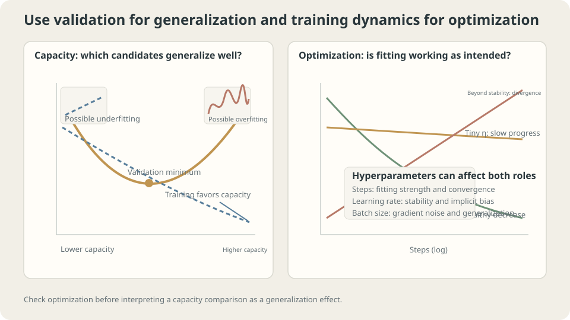

import Objectives from '../../../components/Objectives.astro';
import Ask from '../../../components/Ask.astro';
import Prereq from '../../../components/Prereq.astro';
import Question from '../../../components/Question.astro';
import Answer from '../../../components/Answer.astro';
import QuizBlock from '../../../components/QuizBlock.astro';
import Option from '../../../components/Option.astro';
import Explanation from '../../../components/Explanation.astro';
import VizPlan from '../../../components/VizPlan.astro';
import Remark from '../../../components/Remark.astro';
import Bridge from '../../../components/Bridge.astro';
import UsedBy from '../../../components/UsedBy.astro';
import Ref from '../../../components/Ref.astro';

# Recipe or Cooking Adjustment? Parameters and Hyperparameters

<Objectives title="After reading, you can">
- Define parameters and hyperparameters through their role in the procedure.
- Distinguish training-objective efficiency from selection for fresh-data performance.
- Explain why optimization settings can also affect regularization and require independent assessment.
</Objectives>

<Prereq items={frontmatter.prereqs} />

## Written recipe and adjustments at the stove

A recipe specifies ingredients and amounts, rather than every tiny movement at every second.

Some choices define the cooking procedure; other adjustments happen while following it.

Likewise, weights are updated inside training while depth, rate, and stopping rules define or control that run. More advanced procedures can learn such settings too, so the distinction is relative to the chosen inner and outer loops.

Cooking smoothly and tasting good with fresh ingredients are different goals. **Are we choosing the lowest training loss or the best future predictions?** One measurement need not answer both.

<Ask>
What does the inner optimizer change?<br />
What defines the procedure around it?<br />
Which score answers the selection question?
</Ask>

<Question label="Discussion" id="Q1">
Classify the settings and explain why training loss alone cannot determine appropriate capacity.

<Answer summary="Show the reasoning">
The distinction is **which procedure chooses the quantity**, rather than how important it is.

$$
\hat\theta(\lambda)=\arg\min_{\theta}\ \widehat R_n\big(f_\theta;\lambda\big).
$$

Parameters $\theta$ are the inner fitted variables. Hyperparameters specify the objective, family, or solver around that fit. A learning rate need not appear in the ideal argmin to control its numerical approximation.

Two useful, overlapping roles are

| | Family or regularization | Optimization procedure |
|---|---|---|
| Examples | Degree, depth, width, penalty, dropout | Rate, batch, momentum, gain, update count |
| Checks | Appropriate held-out comparisons and learning curves | Loss progress, gradients, scale, stability, and budget |

For nested $\mathcal F_1\subseteq\mathcal F_2$, the exact minimum training risk over the larger set is no greater: it can reuse the smaller set's solution.

Thus maximal capacity is among training-score minimizers, possibly tied with others. Numerical and optimization errors can break observed monotonicity. What the score omits is the fresh-data cost of choosing extra flexibility.
</Answer>
</Question>

## Diagnose trainability, then compare generalization

First establish that candidate procedures can train meaningfully; then assess the question of interest.

Inspect stable progress, gradient scales, and small-subset fitting before attributing poor outcomes to capacity. An unstable run cannot provide a clean architecture comparison.

Use development evaluation to compare capacity and restrictions. Learning-curve patterns guide interventions but do not uniquely diagnose their cause.

Several settings affect both roles:

- **Duration** is a compute budget and can act as implicit regularization.
- **Rate** changes convergence and finite-time solutions.
- **Batch size** affects update cost, count, noise, and possibly selected solutions.

Calling these “optimization settings” does not justify using training scores alone for a generalization claim.



*Training diagnostics and fresh-data comparisons answer different questions and interact.*

## Selecting capacity with training loss

Repeatedly split 120 toy examples into sixty training, thirty validation, and thirty test observations. Compare choosing degrees one through fifteen by training versus validation loss.

```python
# Core selection step; x, y, tr, va, DEG, and Polynomial are set by the experiment.
fits = [Polynomial.fit(x[tr],y[tr],d) for d in DEG]
train_scores = [((f(x[tr])-y[tr])**2).mean() for f in fits]
val_scores = [((f(x[va])-y[va])**2).mean() for f in fits]
```

```
Representative 200-repeat record:
training selection: mode degree 15, upper limit selected 100%, median risk .0530
validation selection: mode degree 5, upper limit selected 3%, median risk .0262
```

The observed training selection favors the upper bound, as expected from nested-family minima. Extending past interpolation can produce ties or numerical problems rather than guaranteed unique selection of the highest degree.

Validation selection improves median population risk here. Its preferred degree is consistent with earlier toy comparisons, but finite validation noise and selection optimism remain.

> **Training fit alone contains no explicit cost for choosing additional capacity.**

<Remark label="Supplement" summary="Why can parameters be fitted on training data?">
The distinction is not that every parameter fit is safe while every outer choice is forbidden on training data.

A restricted family, regularizer, and algorithm provide inductive bias for fitting weights. Choosing that restriction itself by unadjusted fit favors flexibility. Both levels need generalization reasoning; parameter fitting also overfits without suitable controls.

Complexity-corrected criteria can compare families under their assumptions; held-out evaluation supplies another approach. Raw training loss alone does not account for selection flexibility.
</Remark>

## What about optimizer settings?

Could rates and update counts be selected using training loss because the formal function family stays fixed?

The answer depends on the question being answered.

For **training-objective efficiency**, comparing achieved training loss under a specified compute budget is appropriate. The known least-squares optimum offers a useful reference in the earlier optimizer example.

For **fresh-data performance**, settings influencing implicit regularization or the attained solution require suitable development evaluation.

Duration illustrates the difference directly:

```
updates   training   validation   population
100       .0713      .1167        .1317
10000     .0302      .0476        .0502
100000    .0196      .0290        .0290
1000000   .0147      .0324        .0318
5000000   .0130      .0434        .0458
```

In this record, longer training keeps improving fit while population risk worsens after an intermediate minimum. Training-score selection would miss the relevant generalization optimum.

Rate lacks a nested-family monotonic law: too large can destabilize and too small can leave incomplete fitting. Use training diagnostics to screen ineffective solves, then independent development evidence for generalization.

> **Optimizing a training score and selecting a useful predictor are different tasks.**

State the target explicitly before choosing the metric: compute efficiency or fresh-data prediction quality?

Keep evaluation independent and rerun the permitted pipeline for each candidate. Nested-family monotonicity does not compare arbitrary unrelated architectures. Small validation sets retain uncertainty, regardless of how clearly the conceptual distinction is stated.

## A practical sequence

Combine optimization and selection in a controlled loop:

1. Establish stable fitting and sensible gradient/activation scales for an initial configuration.
2. Compare capacity and regularization using development data or appropriate CV.
3. Recheck optimization after changing the family or representation.
4. Freeze the selected procedure before independent final evaluation.

Settings interact, so one-at-a-time tuning can miss useful combinations. The next note treats the search space itself.

## Two roles, two evaluation questions

<iframe loading="lazy" src="/personal_website/notes/research_areas/machine-learning-foundations/l3-experimental-method/l3-0-2.en.html" class="demo-frame" title="Parameters, hyperparameters, training fit, and validation selection" style="height: 853px; width: 100%; border: none;"></iframe>

**Compare training-based and validation-based capacity selection in the specified toy.**

## Check your understanding

<QuizBlock id="ml-l3-0-a">
A batch size gives the lowest training loss. Is that sufficient to claim best future performance?
<Option>Yes: batch size is only an optimizer setting.</Option>
<Option correct>No: evaluate fresh-data performance and specify whether steps, examples, or time were held fixed.</Option>
<Option>Batch size never affects outcomes.</Option>
<Explanation>Rate, noise, update count, and hardware cost interact. The simple ratio model does not describe all training behavior.</Explanation>
</QuizBlock>

<QuizBlock id="ml-l3-0-b">
What follows when exact ERM's nested family expands beyond interpolation?
<Option>Training minima must rise.</Option>
<Option correct>The minimum cannot increase, but capacities may tie; training fit still cannot choose best generalization.</Option>
<Option>The returned numerical score is guaranteed exact and monotone.</Option>
<Explanation>Set inclusion constrains exact minima, not every finite-precision solver result or a unique selected capacity.</Explanation>
</QuizBlock>

<QuizBlock id="ml-l3-0-c">
Which use of training loss is misleading?
<Option>Comparing solvers' achieved training objective under a defined budget.</Option>
<Option correct>Choosing final training duration for generalization solely by the smallest training loss.</Option>
<Option>Screening initialization settings for whether meaningful fitting begins.</Option>
<Explanation>Optimization screening is useful, but final generalization selection—including gain and duration—needs the appropriate independent evaluation.</Explanation>
</QuizBlock>

<QuizBlock id="ml-l3-0-d">
Which statement is false?
<Option>The parameter/hyperparameter distinction depends on the procedure's roles.</Option>
<Option>Changing capacity can require retuning optimization.</Option>
<Option correct>Having a large unused validation set repairs a choice made only from raw training error.</Option>
<Explanation>The validation set must actually enter the appropriate development comparison; merely existing does not add missing generalization information to the training score.</Explanation>
</QuizBlock>

<UsedBy slug={frontmatter.slug} />

<Bridge to="ml-hyperparameter-search">
Once development evaluation is defined, how should we explore many interacting settings under a limited budget? Next compare structured grids with random candidates and ask how the number of influential dimensions affects their efficiency.
</Bridge>

## References

1. Bergstra, J., Bengio, Y. [*Random Search for Hyper-Parameter Optimization.*](https://jmlr.org/papers/v13/bergstra12a.html) JMLR 2012.
2. Hastie, T., Tibshirani, R., Friedman, J. [*The Elements of Statistical Learning*](https://hastie.su.domains/ElemStatLearn/), 2nd ed. Springer 2009, Ch. 7.2, 7.10.
3. Dodge, J. et al. [*Show Your Work: Improved Reporting of Experimental Results.*](https://aclanthology.org/D19-1224/) EMNLP 2019.
