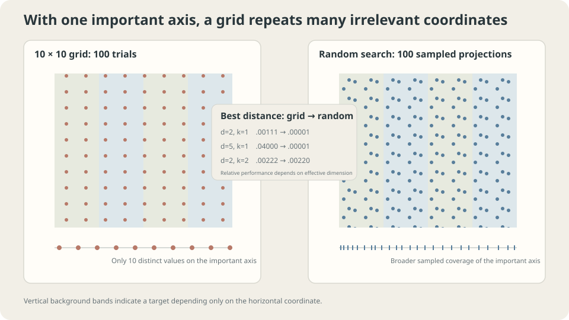

import Objectives from '../../../components/Objectives.astro';
import Ask from '../../../components/Ask.astro';
import Prereq from '../../../components/Prereq.astro';
import Question from '../../../components/Question.astro';
import Answer from '../../../components/Answer.astro';
import QuizBlock from '../../../components/QuizBlock.astro';
import Option from '../../../components/Option.astro';
import Explanation from '../../../components/Explanation.astro';
import VizPlan from '../../../components/VizPlan.astro';
import Remark from '../../../components/Remark.astro';
import Bridge from '../../../components/Bridge.astro';
import UsedBy from '../../../components/UsedBy.astro';
import Ref from '../../../components/Ref.astro';

# One Hundred Trials: A Grid or Random Points?

<Objectives title="After reading, you can">
- Count distinct grid and random projections under a fixed budget.
- State the low-effective-dimension assumptions and limits of that argument.
- Explain the information used by Bayesian optimization and successive-halving methods.
</Objectives>

<Prereq items={frontmatter.prereqs} />

## Two settings and one hundred evaluations

Two hyperparameters vary continuously between zero and one. You can afford one hundred evaluations.

A ten-by-ten grid explores chosen combinations; random search draws one hundred pairs. Suppose only one coordinate strongly affects the result.

The grid tries only ten values on that coordinate, repeatedly changing an irrelevant one. Continuous random sampling almost surely tries one hundred distinct values there.

The same nominal budget can therefore explore very different numbers of influential positions.

<Ask>
Which design avoids repeated projections?<br />
Must we know the important coordinates first?<br />
Does projection count prove universal superiority?
</Ask>

<Question label="Discussion" id="Q1">
For budget $B$ in $d$ dimensions, count values per coordinate and projected locations when only $k$ coordinates matter.

<Answer summary="Show the reasoning">
A full grid with $m$ values per coordinate uses $m^d$ evaluations:

$$
m=B^{1/d}.
$$

If the budget is a hard upper bound, take $m=\lfloor B^{1/d}\rfloor$. For $B=100$, dimensions three and five permit four and two values per coordinate, respectively, not rounded counts that exceed the budget.

Independent continuous sampling produces $B$ distinct projected coordinate values almost surely. Discrete or categorical coordinates can repeat.

Project onto the $k$ influential coordinates:

- A full $m^d=B$ grid produces only $m^k=B^{k/d}$ distinct positions.
- Continuous random search still produces $B$ distinct positions almost surely.

The redundant-projection fraction is $1-B^{k/d-1}$. This counts noiseless evaluations; repeated measurements can still help estimate a noisy score.

Random exploration does not need advance knowledge of the influential coordinates. If $k=d$, this particular redundancy disappears, but objective shape, grid alignment, and sampling distributions still determine comparative performance.
</Answer>
</Question>

## Look at the projection

Plot both designs in two dimensions and project onto the influential horizontal axis.

- The grid collapses to ten locations, repeatedly evaluated under the noiseless one-coordinate target.
- Random points give one hundred distinct horizontal locations, though they need not be evenly spaced.

This motivates random search in low-effective-dimensional hyperparameter spaces, as studied by Bergstra and Bengio [1]. It explains a mechanism rather than guaranteeing an outcome on every task.

Jittered grids, Latin hypercubes, and other space-filling designs also address aspects of coverage. They are related alternatives, not identical to independent random sampling.



*Projection redundancy appears when some coordinates do not affect the noiseless target.*

## Quantify the example and its limits

Use a target depending only on the first $k$ coordinates:

$$
f(h)=\sum_{j=1}^{k}\big(h_j-0.3\big)^2 ,
$$

The following original simulation gives random search one hundred points but rounds grid counts. Its grid budgets are 100, 100, 125, 243, 100, and 81. It illustrates resolution effects, **not a strictly equal-cost ranking**.

```
d   k    grid minimum   random minimum   grid values per coordinate
1   1    .00001        .00001           100
2   1    .00111        .00001           10
3   1    .00250        .00001           5
5   1    .04000        .00001           3
2   2    .00222        .00220           10
4   2    .08000        .00230           3
```

Read each comparison with its actual budget.

The one-dimensional results are close at displayed precision. With no irrelevant projection, grid spacing and random gaps still differ; other one-dimensional objectives need not tie.

When only one coordinate matters, adding irrelevant dimensions reduces grid resolution. For the three-value grid $0,0.5,1$, target coordinate 0.3 is missed by 0.2, giving squared error 0.04. That value comes directly from grid placement.

The two-important-coordinate example happens to be close. The redundant-projection argument no longer applies there, but it does not establish equal efficiency in general.

> **Low effective dimension explains one random-search advantage, not every search outcome.**

The four-dimensional example with two influential coordinates shows another substantial resolution gap, subject to its unequal grid budget. Real spaces can have a few dominant settings, but interactions and task-specific importance must be investigated.

<Remark label="Supplement" summary="Choose a meaningful sampling scale">
Positive settings spanning orders of magnitude, such as rate or penalty, often call for log-scale exploration. Linear-uniform draws put most mass in the numerically largest interval.

Ask whether multiplicative or additive changes are meaningful. Rate and penalty often favor log coordinates; probability parameters need bounded treatment. Near-one momentum can be explored through the log scale of $1-\beta$, reflecting its memory time scale.

Neither grid nor random search compensates automatically for a badly chosen range or sampling distribution. Scale choices determine where the budget goes.
</Remark>

## Two ways to use more information

Independent random search does not adapt the next candidate to previous scores.

Two families add different information:

**Bayesian optimization:** fit a probabilistic surrogate to observed settings and scores, then choose a candidate through an acquisition rule balancing predicted quality and uncertainty. Its efficiency depends on model fit, dimensionality, noise, and variable types. It need not use a smooth GP; other surrogates support other assumptions [3].

**Successive halving / Hyperband:** allocate small budgets to many candidates and retain promising ones for larger budgets. Low-budget evidence must be informative enough about the final objective for this to work well; late-improving configurations can be eliminated prematurely [2].

A random baseline and initial broad exploration can help define ranges and diagnose influential variables before a more elaborate search. There is no universal requirement to run thirty or fifty trials first, nor a universal winner between cold-start methods.

## A practical search procedure

1. Specify ranges, scales, conditional dependencies, and total compute budget.
2. Run an affordable initial exploration, including failed or unstable trials in the log.
3. Inspect score-versus-setting plots and interactions; a flat marginal plot does not prove irrelevance.
4. Refine useful ranges or use a suitable adaptive or multi-fidelity method.
5. Record the entire search procedure for independent evaluation and reporting.

Use consistent development protocols and account for stochastic scores. The noiseless projection example does not identify which observed winner is truly best under evaluation noise. Adaptive search also changes the selection procedure that must later be evaluated.

## Inspect the exploratory results

Candidate plots can provide information about response structure, beyond locating one favorable configuration.

Plot each coordinate against development score, with its sampling scale and other settings recorded.

- A visible trend can suggest influence or a useful range.
- An unstructured marginal cloud can reflect weak influence, interactions, inadequate coverage, or noisy scores.

For the additive toy with two influential coordinates, their plots reveal valleys while irrelevant coordinates do not. Restricting attention to those coordinates improves grid resolution, but real interactions may require joint plots or further experiments.

Once only a few well-understood settings remain, a grid can be practical and interpretable.

> **Search efficiency depends on dimensions, ranges, scales, interactions, and noise.**

## Compare designs under a stated budget

<iframe loading="lazy" src="/personal_website/notes/research_areas/machine-learning-foundations/l3-experimental-method/l3-1-2.en.html" class="demo-frame" title="Grid and random search: nominal and effective dimensions" style="height: 1097px; width: 100%; border: none;"></iframe>

**Track distinct projections and actual evaluation counts as dimension changes.**

## Check your understanding

<QuizBlock id="ml-l3-1-a">
With six coordinates and sixty-four evaluations, how many values per coordinate fit a balanced full grid?
<Option>Ten.</Option>
<Option correct>Two, since $2^6=64$; compare random or space-filling designs if finer marginal exploration is needed.</Option>
<Option>Sixty-four.</Option>
<Explanation>Full-grid count multiplies across dimensions. Distinct random coordinate values assume continuous sampling; categorical settings can repeat.</Explanation>
</QuizBlock>

<QuizBlock id="ml-l3-1-b">
Grid and random search tie approximately on one two-dimensional target where both coordinates matter. What follows?
<Option>Random search is universally best, so the simulation is invalid.</Option>
<Option correct>The particular target and designs give similar results; no universal tie follows.</Option>
<Option>Grids always win in low dimensions.</Option>
<Explanation>The irrelevant-coordinate projection mechanism disappears, but alignment, objective shape, coverage, and randomness remain.</Explanation>
</QuizBlock>

<QuizBlock id="ml-l3-1-c">
What is a key risk of aggressively eliminating low-budget trials?
<Option>Every objective must be differentiable.</Option>
<Option correct>Early rankings may misrepresent final rankings and discard slow-improving candidates.</Option>
<Option>Hyperparameters must be mutually independent.</Option>
<Explanation>Resource allocation uses early performance as evidence about later value. Set budget levels according to learning dynamics and check that premise.</Explanation>
</QuizBlock>

<QuizBlock id="ml-l3-1-d">
Which claim is false?
<Option>Search scale affects coverage.</Option>
<Option>Random projections can explore unknown important coordinates without identifying them first.</Option>
<Option correct>Finite random search guarantees the global optimum of a continuous space.</Option>
<Explanation>Neither finite grid nor random exploration has that unrestricted guarantee. Projection count explains a coverage property, not certainty of optimization.</Explanation>
</QuizBlock>

<UsedBy slug={frontmatter.slug} />

<Bridge to="ml-nested-validation">
After searching, can the best observed development score be reported as the final result? Next give all candidates identical true quality and measure how far winner selection alone moves the reported score.
</Bridge>

## References

1. Bergstra, J., Bengio, Y. [*Random Search for Hyper-Parameter Optimization.*](https://jmlr.org/papers/v13/bergstra12a.html) JMLR 2012.
2. Li, L. et al. [*Hyperband.*](https://jmlr.org/papers/v18/16-558.html) JMLR 2018.
3. Snoek, J., Larochelle, H., Adams, R. [*Practical Bayesian Optimization of Machine Learning Algorithms.*](https://arxiv.org/abs/1206.2944) NeurIPS 2012.
