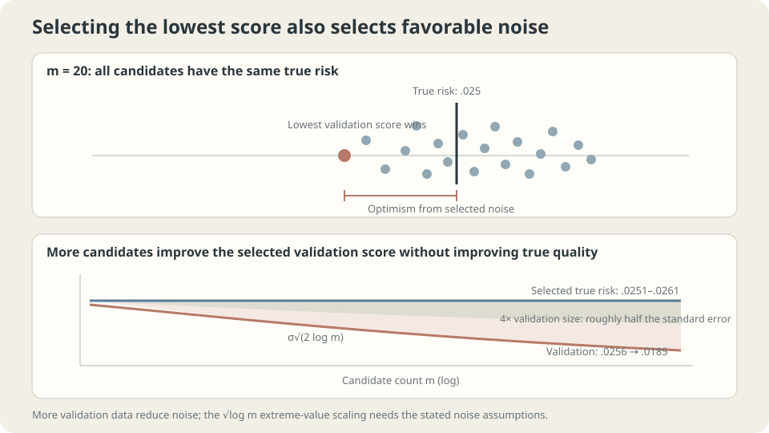

import Objectives from '../../../components/Objectives.astro';
import Ask from '../../../components/Ask.astro';
import Prereq from '../../../components/Prereq.astro';
import Question from '../../../components/Question.astro';
import Answer from '../../../components/Answer.astro';
import QuizBlock from '../../../components/QuizBlock.astro';
import Option from '../../../components/Option.astro';
import Explanation from '../../../components/Explanation.astro';
import VizPlan from '../../../components/VizPlan.astro';
import Remark from '../../../components/Remark.astro';
import Bridge from '../../../components/Bridge.astro';
import UsedBy from '../../../components/UsedBy.astro';
import Ref from '../../../components/Ref.astro';

# Pick the Best Student: Selection Bias and Nested Validation

<Objectives title="After reading, you can">
- Derive expected selection optimism using concavity of minimum.
- Separate reported development scores from the selected model's true risk.
- Explain nested validation's procedure-level target and its computational and statistical limitations.
</Objectives>

<Prereq items={frontmatter.prereqs} />

## Select the highest-scoring student

A hundred students take one exam. Choose the highest scorer for a competition.

Will that student's next score match the selected score?

If abilities are identical and exam errors fluctuate independently, selecting the winner selects favorable noise. A fresh score regresses toward the common expected level, rather than being guaranteed lower in every realization.

With differing abilities, the winner mixes genuine quality and favorable noise. One score cannot fully separate them.

After <Ref to="ml-hyperparameter-search" mode="title"/>, we similarly select the lowest of many validation losses. **Can its selected score serve as the final performance estimate?**

<Ask>
How much of the winning score is quality?<br />
How much is favorable evaluation noise?<br />
What independent information could separate them?
</Ask>

<Question label="Discussion" id="Q1">
Why is minimum-score selection optimistic in expectation? What happens if all true candidate risks agree?

<Answer summary="Show the reasoning">
Fix candidates independently of an iid validation sample. With integrable losses, each score is unbiased for that candidate's risk.

Select $\hat\jmath=\arg\min_j\widehat R_{\mathrm{val}}(f_j)$ and consider reporting that minimum.

Concavity of minimum and Jensen give

$$
\mathbb E\Big[\min_j \widehat R_{\text{val}}(f_j)\Big]\ \le\ \min_j\ \mathbb E\big[\widehat R_{\text{val}}(f_j)\big]=\min_j R(f_j).
$$

The expected minimum score is no greater than the best fixed candidate's risk, which is no greater than the selected candidate's expected true risk. Equality can occur in special cases; optimism need not be strict for every family.

If every true risk equals $R$ and scores are $R+\xi_j$ with centered errors, then

$$
\mathbb E\big[\widehat R_{\text{val}}(f_{\hat\jmath})\big]=R+\mathbb E\big[\min_j \xi_j\big]\approx R-\sigma\sqrt{2\log m}.
$$

The final asymptotic approximation requires iid Gaussian errors and sufficiently large $m$. Shared validation induces correlations; adaptive candidates may depend on the sample. Mean and variance alone do not justify a universal $\sqrt{2\log m}$ correction.

With exactly equal true risks, selection cannot improve true quality even if the reported score improves. The next experiment illustrates a related but less idealized setting.
</Answer>
</Question>

## Separate quality changes from selection effects

The ideal argument fixes exactly equal risks. The experiment instead fits the same algorithm on different datasets. Before sampling, risks have the same distribution; individual fitted risks are not necessarily equal.

Each candidate uses a separate training sample and all share thirty validation observations. Select the lowest validation score and repeat the experiment, reporting medians:

```
m    winner validation   winner population risk   candidate-average risk   optimism
1    .0256               .0261                    .0261                    .0004
5    .0225               .0251                    .0273                    .0025
20   .0206               .0251                    .0277                    .0046
100  .0187               .0257                    .0280                    .0070
400  .0185               .0260                    .0283                    .0075
```

Read the selected score and selected risk together.

The recorded validation minimum improves substantially with search size.

The selected population risks change far less and do not show a comparable monotonic improvement in this table.

> **A better winning score can greatly overstate improvement in the selected model.**

The $m=1$ control has little recorded gap. These are medians from finite repetition, so near-zero values illustrate rather than prove expected unbiasedness.

The setup is neither exactly equal-risk nor independent Gaussian errors. Do not attribute every discrepancy from the ideal approximation to one cause such as correlation.

Identical candidate-generation laws keep expected candidate-average risk unchanged as $m$ changes. Finite-simulation medians can still vary and require separate interpretation.



*Exactly equal-quality candidates isolate pure selection effects; realistic candidates can combine quality differences and evaluation noise.*

## Evaluate selection as part of training

The direct remedy is evaluation information unused in the choices being assessed.

A training/validation/test split can suffice when data permit: fit on training, select on validation, freeze, and assess on test.

With limited data, **nested cross-validation** evaluates a broader algorithm:

> **Hyperparameter selection is part of the training procedure.**

Wrap fitting and selection together, then cross-validate that complete procedure:

```
For each outer fold:
    Reserve the outer test fold.
    Using only the remaining observations:
        Run inner CV to choose settings and fit learned preprocessing.
        Refit with the selected settings on the outer training data.
    Evaluate on the reserved outer fold.
Aggregate outer scores using the specified weighting.
```

Selecting settings once using the whole dataset before outer CV leaks outer-test information into selection. The outer loop then no longer evaluates an independent selection procedure.

<Remark label="Caution" summary="The evaluation target is a procedure, not the final fitted model">
Different outer folds can choose different settings. Their scores assess the same specified selection procedure applied to different outer training samples.

> The target is expected performance of the complete procedure at the outer training size.

This is not direct evaluation of the particular final model fitted to all observations. Training-size differences and fold dependence still matter.

After comparing procedures, apply the selected one to all allowed training data. Additional independent data can assess the final fit. Nested CV is useful, but not the only valid evaluation design.

The search cost is roughly outer folds times inner folds times candidates, plus refits. Five by five by fifty already implies about 1250 inner fits. Resource-aware alternatives must still preserve the appropriate separation.
</Remark>

## Record the actual search

The full search includes more than the final candidate list.

Keep a record of

- Every grid or random configuration.
- Manual ideas evaluated and discarded.
- Changes motivated by development scores.
- Directions abandoned after inspecting results.

These decisions belong to the adaptive procedure. Their count cannot simply be substituted into the independent-Gaussian extremum formula.

Larger independent validation samples can reduce score uncertainty under finite-variance iid assumptions. The resulting selection-bias reduction depends on the candidate errors and their dependence; do not treat a simple model's coefficient as a general correction.

Shared scores, differing risks, adaptive modifications, and repeated final-test feedback all need explicit treatment. Independent outer assessment is the straightforward approach for the complete procedure; specialized reusable-holdout methods require their own mechanisms and assumptions [3].

## A shuffled-label diagnostic

A useful diagnostic reruns the entire search with an appropriate label permutation.

Under a valid no-signal permutation setup, fresh-data performance should match the relevant baseline in expectation, while selected development scores may still look favorable.

- Untouched outer evaluation should reflect the no-signal task, up to sampling uncertainty.
- Reused selection scores can appear better simply through searching noisy estimates.

Both leakage and winner selection can produce misleading scores. Their magnitudes overlap; a particular score size does not uniquely identify which mechanism occurred.

Permutation checks do not exactly decompose the original score into signal and bias. Respect exchangeability and structural constraints; finite results can depart from baseline by chance.

## Candidate count and evaluation uncertainty

<iframe loading="lazy" src="/personal_website/notes/research_areas/machine-learning-foundations/l3-experimental-method/l3-2-2.en.html" class="demo-frame" title="Winner selection, validation size, and independent assessment" style="height: 880px; width: 100%; border: none;"></iframe>

**Compare the ideal Gaussian-noise scale with the assumptions of an actual search.**

## Check your understanding

<QuizBlock id="ml-l3-2-a">
A team reports the best validation accuracy among two hundred configurations. Is that score unbiased merely because validation never updated weights?
<Option>Yes.</Option>
<Option correct>No: it influenced selection. Use untouched evaluation of the selected procedure.</Option>
<Option>Reasonable candidate choices automatically eliminate optimism.</Option>
<Explanation>Weight fitting is only one information path. Selection also makes the reported winner depend on evaluation noise.</Explanation>
</QuizBlock>

<QuizBlock id="ml-l3-2-b">
Winner risk changes little while winner validation score improves. What does this support?
<Option>Searching candidates is always useless.</Option>
<Option correct>The selected score can overstate quality improvement; differing fitted risks prevent calling every change pure selection noise.</Option>
<Option>Every risk estimate must be invalid.</Option>
<Explanation>Evaluate the chosen procedure independently. The ideal equal-risk argument and this resampled-training experiment are related but distinct.</Explanation>
</QuizBlock>

<QuizBlock id="ml-l3-2-c">
Which workflow contaminates outer evaluation?
<Option correct>Choose settings by CV on all observations, then report CV on those same observations as if selection had not used them.</Option>
<Option>Select within each outer training fold, then assess its reserved fold.</Option>
<Option>Separate training, selection, and final testing.</Option>
<Explanation>Every outer held-out observation must stay outside the fitting and choices assessed by that fold.</Explanation>
</QuizBlock>

<QuizBlock id="ml-l3-2-d">
Which statement is unjustified?
<Option>Independent equal-risk Gaussian score errors give an asymptotic extremum scale near $\sigma\sqrt{2\log m}$.</Option>
<Option>Fixed-candidate iid finite-variance evaluation commonly has root-sample-count standard error.</Option>
<Option correct>Sufficiently large candidate quality differences universally make selection bias vanish exactly.</Option>
<Explanation>Quality separation can reduce the effect, but exact equality depends on the complete score distribution and selection behavior. Jensen need not be strict in special cases.</Explanation>
</QuizBlock>

<UsedBy slug={frontmatter.slug} />

<Bridge to="ml-seeds-and-reporting">
Even after separating selection from evaluation, repeated runs can differ. Next measure seed variation, distinguish paired method comparisons from best-run reporting, and ask how many replications support a claimed improvement.
</Bridge>

## References

1. Cawley, G., Talbot, N. [*On Over-fitting in Model Selection and Subsequent Selection Bias in Performance Evaluation.*](https://jmlr.org/papers/v11/cawley10a.html) JMLR 2010.
2. Varma, S., Simon, R. [*Bias in error estimation when using cross-validation for model selection.*](https://doi.org/10.1186/1471-2105-7-91) BMC Bioinformatics 2006.
3. Dwork, C. et al. [*The reusable holdout.*](https://doi.org/10.1126/science.aaa9375) Science 2015.
