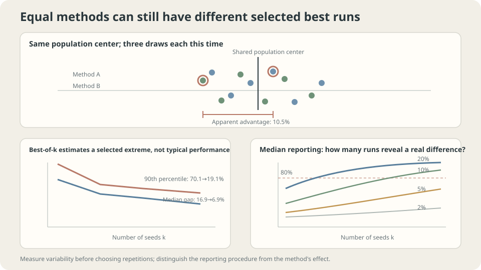

import Objectives from '../../../components/Objectives.astro';
import Ask from '../../../components/Ask.astro';
import Prereq from '../../../components/Prereq.astro';
import Question from '../../../components/Question.astro';
import Answer from '../../../components/Answer.astro';
import QuizBlock from '../../../components/QuizBlock.astro';
import Option from '../../../components/Option.astro';
import Explanation from '../../../components/Explanation.astro';
import VizPlan from '../../../components/VizPlan.astro';
import Remark from '../../../components/Remark.astro';
import Bridge from '../../../components/Bridge.astro';
import UsedBy from '../../../components/UsedBy.astro';
import Ref from '../../../components/Ref.astro';

# Three Runs, Three Answers: What Should We Report?

<Objectives title="After reading, you can">
- Measure apparent winner advantages when methods have identical outcome distributions.
- Plan repetitions using variance of the intended comparison rather than a universal seed count.
- Report outcome summaries, uncertainty sources, search effort, and paired differences clearly.
</Objectives>

<Prereq items={frontmatter.prereqs} />

## Three different results

Three seeds give accuracies 0.831, 0.847, and 0.822.

**Which result should be reported?**

The best value describes a selected run; the average estimates a mean; the complete results reveal variation. These answer different questions.

A baseline's three runs give 0.818, 0.835, and 0.809. Comparing only maxima suggests a 1.2-percentage-point advantage. What does it establish?

Within-method spread is substantial, but overlapping ranges alone neither prove nor disprove a method difference. Analyze the intended comparison and its uncertainty.

We will simulate apparent advantages between identical methods and derive what information is needed to plan replications.

<Ask>
Do we want typical performance or a selected best run?<br />
How variable is the method difference?<br />
Which repeated experiment represents the deployment question?
</Ask>

<Question label="Discussion" id="Q1">
What does each summary estimate, and why does naming the observed better result a winner create an apparent advantage?

<Answer summary="Show the reasoning">
A run's score $X$ varies with specified randomness: initialization, batch order, augmentation, sampling, and possibly nondeterministic arithmetic. Choose whether the target is its mean, median, or a selection procedure's performance.

Common summaries differ:

- An iid finite-mean sample average is unbiased; with finite variance its standard error is $\sigma/\sqrt k$. A sample median is not generally unbiased, and its usual root-$k$ asymptotics need regularity near a unique median.
- A best-of-$k$ statistic targets an extreme, not a center. More trials shift it toward the favorable tail.

Two identical methods' independently selected best scores still have zero expected **signed** difference. Calling the observed better one the winner changes the reported comparison to a nonnegative magnitude. This does not imply extrema always increase variance; the example's apparent gap decreases with $k$.

An observed winner alone is therefore uninformative about a reliable effect. Estimate the distribution of the method difference and define the effect of practical interest.
</Answer>
</Question>

## Measure run variability

Any uncertainty calculation needs the relevant variation first.

The earlier small tanh-network experiment records two hundred finite-training losses:

```
median .0034, standard deviation .0010, range [.0023,.0085]
```

The standard deviation is about 29% of the median in this particular MSE experiment. It characterizes this outcome scale, not every metric's precision.

Variability differs greatly across tasks and randomness sources. A few repetitions give preliminary evidence, but tail-sensitive spread estimates may need more. Measure the intended project rather than transferring a generic percentage.



*Repeated-run summaries and comparison design determine what an apparent advantage means.*

## Apparent advantage from selecting observed winners

Draw both methods from the same empirical two-hundred-run distribution. Each chooses its minimum loss among $k$ draws. Repeating the comparison gives the following relative winner-versus-loser gaps:

```
k    median apparent gap   90th percentile
1    16.9%                 70.1%
3    10.5%                 26.8%
5    8.9%                  23.3%
10   6.9%                  19.1%
```

At three trials, 10.5% is the **median** apparent gap under this particular MSE distribution, not a mean or a threshold transferable to accuracy.

> **The best observed run does not estimate a method's typical improvement.**

Here gaps shrink with $k$. For bounded-below losses, minima can converge to a support endpoint. The issue is the object being estimated, not that extreme statistics can never converge.

A mean or median instead targets a center, with uncertainty shrinking under the relevant assumptions. Choose the target before increasing trial count.

<Remark label="Caution" summary="A seed does not capture every source of randomness">
Training randomness is only one layer:

- Dataset generation or splitting can change results.
- Augmentation, dropout, and batch sampling introduce further randomness.
- Nondeterministic parallel arithmetic can vary even with the same seeded random draws.

Match repetitions to the target. Conditional training performance on one fixed dataset can legitimately hold it fixed. Estimating a resampled-data procedure needs data variability included. A deterministic mode can reduce some hardware variability, with platform-dependent costs and limits.
</Remark>

## Plan repetitions using the difference

Let paired scores give $D_i=X_i^A-X_i^B$. For independent replications with finite difference variance,

$$
\bar D=\frac1k\sum_{i=1}^kD_i,
\qquad\operatorname{SE}(\bar D)=\frac{\sigma_D}{\sqrt{k}}.
$$

Halving the standard error requires roughly four times as many pairs. Confidence-interval width also depends on the chosen confidence procedure; testing power depends on effect size, significance level, and test design. A 29% single-method relative spread does not determine a universal seed count.

> **Specify the difference the experiment must resolve before spending the compute budget.**

Pairing can help because

$$
\begin{aligned}
\operatorname{Var}(X^A-X^B)
&=\operatorname{Var}(X^A)+\operatorname{Var}(X^B)\\
&\quad-2\operatorname{Cov}(X^A,X^B).
\end{aligned}
$$

Shared splits or matched randomness reduce difference variance when covariance is positive. Matching seed numbers alone does not ensure different architectures consume the same underlying random quantities.

## What to report

Make the following distinctions visible:

1. The estimand and summary: mean or median, repetitions, and a suitable spread or uncertainty measure.
2. Paired differences where the design supports meaningful pairing.
3. Hyperparameter search effort and selection procedure, separately from final-run replications.
4. Any best-run statistic explicitly identified as selected, alongside typical performance.
5. A final evaluation protocol kept outside subsequent modeling decisions.

State what was repeated: training on fixed observations or the entire data-sampling pipeline. Range and interquartile range describe run spread; confidence intervals concern uncertainty in a specified estimand. Relative MSE changes and accuracy percentage points are not interchangeable.

## Estimate variability for your experiment

First collect run outcomes, then method pairs if comparing procedures.

A short exploratory driver is

```python
# run_everything defines and records the intended sources of randomness.
res = [run_everything(seed=s) for s in range(8)]
med = np.median(res)
spread = np.std(res,ddof=1)
print('median:',med,'sample SD:',spread)
# Report the individual scores; relative spread is meaningful only for a suitable scale.
```

Eight runs can reveal issues but do not guarantee precise tail or standard-deviation estimates. Retain paired outcomes, assess distribution shape, and plan more repetitions according to the desired uncertainty.

## Compare summaries as repetitions increase

<iframe loading="lazy" src="/personal_website/notes/research_areas/machine-learning-foundations/l3-experimental-method/l3-3-2.en.html" class="demo-frame" title="Best-run and median summaries across repeated experiments" style="height: 923px; width: 100%; border: none;"></iframe>

**The demo's ranking frequency is not a significance-controlled test power, nor a universal replication requirement.**

## Check your understanding

<QuizBlock id="ml-l3-3-a">
Two methods each report only their best of three accuracies. Can their small observed gap establish a typical improvement?
<Option>Yes, because both used three trials.</Option>
<Option correct>No: report repetitions and appropriate paired differences; a toy MSE gap table is not an accuracy significance threshold.</Option>
<Option>A larger architecture is the only missing ingredient.</Option>
<Explanation>Selection changes the estimand. Equal trial count does not turn selected maxima into typical outcomes or supply an uncertainty analysis.</Explanation>
</QuizBlock>

<QuizBlock id="ml-l3-3-b">
Does increasing best-of-$k$ repetitions necessarily estimate typical performance better?
<Option>Yes: enough trials makes the minimum equal the mean.</Option>
<Option correct>No: extrema and centers target different population quantities.</Option>
<Option>Only if the methods secretly differ in quality.</Option>
<Explanation>An extreme can converge while still targeting a favorable endpoint rather than the mean or median. Choose the intended summary first.</Explanation>
</QuizBlock>

<QuizBlock id="ml-l3-3-c">
A single-method relative spread is 29%, and the desired effect is 2%. What else is needed to plan repetitions?
<Option>A universal rule of one hundred seeds.</Option>
<Option correct>The comparison scale, paired-difference variance, interval or test criteria, and resources.</Option>
<Option>Only three favorable outcomes.</Option>
<Explanation>Power and precision depend on the actual difference distribution and inferential goal, not one transferred ratio.</Explanation>
</QuizBlock>

<QuizBlock id="ml-l3-3-d">
Which statement is false?
<Option>Positive paired covariance can reduce difference variance.</Option>
<Option>Data randomness should be included when it belongs to the estimand.</Option>
<Option correct>A fixed seed always guarantees bitwise-identical results on the same machine.</Option>
<Explanation>Parallel floating-point reduction order and nondeterministic operators can introduce other variation. Determinism depends on the full software, hardware, and configuration.</Explanation>
</QuizBlock>

<UsedBy slug={frontmatter.slug} />

<Bridge to="ml-mlp">
We have defined objectives, checked optimization, and organized credible comparisons. The next unit asks what structure the model itself assumes about data.

Architectural choices encode assumptions about locality, translation, order, and interactions. Begin with a broadly flexible MLP and ask why the existence of an approximating network says little by itself about practical learning.
</Bridge>

## References

1. Dodge, J. et al. [*Show Your Work: Improved Reporting of Experimental Results.*](https://aclanthology.org/D19-1224/) EMNLP 2019.
2. Bouthillier, X. et al. [*Accounting for Variance in Machine Learning Benchmarks.*](https://proceedings.mlsys.org/paper_files/paper/2021/hash/cfecdb276f634854f3ef915e2e980c31-Abstract.html) MLSys 2021.
3. Henderson, P. et al. [*Deep Reinforcement Learning that Matters.*](https://arxiv.org/abs/1709.06560) AAAI 2018.
