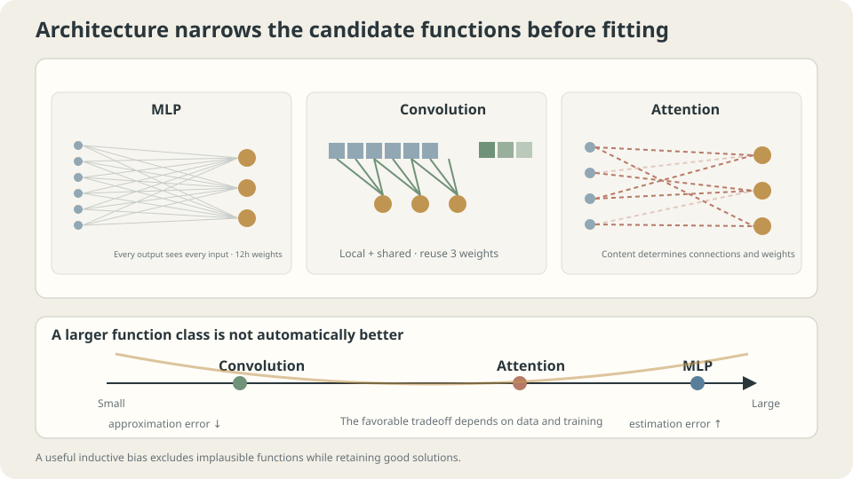

import Objectives from '../../../components/Objectives.astro';
import Ask from '../../../components/Ask.astro';
import Prereq from '../../../components/Prereq.astro';
import Question from '../../../components/Question.astro';
import Answer from '../../../components/Answer.astro';
import QuizBlock from '../../../components/QuizBlock.astro';
import Option from '../../../components/Option.astro';
import Explanation from '../../../components/Explanation.astro';
import VizPlan from '../../../components/VizPlan.astro';
import Remark from '../../../components/Remark.astro';
import Bridge from '../../../components/Bridge.astro';
import UsedBy from '../../../components/UsedBy.astro';
import Ref from '../../../components/Ref.astro';

# If MLPs Can Approximate Everything, Why Use Other Architectures?

<Objectives title="After reading, you can">
- State the existence guarantee and what it omits about a fixed network and training process.
- Interpret finite-budget frequency-learning experiments with appropriate limits.
- Explain which spatial assumptions dense MLPs do not encode and how fixed coordinate permutations affect their function family.
</Objectives>

<Prereq items={frontmatter.prereqs} />

## Enough building blocks

The previous units addressed objectives, training, and evaluation. Now ask whether model structure can encode useful knowledge, like bridge-specific pieces making construction easier than an unrestricted pile of blocks.

Cybenko's theorem [1] gives a starting point: suitable continuous sigmoidal activations and sufficient hidden width permit uniform approximation of continuous functions on a compact cube. It is not a statement about arbitrary activations or one fixed width.

That may sound as if practical progress requires only wider MLPs.

Yet locality, shared weights, residual paths, and content-dependent interactions can dramatically change efficiency. What do such structures provide beyond an existence result?

<Ask>
What does an approximating network's existence guarantee?<br />
How wide must the actual model be?<br />
Will finite-data training find a useful approximation?
</Ask>

<Question label="Discussion" id="Q1">
State the approximation theorem and compare it with practical learning requirements.

<Answer summary="Show the reasoning">
For continuous $f:[0,1]^d\to\mathbb R$ and every $\varepsilon>0$, there exist suitable width and parameters such that

$$
\sup_{x\in[0,1]^d}\big|f_\theta(x)-f(x)\big|<\varepsilon .
$$

This is **existence** in an expanding function family. It can make approximation error arbitrarily small under the theorem's assumptions.

It leaves three practical questions:

1. **Required resources:** the statement alone gives no practical width for this target and accuracy.
2. **Optimization:** it does not guarantee gradient training finds the approximating parameters within a budget.
3. **Generalization:** finitely many training observations do not identify the desired uniform approximation automatically.

Architecture can alter representation efficiency, optimization, and generalization through useful restrictions or parameterizations. It need not merely enlarge or shrink one nested family.
</Answer>
</Question>

## Architecture expresses assumptions

Think of an architecture as encoding preferences about possible rules:

- **Dense MLP:** no built-in privileged spatial adjacency or translated weight sharing; other architectural and training preferences remain.
- **Convolution:** local interactions with shared spatial filters.
- **Attention:** interactions selected from content.
- **Residual blocks:** a direct identity route plus a learned correction.

Well-matched assumptions can improve sample and computational efficiency. Incorrect restrictions can exclude useful rules. Their benefit is task- and procedure-dependent rather than guaranteed by fewer candidates alone.

An MLP is therefore not assumption-free. Activation, depth, initialization, and optimization can create strong preferences, including frequency effects in particular regimes.



*Structural bias can help when it matches the task; flexibility alone does not determine learnability.*

## What does widening buy?

A width experiment measures achieved training and population risks, not approximation error in isolation.

For thirty toy examples and a $1\to h\to h\to1$ tanh model trained with Adam for 4000 updates, representative five-seed medians are

```
h    parameters   training   population
2    13           .0140      .0285
4    33           .0132      .0286
8    97           .0084      .0443
16   321          .0039      .0447
32   1153         .0033      .0454
64   4353         .0030      .0478
128  16897        .0026      .0440
```

Training fit improves while population risk does not. Width two means two units in each hidden layer, not two parameters. Finite-time results cannot uniquely separate approximation and estimator variability.

This is one capacity-generalization comparison, not a universal U-shape law or proof that sufficiently wide networks always generalize badly.

> **Representation, optimization, and generalization require separate evidence.**

<Remark label="Supplement" summary="Why can depth improve efficiency?">
One-hidden-layer universality does not imply it is the cheapest representation. Particular compositional function classes admit depth-separation results under specific activations, domains, and accuracy criteria; no universal exponential width formula applies to every target.

Depth can reuse intermediate computations. Shared convolution filters and token projections offer other forms of computational reuse. Choose representations that make relevant functions economical.
</Remark>

## Keep the network fixed and change frequency

To inspect finite-budget learning, hold the procedure fixed while changing the target.

Use noiseless observations of $\sin(2\pi kx)$ at two hundred inputs, with a width-sixty-four tanh model. Zero prediction has MSE near one half under uniform evaluation. Parameter count alone does not prove this particular fixed network can reach every desired accuracy.

```
k    200 updates   1000 updates   5000 updates
1    .0100         .0000         .0000
4    .4630         .0003         .0004
16   .4962         .4717         .0015
32   .4972         .4960         .3875
```

Lower-frequency targets learn earlier under these settings; the highest frequency remains poorly fitted within the budget.

This resembles **spectral bias** studied in [2]. The experiment alone does not distinguish representation limits from target-specific optimization difficulty or inappropriate hyperparameters.

> **Existence of an approximating network does not ensure useful finite-budget learning.**

Such frequency preferences are an inductive bias of particular architecture/training regimes, not a universal theorem that every MLP learns only smooth rules. Spatial and linguistic structure may call for additional biases.

## Dense layers do not privilege neighboring pixels

For a reproducible spatial toy, generate short horizontal or vertical lines at controlled positions in small noisy images.

```python
import numpy as np
IMG = 12
def toy_img(n=600,size=IMG,noise=.15,seed=0,x_range=(0,1.)):
    """Binary line orientation; x_range controls position along the line axis."""
    rng = np.random.default_rng(seed)
    X = np.zeros((n,size,size))
    y = np.zeros(n,dtype=int)
    lo,hi = x_range
    for i in range(n):
        cls = i%2
        y[i] = cls
        L = 6
        c = int(rng.uniform(lo,hi)*(size-L))
        r = rng.integers(0,size)
        if cls==0: X[i,r,c:c+L] = 1.
        else: X[i,c:c+L,r] = 1.
    X += noise*rng.standard_normal(X.shape)
    return X.reshape(n,-1),y*2-1
```

Predict orientation using a $144\to64\to64\to1$ MLP. The same orientation at another position should retain its semantic label. For vertical lines, the controlled longitudinal coordinate is vertical, so call this a **restricted-position** rather than uniformly left/right experiment.

**First verify ordinary learning:**

```
training accuracy 1.000, test accuracy .968
```

The dense model can perform this task well with training and testing positions drawn similarly. This architecture has more than four thousand parameters; that smaller count belonged to the one-dimensional model.

**Train on restricted positions and test shifted positions:**

```
training accuracy 1.000, shifted-position test accuracy .625
```

The shifted-position task degrades sharply in this record, though it remains above chance.

Dense first-layer weights are tied to input coordinates rather than shared across translations. They can represent transferable spatial rules, but finite training does not guarantee learning them. Background noise still supplies gradients at other coordinates, so their weights are not literally unchanged from initialization.

**Permute coordinates consistently:**

Apply one fixed random pixel permutation to every training and test image, then retrain under the ordinary full-position setup:

```
training accuracy 1.000, test accuracy .975
```

Performance is similar in these runs despite destroying visual adjacency. The small numerical difference is not by itself proof of equality or improvement.

For a fixed permutation $P$, replacing input $x$ by $Px$ and first-layer weights $W$ by $WP^{-1}$ preserves the represented function. The **family** is closed under coordinate relabeling. This does not mean a fixed trained model satisfies $f(Px)=f(x)$.

> **Dense MLPs can represent local rules but do not hard-code privileged pixel adjacency.**

Convolution explicitly shares local patterns; attention chooses interactions from content; residual structure changes information paths. Their advantages must be checked against the task and evaluation, rather than assumed from this single toy.

## Width, frequency, and coordinate structure

<iframe loading="lazy" src="/personal_website/notes/research_areas/machine-learning-foundations/l4-architectures/l4-0-2.en.html" class="demo-frame" title="MLP width, frequency learning, and spatial structure" style="height: 871px; width: 100%; border: none;"></iframe>

**Keep the training budget fixed while inspecting what changing the target or representation does.**

## Check your understanding

<QuizBlock id="ml-l4-0-a">
Does universal approximation prove a particular fixed MLP has enough capacity for the task?
<Option>Yes.</Option>
<Option correct>No: sufficient width exists under the theorem's assumptions, but the fixed model still needs analysis.</Option>
<Option>No MLP has any approximation theorem.</Option>
<Explanation>Existence over a family does not settle the chosen member's resources, optimization, or generalization.</Explanation>
</QuizBlock>

<QuizBlock id="ml-l4-0-b">
Why can a fixed pixel permutation preserve a dense MLP's function family?
<Option>Permutation always simplifies images.</Option>
<Option correct>It can be absorbed by relabeling first-layer weights, while fixed-weight invariance is a different claim.</Option>
<Option>Only synthetic images admit coordinate relabeling.</Option>
<Explanation>The algebra applies to the dense input layer. Retrained finite-budget outcomes need not be identical.</Explanation>
</QuizBlock>

<QuizBlock id="ml-l4-0-c">
Does more data only from the original restricted positions guarantee transfer to shifted positions?
<Option correct>No: compare representative positions, justified augmentation, and architectures with suitable sharing.</Option>
<Option>Yes, by sample count alone.</Option>
<Option>It must always worsen transfer.</Option>
<Explanation>The issue is evidence and learning bias, not impossibility of representing a translation rule with an MLP.</Explanation>
</QuizBlock>

<QuizBlock id="ml-l4-0-d">
Which claim is false?
<Option>Wider training fits can fail to improve fresh-data risk.</Option>
<Option>Some architecture/training regimes preferentially learn lower frequencies.</Option>
<Option correct>Dense MLPs have no inductive bias and are neutral for every task.</Option>
<Explanation>Dense architecture and training still impose preferences. Absence of explicit adjacency sharing is not absence of all assumptions.</Explanation>
</QuizBlock>

<UsedBy slug={frontmatter.slug} />

<Bridge to="ml-backprop">
To compare trainable architectures, we need gradients through their computation graphs. Next derive reverse accumulation from the chain rule and compare its cost with coordinate-wise finite differences and forward-mode differentiation.
</Bridge>

## References

1. Cybenko, G. [*Approximation by Superpositions of a Sigmoidal Function.*](https://doi.org/10.1007/BF02551274) Mathematics of Control, Signals and Systems 1989.
2. Rahaman, N. et al. [*On the Spectral Bias of Neural Networks.*](https://proceedings.mlr.press/v97/rahaman19a.html) ICML 2019.
3. Bronstein, M., Bruna, J., Cohen, T., Veličković, P. [*Geometric Deep Learning.*](https://arxiv.org/abs/2104.13478) 2021.
