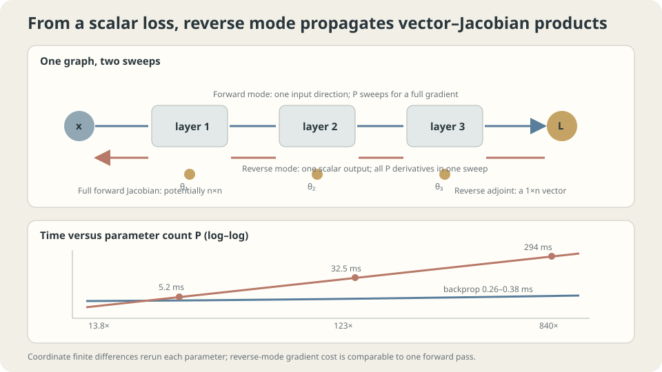

import Objectives from '../../../components/Objectives.astro';
import Ask from '../../../components/Ask.astro';
import Prereq from '../../../components/Prereq.astro';
import Question from '../../../components/Question.astro';
import Answer from '../../../components/Answer.astro';
import QuizBlock from '../../../components/QuizBlock.astro';
import Option from '../../../components/Option.astro';
import Explanation from '../../../components/Explanation.astro';
import VizPlan from '../../../components/VizPlan.astro';
import Remark from '../../../components/Remark.astro';
import Bridge from '../../../components/Bridge.astro';
import UsedBy from '../../../components/UsedBy.astro';
import Ref from '../../../components/Ref.astro';

# A Defect on the Production Line: Backpropagation and Sensitivity

<Objectives title="After reading, you can">
- Compose local sensitivities and distinguish input-direction JVPs from output-direction VJPs.
- Explain scalar-loss reverse-mode cost relative to the forward computation.
- Use finite differences for checks while controlling precision, step size, randomness, and nondifferentiable points.
</Objectives>

<Prereq items={frontmatter.prereqs} />

## A long production line

A fifty-stage production line ends with a quality penalty. We ask a sensitivity question: **if stage seventeen's temperature changes slightly, how does the final penalty change?**

One approach perturbs a setting and reruns the entire line. Repeating this for a thousand settings requires a thousand or more full evaluations.

Training similarly needs gradients for many parameters. Coordinate-wise reruns become costly as the parameter count grows.

<Ask>
Can we calculate all parameter sensitivities together,<br />
rather than rerunning the line for each setting?<br />
What makes one chain-rule evaluation order cheaper?
</Ask>

<Question label="Discussion" id="Q1">
Write the chain rule and compare its computational directions.

<Answer summary="Show the reasoning">
A layered network composes functions:

$$
L=\ell\big(h_D\big),\quad h_\ell=f_\ell(h_{\ell-1};\theta_\ell),\quad h_0=x .
$$

The chain rule gives

$$
\frac{\partial L}{\partial\theta_\ell}
=\frac{\partial L}{\partial h_D}
\left(\frac{\partial h_D}{\partial h_{D-1}}\cdots
\frac{\partial h_{\ell+1}}{\partial h_\ell}\right)
\frac{\partial h_\ell}{\partial\theta_\ell}.
$$

Associativity preserves the derivative, but different groupings can change the required work and intermediate storage.

**Reverse mode:** begin with the scalar loss's output sensitivity and propagate vector–Jacobian products backward:

$$
((\text{output row vector}\,J_D)J_{D-1})\cdots.
$$

For equal-width dense layers, these products cost approximately $O(Dn^2)$, comparable to forward computation. At each layer, collect its parameter contribution during the same sweep.

Explicitly multiplying full Jacobian matrices can cost $O(Dn^3)$, but **forward-mode AD need not do that**. It propagates one directional tangent at a time, also with forward-comparable cost. Obtaining all scalar-loss parameter derivatives that way usually requires one direction per parameter.

A scalar loss has one output direction, making reverse accumulation especially economical. For a full vector-output Jacobian, the relative input/output dimensions determine the usual number of sweeps.

In the production-line analogy, reverse mode propagates final-penalty sensitivity backward to every setting; forward mode follows one specified setting perturbation toward the output.

Reverse mode removes the multiplier from rerunning separately for all parameters. Its absolute cost still grows with the underlying model computation.
</Answer>
</Question>

## Two directions answer different questions

Remember each mode through its question:

- **JVP:** how does output change for one input direction? One forward tangent sweep answers that direction.
- **VJP:** how does one weighted output combination depend on all inputs? One reverse sweep answers that output direction.

For an entire dense Jacobian, the usual sweep-count comparison is

$$
f:\mathbb R^P\to\mathbb R^m:\qquad
\text{forward sweeps}\sim P,\quad\text{reverse sweeps}\sim m.
$$

Scalar-loss training has $m=1$ and many parameters. A small-input, large-output problem can favor forward mode. If only one JVP is needed, there is no need to calculate the full Jacobian at all.

Backpropagation applies reverse-mode differentiation to the training graph, accumulating sensitivities from all downstream uses.



*A scalar-loss reverse sweep can collect every parameter-gradient component.*

## Compare reverse derivatives and finite differences

At the same network state, compare analytic reverse accumulation with central differences:

```python
# Core experiment sketch; model helpers and arrays are supplied by the setup.
G,_ = mlp.grads(P,X,y)
for i in range(n_params):
    vp = v0.copy(); vp[i] += eps
    vm = v0.copy(); vm[i] -= eps
    g_fd[i] = (loss(unflat(P,vp))-loss(unflat(P,vm)))/(2*eps)
```

```
parameters   reverse ms   finite-difference ms   ratio   relative discrepancy
33           .38          5.2                    13.8    2.22e-10
321          .26          32.5                   123.0   4.29e-10
2497         .35          294.3                  840.5   8.07e-10
```

Interpret timing and accuracy separately.

Small reverse timings here include fixed overhead and measurement noise. They do not imply that large models have constant absolute runtime. Compare forward and backward costs within each model to assess their relative factor.

Central differences need two forward evaluations per checked coordinate. This makes a complete large-parameter gradient expensive, while checking a few coordinates can remain practical. Exact runtime ratios depend on hardware and implementation.

The close agreement supports the local derivative implementation. AD applies chain-rule derivatives of the executed operations, subject to floating-point arithmetic and specified behavior at nonsmooth points; finite differences add a step-dependent approximation.

> **Backpropagation reuses the chain rule efficiently; it does not estimate derivatives by perturbing every parameter.**

<Remark label="Supplement" summary="Saved activations and checkpointing">
Reverse operations need suitable forward intermediate values. Saving them trades memory for avoiding recomputation; storage depends on graph, batch, and activation sizes.

Checkpointing stores selected intermediates and recomputes others, exchanging more work for less memory. Mixed precision changes storage and arithmetic through another mechanism.

The practical comparison is many separate forward reruns versus a forward sweep, reverse sweep, and the memory or recomputation needed for intermediate values.
</Remark>

## When numerical derivatives remain useful

Finite differences are useful for checking custom backward rules, and for other numerical tasks where analytic or AD derivatives are unavailable. Their role is not restricted to one universal use case.

Check selected coordinates or directions with several perturbation sizes. A representative central-difference comparison gives

```
h        relative discrepancy
1e-1     1.087e-3
1e-3     1.091e-7
1e-5     1.671e-11
1e-7     1.449e-9
1e-9     1.343e-7
1e-11    1.223e-5
```

Two competing numerical errors explain the shape.

**Truncation:** a sufficiently smooth scalar function has central-difference expansion

$$
\frac{L(\theta+h)-L(\theta-h)}{2h}=L'(\theta)+\frac{h^2}{6}L'''(\theta)+O(h^4),
$$

The leading truncation term is $O(h^2)$. In this example, reducing $h$ from $10^{-1}$ to $10^{-3}$ reduces this error by about $10^4$.

**Roundoff:** subtracting nearby floating-point values loses significant digits. Dividing their evaluation error by $2h$ can amplify it like $1/h$, with constants depending on function scale and arithmetic.

The best displayed step near $10^{-5}$ is example-specific. Use double precision where feasible, sweep steps, fix stochastic draws, avoid kinks, and inspect absolute as well as relative error, especially near zero gradients.

> **Smaller perturbations do not indefinitely improve finite-difference accuracy.**

<Remark label="Caution" summary="Precision changes the useful step range">
Single precision has fewer significant digits, often moving the useful perturbation range toward larger steps and increasing the achievable error floor. The precise values depend on function scaling and operations.

Prefer double-precision local tests for stringent derivative checks. A single-precision discrepancy need not prove a bug. Check both isolated custom operations and selected end-to-end paths; local checks alone can miss graph-wiring errors.
</Remark>

## How sensitivities are distributed

At each production-line stage:

1. Start from the derivative of the final scalar penalty with respect to the output.
2. Multiply upstream sensitivity by the local input Jacobian to send it to earlier nodes.
3. Collect the local parameter gradient using the same upstream sensitivity.

A graph operation needs its local derivative rule and incoming adjoints. Contributions from multiple downstream branches must be **summed** before earlier propagation. This locality makes automatic differentiation composable.

The executed graph must have the required derivative rules; practical frameworks assign conventions at points such as ReLU zero. Loops can be differentiated through their executed/unrolled operations. Saved values, recomputation, and mutation handling also affect correctness and resources.

## Read a plain MLP backward pass

The helper interface from <Ref to="ml-loss-landscape" mode="title"/> contains the following plain-network mechanism. The forward helper must expose the stated input activations:

```python
# Plain tanh MLP sketch; fwd is supplied by the model implementation.
def grads(P,X,y):
    out,hs = fwd(P,X)
    g = 2*(out-y[:,None])/len(y)
    G = []
    for i in range(len(P)-1,-1,-1):
        W,b = P[i]
        h = hs[i]
        G.append((h.T@g,g.sum(0)))
        if i>0:
            d = g@W.T
            z = hs[i-1]@P[i-1][0]+P[i-1][1]
            g = d*(1-np.tanh(z)**2)
    return list(reversed(G)),((out-y[:,None])**2).mean()
```

Here `hs` stores each layer's input activation. `g` holds batchwise upstream sensitivities, not a full parameter Jacobian. The snippet handles a plain MLP and includes no residual-branch backward rule.

The product `h.T @ g` both sums across the batch and applies the linear layer's parameter derivative. The forward activation becomes a backward multiplier, explaining why it must be saved or recomputed.

Omitting $1-\tanh^2(z)$ gives the wrong derivative. Training might still move, fail, or behave misleadingly; it need not merely become slower or preserve a roughly correct direction.

Numerical or directional checks can detect such missing factors at suitable points. No universal error magnitude or ten-order separation is guaranteed; test representative inputs and multiple perturbation scales.

## Reverse sweeps and numerical checking

<iframe loading="lazy" src="/personal_website/notes/research_areas/machine-learning-foundations/l4-architectures/l4-1-2.en.html" class="demo-frame" title="Forward and reverse differentiation with finite-difference checks" style="height: 880px; width: 100%; border: none;"></iframe>

**Separate timing from accuracy and compare perturbation scales.**

## Check your understanding

<QuizBlock id="ml-l4-1-a">
Why avoid complete coordinate-wise finite differences for routine training with thousands of parameters?
<Option>Thousands of coordinates are always cheap.</Option>
<Option correct>They require many complete forward evaluations per update; reverse mode reuses the graph for a scalar-loss gradient.</Option>
<Option>Finite differences can never be accurate.</Option>
<Explanation>Carefully chosen finite differences can be accurate enough for selected checks. Their full-gradient cost is the main scalability problem.</Explanation>
</QuizBlock>

<QuizBlock id="ml-l4-1-b">
Is forward-mode differentiation useless?
<Option>Yes: reverse mode always costs less.</Option>
<Option correct>No: a JVP answers one input direction, and input/output dimensions determine full-Jacobian sweep counts.</Option>
<Option>It computes a different mathematical derivative.</Option>
<Explanation>Both modes use chain-rule derivatives. Mixed-mode products can also avoid forming Hessians or full Jacobians.</Explanation>
</QuizBlock>

<QuizBlock id="ml-l4-1-c">
Why can very small central-difference steps worsen accuracy?
<Option>Taylor expansion stops being valid precisely because the step is small.</Option>
<Option correct>Roundoff and subtractive cancellation are amplified by division by the small step.</Option>
<Option>The gradient must have changed discontinuously.</Option>
<Explanation>Truncation decreases with step size in the smooth regime; arithmetic error can increase. Balance both rather than minimizing the step blindly.</Explanation>
</QuizBlock>

<QuizBlock id="ml-l4-1-d">
Which claim is false?
<Option>Saved activations trade storage for less recomputation.</Option>
<Option>AD applies derivatives of the executed operations subject to arithmetic and nonsmooth conventions.</Option>
<Option correct>Backpropagation replaces the chain rule with a fundamentally different derivative formula.</Option>
<Explanation>Efficiency comes from reuse, product direction, and adjoint accumulation, not a different derivative law.</Explanation>
</QuizBlock>

<UsedBy slug={frontmatter.slug} />

<Bridge to="ml-convolution">
With graph differentiation established, return to architecture: a shifted line should not require learning the same local pattern again. Next encode locality and shared weights as convolution and examine the limits of translation equivariance.
</Bridge>

## References

1. Rumelhart, D., Hinton, G., Williams, R. [*Learning representations by back-propagating errors.*](https://doi.org/10.1038/323533a0) Nature 1986.
2. Griewank, A., Walther, A. [*Evaluating Derivatives.*](https://doi.org/10.1137/1.9780898717761) 2nd ed. SIAM 2008.
3. Baydin, A. et al. [*Automatic Differentiation in Machine Learning: a Survey.*](https://jmlr.org/papers/v18/17-468.html) JMLR 2018.
