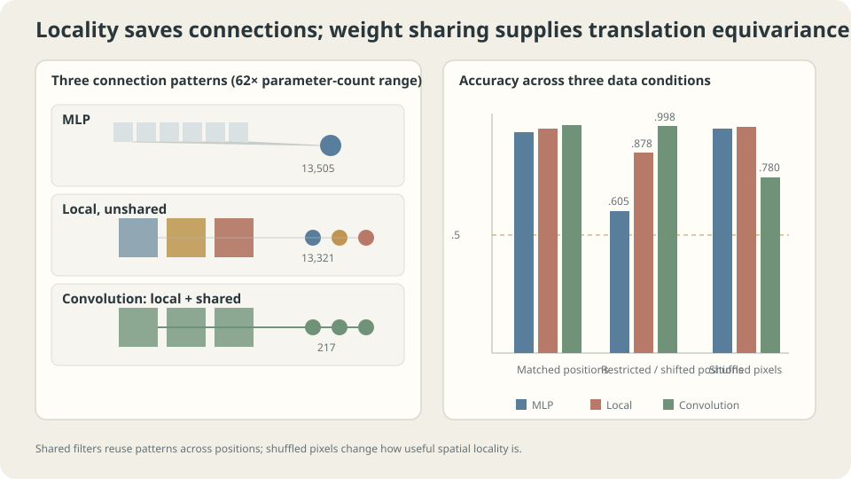

import Objectives from '../../../components/Objectives.astro';
import Ask from '../../../components/Ask.astro';
import Prereq from '../../../components/Prereq.astro';
import Question from '../../../components/Question.astro';
import Answer from '../../../components/Answer.astro';
import QuizBlock from '../../../components/QuizBlock.astro';
import Option from '../../../components/Option.astro';
import Explanation from '../../../components/Explanation.astro';
import VizPlan from '../../../components/VizPlan.astro';
import Remark from '../../../components/Remark.astro';
import Details from '../../../components/Details.astro';
import Bridge from '../../../components/Bridge.astro';
import UsedBy from '../../../components/UsedBy.astro';
import Ref from '../../../components/Ref.astro';

# The Same Pattern in Another Position: Convolution and Equivariance

<Objectives title="After reading, you can">
- Separate local connectivity from shared spatial weights.
- Define equivariance and invariance and derive convolution under specified translation domains.
- Check boundaries, stride, pooling, and task assumptions before claiming whole-network symmetry.
</Objectives>

<Prereq items={frontmatter.prereqs} />

## A concept and its position

An MLP does not pre-share local detectors across positions. **Can one ear detector serve both the upper-left and lower-right corners of an image?**

For an orientation task, moving a line should preserve its label. For localization tasks, movement should instead alter the output location. Encode the relationship appropriate to the task.

<Ask>
Can a detector move with the pattern?<br />
When should the final answer ignore position?<br />
Which operation implements each requirement?
</Ask>

<Question label="Discussion" id="Q1">
Compare invariance $f(Tx)=f(x)$ with equivariance $f(Tx)=Tf(x)$. What does early invariance discard?

<Answer summary="Show the reasoning">
An invariant representation identifies inputs differing only by the specified translation. It can no longer distinguish their absolute translated positions.

Relative position, length, and size can themselves be translation-invariant, so they need not all disappear. What survives depends on the representation.

Invariance trades distinctions for a guarantee. That is useful only when those distinctions are unnecessary for the task.

Equivariance makes outputs transform compatibly. It is not invertibility or information preservation: even the zero map is equivariant. Compatible equivariant maps compose equivariantly.

Spatial feature layers often retain equivariance; a final classification head may aggregate positions into invariance. Global pooling achieves this when the group action permutes the pooled domain and earlier operations satisfy the required symmetry.

For suitable linear operators on an infinite translation lattice or a finite circular domain, commuting with all translations forces a convolutional form.

Thus convolution follows from a specified linear translation-equivariance requirement. Boundary domain and operator assumptions are part of that statement.
</Answer>
</Question>

<Details label="Details" summary="Why a translation-equivariant linear map is convolution">
Write $(fx)_i=\sum_jW_{ij}x_j$ and $(T_sx)_i=x_{i-s}$ on a translation-compatible domain. Require $fT_s=T_sf$.

Apply both sides to basis vector $e_j$ and compare component $i$:

$$
W_{i,j+s}=W_{i-s,j}\qquad\text{for all compatible }i,j,s.
$$

Equivalently, $W_{i+s,j+s}=W_{ij}$. Taking $s=-j$ gives $W_{ij}=W_{i-j,0}=w(i-j)$, so

$$
(fx)_i=\sum_j w(i-j)\,x_j,
$$

This is convolution: coefficients depend on relative displacement, not absolute position. Weight sharing follows from equivariance in this setting.

**Locality is additional:** require the kernel to vanish beyond a chosen neighborhood. Equivariance does not imply locality, and local connectivity alone does not imply equivariance.
</Details>

## Two independent structural choices

Typical convolution combines

- **Locality:** each output observes a small input neighborhood.
- **Sharing:** translated neighborhoods use the same filter coefficients.

A locally connected layer keeps neighborhoods but gives each position independent weights.

Compare the following recorded architectures:

| Model | Local | Spatially shared | Parameters |
|---|---|---|---|
| Dense MLP | No | No | 13,505 |
| Local unshared layer | Yes | No | 13,321 |
| Shared convolution | Yes | Yes | 217 |

The dense and unshared controls have similar parameter counts. Spatial models use global aggregation and a linear output; the dense MLP uses its corresponding classification head. These are not literally identical spatial pooling operations on an MLP hidden vector. The record uses matched Adam training and three-seed medians.

## Three data conditions

Use ordinary positions, restricted training positions followed by shifted test positions, and one fixed pixel permutation applied consistently. As noted in <Ref to="ml-mlp"/>, the toy controls the line's longitudinal coordinate, not uniformly the horizontal coordinate for both orientations.

```
model             parameters   ordinary   shifted-position   permuted
MLP               13505        .982       .605               .980
local unshared    13321        1.000      .878               .998
convolution       217          1.000      .998               .780
```

Shifted-position accuracy improves across these three recorded models. The shared detector transfers particularly well here.

This supports the sharing motivation without separately measuring bias and variance or guaranteeing the same ranking on every dataset.

> **A well-matched structural restriction can improve efficiency and prediction together.**

Now inspect the permuted-coordinate condition.

A fixed random permutation destroys ordinary pixel neighborhoods while preserving the information as a vector.

- The dense MLP performs similarly, consistent with coordinate relabeling of its function family.
- The shared convolution degrades, consistent with mismatch of shared local patterns.
- The local unshared model remains accurate in this particular task.

The unshared result requires care: high accuracy after permutation does not prove locality imposes no restriction.

Overlapping receptive fields and many position-specific parameters can still provide enough information to solve this task. Yet the locally connected family remains restricted relative to arbitrary dense maps; this table does not prove equivalence of those families.

A shared small filter has fewer independent ways to adapt to the arbitrary neighborhoods induced by permutation. This is a plausible mechanism consistent with the result, not a unique identification from accuracy alone.

> **A structure-destroying intervention is evidence about bias–data alignment, not a complete explanation of learned mechanisms.**



*Locality and sharing affect parameterization differently; their utility depends on the data geometry.*

## Exact equivariance has assumptions

Stride-one convolution is algebraically equivariant on compatible domains. For finite images, boundary handling matters. Striding usually preserves only compatible shifts. A layer property does not automatically establish the same property for the full network.

Compare a randomly initialized convolution on a shifted image, restricting to matching unaffected interior positions:

```
max equivariance discrepancy on the checked interior: 0.000e+00
feature magnitude: .9530
```

The exact mathematical identity does not require training. Computed equality can still reflect floating-point conventions and the chosen test domain.

For a dense hidden vector, a direct representation-change comparison gives

```
mean absolute hidden-vector change after input shift: .2148
reference representation magnitude: .1818
```

This is not the same spatial-equivariance metric: the hidden vector has no specified output translation action. The observation shows changed representations, not a theorem that no such action could ever be defined.

A structural identity follows from operations and their compatible actions; learned approximate invariance needs empirical evidence. Check the actual composed computation in either case.

<Remark label="Supplement" summary="From equivariance to invariance by pooling">
For a spatial feature map, global max pooling ignores permutations of the pooled positions.

If $f$ is equivariant and $g$ pools a translation-compatible domain, then

$$
g(f(T_sx))=g(T_s f(x))=g(f(x)),
$$

The last equality uses invariance of the aggregation to that permutation. Finite cropping, padding, and unmatched output domains can invalidate the required premise.

Global pooling removes spatial indexing from its result. Local downsampling is a different operation and can preserve coarse position while losing exact fine-shift equivariance. Dense-output tasks often need spatial information retained at several scales.
</Remark>

## When the answer actually depends on position

An exactly invariant representation cannot distinguish translated inputs when their labels must differ. That makes invariance inappropriate for some localization or layout tasks.

Change the toy label to whether the line lies in an earlier or later spatial region. A naive prediction is that an invariant convolution-plus-pooling model should struggle.

```
MLP: training 1.000, test .893
convolution: training .998, test .935
```

The convolution succeeds. The assumed exact whole-model invariance needs checking.

Finite windows and boundaries can expose absolute-position cues, changing which filter alignments and pooled values are available. The actual implementation can therefore violate the ideal symmetry.

Those cues are a plausible explanation, but accuracy alone does not prove exactly which one was used. Compare padding, circular boundaries, controlled translations, and explicit coordinate inputs to test it.

Three practical implications follow:

1. Measure the actual network's transformation behavior, including boundary and sampling operations.
2. When position is genuinely relevant, consider providing coordinates or position encodings explicitly [3].
3. High accuracy does not uniquely identify the feature or mechanism responsible.

> **Check the symmetry implemented by the full computation, rather than only the intended architectural slogan.**

## Explore locality, sharing, and transformations

<iframe loading="lazy" src="/personal_website/notes/research_areas/machine-learning-foundations/l4-architectures/l4-2-2.en.html" class="demo-frame" title="Locality, shared filters, and translation equivariance" style="height: 959px; width: 100%; border: none;"></iframe>

**Compare compatible interior equivariance with boundary-sensitive whole-image behavior.**

## When is this bias useful?

Local shared structure is often meaningful for images, audio, and ordered signals. Arbitrarily ordered table columns or unstructured sets do not automatically supply a meaningful translation neighborhood.

Check three assumptions:

**Neighborhoods:** the selected ordering must represent useful adjacency. Permutation illustrates how a mismatch can hurt, but does not prove convolution must lose on every arbitrarily ordered dataset.

**Transformation relevance:** whether to preserve equivariance or discard position depends on the labels. Partial position dependence may call for a mixed design.

**Scale:** a fixed kernel observes a limited neighborhood. Real tasks can require both fine details and larger context, motivating the next note.

## Check your understanding

<QuizBlock id="ml-l4-2-a">
What does the permutation table establish?
<Option>Convolution is universally fragile.</Option>
<Option correct>It supports a local-sharing interpretation in this controlled task, without uniquely identifying every learned mechanism.</Option>
<Option>Unshared local layers are universally better.</Option>
<Explanation>Interventions constrain explanations but do not prove all architectural differences arise from one factor or that unhurt models used no structure.</Explanation>
</QuizBlock>

<QuizBlock id="ml-l4-2-b">
What does exact early translation invariance necessarily remove?
<Option>Only computation speed.</Option>
<Option correct>The ability to distinguish inputs differing solely by that global translation; other information depends on the representation.</Option>
<Option>Every relative relationship and shape feature.</Option>
<Explanation>Equivariance also does not guarantee invertibility. Select transformation behavior according to the task.</Explanation>
</QuizBlock>

<QuizBlock id="ml-l4-2-c">
A finite convolutional classifier predicts absolute position well. What should be checked?
<Option>Assume all convolutional classifiers encode exact absolute location.</Option>
<Option correct>Inspect boundaries, padding, sampling, and other operations that may violate the assumed invariance.</Option>
<Option>Declare a bug solely because accuracy exceeds chance.</Option>
<Explanation>An exact invariant law and an approximately invariant finite implementation are different claims. Design interventions to test the source of position information.</Explanation>
</QuizBlock>

<QuizBlock id="ml-l4-2-d">
Which claim is false?
<Option>Compatible translation-equivariant linear lattice maps have convolutional form.</Option>
<Option>Compatible stride-one convolutional equivariance does not require learning.</Option>
<Option correct>Fewer parameters universally guarantee better generalization.</Option>
<Explanation>The experiment concerns a matched structural bias, not parameter count as a universal predictor of performance.</Explanation>
</QuizBlock>

<UsedBy slug={frontmatter.slug} />

<Bridge to="ml-unet">
Shared detectors reuse local patterns, but images contain texture, objects, and entire scenes. How can a model collect broad context while retaining precise details? Next combine multiple scales and skip connections.
</Bridge>

## References

1. LeCun, Y. et al. [*Backpropagation Applied to Handwritten Zip Code Recognition.*](https://doi.org/10.1162/neco.1989.1.4.541) Neural Computation 1(4), 1989.
2. Cohen, T. & Welling, M. [*Group Equivariant Convolutional Networks.*](https://arxiv.org/abs/1602.07576) ICML 2016.
3. Liu, R. et al. [*An Intriguing Failing of Convolutional Neural Networks and the CoordConv Solution.*](https://arxiv.org/abs/1807.03247) NeurIPS 2018.
