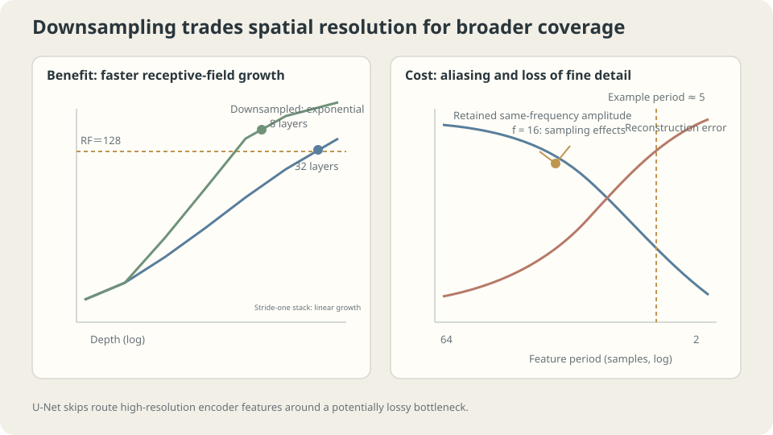

import Objectives from '../../../components/Objectives.astro';
import Ask from '../../../components/Ask.astro';
import Prereq from '../../../components/Prereq.astro';
import Question from '../../../components/Question.astro';
import Answer from '../../../components/Answer.astro';
import QuizBlock from '../../../components/QuizBlock.astro';
import Option from '../../../components/Option.astro';
import Explanation from '../../../components/Explanation.astro';
import VizPlan from '../../../components/VizPlan.astro';
import Remark from '../../../components/Remark.astro';
import Details from '../../../components/Details.astro';
import Bridge from '../../../components/Bridge.astro';
import UsedBy from '../../../components/UsedBy.astro';
import Ref from '../../../components/Ref.astro';

# How can one kernel handle texture, objects, and an entire scene?

<Objectives title="After reading, you can">
- **Calculate receptive fields and compare depth with downsampling.** Track how repeated changes in stride expand coverage in the original coordinates.
- **Measure what downsampling loses and explain the role of a skip connection.** Compare retained frequency components with reconstruction error.
- **Separate the roles of residual connections and normalization.** Use initial signal scales and training results across depths to assess each choice.
</Objectives>

<Prereq items={frontmatter.prereqs} />

## One kernel sees one scale

The previous note's convolution looks at a small patch, while a photograph contains both detail and context. A map presents the same tradeoff: zoom out to see the route, zoom in to locate an intersection. **Can a model preserve both kinds of information?**

A photograph contains **texture** with periods of a few pixels, **objects** spanning tens of pixels, and **composition** across the whole image. Distinguishing cats from dogs might require both fur texture and ear shape, at very different scales.

A $K\times K$ kernel sees a region of side length $K$. Start by stacking $d$ layers with stride 1 and no dilation. The **receptive field** describes the input region that can influence an output. Its side length is

$$
\mathrm{RF}=1+d\,(K-1).
$$

For $K=5$:

```
  depth   1   RF =    5
  depth   2   RF =    9
  depth   4   RF =   17
  depth   8   RF =   33
  depth  16   RF =   65
  depth  32   RF =  129
```

**The receptive field grows linearly with depth.** Covering an offset of $128$ positions requires $32$ layers, each operating at the **original resolution**.

<Ask>
A $5\times5$ kernel needs $32$ layers to cover an offset of $128$.<br />
Halve the resolution every two layers, and $10$ layers cover $249$ positions.<br />
Where did the discarded information go?
</Ask>

<Question label="Discussion" id="Q1">
Downsampling makes a large receptive field much cheaper. First calculate the saving, then ask: **what information is discarded, and can we recover it?**

<Answer summary="Show the reasoning">
**First, the saving.** After downsampling, the same kernel covers twice the distance in the original coordinates. Each layer adds $(K-1)$ times the current effective stride to its receptive field; every halving doubles that stride. With downsampling every two layers:

```
  depth   1   RF =    5   （stride 1）
  depth   2   RF =    9   （stride 2）
  depth   4   RF =   25   （stride 4）
  depth   6   RF =   57   （stride 8）
  depth   8   RF =  121   （stride 16）
  depth  10   RF =  249   （stride 32）
```

This table uses stride 2 in every second $5\times5$ convolution. In general, track

$$
\begin{aligned}
r_\ell&=r_{\ell-1}+(K_\ell-1)j_{\ell-1},\\
j_\ell&=s_\ell j_{\ell-1}.
\end{aligned}
$$

Here $r$ is receptive-field size and $j$ is the spacing between adjacent outputs in original-image coordinates. Smaller feature maps save computation at fixed channel count; increasing channels changes the total cost.

**What is the price?** Pooling combines adjacent values. A thin line, an exact boundary location, or a high-frequency texture may disappear when values are merged.

**Upsampling alone cannot uniquely recover it.** Replication or interpolation creates a higher-resolution signal from what remains. If distinct inputs produced the same pooled output, that output cannot tell us which input was present.

**The decision is whether the task can afford this loss.**

- For a **low-dimensional output**, such as a class or score, some spatial detail may be irrelevant. Classification networks often progressively reduce resolution.
- For an **image-sized output requiring detail**, such as segmentation, denoising, or generation, discarded boundaries may be exactly what the output needs.

A natural solution gives high-resolution features another route around the bottleneck. The encoder gathers broad context; the decoder restores resolution while receiving features from corresponding encoder levels. These are U-Net's long skip connections. They are a common design, not the only possible architecture.
</Answer>
</Question>

## What exactly does downsampling destroy?

The phrase “high frequencies are lost” is qualitative. Let us measure it.

Take a cosine signal of length $64$, apply $2\times$ average pooling, then restore its length with nearest-neighbor upsampling. Measure **the remaining amplitude at the original frequency** and **the total reconstruction error**.

```
    f   period (samples)   retained same-frequency amplitude   reconstruction error
    1        64.0                    0.9976                         0.0491
    2        32.0                    0.9904                         0.0980
    4        16.0                    0.9619                         0.1951
    8         8.0                    0.8536                         0.3827
   12         5.3                    0.6913                         0.5556
   16         4.0                    0.7071                         0.7071
   24         2.7                    0.1464                         0.9239
   31         2.1                    0.0024                         0.9988
   32         2.0                    0.0000                         1.0000
```

**The final row is exactly zero.** The period-two signal $+1,-1,+1,-1,\dots$ averages to zero in every pair. It is **eliminated**, not merely attenuated.

The table measures particular sinusoids under this particular filter and sampling procedure. It does not imply that every feature narrower than five or six pixels loses half its amplitude: signal shape, phase, and sampling matter too.

The rightmost column gives another perspective: a period-eight signal already has $38\%$ relative reconstruction error after one down-and-up cycle. Repeating the cycle processes an already altered signal.

> **Average pooling can map distinct inputs to the same output. Upsampling may guess missing detail, but it cannot turn discarded information into retained evidence.**

This experiment does not establish a universal $s/5$ threshold. Check whether detail survives in channels, skips, or another representation. Reducing spatial resolution need not lose information: rearranging pixels into channels can be reversible.

<Remark label="Caution" summary="One amplitude row is not monotone: sampling and aliasing matter">
At $f=16$ (period $4$), the retained amplitude $0.7071$ exceeds the $0.6913$ at $f=12$ (period $5.3$). This is not simply measurement noise.

Downsampling makes some frequencies indistinguishable on the coarser grid: **aliasing**. Upsampling can also create spectral images. Distinguish Fourier amplitude from projection onto the original cosine, and account for phase and the special Nyquist case. A component at $f=20$ is higher-frequency than $f=12$; it should not be described as a newly created low frequency. These measurements do not define a universal attenuation cutoff.

The reconstruction-error column counts energy moved to other components as error too. In these two rows it increases from $0.5556$ to $0.7071$.

Low-pass filtering before decimation reduces aliasing. Upsampling design also matters: unequal overlap and sampling artifacts can produce checkerboard patterns. Smoothing can help, but artifact mechanisms depend on the specific operators.
</Remark>



**Figure:** Downsampling expands coverage in original coordinates. Average pooling may lose detail, motivating a separate route for high-resolution information.

## The line across the bottleneck

Q1 motivated the skip connection: information needed for a detailed output should have a route that avoids a lossy bottleneck.

Two connections are often called “skips,” but their main motivations differ:

- **U-Net's long skip** connects an encoder level to the corresponding decoder level, usually by **concatenation**. It carries high-resolution information around the bottleneck.
- **A residual connection**, usually **addition**, writes $h_{l+1}=h_l+F(h_l)$ across a short block. It provides a direct signal and gradient route through a deep network.

These roles can overlap, but the distinction is useful: one preserves detailed features across scales; the other changes how depth is optimized.

## The cost of depth itself

Depth introduces an optimization problem separate from receptive-field coverage. <Ref to="ml-loss-landscape" mode="title"/> examined gain; here we vary depth directly.

Use a $144\to32\to32\to\cdots\to1$ tanh stack with depths $8$ through $64$. Compare **plain layers**, **residual layers**, and **residual layers followed by LayerNorm**. Train with Adam at $\eta=0.003$ for 1200 steps and report the median over three seeds.

**First, output scale at initialization, for depth $32$:**

```
                 L1       L4       L8       L16      L32
  plain        0.2418   0.2265   0.1695   0.1513   0.0928
  residual     0.2418   0.5845   1.2501   2.5496   4.3765
  residual+LN  0.2418   1.0000   1.0000   1.0000   1.0000
```

The scales differ, but this table alone cannot identify every cause. LayerNorm [3] computes a mean $\mu(h)$ and variance $s^2(h)$ over designated feature dimensions:

$$
\operatorname{LN}(h)=\gamma\odot\frac{h-\mu(h)}{\sqrt{s^2(h)+\varepsilon}}+\beta.
$$

The normalized variance is exactly 1 only under idealizations such as ignoring $\varepsilon$ and omitting learned affine scaling. Practical LayerNorm outputs need not have variance exactly 1.

**Next, compare gradient magnitudes:** the ratio between the first and last hidden layers, with 1 meaning equal magnitudes.

```
  depth   4   plain 2.87e-01   residual 1.41e+01   residual+LN 2.71e-02
  depth   8   plain 7.05e-01   residual 5.61e+00   residual+LN 6.59e-02
  depth  16   plain 7.60e-02   residual 1.18e+00   residual+LN 1.74e-01
  depth  32   plain 6.47e-02   residual 7.64e-01   residual+LN 1.38e-01
  depth  64   plain 7.33e-02   residual 4.97e-01   residual+LN 1.29e-01
```

At depth $64$, the residual ratio is closer to 1. Its local Jacobian contains $I+\partial F/\partial h_l$, adding a direct branch. Other branches can still cancel or amplify gradients. This setting improves; residual networks are not universally immune to vanishing gradients.

**Finally, training MSE:**

```
  depth   8   plain 0.0000   residual 0.0000   residual+LayerNorm 0.0000
  depth  16   plain 0.0000   residual 0.0000   residual+LayerNorm 0.0000
  depth  32   plain 0.7399   residual 0.0000   residual+LayerNorm 0.0000
  depth  64   plain 0.9915   residual 0.0000   residual+LayerNorm 0.9096
```

**Depth $32$ makes the motivation concrete.** At the same width, data, and optimizer settings, the plain model stalls near a constant-prediction baseline, while the residual model fits to the displayed precision. The connection changes the parameterization and trainability, not just the nominal layer count.

> **Residual connections can make a deep model's capacity easier to reach through training.**

<Details label="Details" summary="Why is identity plus a small correction a useful starting point?">
Write a layer as $h_{l+1}=h_l+F(h_l)$. If the residual branch is initialized small, the block starts near identity. Many small changes can still accumulate, so a hundred such blocks need not jointly remain near identity.

This gives two useful possibilities.

**First, a meaningful starting map.** A small residual branch initially passes its input through, then learns corrections. The plain stack's shrinking RMS suggests attenuation, although RMS alone does not prove that its output has lost all dependence on the input.

**Second, an extra block can preserve a shallower map.** If its residual branch can realize $F=0$, the block is identity. This gives a simple way to embed a shallower computation in a deeper model, provided dimensions and other operations permit it. It does not guarantee that optimization finds that embedding.

The cost appears in the middle row: output scale grows from $0.24$ to $4.38$ as residual contributions accumulate. Architectures may scale residual branches, initialize a learned gate near zero, or use normalization. The appropriate scaling depends on depth and architecture; a fixed factor is not a universal remedy.
</Details>

## A deliberate counterexample: normalization is not free insurance

One number remains unexplained: at **depth $64$**, residual training MSE is **$0.0000$**, but residual plus LayerNorm gives **$0.9096$**.

Normalization hurts this particular training setup. A familiar design choice still needs an experiment.

The gradient ratio provides a clue: $0.497$ for residual versus $0.129$ with LN. Normalization changes the gradient geometry, suppressing directions associated with uniform shifts and, approximately, positive scaling. But this ratio does not establish the unique cause of failure. Placement, affine parameters, and learning rate should also be compared.

**LayerNorm nevertheless has a concrete scale property.** Measure it:

```
  multiply W by   0.01 :  max|LN(XWc) - LN(XW)| = 6.853e-03
  multiply W by   1.00 :  max|LN(XWc) - LN(XW)| = 0.000e+00
  multiply W by 100.00 :  max|LN(XWc) - LN(XW)| = 6.874e-07
```

For positive rescaling and negligible $\varepsilon$, the normalized output is approximately unchanged. The discrepancy at $c=0.01$ reflects the larger relative contribution of $\varepsilon=10^{-5}$; reducing it strengthens the invariance, subject to numerical precision.

The corresponding gradient scaling is:

```
  multiply W by  0.1 :  gradient norm for W = 178.238   (times c = 17.824)
  multiply W by  1.0 :  gradient norm for W =  17.824   (times c = 17.824)
  multiply W by 10.0 :  gradient norm for W =   1.782   (times c = 17.824)
```

For isolated $\operatorname{LN}(XW)$, ignoring $\varepsilon$ and taking $c>0$, the forward map is invariant to $W\mapsto cW$, while its gradient scales as $1/c$. The weight norm also grows by $c$, so a fixed-step **relative update scales as $1/c^2$**. It is not automatically constant. Biases, nonlinearities, and residual branches require checking the relationship again.

> **Normalization reduces sensitivity to feature scale while changing which gradient directions pass through. Whether this helps depends on the task and training setup.**

Residual connections and normalization address related but distinct issues. Deep architectures often benefit from both, but this width-$32$ tanh experiment does not support adding this particular LN configuration automatically. It also does not establish that scale control is its only possible benefit.

**In your own model**, inspect per-layer output RMS, gradients, updates, and training curves together. Stable RMS alone does not show that normalization is unnecessary; compare its placement and hyperparameters directly.

## Receptive field, frequency, and depth

<iframe loading="lazy" src="/personal_website/notes/research_areas/machine-learning-foundations/l4-architectures/l4-3-2.en.html" class="demo-frame" title="Interactive demo: receptive field, frequency, and depth" style="height: 880px; width: 100%; border: none;"></iframe>

**Interactive demo:** Downsampling, skips, depth, and connection type let you explore three separate questions: coverage, retained detail, and trainability.

## Designing a U-shaped network

Turn the observations into a sequence of decisions.

1. **Estimate the required receptive field.** How far apart are the pieces of evidence the task must combine? Compare depth and downsampling to cover that distance.
2. **Check which details must survive.** Measure your actual filtering and sampling pipeline; there is no universal $s/5$ rule. When broad context and fine localization are both needed, compare a multiscale encoder with high-resolution skips.
3. **Choose what the skip carries and how to merge it.** Concatenation preserves separate channel representations at a higher channel cost. Addition is cheaper but requires compatible shapes and representations. Compare them for the output's localization needs.
4. **Inspect gradient routes.** The toy's depth thresholds are not universal. Examine gradients, updates, and training performance together.
5. **Compare normalization configurations.** Pre-norm, post-norm, affine parameters, and step size all matter. RMS alone cannot decide whether to use LN.

**What do these decisions assume?** Multiscale processing is useful when the data and task contain useful structure at several scales. Spatial downsampling needs a meaningful neighborhood structure. Finally, the depth and normalization results come from a narrow tanh stack; width, nonlinearity, initialization, and learning rate can change them. Repeat the measurements in your own setting.

## Check your understanding

<QuizBlock id="ml-l4-3-a">
At $f=32$ (period two), the retained amplitude after average pooling is exactly zero. What does this show?
<Option>The measurement lacks precision; a small oscillation remains.</Option>
<Option correct>Every adjacent pair of $+1,-1,+1,-1,\dots$ averages to zero. The oscillation is eliminated, so that pooled output cannot uniquely determine the original signal.</Option>
<Option>Only average pooling loses it; max pooling would preserve the original oscillation.</Option>
<Explanation>
Max pooling returns a constant $+1$, which also loses the original oscillation. A continuous operation mapping two unrestricted real values to one cannot preserve both degrees of freedom. The operators differ in which information they discard.
</Explanation>
</QuizBlock>

<QuizBlock id="ml-l4-3-b">
A task needs relationships between objects about $100$ pixels apart and boundaries only $3$ pixels wide. Which design direction is worth comparing?
<Option>A flat stack with enough layers for the receptive field and no downsampling.</Option>
<Option correct>A multiscale encoder with high-resolution skips: one route gathers context and another retains localization. This is not the only viable architecture, and there is no universal three-pixel cutoff.</Option>
<Option>A single $101\times101$ kernel.</Option>
<Explanation>
A flat stack can work but processes every layer at full resolution. A single-channel $101\times101$ kernel already has $10201$ coefficients and covers almost the whole input. The exercise separates two requirements—coverage and output detail—before comparing costs. The large kernel remains convolutional, but its locality restriction is much weaker.
</Explanation>
</QuizBlock>

<QuizBlock id="ml-l4-3-c">
At depth $64$, residual training MSE is $0.0000$ while residual plus LN gives $0.9096$. What is the best interpretation?
<Option>The experiment must be wrong because normalization cannot hurt training.</Option>
<Option correct>This LN placement and fixed training setup did not help. Gradient ratios offer a clue, but learning rate, affine parameters, and pre/post-norm comparisons are needed before assigning a unique cause.</Option>
<Option>LayerNorm is useful only for Transformers, never for convolutions or MLPs.</Option>
<Explanation>
Architecture names alone do not determine whether normalization helps. Inspect signal scales, gradients, updates, and controlled training comparisons. Even stable RMS does not settle every effect of normalization.
</Explanation>
</QuizBlock>

<QuizBlock id="ml-l4-3-d">
Which statement is **incorrect**?
<Option>U-Net's long skips mainly preserve detailed features across the bottleneck; residual skips mainly provide direct paths through a deep computation.</Option>
<Option>Isolated $\operatorname{LN}(XW)$ is invariant to positive rescaling when $\varepsilon$ is ignored, but this does not fix the relative update at a constant learning rate.</Option>
<Option correct>Repeated downsampling expands the receptive field rapidly, so enough layers guarantee preservation of detail at every scale.</Option>
<Explanation>
Coverage and preservation are different. A broad receptive field says which input region can influence an output, not whether every detail remains recoverable. High-resolution routes or other information-preserving representations address a separate requirement.
</Explanation>
</QuizBlock>

<UsedBy slug={frontmatter.slug} />

<Bridge to="ml-attention">
Local convolutions need several layers to transmit distant information. In a sentence, a pronoun may refer to a name much earlier. **Can content decide directly which position to consult?** This motivates attention.
</Bridge>

## References

1. Ronneberger, O., Fischer, P. & Brox, T. [*U-Net: Convolutional Networks for Biomedical Image Segmentation.*](https://arxiv.org/abs/1505.04597) MICCAI 2015.
2. He, K., Zhang, X., Ren, S. & Sun, J. [*Deep Residual Learning for Image Recognition.*](https://arxiv.org/abs/1512.03385) CVPR 2016.
3. Ba, J., Kiros, J. & Hinton, G. [*Layer Normalization.*](https://arxiv.org/abs/1607.06450) 2016.
