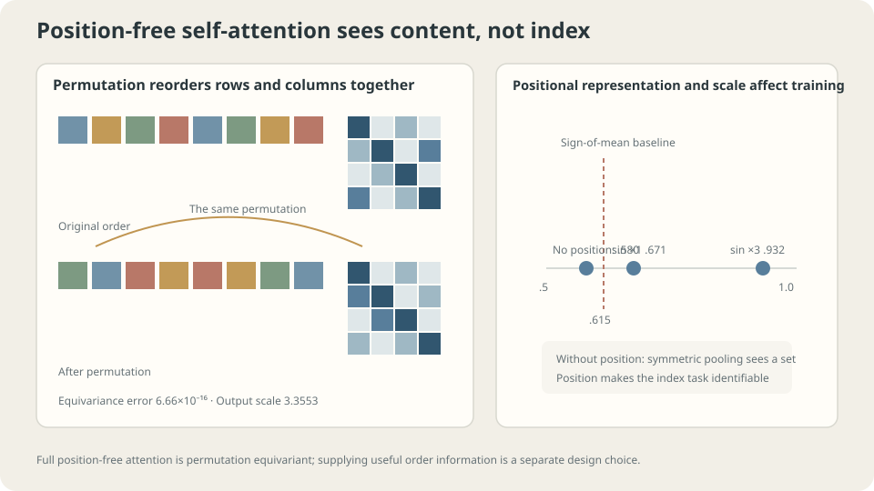

import Objectives from '../../../components/Objectives.astro';
import Ask from '../../../components/Ask.astro';
import Prereq from '../../../components/Prereq.astro';
import Question from '../../../components/Question.astro';
import Answer from '../../../components/Answer.astro';
import QuizBlock from '../../../components/QuizBlock.astro';
import Option from '../../../components/Option.astro';
import Explanation from '../../../components/Explanation.astro';
import VizPlan from '../../../components/VizPlan.astro';
import Remark from '../../../components/Remark.astro';
import Details from '../../../components/Details.astro';
import Bridge from '../../../components/Bridge.astro';
import UsedBy from '../../../components/UsedBy.astro';
import Ref from '../../../components/Ref.astro';

# Can content decide where to look?

<Objectives title="After reading, you can">
- **Write self-attention and identify what it preserves and omits.** Check permutation equivariance and compare positional encodings at different scales.
- **Explain the $1/\sqrt d$ factor.** Measure attention entropy and maximum weights across dimensions.
- **Compare attention with convolution.** Account for both computational cost and the number of layers needed to connect distant positions.
</Objectives>

<Prereq items={frontmatter.prereqs} />

## Can we choose neighbors after reading the content?

Previous layers transmit information locally. In “Ming handed Hua the book because he needed it tomorrow,” resolving “he” requires earlier names and context, not just adjacent words. **Can content determine whom to consult?** Convolution fixes its support by position; attention learns content-dependent matches.

Locality is often useful in images: adjacent pixels commonly belong to the same object. Other relationships need more:

- Which noun does “it” refer to—three words earlier or thirty?
- Which object contains this pixel? Similar colors and textures may be far away.
- Which atoms interact? Their types and geometry matter more than their indices in a list.

The shared requirement is **choosing where to look after inspecting content**. A fixed neighborhood cannot directly express arbitrary content-dependent connections in a single local layer.

<Ask>
A convolution's neighborhood is fixed when we design the layer.<br />
But the relevant location may depend on the content.<br />
Can the model choose whom to consult?
</Ask>

<Question label="Discussion" id="Q1">
Construct a layer whose output at each position is a **content-dependent weighted average** over positions, with nonnegative weights summing to one. Then check **what this construction preserves and what it omits**. The convex average bounds the output by its value vectors, though learned projections can change their scale.

<Answer summary="Show the reasoning">
Scaled dot-product attention [1] is one way to meet these requirements; the requirements do not uniquely determine it.

Map a pair of inputs $(i,j)$ to a compatibility score. A simple choice projects each input and takes an inner product:

$$
s_{ij}=\frac{(x_iW_Q)\cdot(x_jW_K)}{\sqrt d}.
$$

The projections have different weights because **what I seek** (query) and **what I offer for matching** (key) have different roles. We will explain $\sqrt d$ below.

Use softmax to make weights nonnegative and normalized: $a_{ij}=\mathrm{softmax}_j(s_{ij})$.

The averaged content need not equal $x_j$. A third projection separates **content used for matching** from **content passed onward**:

$$
\mathrm{out}_i=\sum_j a_{ij}\,(x_jW_V).
$$

Three projections, dot products, and softmax give this basic self-attention layer.

**What remains?** Each input position has a corresponding output. The layer is a sequence-to-sequence map that can be stacked.

**What is absent?** Every score depends on content, with no use of the numerical indices $i,j$. Reordering all tokens merely reindexes scores, weights, and outputs:

$$
\mathrm{Attn}(Px)=P\,\mathrm{Attn}(x)
\quad\text{for every permutation }P.
$$

This is **permutation equivariance**. It imposes more symmetry than translation equivariance in <Ref to="ml-convolution" mode="title"/>, on domains where translations are permutations.

The argument concerns full self-attention without positional information or a fixed positional mask. Equivariance means the output reorders with the input, not that it stays unchanged. Symmetric pooling then gives a permutation-invariant set function. Causal masks and positional terms change this symmetry.
</Answer>
</Question>

## It really does not know the order

Check a randomly initialized layer under a fixed token permutation:

```
  max |Attn(permuted x) - permuted Attn(x)| = 6.661e-16
  reference output scale: max|Attn(x)| = 3.3553
```

The discrepancy is at floating-point precision. The exact-arithmetic identity follows from the structure, rather than being an approximate behavior learned in training.

After mean pooling, equivariance becomes invariance:

```
  max |y(permuted x) - y(x)| = 1.665e-16
```

**This attention-plus-symmetric-pooling model is a set function.** It can use which tokens are present, but cannot distinguish their original order. Without pooling, outputs remain indexed and equivariant.

**How much does that matter?** Take $L=8$ iid random tokens, each of dimension $16$. The label is the sign of coordinate zero of **the token at position zero**. A learned query pools the tokens through attention, followed by a linear output.

A feasible baseline predicts the sign of the mean. For Gaussian inputs its accuracy is

$$
\frac12+\frac1\pi\arcsin(1/\sqrt8)=0.6150.
$$

**This is not the upper bound for all set functions.**

Given only the multiset, each token is equally likely to have occupied position zero. If $r$ tokens have positive signs, the conditional positive-label probability is $r/8$. The Bayes decision follows the majority sign. For $r\sim\operatorname{Binomial}(8,1/2)$, the optimal accuracy is

$$
\mathbb E\left[\frac{\max(r,8-r)}8\right]
=\frac1{256}\sum_{r=0}^{8}\binom8r\frac{\max(r,8-r)}8
=0.63671875.
$$

```
  sign-of-mean baseline                          0.6150
  invariant Bayes bound for this iid task        0.6367

  no positional encoding         train 0.640   test 0.580
  sinusoidal encoding times 1    train 0.698   test 0.671
  sinusoidal encoding times 3    train 0.927   test 0.932
```

The position-free model remains below the Bayes bound; it has not exhausted every possible set-based decision. A finite test accuracy also fluctuates. The bound concerns population accuracy.

With positional encoding scaled by three, test accuracy reaches $0.932$ under the same architecture, data, and budget. The input now includes position-dependent constant vectors.

The intermediate row matters: directly adding the standard sinusoidal vectors reaches only $0.671$. Encoding strength affects this experiment substantially.

The logits mix content-content, position-position, and cross terms. When random content and positional vectors have comparable component scales, positional distinctions may be difficult for this trained model to extract. Increasing the positional scale helps here; the table alone does not establish a universal signal-to-noise threshold or a single causal explanation.

> **Including position in the input does not guarantee that a fixed model and training budget will use it effectively.**

<Ref to="ml-conditioning" mode="title"/> gives a related example: directly appending scalar time produces error $0.0018$, compared with $0.0004$ for sinusoidal embedding. Representation and scale affect how readily a model uses available information.



**Figure:** Full attention without positional information or a fixed positional mask is permutation equivariant. The effects of encoding type and scale require separate experiments.

## What does $1/\sqrt d$ prevent?

The denominator in Q1 controls logit scale, which affects softmax concentration and training.

Suppose $q,k$ have approximately independent, zero-mean, unit-variance components, with the independence needed across products. Their dot product sums $d$ terms and has standard deviation approximately $\sqrt d$. **Higher dimension then spreads the logits more widely.**

For each query, use $16$ keys. Uniform attention has entropy $\ln16=2.7726$ nats:

```
  d=   4  unscaled   logit SD  1.779   entropy 1.8090   max weight 0.4222
  d=   4  /sqrt(d)   logit SD  0.889   entropy 2.4237   max weight 0.2298
  d=  16  unscaled   logit SD  4.101   entropy 0.8689   max weight 0.6956
  d=  16  /sqrt(d)   logit SD  1.025   entropy 2.3428   max weight 0.2483
  d=  64  unscaled   logit SD  7.759   entropy 0.4317   max weight 0.8367
  d=  64  /sqrt(d)   logit SD  0.970   entropy 2.3808   max weight 0.2373
  d= 256  unscaled   logit SD 15.789   entropy 0.2051   max weight 0.9177
  d= 256  /sqrt(d)   logit SD  0.987   entropy 2.3692   max weight 0.2426
  d=1024  unscaled   logit SD 32.126   entropy 0.0886   max weight 0.9639
  d=1024  /sqrt(d)   logit SD  1.004   entropy 2.3571   max weight 0.2453
```

The unscaled standard deviations track $\sqrt d$. At $d=1024$, attention is already nearly one-hot at random initialization: entropy $0.0886$ and maximum weight $0.9639$.

The softmax Jacobian is $\operatorname{diag}(a)-aa^\top$. Near one-hot weights it becomes small, weakening gradients through the allocation of attention. Finite logits do not imply exactly zero gradients or permanent failure of the whole model. Scaling reduces the risk of excessive initial concentration.

After division by $\sqrt d$, the five tested dimensions give similar logit standard deviations, entropy, and maximum weights. Under these initialization assumptions, changing dimension no longer strongly changes initial attention concentration. Learned queries and keys need not retain those assumptions.

<Remark label="Supplement" summary="What changes with multiple heads?">
Multi-head attention splits a total dimension into heads, performs separate attention operations, and concatenates their outputs.

Separate Q, K, and V projections permit simultaneous matching patterns. The random-logit table alone does not prove that smaller head dimensions always train more easily.

At fixed total dimension, leading dot-product and value-aggregation arithmetic remains comparable, but there are usually $h$ separate $L\times L$ weight matrices. Softmax, storage, and implementation overhead do not disappear.

Multiple heads are permitted to specialize; they are not guaranteed to do so. Redundancy between trained heads is a separate empirical question.
</Remark>

## The price: quadratic sequence length

Attention buys a short **interaction path**. In full attention, any position can directly consult any other in one layer. Compare stride-one, non-dilated convolution:

```
  To cover an offset d:
    d =   16    convolution (K=5):   4 layers     self-attention: 1 layer
    d =   64    convolution (K=5):  16 layers     self-attention: 1 layer
    d =  256    convolution (K=5):  64 layers     self-attention: 1 layer
    d = 1024    convolution (K=5): 256 layers     self-attention: 1 layer
```

Downsampling can reduce the required depth to logarithmic order, while introducing the information-preservation questions in <Ref to="ml-unet" mode="title"/>. Dilation and other architectures offer additional tradeoffs.

**The cost is computation.** Dense attention forms $L\times L$ scores. Here are single-head measurements with $d=64$ and batch size $4$:

```
  L =   64     0.88 ms     relative   1.0     (pure L² prediction:    1.0)
  L =  128     2.34 ms     relative   2.6     (                       4.0)
  L =  256     7.36 ms     relative   8.3     (                      16.0)
  L =  512    33.29 ms     relative  37.6     (                      64.0)
  L = 1024   105.15 ms     relative 118.8     (                     256.0)
  L = 2048   348.42 ms     relative 393.8     (                    1024.0)
```

Projection costs scale as $Ld^2$; score computation and value aggregation scale as $L^2d$. Near $L\approx d$, both matter. At large $L$, the quadratic term dominates arithmetic. Wall-clock timings also depend on kernels, hardware, and overhead, so these measurements need not follow an exact power law.

This motivates patching in vision Transformers [2]. A $224\times224$ image has $50176$ pixel tokens and roughly $2.5\times10^9$ pairwise scores per head. Nonoverlapping $16\times16$ patches reduce $L$ to $196$. Patching is one way to make dense attention affordable; alternatives change the interaction structure or implementation.

> **Convolution trades depth for interaction distance; dense attention pays for all pairs. Compare sequence length, required interactions, and budget.**

## Content chooses the match; position is supplied separately

<iframe loading="lazy" src="/personal_website/notes/research_areas/machine-learning-foundations/l4-architectures/l4-4-2.en.html" class="demo-frame" title="Interactive demo: content matching and positional information" style="height: 929px; width: 100%; border: none;"></iframe>

**Interactive demo:** Shuffle token order to inspect equivariance error near floating-point precision. Disable scaling and increase dimension to observe attention entropy fall.

## Different architectures make different assumptions

Compare the inductive biases introduced throughout L4:

| Architecture | Structural preference |
| --- | --- |
| Convolution | Local interactions and shared patterns across positions |
| U-Net | Multiscale context with routes retaining high-resolution features |
| Self-attention without position | Content-dependent global interactions and permutation equivariance |
| Dense MLP | No built-in permutation or translation symmetry across input coordinates |

More symmetry means **more restrictions**: equivariance under every permutation implies equivariance under its translation subgroup, but not conversely. Global attention also differs from local convolution in connectivity. Symmetry alone cannot rank complete architectures by expressiveness.

<Remark label="Supplement" summary="How does attention fit inside a Transformer?">
A Transformer block also contains tokenwise feed-forward networks, residual connections, and normalization. Attention exchanges information between positions; shared feed-forward networks transform each token nonlinearly. Residual paths and normalization shape how signals and gradients pass through depth. A whole Transformer is more than one weighted average.
</Remark>

As <Ref to="ml-mlp" mode="title"/> explains, a broader function class can require more data to distinguish good candidates. A useful inductive bias can improve finite-data generalization, although parameter count or symmetry alone does not determine the bias–variance tradeoff.

The vision Transformer experiments [2] illustrate the importance of data scale and training recipe when comparing convolutional and Transformer models. They do not establish a universal crossover point: augmentation, pretraining, architecture, and compute also change the result.

**What should you check?**

First, **provide usable positional information when order matters**. The $0.671$ versus $0.932$ experiment motivates an encoding-scale sweep, not a universal instruction to multiply by three.

Second, **keep interaction cost affordable**. Patching, sparse attention, and linear approximations make different compromises. They do not all restore locality: some approximate global interactions instead.

Third, **compare learning curves under your data and budget**. More data may help a descending curve; a plateau may motivate changes to optimization, representation, or architecture. Neither shape alone identifies the unique remedy. See <Ref to="ml-learning-curves" mode="title"/>.

## Check your understanding

<QuizBlock id="ml-l4-4-a">
The model without position reaches test accuracy $0.580$. Which interpretation of the theoretical baselines is correct?
<Option>More training must eventually exceed every position-free bound.</Option>
<Option correct>The sign-of-mean baseline is $0.6150$, while the invariant Bayes bound for this iid task is $0.6367$, achieved by majority sign. Without order information, the original position-zero token cannot be identified.</Option>
<Option>$0.6150$ is the upper bound for all position-free models.</Option>
<Explanation>
The multiset hides which token originally occupied position zero. Majority sign is the optimal decision given this information, with population accuracy about $0.6367$. Recovering the designated position requires order information in the representation or structure.
</Explanation>
</QuizBlock>

<QuizBlock id="ml-l4-4-b">
At $d=1024$, unscaled attention has entropy $0.0886$ and maximum weight $0.9639$. What follows?
<Option>Training must be faster because the attention is already decisive.</Option>
<Option correct>Near-one-hot weights make the softmax Jacobian small, potentially making matching weights harder to learn. This does not prove the whole model can never update.</Option>
<Option>Adam automatically removes every effect of softmax saturation.</Option>
<Explanation>
Adam's coordinatewise scaling does not guarantee recovery from a poorly conditioned softmax Jacobian. Other gradient paths may still operate. Scaling the logits addresses a specific source of initial concentration rather than promising successful training by itself.
</Explanation>
</QuizBlock>

<QuizBlock id="ml-l4-4-c">
Measured time grows more slowly than a pure $L^2$ prediction over much of the table. What is the best explanation?
<Option>Dense attention therefore has no quadratic arithmetic cost.</Option>
<Option correct>Both linear-in-length projections, $Ld^2$, and quadratic pairwise operations, $L^2d$, contribute. Hardware and implementation also affect timings; the quadratic term dominates asymptotically at fixed dimension.</Option>
<Option>A GPU would automatically make exact dense attention arithmetic linear in length.</Option>
<Explanation>
Faster kernels can change constants, memory traffic, and practical scaling. They do not eliminate the pairwise arithmetic of standard dense attention. Memory-efficient exact algorithms can avoid storing the entire matrix without changing this arithmetic order; linear-attention methods alter the computation itself.
</Explanation>
</QuizBlock>

<QuizBlock id="ml-l4-4-d">
Which statement is **incorrect**?
<Option>Permutation equivariance of full position-free self-attention is structural, up to numerical rounding.</Option>
<Option>Using $16\times16$ patches reduces a $224\times224$ image from about fifty thousand tokens to $196$, greatly reducing pairwise cost.</Option>
<Option correct>Because attention connects any pair in one layer, it must outperform convolution on every task if computation is affordable.</Option>
<Explanation>
Connectivity describes possible interactions, not guaranteed test performance. Attention also has inductive biases. Compare task structure, available data, training recipe, and compute rather than deriving a universal winner from interaction range.
</Explanation>
</QuizBlock>

<UsedBy slug={frontmatter.slug} />

<Bridge to="ml-conditioning">
Positional encoding reminds us that a model can use only the information it actually receives. If the same image needs different corrections under different instructions or noise levels, how should those conditions enter the network? Next we compare concatenation, feature modulation, and cross-attention.
</Bridge>

## References

1. Vaswani, A. et al. [*Attention Is All You Need.*](https://arxiv.org/abs/1706.03762) NeurIPS 2017.
2. Dosovitskiy, A. et al. [*An Image is Worth 16x16 Words.*](https://arxiv.org/abs/2010.11929) ICLR 2021.
3. Tay, Y., Dehghani, M., Bahri, D. & Metzler, D. [*Efficient Transformers: A Survey.*](https://arxiv.org/abs/2009.06732) ACM Computing Surveys 55(6), 2022.
