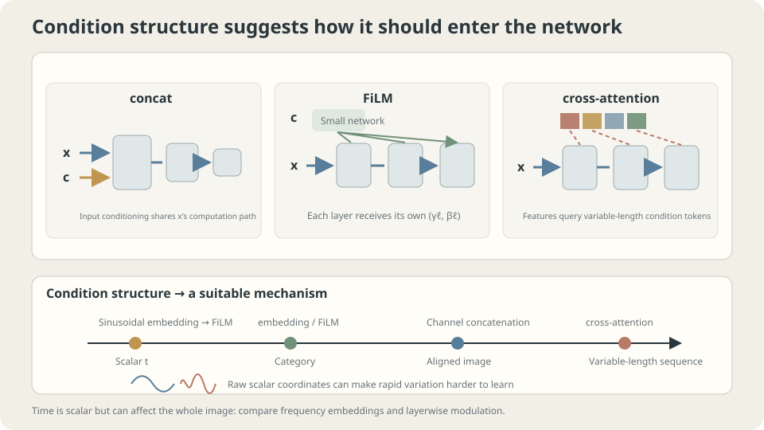

import Objectives from '../../../components/Objectives.astro';
import Ask from '../../../components/Ask.astro';
import Prereq from '../../../components/Prereq.astro';
import Question from '../../../components/Question.astro';
import Answer from '../../../components/Answer.astro';
import QuizBlock from '../../../components/QuizBlock.astro';
import Option from '../../../components/Option.astro';
import Explanation from '../../../components/Explanation.astro';
import VizPlan from '../../../components/VizPlan.astro';
import Remark from '../../../components/Remark.astro';
import Bridge from '../../../components/Bridge.astro';
import UsedBy from '../../../components/UsedBy.astro';
import Ref from '../../../components/Ref.astro';

# Where should instructions enter a shared model?

<Objectives title="After reading, you can">
- **Explain why a raw scalar condition can be difficult to use.** Compare scalar inputs, sinusoidal embeddings, and a wider network under a fixed step budget.
- **Distinguish three conditioning mechanisms.** Concatenation changes inputs, FiLM modulates features, and cross-attention chooses condition content to consult.
- **Explain why a null condition needs training.** Measure how independent condition dropout changes null-branch error.
</Objectives>

<Prereq items={frontmatter.prereqs} />

## One machine, different instructions

The same photograph can be brightened or turned into a night scene. The photograph alone does not specify which answer is wanted. **Where does the instruction enter the network?** Write this extra information as a condition $c$:

- “Make this a **night scene**”: a category condition.
- “Generate from this description”: a sequence of tokens.
- “We are at **step 300**; perform the appropriate correction”: a scalar condition.

The last condition describes **the algorithm's state**, rather than a user instruction. Shared weights perform different operations at different stages, so the stage must be supplied.

Conditions can enter the input, modulate intermediate features, or be queried through attention. These choices change computations and have different costs for different condition structures.

<Ask>
Where should an instruction enter?<br />
Is one extra input coordinate enough?<br />
What if that coordinate is a scalar requiring rapid variation?
</Ask>

<Question label="Discussion" id="Q1">
How does a conditional model differ mathematically from an unconditional one? If a scalar condition is appended as another input coordinate, what must the network learn along that coordinate?

<Answer summary="Show the reasoning">
**Fix the learning objective first.** Under squared-error regression with finite second moments, the ideal conditional predictor is

$$
f_\theta(x,c)\ \approx\ \mathbb E[Y\mid X=x,\,C=c].
$$

The condition refines the information available. Conditional variance cannot increase **after averaging over the conditioning variables**, but a particular subgroup can have larger variance. Finite models and data need not achieve lower error.

**What must a raw-coordinate model learn?** If the desired function varies rapidly with $c$, the network must construct those oscillations along that input coordinate.

The frequency experiment in <Ref to="ml-mlp" mode="title"/> found training MSE increasing from $0.0000$ to $0.3875$ when the target changed from one to 32 cycles at fixed width and budget. This illustrates a spectral training bias in that setting; it can affect a condition coordinate just as it affects a spatial coordinate.

**Two different responses are possible.**

- **Supply frequency features directly:** replace or augment $c$ with sine and cosine features at several frequencies. A frequency already present can be selected by a linear layer.
- **Give the condition another route:** use it to modulate intermediate features, rather than treating it only as an ordinary input coordinate.

We measure the first choice and explain when the second fits the structure of the condition. Neither is universally necessary or superior.
</Answer>
</Question>

## Three injection mechanisms

Compare what each mechanism changes:

- **Concatenation:** $f([x,c])$. This is simple and natural for aligned inputs, such as an image and a pixelwise mask. Input-level conditioning must propagate through subsequent layers; concatenation can also be applied at intermediate layers.
- **FiLM:** compute layerwise scales and shifts from $c$, then apply featurewise affine modulation. Global conditions such as class, time, or style can directly change intermediate computations.
- **Cross-attention:** current features supply queries; condition tokens supply keys and values. Different positions can consult different parts of the condition. Other mechanisms can also process variable-length inputs through encoders, but cross-attention provides direct content matching.

These mechanisms can coexist: FiLM for time, cross-attention for text, and concatenation for aligned auxiliary images. **Condition structure** suggests useful candidates:

| Condition | A mechanism worth comparing |
| --- | --- |
| Scalar time or strength | Embedding followed by FiLM or concatenation |
| Discrete category | Learned embedding followed by FiLM |
| Aligned image, mask, or edge map | Channelwise concatenation |
| Variable-length token sequence | Cross-attention |



**Figure:** The three mechanisms change different computations. A time embedding is a representation choice for scalar conditions.

## Why embed a scalar first?

A sinusoidal embedding maps $c\in[0,1]$ to multiple frequencies:

$$
\mathrm{emb}(c)=\big(\sin(2\pi f_jc),\ \cos(2\pi f_jc)\big)_{j=0}^{J-1},
\qquad f_j=2^{\,j}.
$$

**It replaces “construct this oscillation from a scalar” with “use an oscillation already supplied in the input.”**

For example, if $\sin(16\pi c)$ is already a feature, a linear layer can select it directly. This motivates Fourier features [2]; it does not imply that every network's first-layer weights must grow as $O(k)$.

Check an important limitation: these integer frequencies give $\operatorname{emb}(0)=\operatorname{emb}(1)$. If the endpoints need different answers, retain raw $c$, include suitable noninteger frequencies, or use another endpoint-distinguishing representation.

Geometric frequencies $f_j=2^j$ cover several scales with only $J$ frequency pairs, or $2J$ trigonometric coordinates. Their ratio spans $2^{J-1}$ from the first frequency to the last.

<Remark label="Supplement" summary="The link to positional encodings and Fourier features">
Transformer sinusoidal positional encodings also use sine/cosine pairs at geometric frequencies. The scalar denotes token position rather than time or condition strength. The exact frequency choices and the way features enter the model differ.

Coordinate-based networks use related **Fourier features** [2]. Their neural-tangent-kernel analysis explains how feature mappings can alter a model's effective spectral bias. The result depends on architecture and regime; it is not a theorem that all unembedded networks have exponentially decaying frequency response or can never learn high frequencies.

The reusable idea is to **compare multiscale frequency features when a scalar must influence the output at several scales**, while checking endpoint collisions and the frequencies the task actually needs.
</Remark>

## Three representations on one task

Choose a target with deliberately rapid dependence on the condition:

$$
y=\sin\big(2\pi x+2\pi\cdot 8\cdot t\big),\qquad x,t\sim U(0,1),\ n=800 .
$$

The dependence on $x$ has one cycle, while the dependence on $t$ has **eight**. Run 6000 Adam steps at $\eta=0.01$ for each setting:

```
  concatenate scalar t          input dim  2   h= 64   training MSE 0.0018
  concatenate sinusoidal t      input dim 13   h= 64   training MSE 0.0004
  concatenate scalar t, wider   input dim  2   h=128   training MSE 0.0010
```

The embedding reduces displayed error by about a factor of four with 11 additional input coordinates. Doubling hidden width approximately quadruples the dominant hidden-layer parameter count, yet gives a smaller improvement here. This is evidence for this representation under this task and budget, rather than a universal efficiency ranking.

> **Fixed embedding frequencies need no training, but they change the representation, downstream parameter count, and represented functions. Controlled comparisons are needed to explain an improvement.**

This motivates common sinusoidal time embeddings. They are part of the model's input representation, even when the frequency map has no learned parameters. Like feature scaling in <Ref to="ml-gradient-descent" mode="title"/>, they can change optimization, though their effect is more than a simple change of units.

## “No condition” needs training too

A conditional model sometimes needs to operate without an explicit condition:

- To generate with no requested category.
- To compare conditional and unconditional predictions, as guidance methods often do.
- To handle a user who provides no condition.

A **null token** can represent absence—for example, an all-zero class vector. But **if conditions are always present in training, that null input was never constrained by the objective**.

Use $y=\sin(2\pi x)+0.8c$, with independent, equally likely binary classes. The unconditional squared-error predictor is therefore

$$
\mathbb E[Y\mid X=x]=\sin(2\pi x)+0.4.
$$

Independently replace the condition with null with probability $p$. Null examples then train this marginalized target. In general the average uses $p(c\mid x)$, not necessarily equal class weights.

```python
def feats(x, c, mask):                      # mask=0 drops this condition
    oh = np.zeros((len(x), 2)); oh[np.arange(len(x)), c] = 1.0
    return np.c_[x, oh*mask[:,None]]

mask = (rng.random(N) > p).astype(float)    # p is condition-dropout probability
```

```
  dropout p=0.0   median null-prediction MSE against the class average: 1.3908
  dropout p=0.1   median null-prediction MSE against the class average: 0.0660
  dropout p=0.3   median null-prediction MSE against the class average: 0.0225
  reference: always predicting 0 gives MSE 0.6575
```

With $p=0$, the objective never constrains null behavior, and it performs poorly here. The function still has an output; there is no guarantee that it equals the class average. Other initializations or models need not fail by the same amount.

At $p=0.1$, null error falls by roughly twenty-one times; $p=0.3$ lowers it further. Increasing $p$ also reduces the fraction of condition-present examples. This table measures only null quality, so it cannot establish the conditional-quality tradeoff or an optimal dropout probability.

> **A null condition is an input whose desired behavior must be learned or otherwise specified.**

**A deliberate violation:** replace the trained null vector with an unseen vector. Its behavior is again unconstrained and may be poor. The issue is not which vector looks geometrically neutral; use the null representation whose behavior the training objective actually specifies.

**Limits of the experiment:** these are small scalar/class-conditioned networks. For token sequences, dropping the entire condition and dropping individual tokens teach different tasks. Tune $p$ while measuring both conditional and null quality, since they share parameters. Independent dropout is important for the intended marginalization; selective missingness can change the null target.

## Injection, frequency, and dropout

<iframe loading="lazy" src="/personal_website/notes/research_areas/machine-learning-foundations/l4-architectures/l4-5-2.en.html" class="demo-frame" title="Interactive demo: conditioning mechanisms, frequency, and dropout" style="height: 914px; width: 100%; border: none;"></iframe>

**Interactive demo:** Increase condition frequency and compare raw-scalar and embedded training curves. The embedding's advantage depends on the supplied frequencies and training setup.

## Check your understanding

<QuizBlock id="ml-l4-5-a">
A model receives normalized scalar time, but its outputs at adjacent steps are almost identical. What should you do first?
<Option>Immediately double the width.</Option>
<Option correct>Check that neighboring steps require different answers and that time actually reaches the computation. Then compare raw time with an endpoint-distinguishing embedding. Similar adjacent outputs alone do not diagnose a frequency-learning failure.</Option>
<Option>Use large unnormalized integer steps instead.</Option>
<Explanation>
Widening helped the measured toy, but less than embedding. Changing units alone is not a targeted remedy and can change conditioning of the optimization. Establish the desired time dependence before choosing a representation.
</Explanation>
</QuizBlock>

<QuizBlock id="ml-l4-5-b">
A model was trained only with conditions present. At deployment, the team supplies an all-zero condition. What is guaranteed?
<Option>The answer is the average of the two classes because zero is their midpoint.</Option>
<Option correct>No class-average guarantee follows. The objective did not constrain null inputs; independent condition dropout is one way to train that branch.</Option>
<Option>The model must choose exactly one of the classes.</Option>
<Explanation>
The network usually still produces an output, but nonlinearity does not map input midpoints to output averages. A desired null behavior must be included in the learning objective or supplied by another justified construction.
</Explanation>
</QuizBlock>

<QuizBlock id="ml-l4-5-c">
Which comparison of FiLM and concatenation is most reasonable?
<Option>FiLM always wins because it influences every layer.</Option>
<Option correct>Condition structure matters. Global class, time, or style can use feature modulation; an aligned mask or edge image naturally fits channelwise concatenation that preserves spatial correspondence.</Option>
<Option>Concatenation always wins because it adds no parameters.</Option>
<Explanation>
Choose mechanisms by the information they must carry, then test them. Concatenation generally increases the next layer's parameter count. Multiple mechanisms can coexist in one model.
</Explanation>
</QuizBlock>

<QuizBlock id="ml-l4-5-d">
Which statement is **incorrect**?
<Option>Fixed sinusoidal frequencies need no learning, but change the input representation and downstream function class.</Option>
<Option>Positional encodings and coordinate-network Fourier features both provide multiscale representations of scalar coordinates.</Option>
<Option correct>Larger condition-dropout probability is always better because the null prediction becomes more accurate.</Option>
<Explanation>
Changing dropout changes the relative training exposure of conditional and null branches. Neither side is guaranteed to improve monotonically. The experiment reports only null error; a complete comparison measures both branches.
</Explanation>
</QuizBlock>

<UsedBy slug={frontmatter.slug} />

<Bridge to="ml-maximum-likelihood">
We have architectures and conditions, but a mean prediction cannot describe every plausible outcome. To generate diverse images or text, we need a distribution. The next unit asks: once data have been observed, what objective should evaluate a probability model?
</Bridge>

## References

1. Perez, E. et al. [*FiLM: Visual Reasoning with a General Conditioning Layer.*](https://arxiv.org/abs/1709.07871) AAAI 2018.
2. Tancik, M. et al. [*Fourier Features Let Networks Learn High Frequency Functions in Low Dimensional Domains.*](https://arxiv.org/abs/2006.10739) NeurIPS 2020.
3. Ho, J., Salimans, T. [*Classifier-Free Diffusion Guidance.*](https://arxiv.org/abs/2207.12598) 2022.
