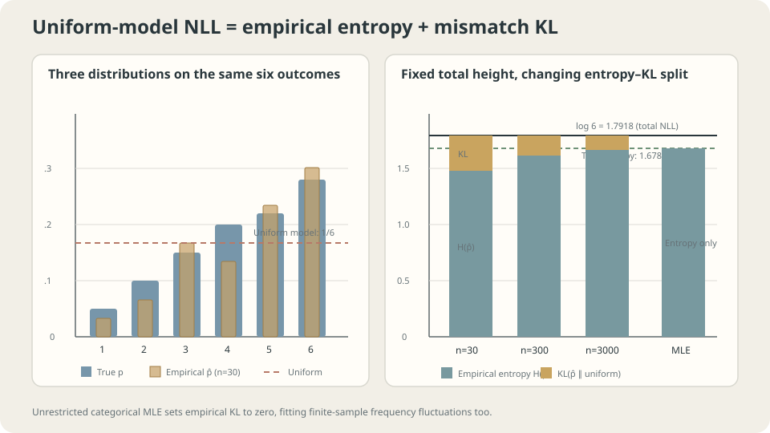

import Objectives from '../../../components/Objectives.astro';
import Ask from '../../../components/Ask.astro';
import Prereq from '../../../components/Prereq.astro';
import Question from '../../../components/Question.astro';
import Answer from '../../../components/Answer.astro';
import QuizBlock from '../../../components/QuizBlock.astro';
import Option from '../../../components/Option.astro';
import Explanation from '../../../components/Explanation.astro';
import VizPlan from '../../../components/VizPlan.astro';
import Remark from '../../../components/Remark.astro';
import Details from '../../../components/Details.astro';
import Bridge from '../../../components/Bridge.astro';
import UsedBy from '../../../components/UsedBy.astro';
import Ref from '../../../components/Ref.astro';

# How should we score how well a model explains the data?

<Objectives title="After reading, you can">
- **Derive average NLL from likelihood.** Decompose discrete empirical NLL into entropy and KL, and explain why continuous empirical measures need different treatment.
- **Derive squared and absolute error from fixed-scale Gaussian and Laplace likelihoods.** Separate a likelihood interpretation from a requirement that the real noise follow that distribution.
- **Explain zero-probability finite-sample MLEs.** Use coin proportions and Gaussian variance to distinguish sampling variability, bias, and conditional asymptotic results.
</Objectives>

<Prereq items={frontmatter.prereqs} />

## Comparing probability models without the true distribution

Previous units predicted an answer $y$ from $x$ and evaluated a loss. <Ref to="ml-empirical-risk" mode="title"/> defined risk, <Ref to="ml-data-splits" mode="title"/> separated evaluation datasets, and <Ref to="ml-seeds-and-reporting" mode="title"/> examined variability.

Now change the goal. To predict tomorrow's order types, we want probabilities for every category, not just the most likely category. The model supplies a distribution $p_\theta$.

A target value can be compared directly with a prediction. But **how do we compare a distribution with a collection of observations?** The observations do not include the true density curve.

<Ask>
One model assigns an event probability $0.7$, another $0.9$.<br />
The event occurs. Which model gets the better score for that observation?<br />
How severely should we penalize a model that assigned probability zero?
</Ask>

<Question label="Discussion" id="Q1">
Compare models using the likelihood of the observed dataset. If we want an additive score that preserves likelihood ordering, why is a logarithm natural?

<Answer summary="Show the reasoning">
**Start with independent observations.** Their joint probability mass, or joint density in the continuous case, factors as

$$
p_\theta(x_1,\dots,x_n)=\prod_{i=1}^n p_\theta(x_i).
$$

This is the **likelihood**, viewed as a function of model parameters for fixed data. Larger values assign more mass or density to the observed dataset. Direct products present two problems.

**Numerical range:** multiplying a thousand probabilities of $0.1$ gives $10^{-1000}$, which underflows in standard floating-point arithmetic.

**Additive structure:** a sum of per-example losses fits empirical-risk optimization and permits unbiased uniformly sampled minibatch estimates of the average objective and, under suitable differentiation conditions, its gradient.

**Taking logarithms addresses both:** products become sums, and $10^{-1000}$ becomes approximately $-2302.6$.

$$
\log p_\theta(x_{1:n})=\sum_{i=1}^n \log p_\theta(x_i).
$$

A continuous transformation satisfying $f(ab)=f(a)+f(b)$ on positive arguments has the form $f(t)=c\log t$. Preserving the ordering requires $c>0$. This characterizes such transformations of likelihood; it does not say every additive scoring rule must be log loss.

**Negate and divide by $n$** to obtain a quantity to minimize: **average negative log-likelihood**, or NLL. Averaging removes the trivial linear scaling with dataset size, though the value still depends on the sample.

$$
\mathcal L(\theta)=-\frac1n\sum_{i=1}^n \log p_\theta(x_i).
$$

For a discrete event, assigning zero probability to the observed category incurs $-\log0=+\infty$. Log loss severely penalizes declaring a possible observation impossible. A better score on one observation alone does not establish a better population model.
</Answer>
</Question>

<Remark label="Supplement" summary="Continuous likelihood uses density, not point probability">
For continuous $X$, $P(X=x)=0$ does not indicate a model error. Likelihood evaluates density $p_\theta(x)$: nearby interval probabilities are approximately density times interval width. Density can exceed 1, and continuous NLL can be negative. Compare models using the same variables, reference measure, and units.
</Remark>

## One score, two parts

A decomposition separates uncertainty in the data from mismatch with the model.

For discrete data, let $\hat p$ be the **empirical distribution** of category frequencies. Add and subtract its entropy term:

$$
\begin{aligned}
\mathcal L(\theta)
&=-\sum_x\hat p(x)\log p_\theta(x)\\
&=H(\hat p)+\mathrm{KL}(\hat p\Vert p_\theta),\\
H(\hat p)&=-\sum_x\hat p(x)\log\hat p(x).
\end{aligned}
$$

The left side is the computable training score. On the right:

- **$H(\hat p)$ does not depend on $\theta$.** It is fixed for this dataset.
- **KL is the adjustable term.** It is nonnegative and vanishes exactly when the two discrete distributions agree. See <Ref to="math-kl" mode="title"/>.

Sample from six categories with probabilities $(0.05,0.10,0.15,0.20,0.22,0.28)$, and compare three quantities:

```
n=  30   MLE average NLL 1.4752 = empirical entropy 1.4752
         uniform NLL 1.7918 = entropy 1.4752 + KL(empirical || uniform) 0.3165
n= 300   MLE average NLL 1.6942 = empirical entropy 1.6942
         uniform NLL 1.7918 = entropy 1.6942 + KL(empirical || uniform) 0.0975
n=3000   MLE average NLL 1.6782 = empirical entropy 1.6782
         uniform NLL 1.7918 = entropy 1.6782 + KL(empirical || uniform) 0.1136
```

The unrestricted categorical model contains every distribution on these six symbols, so its MLE is exactly $\hat p$. Its empirical KL is zero and its training NLL equals empirical entropy. Displayed sums may differ slightly because of rounding.

The uniform model always assigns $1/6$ to every observation, so its NLL is $\log6=1.7918$, independent of the sample.

These empirical entropies approach the true entropy $1.6784$, but individual estimates need not change monotonically with $n$. The finite-sample plug-in entropy is downward biased in expectation.

> **In this discrete setting, MLE chooses the model-family member closest in KL to the empirical distribution, not automatically to the truth.**

Two limits remain: what the model family can represent, and how well the sample represents the population. This observation does not by itself constitute a full bias–variance decomposition.

<Remark label="Supplement" summary="Continuous population and empirical objectives differ">
For densities with a common reference measure and finite relevant terms, the population identity remains

$$
\mathbb E_{X\sim p}[-\log p_\theta(X)]
=H(p)+\mathrm{KL}(p\Vert p_\theta).
$$

Sample-average NLL estimates the left side. But a continuous dataset's empirical measure consists of atoms, while a density model typically assigns those points zero mass. Their empirical-to-model KL is infinite. A finite sample NLL therefore cannot be decomposed directly into “continuous empirical entropy plus empirical KL.”
</Remark>



**Figure:** Uniform-model NLL is fixed. Unrestricted categorical MLE sets empirical KL to zero, thereby also fitting the sample fluctuations in empirical entropy.

## Gaussian likelihood gives least squares

<Ref to="ml-loss-declaration" mode="title"/> treated loss as a declaration of what matters. A likelihood provides a probabilistic interpretation of that declaration through a noise model.

Return to supervised prediction and suppose

$$
y = f_\theta(x)+\varepsilon,\qquad \varepsilon\sim\mathcal N(0,\sigma^2),
$$

Then the conditional model is Gaussian. Expanding its NLL gives

$$
-\log p_\theta(y\mid x)=\frac{(y-f_\theta(x))^2}{2\sigma^2}+\frac12\log(2\pi\sigma^2).
$$

For fixed $\sigma^2>0$, the remaining term is independent of $\theta$, so **minimizing this NLL is equivalent to minimizing squared error**. This interpretation is optional: with finite second moments, squared error still targets the conditional mean even when real noise is not Gaussian.

A fixed-scale Laplace noise model instead gives

$$
-\log p_\theta(y\mid x)=\frac{|y-f_\theta(x)|}{b}+\text{const},
$$

This is **absolute error**. Squared error targets a mean; absolute error targets a median. The two losses encode different estimation goals within a common likelihood framework.

Suppose the target is the uncontaminated population's center, $0$. Observations are $95\%$ standard Gaussian and $5\%$ outliers at $+20$. Use $n=200$ and 2000 repetitions:

```
95% N(0,1) + 5% outliers:
  Gaussian / least squares / mean:   estimate +0.9965 ± 0.3165   MSE 1.0932
  Laplace / absolute error / median: estimate +0.0661 ± 0.0965   MSE 0.0137

Pure N(0,1), no outliers:
  mean    MSE 0.005007
  median  MSE 0.007799    (ratio 1.5578; asymptotic theory pi/2 = 1.5708)
```

The sample mean is near $1$ because the contaminated population mean is $0.95\times0+0.05\times20=1$. It estimates a different quantity rather than making an arithmetic mistake. For the uncontaminated center, the median is less sensitive to these outliers.

Without contamination, the mean has lower MSE. The observed ratio is close to the asymptotic Gaussian value $\pi/2$. Robustness to contamination can cost efficiency when the Gaussian location model is appropriate.

> **Specify the quantity you want to estimate before choosing a loss. Likelihood reveals a probability model associated with that choice.**

<Remark label="Supplement" summary="Classification cross-entropy and squared error">
For a categorical model, the negative log probability of the observed class is the familiar **cross-entropy loss**: the same NLL objective.

Squared error against one-hot labels is also valid for probability vectors: it is the Brier score, whose population optimum is the true class probabilities. No Gaussian interpretation of the labels is required. Optimization differs: softmax cross-entropy has logit gradient $\hat p-y$, whereas squared error introduces the softmax Jacobian. A confidently wrong prediction can therefore receive a much smaller gradient under the latter.
</Remark>

<Details label="Details" summary="The logit gradient of softmax cross-entropy">
Let logits be $z\in\mathbb R^K$, predicted probabilities $\hat p_k=e^{z_k}/\sum_j e^{z_j}$, and observed class $c$. The loss is $\mathcal L=-\log\hat p_c$.

$$
\frac{\partial \mathcal L}{\partial z_k}
=-\frac{\partial}{\partial z_k}\Big(z_c-\log\textstyle\sum_j e^{z_j}\Big)
=-\big(\mathbb 1[k=c]-\hat p_k\big)=\hat p_k-\mathbb 1[k=c].
$$

Thus $\nabla_z\mathcal L=\hat p-y$, with one-hot $y$. A confidently wrong prediction retains a substantial logit correction rather than an extra saturating softmax factor. Implement the forward loss using stable log-softmax or log-sum-exp and use this combined backward expression, as discussed in <Ref to="ml-backprop" mode="title"/>. Upstream network gradients can still encounter other conditioning problems.
</Details>

## Unobserved does not mean impossible

Five customers decline a dish. Does that prove the next customer cannot order it? Treating an observed frequency as a definitive probability can create this mistake.

**Experiment 1: a coin with true head probability $p=0.3$.** The MLE is the observed head proportion. Repeat experiments of size $n$:

```
n=   5   fraction of MLEs assigning zero to heads: 16.61%   MLE SD 0.2043
n=  10   fraction of MLEs assigning zero to heads:  2.79%   MLE SD 0.1445
n=  50   fraction of MLEs assigning zero to heads:  0.00%   MLE SD 0.0652
n= 500   fraction of MLEs assigning zero to heads:  0.00%   MLE SD 0.0205
```

The probability of five tails is $0.7^5=16.807\%$; the simulation gives $16.61\%$. The resulting estimate $\hat p=0$ incurs infinite log loss if the next toss is a head. Displayed zero frequencies at larger $n$ do not mean the event is mathematically impossible.

The MLE calculation is correct. Five tails have likelihood 1 at $p=0$, greater than at any other value. **Best fit to this sample and closest approximation to the population are different goals**, echoing <Ref to="ml-overfitting-underfitting" mode="title"/>.

**Experiment 2: distance from truth.** Measure the median KL from the true coin to its MLE:

```
n=   10   median KL 0.08015
n=  100   median KL 0.00732
n= 1000   median KL 0.00070
n=10000   median KL 0.00007
```

These are **medians**. Around the interior true parameter $p=0.3$, the estimation error has scale $O_p(n^{-1/2})$, and locally

$$
\mathrm{KL}(\operatorname{Bern}(p)\Vert\operatorname{Bern}(p+\delta))
=\frac{\delta^2}{2p(1-p)}+O(\delta^3).
$$

Typical KL therefore has scale $O_p(1/n)$. This is not a claim about its expectation. Every finite $n$ has positive probability of all heads or all tails, giving infinite true-to-MLE KL. The unsmoothed estimator's expected KL is consequently infinite.

**Experiment 3: systematic bias.** For Gaussian data with an estimated mean, the variance MLE divides squared residuals by $n$:

```
n=  3   E[variance MLE] = 0.6646    theory (n-1)/n = 0.6667
n=  5   E[variance MLE] = 0.8014    theory (n-1)/n = 0.8000
n= 10   E[variance MLE] = 0.9042    theory (n-1)/n = 0.9000
n=100   E[variance MLE] = 0.9915    theory (n-1)/n = 0.9900
```

Estimating the mean first systematically reduces the residual variance. Use the identity

$$
\sum_i(x_i-\bar x)^2=\sum_i(x_i-\mu)^2-n(\bar x-\mu)^2
$$

Taking expectations gives $n\sigma^2-\sigma^2$ on the right, so the variance MLE has expectation $(n-1)\sigma^2/n$. This loss of a degree of freedom differs from repeatedly selecting a model on validation data.

<Remark label="Caution" summary="Bias and variability shrink at different rates">
These examples exhibit different scales:

| Quantity | $n=10$ | $n=100$ | Scale |
| --- | --- | --- | --- |
| Coin-proportion MLE standard deviation | $0.1445$ | $\approx0.046$ | $O(n^{-1/2})$ |
| Relative variance-estimation bias | $10\%$ | $1\%$ | $O(n^{-1})$ |
| Median true-to-MLE KL | $0.08015$ | $0.00732$ | Typical scale $O_p(n^{-1})$ |

In these regular, fixed-dimensional examples, bias can shrink faster than standard deviation. This is not a universal MLE theorem. Bias correction, constraints, or priors should be chosen for the estimand, sample size, and evaluation loss.

Dividing by $n-1$ gives an unbiased variance estimator, but it is not the MLE. Its square root is still biased for the standard deviation: unbiasedness does not survive arbitrary nonlinear transformations.
</Remark>

## Likelihood surfaces, sample size, and the zero-probability cliff

<iframe loading="lazy" src="/personal_website/notes/research_areas/machine-learning-foundations/l5-probabilistic-modeling/l5-0-2.en.html" class="demo-frame" title="Interactive demo: likelihood surfaces, sample size, and zero probability" style="height: 850px; width: 100%; border: none;"></iframe>

**Interactive demo:** Population cross-entropy and KL differ by a constant and have the same minimizing mean. The sample NLL available in practice fluctuates around its population counterpart.

## Zero probability during training

The theoretical expression $-\log0=+\infty$ also appears as numerical infinities and NaNs in implementations.

A count model can assign zero to unseen categories; floating-point softmax can underflow tiny probabilities to zero. Mathematically, finite logits give strictly positive softmax probabilities: an unseen token does not automatically receive zero. The opposite pathology occurs in overly flexible continuous models: a Gaussian-mixture component can collapse onto one observation and send sample NLL toward $-\infty$.

**Three remedies address different problems.**

- **Smoothing:** add $\alpha>0$ to each of $K$ category counts. The resulting probability is $(n_k+\alpha)/(n+K\alpha)$. This is the posterior predictive under a symmetric Dirichlet prior, not the general MAP formula.
- **Compute in log space:** use stable `log_softmax` and `logsumexp` rather than taking a logarithm after underflow. This preserves the mathematical objective.
- **Constrain the family:** probability floors or suitable support constraints can prevent certain zeros; variance floors can prevent density collapse. These change the admissible model and can introduce other costs. Heavy tails alone do not ensure positive mass for every possible event.

The product used independence and a shared model. Dependent data can also support MLE, but require the appropriate joint likelihood. Consistency needs conditions such as identifiability, regularity, and suitable optimization. Under misspecification and appropriate assumptions, the estimator may approach the population-KL projection rather than the true distribution.

> **Likelihood scores how a model explains observations. Generalizing from a finite sample to the population requires additional statistical and modeling assumptions.**

## Check your understanding

<QuizBlock id="ml-l5-0-a">
Why is uniform-model NLL $1.7918$ for all three sample sizes?
<Option>Every sample happened to be almost uniform.</Option>
<Option correct>Each observed symbol receives probability $1/6$, so every loss is $\log6$. The entropy and KL parts vary with the sample, but their sum stays fixed.</Option>
<Option>With a million observations it would begin to decrease.</Option>
<Explanation>
For this fixed uniform model, the loss is independent of both category and sample size. As empirical frequencies approach the truth, empirical KL approaches $\log6-1.6784=0.1134$; the sum remains $\log6$.
</Explanation>
</QuizBlock>

<QuizBlock id="ml-l5-0-b">
With $5\%$ outliers, the mean is $+0.9965$ and the median $+0.0661$. Which interpretation is most accurate?
<Option>Absolute error should always be the default.</Option>
<Option correct>The median is less affected if the target is the uncontaminated center $0$. The mean estimates the contaminated population mean $1$, so distance from zero alone does not show that squared error was computed incorrectly.</Option>
<Option>Increasing sample size would make the mean converge to zero.</Option>
<Explanation>
The contaminated distribution has mean $1$. More data do not change that estimand. Specify whether the goal is its mean or the original population's center before judging the estimator.
</Explanation>
</QuizBlock>

<QuizBlock id="ml-l5-0-c">
After five tosses of a $p=0.3$ coin, the MLE is zero with probability about $16.8\%$. What does that mean?
<Option>MLE was computed incorrectly for the Bernoulli family.</Option>
<Option correct>Zero really maximizes likelihood for five tails. Fitting this finite sample does not ensure closeness to truth. Smoothing or a prior adds an assumption that keeps predictive probabilities away from zero.</Option>
<Option>Cross-validation automatically prevents every zero estimate.</Option>
<Explanation>
The event has probability $0.7^5=0.16807$. An all-tail sample does not reveal the true positive head probability. A procedure can avoid zero through an explicit modeling or smoothing choice, but cannot infer the exact unseen probability from that sample alone.
</Explanation>
</QuizBlock>

<QuizBlock id="ml-l5-0-d">
Which statement is **incorrect**?
<Option>Squared-error minimization has an equivalent fixed-positive-variance Gaussian maximum-likelihood interpretation.</Option>
<Option>For an interior Bernoulli truth, typical unsmoothed-MLE KL can scale as $O_p(1/n)$ while its finite-sample expectation is infinite.</Option>
<Option correct>After replacing the variance denominator $n$ by $n-1$, its square root is also unbiased for the standard deviation.</Option>
<Explanation>
Unbiased variance does not imply unbiased standard deviation. Square root is concave, so Jensen's inequality gives an expectation no larger than the square root of expected variance, with strict inequality for a nondegenerate estimator. Unbiasedness is not preserved by nonlinear transformations; whether correcting bias is useful depends on the evaluation goal.
</Explanation>
</QuizBlock>

<UsedBy slug={frontmatter.slug} />

<Bridge to="ml-latent-variables-elbo">
We now have an objective, but **can we compute $p_\theta(x)$?** If a model samples an unobserved latent variable before producing data, likelihood requires integrating over latent values. The next note derives a trainable lower bound for this problem.
</Bridge>

## References

1. Cover, T. & Thomas, J. [*Elements of Information Theory*, 2nd ed.](https://onlinelibrary.wiley.com/doi/book/10.1002/047174882X) Wiley 2006, Ch. 2, 11.
2. Bishop, C. [*Pattern Recognition and Machine Learning.*](https://www.microsoft.com/en-us/research/publication/pattern-recognition-machine-learning/) Springer 2006, Ch. 1.2, 2.3.
3. Murphy, K. [*Probabilistic Machine Learning: An Introduction.*](https://probml.github.io/pml-book/book1.html) MIT Press 2022, Ch. 4.
