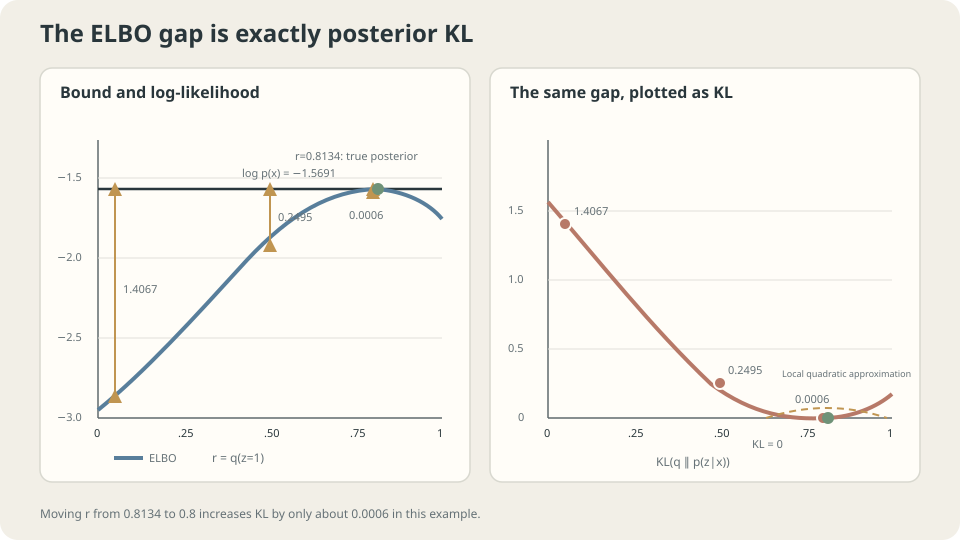

import Objectives from '../../../components/Objectives.astro';
import Ask from '../../../components/Ask.astro';
import Prereq from '../../../components/Prereq.astro';
import Question from '../../../components/Question.astro';
import Answer from '../../../components/Answer.astro';
import QuizBlock from '../../../components/QuizBlock.astro';
import Option from '../../../components/Option.astro';
import Explanation from '../../../components/Explanation.astro';
import VizPlan from '../../../components/VizPlan.astro';
import Remark from '../../../components/Remark.astro';
import Details from '../../../components/Details.astro';
import Bridge from '../../../components/Bridge.astro';
import UsedBy from '../../../components/UsedBy.astro';
import Ref from '../../../components/Ref.astro';

# What can we optimize when the required marginal is intractable?

<Objectives title="After reading, you can">
- **Derive the ELBO identity.** Explain the chosen approximate posterior and when the lower bound is exact.
- **Read EM as alternating improvement of one bound.** Identify what E-steps and M-steps change and where likelihood monotonicity comes from.
- **Explain restricted posterior approximation and posterior collapse.** Use a bimodal example to understand KL direction without treating one example as a universal VAE guarantee.
</Objectives>

<Prereq items={frontmatter.prereqs} />

## An extra, unobserved variable

<Ref to="ml-maximum-likelihood" mode="title"/> provided a clean score: log probability mass or density of the observed data. It assumed **we can evaluate $p_\theta(x)$**.

A handwritten digit records pixels, not its writer's style. If the model first chooses a style and then draws an image, evaluating that image requires averaging over possible styles rather than selecting just one. Such **unobserved variables** are latent variables.

- Points form clusters, but cluster membership is not recorded.
- An image has an underlying content code, but only pixels are observed.
- Speech has hidden phonetic states, while the recording contains a waveform.

Call the latent variable $z$. The joint model factors into a prior and a conditional observation model: sample $z$, then generate $x$. The desired score instead uses the marginal:

$$
p_\theta(x)=\int p_\theta(z)\,p_\theta(x\mid z)\,\mathrm dz .
$$

Two discrete clusters require only two terms. A latent sequence of length $T$ with $K$ states per position has $K^T$ possibilities, although special structure may permit dynamic programming. High-dimensional continuous integrals often need approximation. We seek an objective that is easier to estimate and optimize.

<Ask>
We cannot sum over every hidden explanation.<br />
Can we optimize a tractable substitute<br />
that is guaranteed not to overestimate log-likelihood?
</Ask>

<Question label="Discussion" id="Q1">
Derive a lower bound on $\log p_\theta(x)$ in two ways: Jensen's inequality, and an identity that also gives **the exact gap**. Why is the second route especially useful?

<Answer summary="Show the reasoning">
**Route 1: Jensen.** Fix observed $x$ and choose a distribution $q(z)$ that is easy to sample and evaluate. For the following importance-ratio equality, assume $q$ is positive wherever the joint contributes mass, and the expressions are well-defined:

$$
\log p_\theta(x)=\log\int q(z)\frac{p_\theta(x,z)}{q(z)}\mathrm dz
=\log\mathbb E_{q}\!\left[\frac{p_\theta(x,z)}{q(z)}\right]
\;\ge\;\mathbb E_{q}\!\left[\log\frac{p_\theta(x,z)}{q(z)}\right].
$$

Logarithm is concave, so Jensen gives $\log\mathbb E\ge\mathbb E\log$. The right side is the **evidence lower bound**, or ELBO:

$$
\mathcal F(q,\theta)=\mathbb E_{q(z)}\big[\log p_\theta(x,z)-\log q(z)\big].
$$

The expectation need not have a closed form. If the joint and $q$ are evaluable, samples from $q$ can estimate it without directly calculating the marginal likelihood.

**This route gives an inequality, but not its gap.** A small, controlled gap would make the bound informative about likelihood. A large parameter-dependent gap can distort the optimization objective.

**Route 2: calculate the difference.** Substitute the factorization of the joint into marginal likelihood times posterior:

$$
\mathcal F(q,\theta)=\mathbb E_q\!\left[\log\frac{p_\theta(x)\,p_\theta(z\mid x)}{q(z)}\right]
=\log p_\theta(x)-\mathbb E_q\!\left[\log\frac{q(z)}{p_\theta(z\mid x)}\right],
$$

Equivalently,

$$
\boxed{\;\log p_\theta(x)=\mathcal F(q,\theta)+\mathrm{KL}\big(q(z)\,\big\Vert\,p_\theta(z\mid x)\big).\;}
$$

**This is an identity**, giving three conclusions:

1. Nonnegative KL yields the same lower bound as Jensen.
2. The gap is precisely the KL from the chosen $q$ to the **true posterior**.
3. The bound is exact when $q$ equals that posterior, up to null sets, assuming the relevant terms are defined.

The third conclusion becomes an algorithm below.
</Answer>
</Question>

## The gap really is KL

Treat the identity as a numerical claim we can check.

Use a two-component one-dimensional Gaussian mixture with $p(z=1)=0.7$, means $-1.0$ and $1.5$, and common standard deviation $1$. Its marginal is a sum of two terms, so both log-likelihood and bound are exactly computable.

At $x=0.5$, the true posterior probability is $0.8134$ and log-likelihood is $-1.5691$. Let $q(z=1)=r$ and vary $r$:

```
  r = 0.0500   ELBO = -2.9758   gap = 1.4067   posterior KL = 1.4067
  r = 0.2000   ELBO = -2.4530   gap = 0.8840   posterior KL = 0.8840
  r = 0.5000   ELBO = -1.8186   gap = 0.2495   posterior KL = 0.2495
  r = 0.8134   ELBO = -1.5691   gap = 0.0000   posterior KL = 0.0000
  r = 0.8000   ELBO = -1.5697   gap = 0.0006   posterior KL = 0.0006
  r = 0.9500   ELBO = -1.6507   gap = 0.0816   posterior KL = 0.0816
```

Repeat at three observations and two choices of $r$; the gap and posterior KL still agree to the displayed precision:

```
  x = -2.0   r = 0.3   gap = 0.830826   KL = 0.830826
  x = -2.0   r = 0.6   gap = 2.201990   KL = 2.201990
  x =  0.0   r = 0.3   gap = 0.132907   KL = 0.132907
  x =  0.0   r = 0.6   gap = 0.004070   KL = 0.004070
  x = +2.0   r = 0.3   gap = 3.050125   KL = 3.050125
  x = +2.0   r = 0.6   gap = 1.421288   KL = 1.421288
```

> **The bound's error has an exact identity: KL from the approximate posterior to the true posterior.**

At $r=0.8$, the gap is only about $0.0006$. In this smooth, interior Bernoulli example, the KL expansion starts at second order, so a small parameter deviation costs $O(\delta^2)$.

Nearby-looking parameters do not universally imply small KL. Support and tail mismatch can matter greatly. At $r=0.05$, the gap is already about $1.41$.



**Figure:** Posterior KL exactly separates ELBO from log-likelihood. In a smooth local neighborhood of the optimum, the gap can grow quadratically with parameter error.

## EM: alternating improvements to one bound

The identity holds for any admissible $q$. Regard the bound as an objective in two variables, $q$ and $\theta$, and optimize them alternately.

- **E-step:** hold $\theta$ fixed and maximize the bound over unrestricted $q$. This minimizes posterior KL, giving $q=p_\theta(z\mid x)$ and making **ELBO equal log-likelihood**.
- **M-step:** hold $q$ fixed and maximize expected complete-data log-likelihood over $\theta$. In this Gaussian mixture, weighted estimates solve the update; other models may require numerical optimization.

Sample $n=500$ observations and start deliberately poorly, with means $(-0.2,0.2)$ and equal mixing weights:

```
  init     ELBO = -1119.412                         log-lik = -1094.282
  iter 1   after E: -1094.282 (= current log-lik)   after M: -998.819   mu = -0.113, +0.966
  iter 2   after E:  -978.036 (= current log-lik)   after M: -949.100   mu = -0.271, +1.268
  iter 3   after E:  -923.753 (= current log-lik)   after M: -906.253   mu = -0.594, +1.475
  iter 4   after E:  -898.532 (= current log-lik)   after M: -894.940   mu = -0.762, +1.517
  iter 5   after E:  -893.098 (= current log-lik)   after M: -891.803   mu = -0.854, +1.500
  iter 6   after E:  -890.823 (= current log-lik)   after M: -890.030   mu = -0.919, +1.475
  true means = -1.000, +1.500
```

Three observations follow.

**First, every exact E-step makes the bound equal the current log-likelihood.** It sets posterior KL to zero.

**Second, ELBO never decreases** across these substeps: both improve the same objective.

**Third, log-likelihood never decreases.** The E-step makes the old bound tight; the M-step raises that bound; the new likelihood cannot be below its new bound. This is an inequality argument, not a coincidence of the numerical example.

> **The E-step makes the bound touch the current likelihood; the M-step raises that bound, forcing the new likelihood at least as high.**

Monotonicity does not guarantee a global optimum, nor decreasing distance to the true parameters each round. The objective is sample likelihood, and EM can depend on initialization or approach local solutions.

For dataset log-likelihood $\ell$ and bound $\mathcal F$, an exact E-step followed by any M-step that does not decrease the same bound gives

$$
\ell(\theta^{(k+1)})\ge\mathcal F(q^{(k)},\theta^{(k+1)})
\ge\mathcal F(q^{(k)},\theta^{(k)})=\ell(\theta^{(k)}).
$$

<Details label="Details" summary="Why can an M-step have a closed form when direct likelihood optimization does not?">
Directly maximizing a log of a mixture sum couples components through the denominator created by differentiation.

The M-step instead maximizes an expectation of the **log joint**, with fixed responsibilities $q$. The logarithm is inside the weighted sum. For this Gaussian mixture, the component updates become weighted estimates:

$$
\mu_k\leftarrow\frac{\sum_i q_i(k)\,x_i}{\sum_i q_i(k)},\qquad
\pi_k\leftarrow\frac1n\sum_i q_i(k).
$$

These are averages weighted by posterior responsibilities. They produce the M-step updates above under the stated fixed-variance setup.

After the exact E-step the gap is zero. Changing $\theta$ in the M-step can reopen it. Restricted variational inference need not eliminate the gap at all: we know its identity even when we cannot compute its value.
</Details>

## When the posterior is intractable too

Exact EM requires a feasible E-step. A small discrete latent variable permits direct posterior calculation. A continuous latent vector with a neural decoder generally has no tractable closed-form posterior, although special cases exist.

Restrict $q$ to a tractable parameterized family. An inference network $q_\phi(z\mid x)$ can predict its parameters from $x$, sharing computation across examples instead of separately optimizing every posterior. This is **amortized inference**. A VAE [2] jointly trains $\theta$ and $\phi$:

$$
\begin{aligned}
\mathcal F(\phi,\theta)
&=\mathbb E_{q_\phi(z\mid x)}[\log p_\theta(x\mid z)]\\
&\quad-\mathrm{KL}(q_\phi(z\mid x)\Vert p_\theta(z)).
\end{aligned}
$$

This simply regroups the original ELBO into an expected reconstruction log-likelihood and a posterior-to-prior KL penalty.

The first term rewards useful latent information for explaining $x$; the second penalizes deviation from the prior. If the decoder models the data without using $z$, an inference distribution equal to the prior makes the KL zero. This is **posterior collapse**: a good-looking objective can coexist with an uninformative latent variable.

A precisely computable analogy uses two increasingly similar mixture components. As they merge, observing $x$ reveals less about the component label. Under the model's own true posterior, the average posterior-to-prior KL equals mutual information:

```
  |μ₁-μ₀| = 4.00    E_x[KL(p(z|x) ‖ p(z))] = 0.556150 nats
  |μ₁-μ₀| = 2.00                             0.291858
  |μ₁-μ₀| = 1.00                             0.094910
  |μ₁-μ₀| = 0.50                             0.025576
  |μ₁-μ₀| = 0.20                             0.004182
  |μ₁-μ₀| = 0.05                             0.000262
  |μ₁-μ₀| = 0.00                             0.000000
```

Near zero separation, this example's information shrinks approximately quadratically. It does not describe VAE training dynamics or prove a collapse feedback loop. Inspect KL, reconstruction, and actual latent use before considering KL annealing, free bits, or decoder changes.

<Remark label="Supplement" summary="Average VAE KL contains more than mutual information">
Define the joint $q(x,z)=p_{\mathrm{data}}(x)q_\phi(z\mid x)$ and aggregate posterior $q(z)$. Under suitable integrability conditions,

$$
\mathbb E_x\mathrm{KL}(q_\phi(z\mid x)\Vert p_\theta(z))
=I_q(X;Z)+\mathrm{KL}(q(z)\Vert p_\theta(z)).
$$

The first term measures information about $x$ carried by $z$; the second measures aggregate-posterior mismatch with the prior. The average KL equals mutual information only when the latter term vanishes.
</Remark>

<Remark label="Supplement" summary="A restricted posterior approximation may cover only one mode">
The ELBO identity fixes the direction $\mathrm{KL}(q\Vert p)$, with expectation under the sampleable $q$. A restricted family may avoid low-density regions of $p$ by omitting some modes [3].

Approximate a symmetric mixture of two Gaussians centered at $-2$ and $2$, each with standard deviation $0.5$, by a single Gaussian:

```
  minimize KL(q || p):  mu = +1.9998   sigma = 0.5004   value 0.6931
  minimize KL(p || q):  mu = -0.0000   sigma = 2.0616   value 0.7236
```

The first numerical solution follows one mode at a cost near $\log2$. The second matches the full mean and variance but places more mass between modes. The mixture density is positive everywhere: the gap is low-density, not zero-density.

The two directions weigh errors differently. Mass placed by $q$ where $p$ is tiny is costly for $\mathrm{KL}(q\Vert p)$; mass of $p$ poorly covered by $q$ is costly for the reverse direction. These tendencies depend on the distributions and family, rather than being universal single-mode guarantees. See <Ref to="math-kl" mode="title"/>.

This example concerns the **approximate posterior**. It does not prove that the generated data distribution necessarily underestimates spread; the decoder, variational family, data, and optimization also matter.
</Remark>

## Move $q$ and watch the bound and KL gap

<iframe loading="lazy" src="/personal_website/notes/research_areas/machine-learning-foundations/l5-probabilistic-modeling/l5-1-2.en.html" class="demo-frame" title="Interactive demo: approximate posterior, ELBO, and the KL gap" style="height: 872px; width: 100%; border: none;"></iframe>

**Interactive demo:** Advance one substep at a time. The exact E-step closes the gap; the M-step raises the now-tight bound.

## When is this approach informative?

Check three requirements.

First, **the joint must be evaluable**. The method starts with a tractable joint and an intractable marginal. An unavailable joint log-density leaves the standard ELBO without its required ingredients.

Second, **the inference family must be adequate**. A restrictive family can leave a substantial, parameter-dependent gap. That gap is often unavailable numerically because exact likelihood is unavailable. Family approximation, amortization, and incomplete optimization can all limit inference quality.

Third, **a larger ELBO does not by itself rank likelihoods**. Improvement can come from better inference, a better generative model, or both. Different models may have different gaps, even when evaluated on the same held-out data.

> **ELBO is the quantity we can estimate; log-likelihood is the quantity we want; posterior KL is their often-unavailable difference.**

## Check your understanding

<QuizBlock id="ml-l5-1-a">
Why does changing $r$ from approximately $0.8134$ to $0.8$ cost only about $0.0006$ in ELBO?
<Option>The choice of approximate posterior never matters much.</Option>
<Option correct>In this smooth interior Bernoulli example, the KL first-order term vanishes and the local expansion begins quadratically. This does not apply to arbitrary posterior shapes or large deviations.</Option>
<Option>Only Gaussian mixtures can have locally quadratic KL.</Option>
<Explanation>
Moving farther away to $r=0.5$ already gives gap $0.2495$. A local quadratic argument needs suitable smoothness and a local neighborhood; a stationary first derivative alone does not establish quadratic scaling.
</Explanation>
</QuizBlock>

<QuizBlock id="ml-l5-1-b">
Why does every exact E-step make ELBO equal the current log-likelihood?
<Option>The sample size is large enough for an asymptotic equality.</Option>
<Option correct>The E-step sets $q$ to the true posterior, making the posterior KL in the identity zero. This holds even for a single observation.</Option>
<Option>Gaussian-mixture ELBOs never have a gap, regardless of $q$.</Option>
<Explanation>
The equality follows from the exact posterior choice. The Gaussian mixture matters because its posterior is tractable here, not because all its approximate posteriors are exact.
</Explanation>
</QuizBlock>

<QuizBlock id="ml-l5-1-c">
Two VAEs have ELBOs $-95.2$ and $-97.8$. Can we conclude that the first has higher log-likelihood?
<Option>Yes: the higher lower bound always identifies the higher likelihood.</Option>
<Option correct>No. Their posterior-KL gaps may differ. Additional likelihood estimation or gap control is needed to rank likelihoods.</Option>
<Option>The only issue is whether these were training rather than test scores.</Option>
<Explanation>
Even on identical held-out data with identical inference architecture, gaps need not agree. A single model's bound can improve because inference improves. Exact EM obtains likelihood monotonicity through a tight old bound plus an improving M-step, a stronger condition than an arbitrary increase in ELBO.
</Explanation>
</QuizBlock>

<QuizBlock id="ml-l5-1-d">
Which statement is **incorrect**?
<Option>With fixed posterior weights, the expected complete-data log-likelihood can yield closed-form M-steps; the bound's gap is posterior KL.</Option>
<Option>In the displayed bimodal example, a restricted Gaussian minimizing KL from itself to the target follows one mode.</Option>
<Option correct>Posterior collapse must sharply worsen ELBO, so monitoring ELBO alone always detects it.</Option>
<Explanation>
A powerful decoder may explain data without using $z$. Inspect latent use and KL separately. Average posterior-to-prior KL also includes aggregate-posterior mismatch, so it is not automatically mutual information.
</Explanation>
</QuizBlock>

<UsedBy slug={frontmatter.slug} />

<Bridge to="ml-autoregressive">
ELBO addresses intractable marginalization over latent variables. Could another model design make likelihood directly evaluable? Split $x$ into ordered coordinates and apply the probability chain rule:

$$
p(x)=p(x_1)\,p(x_2\mid x_1)\cdots p(x_L\mid x_{1:L-1}),
$$

**The factorization is exact.** If each conditional probability or density is tractable, log-likelihood is a sum of ordinary prediction objectives, using the tools from previous units.

The model must choose an order, and ordinary generation samples sequentially. Next we examine autoregressive modeling and the consequences of ordering and dependency structure.
</Bridge>

## References

1. Jordan, M., Ghahramani, Z., Jaakkola, T. & Saul, L. [*An Introduction to Variational Methods for Graphical Models.*](https://link.springer.com/article/10.1023/A:1007665907178) Machine Learning 37, 1999.
2. Kingma, D. & Welling, M. [*Auto-Encoding Variational Bayes.*](https://arxiv.org/abs/1312.6114) ICLR 2014.
3. Blei, D., Kucukelbir, A. & McAuliffe, J. [*Variational Inference: A Review for Statisticians.*](https://arxiv.org/abs/1601.00670) JASA 112, 2017.
