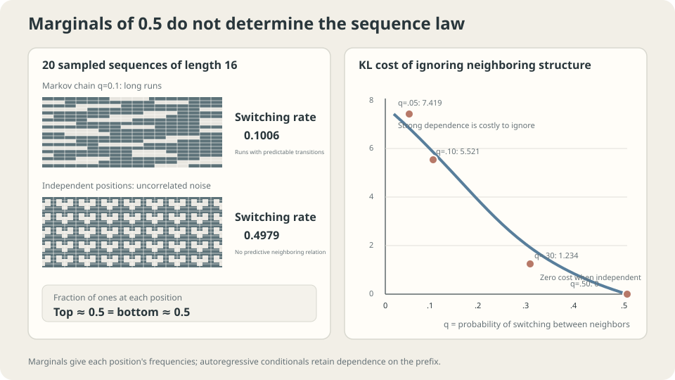

import Objectives from '../../../components/Objectives.astro';
import Ask from '../../../components/Ask.astro';
import Prereq from '../../../components/Prereq.astro';
import Question from '../../../components/Question.astro';
import Answer from '../../../components/Answer.astro';
import QuizBlock from '../../../components/QuizBlock.astro';
import Option from '../../../components/Option.astro';
import Explanation from '../../../components/Explanation.astro';
import VizPlan from '../../../components/VizPlan.astro';
import Remark from '../../../components/Remark.astro';
import Details from '../../../components/Details.astro';
import Bridge from '../../../components/Bridge.astro';
import UsedBy from '../../../components/UsedBy.astro';
import Ref from '../../../components/Ref.astro';

# Can a high-dimensional probability become a sequence of one-dimensional probabilities?

<Objectives title="After reading, you can">
- **Explain why autoregressive factorization is exact and what it simplifies.** Compare global and conditional normalization costs.
- **Measure the cost of ignoring dependencies in a binary Markov chain.** Distinguish independent positions, conditional independence within blocks, and exact block-joint sampling.
- **Identify when ordering matters.** Compare two orders for the same joint distribution within a restricted model family.
</Objectives>

<Prereq items={frontmatter.prereqs} />

## An alternative to integrating out latent variables

The previous note addressed an intractable latent integral through ELBO. Consider another model design: writing a message one character at a time. Each step asks, “Given what is already written, what can come next?”

The probability **chain rule** formalizes this idea. Choose an order for $x=(x_1,\dots,x_L)$:

$$
p(x_1,\dots,x_L)=p(x_1)\,p(x_2\mid x_1)\,p(x_3\mid x_{1:2})\cdots p(x_L\mid x_{1:L-1}).
$$

**The factorization is an identity, not an approximation.** Repeatedly apply the definition of conditional probability on positive-probability prefixes:

$$
\log p(x)=\sum_{l=1}^{L}\log p(x_l\mid x_{1:l-1}),
$$

A high-dimensional log probability becomes a sum of $L$ conditional log probabilities. Each term is a prediction problem, so previous units' learning tools apply.

The conditionals still need to be modeled. Neural language models [1] predict the next word; PixelRNN [2] applies the idea to pixels.

<Ask>
The chain rule introduces no approximation.<br />
How does it make a difficult model tractable,<br />
and where do we pay for the simplification?
</Ask>

<Question label="Discussion" id="Q1">
What makes a direct probability model difficult? If a network scores complete inputs, which step prevents those scores from immediately becoming probabilities? Compare its cost with autoregressive normalization.

<Answer summary="Show the reasoning">
**Normalization is the obstacle.** A network can easily produce a real score $s_\theta(x)$. To turn exponentiated scores into probabilities, normalize:

$$
p_\theta(x)=\frac{e^{s_\theta(x)}}{Z_\theta},\qquad Z_\theta=\sum_{x'} e^{s_\theta(x')}.
$$

The partition function sums over every possible input. With $L$ coordinates and $K$ values each, that is $K^L$ configurations: already $65536$ for $L=16,K=2$. It also depends on $\theta$, so training must account for its changing value or gradient. Exact enumeration is generally infeasible at scale, though special structure and approximation methods can help.

**Factorization replaces global normalization with local normalization.** Each conditional concerns one coordinate with $K$ choices:

$$
p_\theta(x_l\mid x_{1:l-1})=\frac{e^{s_\theta(x_l\mid x_{1:l-1})}}{\sum_{k=1}^{K}e^{s_\theta(k\mid x_{1:l-1})}}.
$$

This is softmax. For evaluating an observed sequence, normalization uses $L$ sums of $K$ terms instead of a sum of $K^L$ terms. Computing context-dependent logits has its own cost; total model cost is not simply $LK$.

The product is automatically normalized: sum over the last coordinate first, then work backward. If every conditional is evaluable exactly, the model's joint likelihood is too, without an ELBO.

**Three costs remain.**

1. **Each conditional may need the entire prefix.** Truncating context can discard dependencies; variable-length architectures must otherwise process that context.
2. **Ordinary sampling has $L$ sequential decisions.** A later token depends on earlier samples. Teacher-forced training can evaluate known prefixes in parallel when the architecture permits it.
3. **An order must be chosen.** Every order admits an exact chain rule, but a restricted learned model may handle some orders better.
</Answer>
</Question>

## Removing conditions removes structure

Measure the cost of discarding dependence.

Generate length-$16$ binary sequences from a symmetric Markov chain. The first bit is fair; each subsequent bit flips with probability $q$. Small $q$ produces long runs. See <Ref to="math-markov-chain" mode="title"/>.

Fit a **positionwise-independent** model. Every marginal is fair, so its optimal probabilities are all $1/2$. The resulting KL is

$$
\begin{aligned}
\mathrm{KL}(p_{\mathrm{true}}\Vert p_{\mathrm{ind}})
&=(L-1)(\ln2-H(q)),\\
H(q)&=-q\ln q-(1-q)\ln(1-q).
\end{aligned}
$$

For $L=16$:

```
  q = 0.05   KL = 7.419 nats
  q = 0.10   KL = 5.521 nats
  q = 0.30   KL = 1.234 nats
  q = 0.50   KL = 0.000 nats
```

The final row is a control: at $q=0.5$, neighboring bits really are independent, and KL is zero. The mismatch in the other rows measures discarded dependency.

At $q=0.05$, the cost is $7.419$ nats, or approximately $0.464$ nats per bit position. Stronger dependence makes the independence assumption more expensive.

Samples show the difference directly:

```
  true-chain samples:         adjacent switching rate 0.1006  (population 0.10)
  independent-model samples:  adjacent switching rate 0.4979  (population 0.50)
```

**Identical marginals, very different samples.** Both have equal zero/one proportions at each position, but one produces runs and the other resembles uncorrelated noise.

> **Coordinatewise independence preserves the marginals while discarding relationships between coordinates.**



**Figure:** The sequences differ in adjacent dependence, not individual-bit marginals. Stronger dependence produces a larger KL penalty for the independent model.

## Can we generate several positions at once?

Generating a block of $B$ positions does not inherently require independence. An exact draw from the conditional **block joint** can preserve the target distribution. Here we analyze a specific approximation: **every position sees the existing prefix but not other new positions within its block**.

For this symmetric chain, a position $j$ steps after the prefix's last bit differs from that bit with probability

$$
q_j=\frac{1-(1-2q)^j}{2}.
$$

The first new position uses $q_1=q$. Later positions have conditional entropy $H(q_j)$ rather than $H(q)$ because intermediate values are hidden. When $B$ divides $L$, the best KL under this approximation is

$$
\mathrm{KL}(p\Vert p_B)
=(B-1)(\log2-H(q))
+\left(\frac LB-1\right)\sum_{j=1}^B\bigl(H(q_j)-H(q)\bigr).
$$

The first term accounts for the first block without a prefix; the second accounts for the remaining blocks. For $L=16,q=0.1$:

| Block size $B$ | Generation rounds | KL (nats) |
| --- | --- | --- |
| 1 | 16 | 0.0000 |
| 2 | 8 | 1.3922 |
| 4 | 4 | 3.0798 |
| 8 | 2 | 4.5815 |
| 16 | 1 | 5.5210 |

Omitting within-block conditioning changes this joint distribution. These values are not lower bounds for all parallel decoding methods, and halving rounds need not halve wall-clock time.

<Remark label="Supplement" summary="The opposite approximation: exact within blocks, independent between blocks">
Another construction models each block exactly but makes **different blocks independent**:

```
  B =  1   16 independent blocks   15 cut links   KL = 5.521 nats
  B =  2    8 independent blocks    7 cut links   KL = 2.576
  B =  4    4 independent blocks    3 cut links   KL = 1.104
  B =  8    2 independent blocks    1 cut link    KL = 0.368
  B = 16    1 block                0 cut links   KL = 0.000
```

Here larger blocks retain more dependencies. Representing and sampling a block joint is a separate problem. A full binary table contains $2^B$ entries, but a structured factorization may avoid enumerating them.

The two block constructions omit different dependencies, so their block sizes cannot be compared as if they meant the same approximation. Ordinary autoregression retains prefix conditioning and normalizes only $K$ options per position, while making sequential sampling decisions.
</Remark>

<Remark label="Supplement" summary="Check dependencies in real data separately">
The equal cost per cut link above comes from this chain's constant switching rate and the between-block-independence construction. The prefix-conditioned, within-block-independent model instead needs its conditional-entropy calculation.

Real data can contain both strong local and important long-range relations. A distant name may determine a later pronoun. Distance alone does not imply irrelevance.

Compare held-out NLL after reducing context from $k$ to $k/2$, and separately test important long-range tasks. Measure the consequence rather than guessing from distance.
</Remark>

## Does order matter?

Every order admits an exact chain-rule factorization. With unrestricted, exactly known conditionals, each reproduces the same joint distribution.

**Restricted model families change the answer.** If a model sees only the previous variable or previous $k$ variables, the order determines which dependencies it can access.

Take three bits: independent fair $x_1,x_2$, and $x_3$ equal to $x_1$ with probability $0.9$. Restrict the model to a first-order chain in its chosen order:

```
  order x1 -> x2 -> x3:  KL(true || model) = 0.368064 nats
  order x1 -> x3 -> x2:  KL(true || model) = 0.000000 nats
  order x2 -> x1 -> x3:  KL(true || model) = 0.000000 nats

  reference, fully independent model: KL = 0.368064 nats
```

Placing unrelated $x_2$ between $x_1$ and $x_3$ hides the only dependence from the first-order model. Its best conditionals reduce to marginals. Moving the related variables together lets the same family represent the joint exactly.

> **Ordering does not change the true joint, but can change which dependencies a restricted model can express.**

Text has a conventional order. Images need a scan order, which can place spatial neighbors far apart in the sequence. Tabular columns may have no natural order at all. A full-context model can reduce, but does not automatically eliminate, the practical impact of ordering.

<Details label="Details" summary="Why is order-agnostic modeling more demanding?">
One can average models over orders or train a shared model across random observed subsets.

This is feasible, but creates many conditioning contexts. Arbitrary subsets number $2^L$, compared with the $L$ prefixes of one fixed order. Parameter sharing can generalize across them, so the count alone is not an exponential training-cost lower bound.

A fixed order concentrates training on its prefix tasks; random-order training broadens the tasks the model must handle. A full-prefix architecture avoids a hard short-context restriction, but finite capacity and optimization can still make some orders easier. Match the choice to data structure and test it.
</Details>

## What happens to small errors over $L$ steps?

Sampling raises another question: how do conditional errors relate to full-sequence mismatch?

Keep the true switching probability at $0.10$ and change the model's value:

```
  model 0.105   one-step KL 0.000135   sequence KL (L=16) 0.0020   relative parameter error   5%
  model 0.110   one-step KL 0.000525   sequence KL        0.0079   relative parameter error  10%
  model 0.120   one-step KL 0.001993   sequence KL        0.0299   relative parameter error  20%
  model 0.150   one-step KL 0.010896   sequence KL        0.1634   relative parameter error  50%
  model 0.200   one-step KL 0.036690   sequence KL        0.5504   relative parameter error 100%
```

The one-step KL is multiplied by $L-1$. Fix the model at $0.12$ and increase sequence length:

```
  L =    8   sequence KL = 0.0140 nats   per position 0.001744
  L =   16   sequence KL = 0.0299 nats   per position 0.001869
  L =   64   sequence KL = 0.1256 nats   per position 0.001962
  L =  256   sequence KL = 0.5083 nats   per position 0.001986
  L = 1024   sequence KL = 2.0393 nats   per position 0.001991
```

Per-position mismatch approaches a constant while total KL grows linearly in this example.

> **Sequence KL adds expected conditional KLs. Linear growth of KL does not imply linear growth of task error.**

These values already compare **complete sequence distributions**, including their generative behavior. In general, the KL chain rule gives

$$
\mathrm{KL}(p\Vert q)=\sum_l\mathbb E_{X_{<l}\sim p}
\mathrm{KL}\bigl(p(X_l\mid X_{<l})\Vert q(X_l\mid X_{<l})\bigr).
$$

Teacher-forced training uses real prefixes; generation uses model-sampled prefixes. Finite models can behave differently across these contexts, a concern discussed as **exposure bias** [3]. It may affect task performance, but is not an extra error term to add without derivation to an already complete joint KL.

<Remark label="Caution" summary="Sequence mismatch and practical generation behavior">
Keep several related observations distinct:

- **Long outputs can drift.** Model-generated prefixes may move into contexts where predictions are less reliable.
- **Per-position and whole-sequence scores use different scales.** About $0.002$ nats per step becomes about $2$ nats over 1024 positions here, without directly determining perceived quality.
- **Temperature changes the sampling distribution.** Lower temperature favors high-probability choices but can reduce diversity or increase repetition. Evaluate the resulting quality and diversity together.

Incoherence can also reflect context limits or insufficient data. Comparing real-prefix and generated-prefix performance provides evidence, but does not uniquely identify the cause.
</Remark>

## Block size, ordering, and sequence length

<iframe loading="lazy" src="/personal_website/notes/research_areas/machine-learning-foundations/l5-probabilistic-modeling/l5-2-2.en.html" class="demo-frame" title="Interactive demo: block size, ordering, and sequence length" style="height: 991px; width: 100%; border: none;"></iframe>

**Interactive demo:** Compare held-out NLL across orders and context lengths with finite data. The true model's finite-test NLL is a reference, not a pointwise lower bound on every other model's score on that sample.

## When is autoregression useful?

Exact model likelihood supports held-out NLL comparison and entropy coding, subject to coding overhead. The conditionals also support prediction, although arbitrary bidirectional infilling does not automatically follow from a left-to-right model.

**The main sampling cost is sequential dependence.** Standard generation makes $L$ ordered decisions; more parallel hardware alone does not make an unknown previous token available. Teacher-forced training can parallelize positions in suitable architectures because the true prefixes are already known. Specialized exact or approximate decoding methods can change practical throughput, so decision count is not a complete runtime model.

**Check the assumptions.** Choose an order compatible with useful structure and model capacity. Make each conditional distribution evaluable: softmax for discrete values, or an appropriate continuous density family. As <Ref to="ml-maximum-likelihood" mode="title"/> explains, that family is a modeling choice. Finally, validate at the sequence lengths you intend to use; short-sequence performance does not guarantee long-sequence quality.

## Check your understanding

<QuizBlock id="ml-l5-2-a">
Why can autoregression replace global normalization over $K^L$ configurations with $L$ normalizations over $K$ choices?
<Option>The factorization is an approximation whose error decays exponentially.</Option>
<Option correct>Each conditional is locally normalized, and their product automatically defines a normalized joint. The chain rule itself is exact.</Option>
<Option>Only weight sharing makes likelihood computable.</Option>
<Explanation>
Different networks at every position would still yield local normalization. Shared weights affect implementation and statistical efficiency, while tractable likelihood comes from normalized conditionals. Context computation remains an additional cost.
</Explanation>
</QuizBlock>

<QuizBlock id="ml-l5-2-b">
Why can generating $B$ positions together change the distribution?
<Option>The error must grow exponentially with the number of calls.</Option>
<Option correct>Making the new positions conditionally independent given the old prefix discards within-block dependence. Exact conditional block-joint sampling need not introduce that approximation.</Option>
<Option>The effect occurs only when sequence length is a power of two.</Option>
<Explanation>
The approximation is the independence assumption, not parallelism itself. Different block models retain different information, so they need different KL calculations.
</Explanation>
</QuizBlock>

<QuizBlock id="ml-l5-2-c">
Why does the order $x_1\to x_2\to x_3$ have the same optimal KL as a fully independent model in the example?
<Option>First-order models are always independent, so order never matters.</Option>
<Option correct>The two permitted adjacent dependencies both involve unrelated $x_2$. Their optimal conditionals reduce to marginals, while the actual $x_1$–$x_3$ relation is hidden. Reordering makes the same family exact.</Option>
<Option>The equality disappears only if the flip probability is made smaller.</Option>
<Explanation>
A smaller flip probability strengthens the missed relation and increases its cost. At flip probability $0.5$, the relation disappears and both orders become exact. The contrast isolates an ordering effect within a restricted family.
</Explanation>
</QuizBlock>

<QuizBlock id="ml-l5-2-d">
Which statement is **incorrect**?
<Option>In the constant-switching example, equal conditional KLs make sequence KL grow linearly with $L-1$.</Option>
<Option>Suitable autoregressive architectures evaluate teacher-forced positions in parallel, while ordinary ancestral generation makes sequential decisions.</Option>
<Option correct>Because the chain rule holds for every order, enough data guarantee that every restricted model trained in every order converges to the same distribution.</Option>
<Explanation>
The chain rule guarantees the existence of exact conditionals, not their membership in a chosen restricted family. The first-order example cannot express the joint in the unfavorable order, regardless of dataset size. Optimization and statistical assumptions also govern convergence.
</Explanation>
</QuizBlock>

<UsedBy slug={frontmatter.slug} />

<Bridge to="ml-evaluating-generative-models">
We can evaluate likelihood and understand how conditionals shape a joint distribution. But generation also needs useful, diverse samples. **Does better held-out NLL guarantee better samples?** Next we separate these questions with counterexamples and choose complementary evaluations.
</Bridge>

## References

1. Bengio, Y., Ducharme, R., Vincent, P. & Jauvin, C. [*A Neural Probabilistic Language Model.*](https://jmlr.org/papers/volume3/bengio03a/bengio03a.pdf) JMLR 3, 2003.
2. van den Oord, A. et al. [*Pixel Recurrent Neural Networks.*](https://arxiv.org/abs/1601.06759) ICML 2016.
3. Ranzato, M., Chopra, S., Auli, M. & Zaremba, W. [*Sequence Level Training with Recurrent Neural Networks.*](https://arxiv.org/abs/1511.06732) ICLR 2016.
