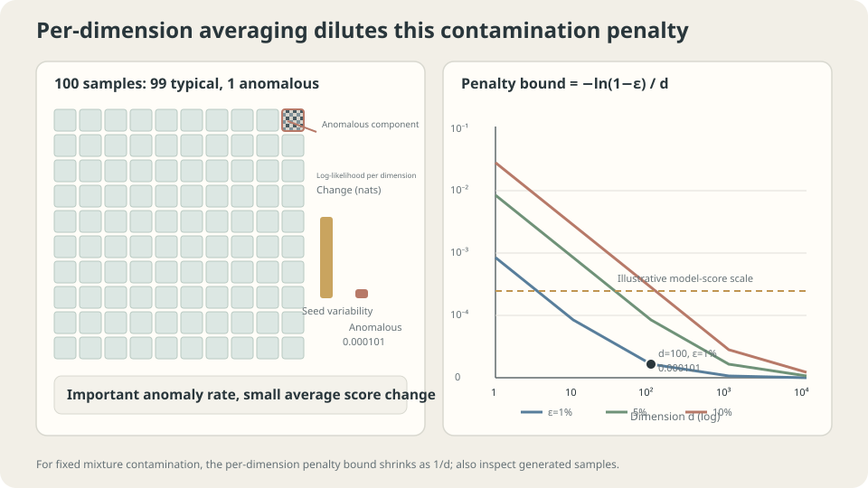

import Objectives from '../../../components/Objectives.astro';
import Ask from '../../../components/Ask.astro';
import Prereq from '../../../components/Prereq.astro';
import Question from '../../../components/Question.astro';
import Answer from '../../../components/Answer.astro';
import QuizBlock from '../../../components/QuizBlock.astro';
import Option from '../../../components/Option.astro';
import Explanation from '../../../components/Explanation.astro';
import VizPlan from '../../../components/VizPlan.astro';
import Remark from '../../../components/Remark.astro';
import Details from '../../../components/Details.astro';
import Bridge from '../../../components/Bridge.astro';
import UsedBy from '../../../components/UsedBy.astro';
import Ref from '../../../components/Ref.astro';

# Which number tells us whether a generative model is good?

<Objectives title="After reading, you can">
- **Separate fidelity, coverage, and training-data memorization.** Use counterexamples to show why success on one does not guarantee success on the others.
- **Derive a KL bound for contamination by an $\varepsilon$ fraction of anomalous samples.** Explain what per-dimension NLL can obscure without dismissing likelihood's statistical value.
- **Combine held-out evaluation, sample inspection, and nearest-neighbor comparisons.** Report estimation uncertainty, feature space, and sampling settings, and distinguish diagnostic evidence from proof.
</Objectives>

<Prereq items={frontmatter.prereqs} />

## Does a better score imply better samples?

<Ref to="ml-maximum-likelihood" mode="title"/>, <Ref to="ml-latent-variables-elbo" mode="title"/>, and <Ref to="ml-autoregressive" mode="title"/> developed likelihood or a lower bound as a model score.

Under suitable conditions, population cross-entropy equals true entropy plus true-to-model KL. Likelihood therefore has a precise statistical meaning. But we estimate it from finite data, and an application may care about more than that expectation.

A report might show an excellent average score while one image in a hundred is visibly abnormal. Another model might generate attractive images but only one kind. **Which kind of “good” matters?** Counterexamples in Theis, van den Oord, and Bethge [1] show why one evaluation does not automatically imply another.

<Ask>
Per-dimension log-likelihood changes by only about $0.007\%$,<br />
yet one percent of generated samples come from a noise component.<br />
Are these observations answering the same question?
</Ask>

<Question label="Discussion" id="Q1">
Before choosing a metric, ask: **what must the generator do?** Name different requirements and construct models that satisfy one while failing another.

<Answer summary="Show the reasoning">
Consider three checks.

1. **Fidelity:** generated samples should resemble valid data under the application's notion of similarity.
2. **Coverage:** the generator should represent the relevant diversity of the data distribution, rather than just one mode.
3. **Training-data memorization:** check whether the model mainly replays training examples. Novelty often matters for continuous images, but genuine new draws from a discrete distribution can repeat existing values; duplication alone is not universally forbidden.

**Three examples expose distinct failures.**

- **Poor fidelity:** mix a correct model with a small anomalous component. The original component still covers the target, but some generated samples are unacceptable. New noise samples are novel without being useful.
- **Poor coverage:** generate from only one plausible mode. Samples may look realistic and differ from training examples, while omitting much of the population.
- **Training replay:** store the training set and resample it. Every output is an observed real example, but matching that finite set does not establish population learning or acceptable memorization behavior.

These examples do not prove that every scalar metric is useless. They show that familiar scores need not identify the source of failure. Precision/recall evaluations [2] similarly distinguish generated-sample quality from distributional coverage.

**What should likelihood detect?** It evaluates model density at **real observations**:

- Missing a region of the target distribution can assign its observations very low density and incur large NLL.
- Adding a small anomalous component may only slightly dilute density at target observations and incur a small average NLL increase.

The next examples quantify this asymmetry. Finite data may still miss a rare target region, so detectability also depends on evaluation sampling.
</Answer>
</Question>

## A small likelihood penalty can coexist with anomalous samples

Let the target be a $d$-dimensional standard Gaussian and contaminate it with a broader Gaussian:

$$
p'=(1-\varepsilon)\,\mathcal N(0,I)+\varepsilon\,\mathcal N(0,100\,I),
$$

Set $\varepsilon=0.01$. Then $99\%$ of draws use the target, while $1\%$ use covariance one hundred times larger, or standard deviation ten times larger. With $d=100$ and twenty thousand test observations:

```
  true model       log-likelihood per dimension = -1.418756 nats/dim
  contaminated     log-likelihood per dimension = -1.418856 nats/dim
  difference = 0.000101 nats/dim, or about 0.0101 nats per full observation
  theoretical bound = -ln(0.99)/d = 0.000101 nats/dim
```

Whether this small difference can be measured depends on sample size, paired estimation, and model variability. Small does not mean undetectable. Rather, the score's scale may not match the application's tolerance for anomalous outputs.

Meanwhile, generated norms behave differently:

```
  target draws:          norm near 10  (sqrt(d))
  contaminated draws:    99% near 10, 1% near 100
```

**A one-percent anomalous component changes the magnitude of per-dimension log-likelihood by only about $0.007\%$ in this example.** Norms near $100$ are far outside the target's typical region, even though both Gaussians have full support.

The general bound follows from the pointwise inequality $p'\ge(1-\varepsilon)p$:

$$
\log p'(x)\ \ge\ \log p(x)+\log(1-\varepsilon)
\quad\Longrightarrow\quad
\frac{\mathbb E[\log p]-\mathbb E[\log p']}{d}\ \le\ \frac{-\ln(1-\varepsilon)}{d}.
$$

The expectation is under the target, so the left side is $\mathrm{KL}(p\Vert p')/d$. The example nearly reaches the bound because the contaminating component contributes negligible density near typical target observations.

> **For this mixture contamination, per-dimension NLL increases by at most $-\ln(1-\varepsilon)/d$, even though an $\varepsilon$ fraction of samples use the anomalous component.**

Dividing by dimension spreads a bounded full-observation KL over more coordinates. The full-observation bound remains $-\log(1-\varepsilon)$. This is a property of this contamination construction, not a claim that all likelihood differences vanish in high dimensions.

<Remark label="Caution" summary="Removing target mass can be much more expensive">
Adding the anomalous component retains at least $(1-\varepsilon)$ times the original density everywhere.

Removing density from a region carrying target probability is different. If model density there approaches zero, its contribution to target-averaged NLL can grow without bound. Assigning zero model probability to a positive-target-mass region can make KL infinite.

Thus small added contamination can be inexpensive in this KL direction, while a missed target region can be very costly. Sample inspection alone has the opposite blind spot: generated samples do not directly show what was never generated.
</Remark>



**Figure:** The per-dimension penalty bound for this contamination scales as $1/d$. A small score change may coexist with a visually or operationally important anomaly rate.

## Attractive samples, wrong distribution

Now use a one-dimensional bimodal target with modes near $\pm1.5$. Compare:

- **The correct model:** represents the full target distribution.
- **A single-mode model:** $\mathcal N(1.5,0.2^2)$, concentrating near one target mode.
- A training-replay model, considered in the next section.

```
                                      single mode   correct model
  mean distance to nearest train point    0.0078        0.0157
  W1(model samples, test sample)           1.6929        0.0430
  coverage: test point within 0.3          0.410         1.000
  mean test log-likelihood               -43.325        -1.700
```

**The first row is a trap.** Concentrating mass in a small, dense region makes generated samples close to training points. This one-sided proximity statistic rewards that behavior without checking omitted modes. It does not by itself establish better perceptual quality.

The other rows detect the missing mode here. Test log-likelihood falls from $-1.700$ to $-43.325$ because observations near the other mode have tiny model density.

The examples illustrate complementary strengths:

| Failure | Inspecting generated samples | Target-data likelihood |
| --- | --- | --- |
| A small anomalous component | Can expose anomalies if enough samples are inspected | Small penalty in this contamination example |
| A missing target mode | Plausible samples alone may conceal it | Large penalty here when test data include that mode |

> **Sample inspection and held-out likelihood ask different questions. Use complementary checks for the failures that matter.**

<Details label="Details" summary="Why changing sampling temperature can change perceived quality">
If normalizable, sampling from a density proportional to $p^{1/T}$ with $T<1$ raises the relative weight of high-density regions. Density is not semantic quality, so fidelity and coverage still require evaluation. For autoregressive models, applying temperature separately to token conditionals generally does not equal globally tempering the joint density.

The sampler is part of the evaluated system. Report temperature, guidance, top-$p$, and related settings so that differences in sampling are not mistaken for differences in the base model.

When practical, sweep settings and report a fidelity–coverage curve. Dominance across comparable operating points supports a stronger conclusion than one selected point; crossing curves indicate different strengths. These empirical curves remain specific to the metrics and their estimation uncertainty.
</Details>

## A third failure: replaying the training set

Even complementary quality and distribution scores may miss training-data replay. Memorization needs its own checks.

Store the training set and emit a random training example. Each output is real observed data. A narrow kernel-density model around those points can also have high training density, although it is a different continuous model from exact discrete replay. Neither observation establishes good held-out behavior.

With $n=200$ training observations:

```
                         W1(samples, train)   W1(samples, test)
  training-replay model         0.0172               0.1249
  correct model                 0.0918               0.0430
```

These distances use finite generated and data samples, so even replay need not give a sample-estimated distance of zero. Comparing its exact empirical law with the identical training empirical law would give zero. The ranking motivates held-out evaluation rather than measuring training proximity alone.

A larger training distance is not itself evidence of learning correctly. Here the known target lets us confirm that the training sample is only one population realization; matching it perfectly need not match the population.

**Held-out distribution distance alone may still be insufficient.** A generator that replays training points with slight jitter can look good under some distribution metrics. Add a comparison of nearest-training-point distances:

```
  mean distance to nearest training point
    training-replay samples    0.00000
    correct-model samples      0.01568
    real held-out data         0.01603
```

**The held-out row provides a reference.** Zero is not automatically an ideal target. Compare generated distances with those of real new observations, accounting for sampling variation and distributional differences. In discrete or duplicate-rich data, exact matches can be legitimate.

> **Unusually small nearest-training distances motivate checks for replay or mode concentration. They are diagnostic evidence, not proof by themselves.**

Training-data extraction from diffusion models [3] shows why memorization can matter beyond distribution quality. Nearest-neighbor analysis is one tool; it does not provide a complete privacy guarantee.

## Three failures, complementary measurements

<iframe loading="lazy" src="/personal_website/notes/research_areas/machine-learning-foundations/l5-probabilistic-modeling/l5-3-2.en.html" class="demo-frame" title="Interactive demo: contamination, missing modes, and training replay" style="height: 938px; width: 100%; border: none;"></iframe>

**Interactive demo:** Compare how contamination, mode concentration, and training replay affect likelihood, sample distances, and coverage. Numerical values depend on the displayed experiment settings.

## A practical evaluation procedure

Combine the lessons into a workflow.

1. **Choose complementary checks for the application.** Combine held-out distribution evaluation, sample fidelity/coverage, and training-similarity analysis. Report exact NLL when available, or explicitly identify a bound. Different model families do not necessarily provide identical evaluable quantities.
2. **Keep observation conventions consistent.** Exact likelihoods can be compared across model families in the same space; ELBOs can have different gaps. Align density units, discretization, and dequantization before ranking scores.
3. **Report sampling settings.** Temperature, guidance, and top-$p$ can alter quality and diversity. Compare matched operating points or a sweep, rather than attributing every sampling difference to the model.
4. **Report seeds and uncertainty.** Distribution scores themselves fluctuate with finite evaluation samples, in addition to training variability. Apply the principles in <Ref to="ml-seeds-and-reporting" mode="title"/>.
5. **Inspect random samples, not just showcase examples.** At a one-percent anomaly rate, twenty independent draws miss every anomaly with probability $0.99^{20}\approx82\%$. State the inspection method and sample count.

**What do these checks depend on?**

First, **held-out data must actually be held out**. Dataset overlap or contamination can undermine claims of generalization. Overlap does not make every score purely a memory score, but it changes what the evaluation can establish.

Second, **feature space matters**. FID uses Gaussian approximations to feature distributions through means and covariances, then computes their squared Gaussian Wasserstein distance. It is not the Wasserstein distance between complete raw-data distributions. Differences discarded by the feature extractor or moment summary may be invisible to it.

Third, **quality depends on the use case**. Data augmentation should be checked through downstream performance; creative tools may need prompt adherence and diversity. Specify unacceptable failures first, then select evaluations capable of detecting them.

## Check your understanding

<QuizBlock id="ml-l5-3-a">
Why does one-percent contamination change per-dimension log-likelihood by only about $0.000101$ nats at $d=100$?
<Option>One percent of anomalous samples must be unimportant for every application.</Option>
<Option correct>The pointwise bound on retained target density limits the expected per-dimension NLL increase to $-\log(1-\varepsilon)/d$. A small value need not meet the application's anomaly tolerance; the full-observation bound has no division by dimension.</Option>
<Option>Sharing a support means the broad Gaussian cannot produce anomalous samples.</Option>
<Explanation>
Shared support does not imply similar distributions or typical samples. The bound comes from the stronger inequality $p'\ge(1-\varepsilon)p$. Whether the anomaly fraction is acceptable is a task decision.
</Explanation>
</QuizBlock>

<QuizBlock id="ml-l5-3-b">
The single-mode generator is closer to its nearest training point than the correct model. What does that establish?
<Option>It must have better overall sample quality, with only a negligible diversity loss.</Option>
<Option correct>One-sided proximity can reward concentration in a small dense region. It needs a complementary coverage or distribution check; both coverage and held-out likelihood detect the missed mode in this example.</Option>
<Option>It proves only that the training set is too small.</Option>
<Explanation>
The test Wasserstein estimate rises from $0.0430$ to $1.6929$. A favorable nearest-point score does not establish a correct distribution. Ask what cheap failure could improve a metric, and pair it with a check for that failure.
</Explanation>
</QuizBlock>

<QuizBlock id="ml-l5-3-c">
Real held-out data have nearest-training distance about $0.01603$, but a generator gives $0.004$. How should we read that?
<Option>The generator is automatically closer to the true distribution.</Option>
<Option correct>It is a reason to investigate. Samples may replay training data or concentrate in dense regions. Inspect close pairs and coverage, using held-out variability as a reference.</Option>
<Option>The generator has learned a distribution more accurate than the truth.</Option>
<Explanation>
This distance has a comparison distribution, not a universal “smaller is better” direction. The value alone cannot distinguish memorization from mode concentration or other dataset effects.
</Explanation>
</QuizBlock>

<QuizBlock id="ml-l5-3-d">
Which statement is **incorrect**?
<Option>Mixture contamination satisfies a finite true-to-model KL bound, whereas zero model mass on a positive-target-mass region can yield infinite KL.</Option>
<Option>Changing temperature can alter quality and diversity, so comparing only a selected sample-quality score can favor a particular sampler setting.</Option>
<Option correct>Moving every metric to held-out data guarantees that a training-replay model will be detected.</Option>
<Explanation>
This toy's held-out distance distinguishes exact replay, but no such guarantee holds for every dataset, sample size, and metric. If memorization matters, add training-similarity and appropriate extraction checks with real held-out controls. Novelty scores alone are not complete proof either.
</Explanation>
</QuizBlock>

<UsedBy slug={frontmatter.slug} />

<Bridge>
The aim is not to find one universally best score. Ask: **what quantity does this number estimate, and does it answer our question?** Training error, held-out NLL, ELBO, and distribution distances provide different evidence with different limits.

The course leaves a working habit: define the problem, then pair each measurement with a check for its blind spots. When another course uses an unfamiliar judgment, follow the note's Used By links back to the relevant tool, then continue with a clearer understanding of what the number means.
</Bridge>

## References

1. Theis, L., van den Oord, A. & Bethge, M. [*A note on the evaluation of generative models.*](https://arxiv.org/abs/1511.01844) ICLR 2016.
2. Sajjadi, M., Bachem, O., Lucic, M., Bousquet, O. & Gelly, S. [*Assessing Generative Models via Precision and Recall.*](https://arxiv.org/abs/1806.00035) NeurIPS 2018.
3. Carlini, N. et al. [*Extracting Training Data from Diffusion Models.*](https://arxiv.org/abs/2301.13188) USENIX Security 2023.
