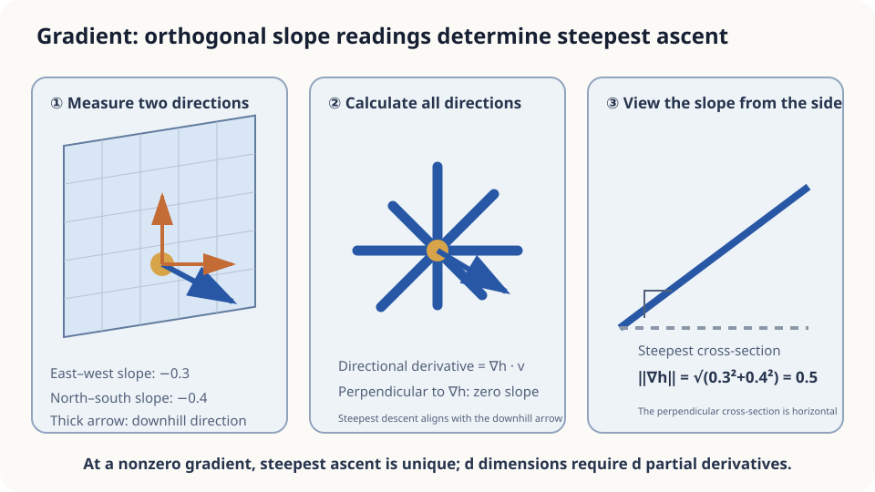

import Objectives from '../../../components/Objectives.astro';
import Prereq from '../../../components/Prereq.astro';
import Question from '../../../components/Question.astro';
import Answer from '../../../components/Answer.astro';
import QuizBlock from '../../../components/QuizBlock.astro';
import Option from '../../../components/Option.astro';
import Explanation from '../../../components/Explanation.astro';
import Details from '../../../components/Details.astro';
import Bridge from '../../../components/Bridge.astro';
import UsedBy from '../../../components/UsedBy.astro';
import Ref from '../../../components/Ref.astro';

# Descending Through Fog: Gradients and Direction

<Objectives title="After reading, you can">
- **Represent local slope with directional derivatives**, recovering all directions from coordinate derivatives under differentiability.
- **Derive steepest local descent** and recognize what a zero gradient fails to determine.
- **Identify limits of gradient descent**, including nonsmooth terrain, local optima, and excessive step sizes.
</Objectives>

<Prereq items={frontmatter.prereqs} />

## Fog hides the mountain

You stand on a mountainside in dense fog. Your phone has no signal, and you can only feel the ground's local tilt beneath your feet.

A natural strategy is to step toward the steepest descent, then check the slope again.

How can a few local readings identify the steepest of infinitely many directions?

First solve this local question. Whether it reaches the lowest valley, and how far one may step, are separate questions.

<Question label="Discussion" id="Q1">
What function describes this situation, what information do we have, and what quantity are we seeking?

<Answer summary="Show the reasoning">
The mountain is the graph of a height function $h(x,y)$, mapping ground position to elevation.

We do not know the whole function. We only observe how height changes under small movements in different directions at the current position.

We seek the direction with the most negative local slope. A gradient organizes these directional readings into one object on which we can optimize.
</Answer>
</Question>

## Think of a tilted tabletop

A tilted planar table has infinitely many directions, but its tilt has a single downhill orientation and steepness. A marble initially accelerates downhill.

Locally approximating the ground by a plane makes every directional slope depend on that same tilt. The steepest direction, a perpendicular level direction, and intermediate slopes follow a cosine relationship.

Two perpendicular slope readings determine the plane's tilt. We do not need to test every direction independently.



*Figure: the gradient points uphill; perpendicular directions have zero first-order height change.*

## Express the tilt mathematically

**Directional derivative.** At $p=(x,y)$, move distance $s$ along a unit vector $u$. Define

$$
D_u h(p)=\lim_{s\to0}\frac{h(p+su)-h(p)}{s}.
$$

The coordinate directions give the familiar partial derivatives.

**Gradient.** Assemble those derivatives into a vector:

$$
\nabla h(p)=\Big(\frac{\partial h}{\partial x}(p),\ \frac{\partial h}{\partial y}(p)\Big).
$$

Differentiability means local planar approximation, which implies

$$
D_u h(p)=\nabla h(p)\cdot u .
$$

The leading height change is $s\nabla h(p)\cdot u$. Dividing by distance gives the directional slope.

<Details label="Details" summary="Derive the directional derivative from differentiability">
Differentiability gives $h(p+v)=h(p)+g\cdot v+o(\|v\|)$. Substitute $v=su$, divide by $s$, and take the limit to obtain $D_uh=g\cdot u$. Coordinate directions show that the components of $g$ are the partial derivatives, so $g=\nabla h$.
</Details>

**Steepest direction.** Minimize $\nabla h\cdot u$ over unit vectors. Cauchy–Schwarz bounds its magnitude by $\|\nabla h\|$, with the minimum attained in the opposite direction:

$$
\min_{\|u\|=1}D_uh=-\|\nabla h\|,
\qquad u=-\frac{\nabla h}{\|\nabla h\|}\quad(\nabla h\ne0).
$$

Equivalently, $D_uh=\|\nabla h\|\cos\theta$. Perpendicular directions are level only to first order, not necessarily along a long straight movement. At zero gradient, first-order information provides no preferred direction.

## Why use a log gradient?

For positive quantities such as signal intensity or population density, relative change can matter more than absolute change.

For $f>0$, the chain rule gives

$$
\nabla\log f=\frac{\nabla f}{f}.
$$

This is absolute change divided by current value. Multiplying $f$ by a positive constant leaves its log gradient unchanged, so an unknown normalization does not affect it.

For the bell-shaped function $f(x)=\exp(-\|x-\mu\|^2/(2\sigma^2))$,

$$
\nabla\log f(x)=-\frac{x-\mu}{\sigma^2}.
$$

The vector points toward the center, grows with distance, and is stronger for a narrower bell. It is a local density-increase direction.

## Check three intuitive claims

**Must we test every direction?** No, for differentiable terrain the coordinate derivatives determine all directional slopes. At a crease such as $|x|$, there may be no gradient or single local plane, so this argument fails.

**Does local steepest descent find the lowest valley?** Not generally. A stationary point can be a minimum, maximum, or saddle. For differentiable convex functions, stationary points are global minimizers, but need not be unique; convergence still requires suitable assumptions and steps.

**Can a steeper slope justify an arbitrarily longer step?** No. The approximation is local. Rapidly changing slopes can make a large step overshoot a valley. <Ref to="math-taylor"/> quantifies this limitation.

## Try the descent

<iframe loading="lazy" src="/personal_website/notes/research_areas/mathematical-foundations/m0-calculus-toolkit/m0-0-2.en.html" class="demo-frame" title="Gradient descent with different terrain and step sizes" style="height: 880px; width: 100%; border: none;"></iframe>

This bowl-shaped example compares stable and excessive step sizes:

```python
import numpy as np
grad = lambda p: np.array([2*p[0], 4*p[1]])
def descend(eta, steps=30, p=np.array([2.0, 1.5])):
    hs = []
    for _ in range(steps):
        p = p - eta * grad(p)
        hs.append(p[0]**2 + 2*p[1]**2)
    return np.array(hs)
print(descend(0.1)[-1])  # stable: height approaches zero
print(descend(0.6)[-1])  # y multiplier is -1.4: divergence
```

## Check your understanding

<QuizBlock id="m0-0-a">
You measure local noise-level changes eastward and northward. Which direction locally reduces noise fastest?
<Option correct>Opposite the vector of the two coordinate derivatives.</Option>
<Option>Opposite only the larger coordinate derivative.</Option>
<Option>We must also independently measure west and south.</Option>
<Explanation>Under differentiability, the two derivatives determine the gradient. Choosing one axis generally misses the steepest direction.</Explanation>
</QuizBlock>

<QuizBlock id="m0-0-b">
Which setting supports the local downhill strategy?
<Option>A nondifferentiable ridge.</Option>
<Option>Unknown competing valleys with a demand for the global best.</Option>
<Option correct>Smooth terrain sloping toward its minimum, with sufficiently small steps.</Option>
<Explanation>The gradient is local information. Global and convergence claims need additional assumptions.</Explanation>
</QuizBlock>

<QuizBlock id="m0-0-c">
Which quantity is unchanged by multiplying positive $f$ by a positive constant?
<Option>$\nabla f$.</Option>
<Option>$\|\nabla f\|$.</Option>
<Option correct>$\nabla\log f$.</Option>
<Explanation>The constant cancels from relative change, while the ordinary gradient scales.</Explanation>
</QuizBlock>

<UsedBy slug={frontmatter.slug} />

<Bridge to="math-divergence">
Gradients identify local function-change directions, without determining step size or global optimality. Next we ask how a field of movement arrows changes the amount of material inside a small region.
</Bridge>

## References

1. Strang, G. [*Calculus.*](https://ocw.mit.edu/courses/res-18-001-calculus-online-textbook-spring-2005/) Wellesley-Cambridge Press; MIT OpenCourseWare.
2. Marsden, J. E., Tromba, A. J. *Vector Calculus.* W. H. Freeman.
3. Nocedal, J., Wright, S. J. [*Numerical Optimization*, 2nd ed.](https://doi.org/10.1007/978-0-387-40065-5) Springer 2006.
