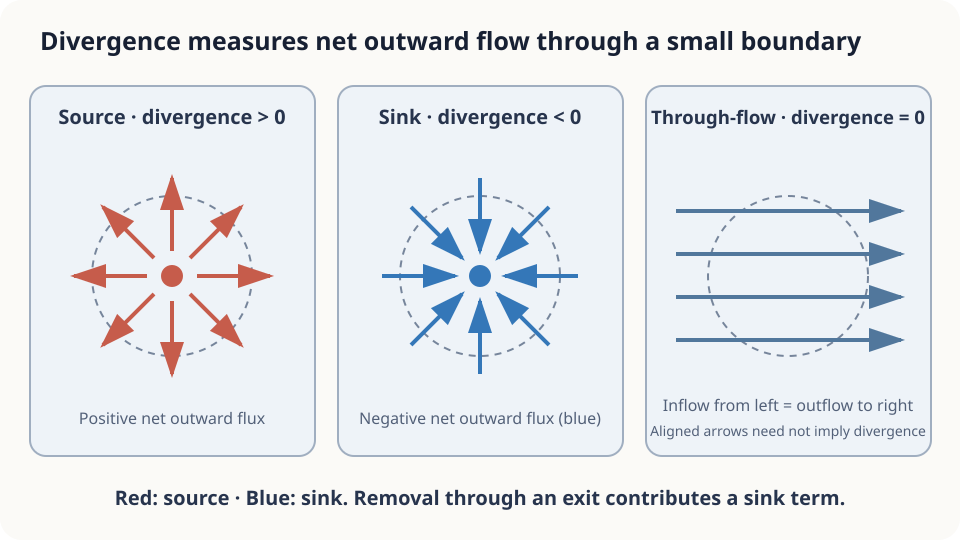

import Objectives from '../../../components/Objectives.astro';
import Prereq from '../../../components/Prereq.astro';
import Question from '../../../components/Question.astro';
import Answer from '../../../components/Answer.astro';
import QuizBlock from '../../../components/QuizBlock.astro';
import Option from '../../../components/Option.astro';
import Explanation from '../../../components/Explanation.astro';
import Details from '../../../components/Details.astro';
import Bridge from '../../../components/Bridge.astro';
import UsedBy from '../../../components/UsedBy.astro';
import Ref from '../../../components/Ref.astro';

# Counting Gate Crossings: Divergence and Flux

<Objectives title="After reading, you can">
- **Define boundary flux** and the conservation assumption connecting it to enclosed mass change.
- **Derive divergence as net outflow per unit volume** and explain the divergence theorem by cell cancellation.
- **Recognize incomplete accounting**, including unmeasured gates and internal sources.
</Objectives>

<Prereq items={frontmatter.prereqs} />

## We cannot see inside the station

You manage a station with no interior camera. Counters record entries and exits at four gates.

Is the population inside increasing or decreasing, and at what rate?

Adding entries and subtracting exits works only if every crossing is counted. Trains can carry people through another part of the boundary.

How can we formalize boundary flow and then localize it to a small region?

<Question label="Discussion" id="Q1">
What are the region, boundary, measured quantity, and desired quantity?

<Answer summary="Show the reasoning">
Before subtracting counts, identify the objects.

The region $\Omega$ is the station interior. Its total population is $N(t)$, and we seek $dN/dt$.

The boundary $\partial\Omega$ separates inside and outside. Gates are traversable parts; walls have no crossing flow.

Counters measure net people crossing a boundary segment per time, with a chosen outward-positive sign convention.

Conservation connects crossings to enclosed change: no one appears or disappears inside. Complete boundary accounting is also required.
</Answer>
</Question>

## A sprinkler, a drain, and a corridor

To count people, speed alone is insufficient. Define the flow field $j=\rho v$, multiplying density by velocity. Its arrows represent transported amount.

Outward arrows around a sprinkler give positive net outflow; inward arrows around a drain give negative net outflow. Uniform corridor flow has equal inflow and outflow.

Shrink a surrounding region to each point and measure net outflow per area. The resulting signed local quantity is divergence.



*Figure: positive divergence at a source, negative at a sink, and zero for uniform through-flow.*

## Express the local counting mathematically

**Flux.** In two dimensions, $j$ has units people per length per time. For a boundary element $ds$ with outward unit normal $n$, $j\cdot n\,ds$ counts outward flow. Only the normal component crosses:

$$
\Phi(\Omega)=\oint_{\partial\Omega}j\cdot n\,ds ,
$$

This is outward-positive **flux**. Conservation gives

$$
\frac{dN}{dt}=-\,\Phi(\Omega):
$$

Enclosed change equals net inflow, provided all changes arise from boundary crossings and there are no internal source terms.

**Divergence.** Consider a small rectangle. Horizontal outflow minus inflow is

$$
\left[j_x\!\left(x+\frac{\Delta x}{2},y\right)
-j_x\!\left(x-\frac{\Delta x}{2},y\right)\right]\Delta y.
$$

Divide by area, add the vertical contribution, and take the limit:

$$
\nabla\!\cdot j\;=\;\frac{\partial j_x}{\partial x}+\frac{\partial j_y}{\partial y}
\;=\;\lim_{|\Omega|\to0}\frac{\Phi(\Omega)}{|\Omega|}.
$$

Divergence adds directional outflow differences. $\nabla\cdot j$ tracks mass transport; $\nabla\cdot v$ instead measures local volume expansion. Population density requires the former.

**Divergence theorem.** Tile the region with small cells. Shared internal edges contribute equal and opposite flows, canceling and leaving only the external boundary:

$$
\oint_{\partial\Omega}j\cdot n\,ds\;=\;\int_\Omega\nabla\!\cdot j\;dA .
$$

For sufficiently regular fields and boundaries, integrated interior divergence equals boundary flux.

<Details label="Details" summary="Why do internal boundaries cancel exactly?">
The same edge flow is $+F$ for one cell and $-F$ for its neighbor. Their sum is exactly zero. Taking a sufficiently regular continuum limit yields the divergence theorem.
</Details>

## State the assumptions behind the intuitive answer

**The result.** Population change equals negative outward flux. This is an exact conservation balance.

**The assumptions.** Include every traversable boundary and any internal sources. Train doors, staff exits, and emergency doors can invalidate a calculation based only on fare gates. A net gate inflow can coexist with a falling station population if a train carries more people away.

**What divergence adds.** Boundary counts describe total change. The density-weighted flow field allows local density-change calculations. Disagreement between them can indicate missing channels, measurement error, or incorrect assumptions.

## Calculate the balance

<iframe loading="lazy" src="/personal_website/notes/research_areas/mathematical-foundations/m0-calculus-toolkit/m0-1-2.en.html" class="demo-frame" title="Boundary flux, interior divergence, and an unrecorded exit" style="height: 820px; width: 100%; border: none;"></iframe>

The grid example verifies exact cancellation, then adds an unrecorded removal:

```python
import numpy as np
n = 40; rho = np.full((n, n), 5.0)
Fx = 0.3 + 0.1*np.random.randn(n, n+1)
Fy = 0.1*np.random.randn(n+1, n)
inside = (slice(10, 30), slice(10, 30))
for leak in (0.0, 0.5):
    N0 = rho[inside].sum()
    div = (Fx[:, 1:] - Fx[:, :-1]) + (Fy[1:, :] - Fy[:-1, :])
    rho_new = rho - div; rho_new[20, 20] -= leak
    flux_out = Fx[10:30, 30].sum() - Fx[10:30, 10].sum() + Fy[30, 10:30].sum() - Fy[10, 10:30].sum()
    print(f"actual {rho_new[inside].sum()-N0:+.3f}; boundary {-flux_out:+.3f}")
```

Without the removal, the numbers agree. With it, they differ by 0.5. In this grid code the extra removal is represented as a source/sink term rather than an explicit boundary edge.

## Check your understanding

<QuizBlock id="m0-1-a">
With no internal sources, where is crowd density increasing fastest?
<Option>Where speed is greatest.</Option>
<Option>Where density gradient is greatest.</Option>
<Option correct>Where $\nabla\cdot(\rho v)$ is most negative.</Option>
<Explanation>Density change is negative divergence of mass flux, not speed or density gradient alone.</Explanation>
</QuizBlock>

<QuizBlock id="m0-1-b">
Reliable gate counters show persistent inflow, but population remains constant. What should you check?
<Option>Whether integer counts invalidate conservation.</Option>
<Option correct>Unrecorded boundary crossings, such as trains or staff exits.</Option>
<Option>Whether divergence requires everyone to stop moving.</Option>
<Explanation>With accurate measurements and no internal sources, complete inflow and outflow must balance.</Explanation>
</QuizBlock>

<QuizBlock id="m0-1-c">
What follows from a smooth mass-flow field having zero divergence throughout a region?
<Option>No motion occurs.</Option>
<Option>Velocity is constant everywhere.</Option>
<Option correct>Every suitable enclosed subregion has zero net outward flux.</Option>
<Explanation>The divergence theorem gives zero integrated flux. This differs from requiring the velocity itself to be divergence-free under arbitrary density.</Explanation>
</QuizBlock>

<UsedBy slug={frontmatter.slug} />

<Bridge to="math-taylor">
Flux and divergence connect boundary accounting to local change. Next, return to predicting position: how much error results from retaining only the current velocity over a finite interval?
</Bridge>

## References

1. Strang, G. [*Calculus.*](https://ocw.mit.edu/courses/res-18-001-calculus-online-textbook-spring-2005/) Wellesley-Cambridge Press; MIT OpenCourseWare RES.18-001 
2. Feynman, R. P., Leighton, R. B., Sands, M. [*The Feynman Lectures on Physics*, Vol. II, Ch. 3: Vector Integral Calculus.](https://www.feynmanlectures.caltech.edu/II_03.html)
3. Marsden, J. E., Tromba, A. J. *Vector Calculus.* W. H. Freeman.
