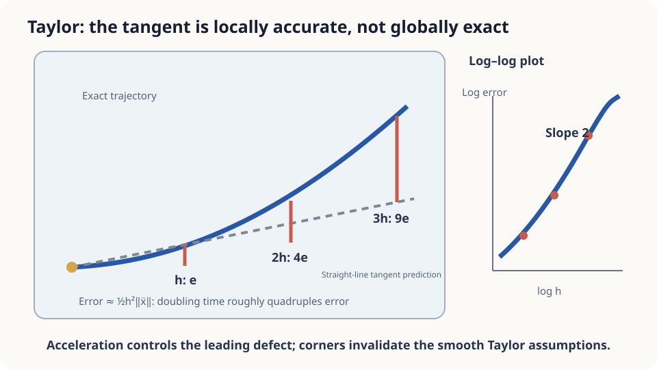

import Objectives from '../../../components/Objectives.astro';
import Prereq from '../../../components/Prereq.astro';
import Question from '../../../components/Question.astro';
import Answer from '../../../components/Answer.astro';
import QuizBlock from '../../../components/QuizBlock.astro';
import Option from '../../../components/Option.astro';
import Explanation from '../../../components/Explanation.astro';
import Details from '../../../components/Details.astro';
import Bridge from '../../../components/Bridge.astro';
import UsedBy from '../../../components/UsedBy.astro';
import Ref from '../../../components/Ref.astro';

# Thirty Seconds Without GPS: Taylor Expansion and Straight-Line Prediction

<Objectives title="After reading, you can">
- **Write constant-velocity prediction as first-order Taylor approximation**, with acceleration controlling its remainder.
- **Add a second-order correction** and state the smoothness needed for cubic local remainder.
- **Test step-size scaling**, distinguishing turns, speed changes, and nonsmooth motion.
</Objectives>

<Prereq items={frontmatter.prereqs} />

## Between location updates

A navigation display receives positions intermittently. Between updates it may extrapolate using the last position and velocity.

Suppose a car travels at 10 m/s around a bend of radius 20 m, immediately after its last location update.

Prediction misses the changing velocity direction. Can current velocity and its rate of change estimate that error?

<Question label="Discussion" id="Q1">
What function is being approximated, what does straight-line prediction compute, and what error do we want?

<Answer summary="Show the reasoning">
Specify a time-dependent position rather than merely a road shape.

The vector function $x(t)$ maps time to planar position. We know its current position and velocity.

The predicted future position is

$$
\tilde x(t+h)=x(t)+h\,\dot x(t)
$$

This replaces the trajectory by its tangent line in time.

We seek the distance between this prediction and the actual future position. Taylor expansion quantifies how long this local approximation remains accurate.
</Answer>
</Question>

## A curved ruler looks straight up close

A short segment of a curved ruler appears straight; a longer segment reveals its deviation.

For a time-parametrized position, acceleration controls departure from constant-velocity prediction. It includes changing speed along a straight route. When a nonzero quadratic term dominates, doubling a small interval approximately quadruples error.

The observed interval plays the role of the short ruler segment.



*Figure: tangent approximation has a leading $h^2$ remainder under suitable smoothness.*

## Calculate the error of constant-velocity prediction

For one scalar coordinate with suitable second differentiability,

$$
\begin{aligned}
f(t+h)&=f(t)+hf'(t)+R_1(h),\\
R_1(h)&=\frac{h^2}{2}f''(\xi),\qquad \xi\in[t,t+h].
\end{aligned}
$$

If $|f''|\leq M$ on the interval, the remainder is at most $Mh^2/2$. Doubling $h$ quadruples this bound for the same $M$; actual errors also depend on variation of the second derivative.

<Details label="Details" summary="Derive the integral remainder">
Apply the fundamental theorem twice: $f(t+h)-f(t)=\int_t^{t+h}f'(s)ds$ and $f'(s)=f'(t)+\int_t^sf''(r)dr$. Exchange integration order:

$$
f(t+h)-f(t)-h f'(t)=\int_t^{t+h}\!\!\int_t^{s}f''(r)\,dr\,ds=\int_t^{t+h}(t+h-r)\,f''(r)\,dr .
$$

The weight integrates to $h^2/2$, giving the norm bound. Continuity yields the scalar intermediate-point form; vector trajectories can use the integral bound directly without assuming one common intermediate point for every component.
</Details>

**Second-order Taylor** includes current acceleration:

$$
f(t+h)=f(t)+h f'(t)+\frac{h^2}{2}f''(t)+R_2(h),\qquad |R_2(h)|\le\frac{h^3}{6}\max|f'''| .
$$

An additional derivative supports one more power of step size in the remainder, provided the required derivatives are bounded. A useful leading approximation needs an interval small enough for those derivatives to vary moderately.

## Three intervals

For uniform circular motion with radius 20 m and speed 10 m/s, acceleration magnitude is $v^2/R=5$ m/s². Hence

$$
\|x(t+h)-\widetilde x(t+h)\|\leq\frac{h^2v^2}{2R}=2.5h^2\ \text{m}.
$$

At one second, the bound is 2.5 m and actual error about 2.48 m. At two seconds, they are 10 m and about 9.73 m, close to quadratic scaling.

At thirty seconds, the 2250 m bound remains valid but loose: actual error is roughly 290 m. The car circles within a bounded area while its tangent prediction travels 300 m away. The local quadratic approximation no longer describes the actual error well over that interval.

A bounded acceleration gives a rigorous upper bound. A nearly unchanged acceleration over a short step gives a useful leading term. Constant-speed straight motion alone makes this error zero; straight motion with changing speed does not.

Adding acceleration improves the one-second example to a cubic remainder bound near 0.42 m. <Ref to="math-higher-order"/> asks whether multiple velocity queries can supply this correction without directly measuring acceleration.

## Run the example and tighten the turn

```python
import numpy as np
def err(h, v=10.0, R=20.0):
    th = v*h/R
    true = R*np.array([np.sin(th), 1-np.cos(th)])
    pred = np.array([v*h, 0.0])
    return np.linalg.norm(true-pred)
hs = np.array([0.125, 0.25, 0.5, 1, 2, 4])
for R in (20.0, 2.0):
    e = np.array([err(h, R=R) for h in hs])
    print(f"R={R}: errors {np.round(e, 2)}")
    print("ratios", np.round(e[1:]/e[:-1], 2),
          "bounds", np.round(50*hs**2/R, 2))
```

For the wider turn, small-step ratios are close to four. The tight turn leaves that regime earlier because velocity changes faster within the same interval.

A nonsmooth corner can invalidate Taylor's assumptions entirely. After an instantaneous direction change, constant-velocity prediction may accumulate error linearly in the remaining interval rather than quadratically.

<iframe loading="lazy" src="/personal_website/notes/research_areas/mathematical-foundations/m0-calculus-toolkit/m0-2-2.en.html" class="demo-frame" title="Navigation prediction: step size, turns, acceleration, and corners" style="height: 800px; width: 100%; border: none;"></iframe>

## Check your understanding

<QuizBlock id="m0-2-a">
What approximation is $f(t)+hf'(t)$?
<Option>Zeroth order.</Option>
<Option correct>First-order Taylor, omitting the change in the derivative.</Option>
<Option>Second order because two numbers were used.</Option>
<Explanation>Second-order prediction adds $h^2f''(t)/2$. An estimated derivative also introduces its own error multiplied by $h$.</Explanation>
</QuizBlock>

<QuizBlock id="m0-2-b">
In a smooth local quadratic regime, halving the update interval approximately changes the constant-velocity error by what factor?
<Option>One half.</Option>
<Option>No change.</Option>
<Option correct>One quarter.</Option>
<Explanation>The leading local error scales with $h^2$ when acceleration is nonzero and sufficiently stable over the interval.</Explanation>
</QuizBlock>

<QuizBlock id="m0-2-c">
Which change can invalidate the smooth Taylor model, rather than merely change its constants?
<Option>A larger turn radius.</Option>
<Option correct>An instantaneous corner in the trajectory.</Option>
<Option>A moderately higher speed on a smooth turn.</Option>
<Explanation>At a corner the needed derivative may not exist. Large smooth steps can also leave the useful local regime without invalidating a bounded-derivative inequality.</Explanation>
</QuizBlock>

<UsedBy slug={frontmatter.slug} />

<Bridge to="math-total-derivative">
A local prediction misses changing rates. Later we accumulate this error over many steps. First, how do we calculate the change experienced when a field depends on both position and time?
</Bridge>

## References

1. Strang, G. [*Calculus.*](https://ocw.mit.edu/courses/res-18-001-calculus-online-textbook-spring-2005/) Wellesley-Cambridge Press; MIT OpenCourseWare RES.18-001 
2. Hairer, E., Nørsett, S. P., Wanner, G. [*Solving Ordinary Differential Equations I: Nonstiff Problems*, 2nd ed.](https://doi.org/10.1007/978-3-540-78862-1) Springer 1993.
