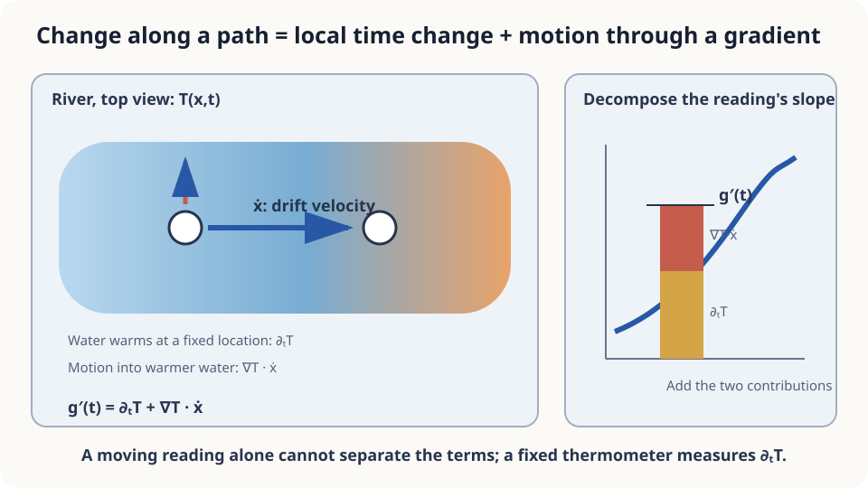

import Objectives from '../../../components/Objectives.astro';
import Prereq from '../../../components/Prereq.astro';
import Question from '../../../components/Question.astro';
import Answer from '../../../components/Answer.astro';
import QuizBlock from '../../../components/QuizBlock.astro';
import Option from '../../../components/Option.astro';
import Explanation from '../../../components/Explanation.astro';
import Details from '../../../components/Details.astro';
import Bridge from '../../../components/Bridge.astro';
import UsedBy from '../../../components/UsedBy.astro';
import Ref from '../../../components/Ref.astro';

# A Drifting Thermometer: Total Derivatives, Integral Differentiation, and JVPs

<Objectives title="After reading, you can">
- **Decompose a moving observation's derivative** into explicit time change and motion through a spatial gradient.
- **State conditions for differentiation under an integral.**
- **Use a JVP to compute the total derivative** without materializing a full Jacobian.
</Objectives>

<Prereq items={frontmatter.prereqs} />

## The reading increased

A thermometer on a floating buoy reports a rise from 18.0 to 18.6 degrees over ten minutes.

Did the river warm up?

Perhaps the buoy merely drifted into a warmer region. How can we distinguish temporal warming from spatial movement?

As with Taylor approximation, examine the separate input changes over a short interval.

<Question label="Discussion" id="Q1">
Which functions compose the reading, and which contributions do we want to separate?

<Answer summary="Show the reasoning">
Treating temperature only as a function of time hides the moving location.

There are two functions: a field $T(x,t)$ and a path $x(t)$. The field varies both across space and over time.

The reported reading is their composition $g(t)=T(x(t),t)$.

We want to split its derivative into fixed-location change and movement through different temperatures. This is the multivariable chain rule.
</Answer>
</Question>

## Walking on an escalator

Your height rises because the escalator moves and because you walk. The two rates add.

A measurement of the total alone cannot identify both contributions. Independently measuring one permits recovering the other.

Fixed-location warming corresponds to escalator motion; drifting across the temperature field corresponds to walking.



*Figure: total change combines a time partial derivative and a spatial directional derivative.*

## Express the two contributions

For a differentiable field and differentiable path,

$$
\frac{d}{dt}T(x(t),t)=\underbrace{\partial_tT(x(t),t)}_{\text{time change}}+
\underbrace{\nabla T(x(t),t)\cdot\dot x(t)}_{\text{motion through the field}}.
$$

The partial derivative holds position fixed. The gradient is taken with respect to position, and its inner product with drift velocity measures the experienced spatial contribution. Their sum is the **total derivative along the path**.

<Details label="Details" summary="Derive the sum from first-order Taylor expansion">
Over time $h$, position changes by $\Delta x=h\dot x+o(h)$. Expand both inputs:

$$
T(x+\Delta x,\,t+h)-T(x,t)=\partial_t T\cdot h+\nabla T\cdot\Delta x+o(h).
$$

Differentiability makes their leading contributions add linearly. Divide by $h$ and take the limit. A jump in the temperature field can invalidate this argument at the crossing.
</Details>

**Differentiation under an integral.** Now average many fixed-location readings with a fixed weight:

$$
m(t)=\int w(x)\,T(x,t)\,dx .
$$

Finite weighted sums differentiate term by term. Under appropriate conditions, their continuous counterpart does too:

$$
\frac{d}{dt}\int w(x)\,T(x,t)\,dx=\int w(x)\,\partial_t T(x,t)\,dx .
$$

This is the **Leibniz rule**. One sufficient local condition is existence of the time derivative and an integrable, time-independent dominating bound for its weighted magnitude. The integration domain is fixed. Moving boundaries require extra terms.

## One moving reading cannot identify both sources

The observed rise is the integral of both contributions along the path. A spatially uniform field removes the movement term, but one drifting thermometer cannot establish that uniformity.

Measure the spatial gradient and buoy velocity at its current location, or the local time derivative there. A fixed thermometer only at the starting point need not describe downstream warming.

For $T(x,t)=18+0.001x+0.0005t$, with distance in meters and time in seconds, drifting at 0.5 m/s for ten minutes contributes 0.3 degrees through motion and 0.3 through temporal warming.

At a discontinuity between unmixed streams, a classical spatial derivative may not exist. An abrupt reading change should not simply be interpreted as gradual temporal warming.

## Compute the total derivative in a program

For a high-dimensional vector field, the spatial derivative is a Jacobian. Explicitly forming a dense $d\times d$ matrix can require quadratic storage and many derivative sweeps.

We only need that matrix applied to one direction: a **Jacobian-vector product (JVP)**. Forward-mode automatic differentiation computes this directly, commonly at a constant multiple of function-evaluation cost. Include a unit time tangent to obtain the total derivative.

```python
import torch
from torch.func import jvp
def T(x, t):
    return 20 + 0.3*torch.exp(-((x-300)/100)**2) + 0.0005*t
x0, t0, xdot = torch.tensor(250.), torch.tensor(0.), torch.tensor(0.5)
reading, dg_dt = jvp(T, (x0, t0), (xdot, torch.tensor(1.)))
_, fixed = jvp(T, (x0, t0), (torch.tensor(0.), torch.tensor(1.)))
print(f"reading {reading:.3f}; total {dg_dt:.6f}; fixed {fixed:.6f}; drift {dg_dt-fixed:.6f}")
```

`jvp` returns the function value and derivative along the supplied tangents. Here the total is about 0.001668, the fixed-position term 0.0005, and motion about 0.001168. The same interface extends to compatible vector inputs and outputs without constructing the Jacobian.

<iframe loading="lazy" src="/personal_website/notes/research_areas/mathematical-foundations/m0-calculus-toolkit/m0-3-2.en.html" class="demo-frame" title="Separate total-derivative contributions and compare JVP with a Jacobian" style="height: 850px; width: 100%; border: none;"></iframe>

## Check your understanding

<QuizBlock id="m0-3-a">
A flying drone reports rising pollution. What helps determine whether pollution is increasing at fixed locations?
<Option>Only extrapolating the reading with Taylor expansion.</Option>
<Option correct>The total-derivative decomposition plus local spatial/motion or temporal measurements.</Option>
<Option>Only the spatial gradient.</Option>
<Explanation>The moving observer mixes temporal and spatial changes. Its single reading series does not identify both.</Explanation>
</QuizBlock>

<QuizBlock id="m0-3-b">
Which event can invalidate the classical chain-rule expression at an instant?
<Option>A fast but smooth drift.</Option>
<Option>Uniform temporal warming.</Option>
<Option correct>A jump across unmixed streams of different temperatures.</Option>
<Explanation>The required differentiability can fail at the jump.</Explanation>
</QuizBlock>

<QuizBlock id="m0-3-c">
What justifies moving a derivative inside a fixed-domain temperature integral?
<Option>Motion of the domain.</Option>
<Option>The divergence theorem.</Option>
<Option correct>A differentiation-under-the-integral theorem with suitable derivative and domination assumptions.</Option>
<Explanation>A fixed domain has no moving-boundary term. Exchanging differentiation and integration still requires justification.</Explanation>
</QuizBlock>

<UsedBy slug={frontmatter.slug} />

<Bridge to="math-gaussian">
We can now separate spatial and temporal change and justify differentiating suitable averages. Next, suppose measurements themselves are noisy: what happens when independent measurement errors are combined?
</Bridge>

## References

1. Strang, G. [*Calculus.*](https://ocw.mit.edu/courses/res-18-001-calculus-online-textbook-spring-2005/) Wellesley-Cambridge Press; MIT OpenCourseWare RES.18-001 
2. Baydin, A. G., Pearlmutter, B. A., Radul, A. A., Siskind, J. M. [*Automatic Differentiation in Machine Learning: a Survey.*](https://arxiv.org/abs/1502.05767) JMLR 2018.
3. PyTorch documentation, [*torch.func.jvp*](https://pytorch.org/docs/stable/generated/torch.func.jvp.html).
