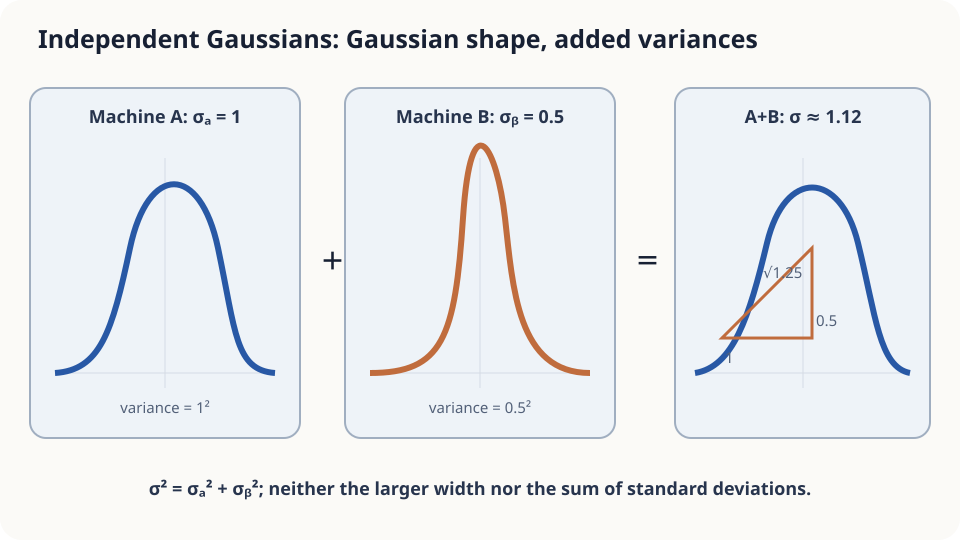

import Objectives from '../../../components/Objectives.astro';
import Prereq from '../../../components/Prereq.astro';
import Question from '../../../components/Question.astro';
import Answer from '../../../components/Answer.astro';
import QuizBlock from '../../../components/QuizBlock.astro';
import Option from '../../../components/Option.astro';
import Explanation from '../../../components/Explanation.astro';
import Details from '../../../components/Details.astro';
import Bridge from '../../../components/Bridge.astro';
import UsedBy from '../../../components/UsedBy.astro';
import Ref from '../../../components/Ref.astro';

# Two Scales: Linear Combinations of Gaussians

<Objectives title="After reading, you can">
- **State Gaussian closure under affine transformations** and the variance rule for independent sums.
- **Derive inverse-variance measurement weights.**
- **Separate distributional and variance assumptions**, including the effect of correlated errors.
</Objectives>

<Prereq items={frontmatter.prereqs} />

## Two readings

Two unbiased scales have noise standard deviations 1 kg and 0.5 kg. Today they read 72.8 and 71.9 kg.

Which weight should you report?

Using both sounds useful, but equal weighting might let the noisier scale undermine the better one.

Treat the quoted noise magnitudes as standard deviations, not guaranteed error limits. Minimize the variance of an unbiased weighted combination.

<Question label="Discussion" id="Q1">
What is random, how do we represent reliability, and which estimators are being compared?

<Answer summary="Show the reasoning">
The true weight $w$ is fixed but unknown. The readings are random.

Write $Y_A=w+\varepsilon_A$ and $Y_B=w+\varepsilon_B$, with zero-mean independent errors of known variances. Gaussian errors additionally specify their full distribution.

Compare $\hat w=aY_A+bY_B$. Unbiasedness requires $a+b=1$. Equal averaging and using only scale B are special cases. We seek the lowest-variance estimator in this linear unbiased family.
</Answer>
</Question>

## Combine two independent jitters

Two independent displacements sometimes reinforce and sometimes oppose each other. Their variances add: standard deviations 1 and 0.5 combine to $\sqrt{1^2+0.5^2}\approx1.12$, rather than their sum or maximum.

Gaussianity additionally preserves the bell-shaped distribution under linear combination.



*Figure: standard deviations combine through their squares.*

## Write the combination mathematically

A scalar Gaussian has density $\exp(-(x-\mu)^2/(2\sigma^2))/(\sqrt{2\pi}\sigma)$. Two useful rules are:

1. **Affine transformation:** $aX+b\sim\mathcal N(a\mu+b,a^2\sigma^2)$.
2. **Independent addition:** Gaussian means and variances each add.

For independent Gaussian linear combinations, means use the coefficients and variances their squares. Variance addition itself only needs uncorrelated finite-variance errors; Gaussianity identifies the resulting distribution.

<Details label="Details" summary="Prove Gaussian closure using moment-generating functions">
The Gaussian MGF is $M_X(s)=\exp(\mu s+\sigma^2s^2/2)$. Independence factors the MGF of a sum:

$$
M_{X_1+X_2}(s)=\exp\!\big((\mu_1+\mu_2)s+\tfrac12(\sigma_1^2+\sigma_2^2)s^2\big),
$$

This is the MGF of the stated Gaussian. In general, sum variance includes twice the covariance, which vanishes under independence.
</Details>

**Vectors.** The covariance matrix stores individual variances on its diagonal and pairwise covariance elsewhere. An affine transformation of a multivariate Gaussian satisfies

$$
AX+b\sim\mathcal N\big(A\mu+b,\ A\Sigma A^{\!\top}\big).
$$

A weighted scalar estimate has variance $a^\top\Sigma a$, reducing to $\sum_i a_i^2\sigma_i^2$ for independent coordinates.

## Equal averaging or reliability weighting?

For an unbiased combination with independent errors,

$$
\mathrm{Var}(\hat w)=a^2\sigma_A^2+b^2\sigma_B^2 .
$$

The cross term vanishes, and squared weights determine each variance contribution.

- **Equal average:** variance 0.3125 and standard deviation about 0.559 kg.
- **Only B:** variance 0.25 and standard deviation 0.5 kg.

Equal averaging is worse than using only B. The information is useful, but the assigned weights are poor.

Differentiate the variance with respect to $a$, setting $b=1-a$:

$$
a=\frac{1/\sigma_A^2}{1/\sigma_A^2+1/\sigma_B^2},\qquad b=\frac{1/\sigma_B^2}{1/\sigma_A^2+1/\sigma_B^2},\qquad
\mathrm{Var}(\hat w)=\frac{1}{1/\sigma_A^2+1/\sigma_B^2}.
$$

Weights are proportional to **precision**, or inverse variance. Here $a=0.2$, $b=0.8$, the estimate is 72.08 kg, and its standard deviation is about 0.447 kg. Independent precisions add; the same rule extends to more measurements.

This optimizes linear unbiased estimation under the stated known variances. The weight calculation does not require Gaussianity, and does not claim optimality among every possible biased estimator at every parameter value.

Correlated errors require covariance terms. With a shared independent error $c$, averaging $n$ devices leaves variance $\sigma_c^2+\sigma^2/n$: the common component remains. Bias or outliers require checking the error model again.

## Simulate ten thousand mornings

```python
import numpy as np
rng = np.random.default_rng(0); n = 10_000; w = 72.0
sA, sB = 1.0, 0.5
def trial(rho=0.0, glitch=0.0):
    eA = rng.normal(0, sA, n)
    eB = rho*eA*(sB/sA) + np.sqrt(1-rho**2)*rng.normal(0, sB, n)
    eA = eA + glitch*rng.choice([0, 10], n, p=[0.98, 0.02])
    yA, yB = w + eA, w + eB
    for name, est in [("mean", (yA+yB)/2), ("B", yB), ("weighted", 0.2*yA+0.8*yB)]:
        print(name, "standard deviation", est.std())
for rho, g in [(0.0, 0), (0.8, 0), (0.0, 1)]:
    print(rho, g); trial(rho, g)
```

The independent case matches the derived standard deviations. Correlation invalidates weights that ignore covariance; glitches change the actual variance and may introduce bias. These are reasons to update the error model, not to reject all non-Gaussian linear combinations.

<iframe loading="lazy" src="/personal_website/notes/research_areas/mathematical-foundations/m1-probability/m1-0-2.en.html" class="demo-frame" title="Measurement weights, correlation, and outliers" style="height: 800px; width: 100%; border: none;"></iframe>

## Check your understanding

<QuizBlock id="m1-0-a">
Three independent unbiased estimates have standard deviations 2000, 1000, and 1000. Which weights minimize variance?
<Option>Equal thirds.</Option>
<Option>Ignore the first estimate.</Option>
<Option correct>$1/9,4/9,4/9$.</Option>
<Explanation>Precision ratios are $1/4:1:1$. Less reliable information still contributes with a smaller weight.</Explanation>
</QuizBlock>

<QuizBlock id="m1-0-b">
Two scales share error standard deviation 0.8 and each has independent noise standard deviation 0.5. What is their mean's standard deviation?
<Option>About 0.35.</Option>
<Option correct>About $\sqrt{0.8^2+0.5^2/2}=0.87$.</Option>
<Option>Divide the whole single-scale standard deviation by $\sqrt2$.</Option>
<Explanation>The shared error does not average away.</Explanation>
</QuizBlock>

<QuizBlock id="m1-0-c">
For Gaussian $X\in\mathbb R^3$ and a $2\times3$ matrix $A$, what is the law of $AX$?
<Option>$\mathcal N(A\mu,A\Sigma)$.</Option>
<Option>Not Gaussian because $A$ is rectangular.</Option>
<Option correct>$\mathcal N(A\mu,A\Sigma A^\top)$, possibly degenerate.</Option>
<Explanation>Affine Gaussian closure does not require an invertible square matrix. Covariance transforms on both sides.</Explanation>
</QuizBlock>

<UsedBy slug={frontmatter.slug} />

<Bridge to="math-conditional-expectation">
We combined readings of one fixed unknown quantity. Next, randomly select a person and observe only shoe size: which possible people should enter a height prediction, and with what weights?
</Bridge>

## References

1. Grimmett, G., Stirzaker, D. *Probability and Random Processes*, 3rd ed. Oxford University Press 2001.
2. Bishop, C. M. [*Pattern Recognition and Machine Learning.*](https://www.microsoft.com/en-us/research/publication/pattern-recognition-machine-learning/) Springer 2006, Ch. 2.3.
3. Kay, S. M. *Fundamentals of Statistical Signal Processing, Vol. I: Estimation Theory.* Prentice Hall 1993.
