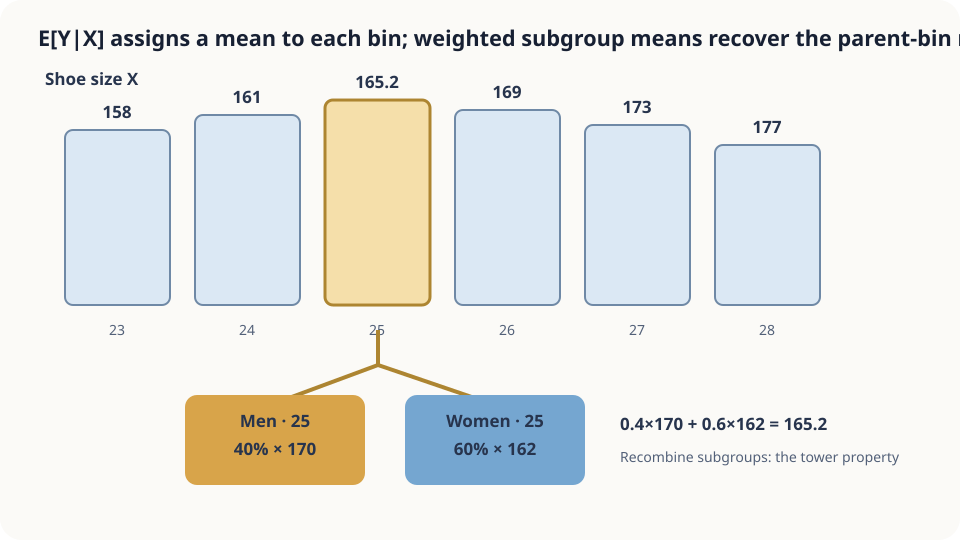

import Objectives from '../../../components/Objectives.astro';
import Prereq from '../../../components/Prereq.astro';
import Question from '../../../components/Question.astro';
import Answer from '../../../components/Answer.astro';
import QuizBlock from '../../../components/QuizBlock.astro';
import Option from '../../../components/Option.astro';
import Explanation from '../../../components/Explanation.astro';
import Details from '../../../components/Details.astro';
import Bridge from '../../../components/Bridge.astro';
import UsedBy from '../../../components/UsedBy.astro';
import Ref from '../../../components/Ref.astro';

# Guessing Height from Shoes: Conditional Expectation

<Objectives title="After reading, you can">
- **Distinguish a conditional mean at a fixed value from a conditional-expectation random variable.**
- **Derive the tower property** as probability-weighted recombination of finer groups.
- **State how additional information affects ideal squared error** and why finite-data estimation can still deteriorate.
</Objectives>

<Prereq items={frontmatter.prereqs} />

## Only the shoes are visible

A photograph shows shoes of size 25 cm, and you must guess the wearer's height.

What value would you predict, and why?

How would additional group information change your prediction?

A natural rule averages heights among people with the same observed features. We use illustrative groups and numbers, not an empirical demographic model. How are coarse and fine group averages related?

<Question label="Discussion" id="Q1">
What generates the random variables, what average is predicted, and what changes when we learn another feature?

<Answer summary="Show the reasoning">
Identify the source of randomness as well as the measured height.

A person is randomly drawn from a population, producing jointly distributed height $Y$, shoe size $X$, and group label $G$.

Given $X=25$, average heights under that conditional population. This is a group center, not a guaranteed individual height.

Additional $G$ divides the same shoe-size group into finer groups. Their weighted averages must recombine into the original average.
</Answer>
</Question>

## Group, average, and recombine

A table maps each shoe size to its group's average height. Observing size selects the corresponding table entry.

Refining groups does not replace the population. Weighting fine-group means by their conditional proportions recovers the coarse mean. Individual fine groups can still have larger variance.

Additional information can move a prediction up or down; those changes average back to the original prediction.



*Figure: conditional expectation labels each group with its mean; the tower property recombines the labels.*

## Define the group average

For jointly distributed $X,Y$, define

$$
m(x)=\mathbb E[Y\mid X=x]
=\sum_y yP(Y=y\mid X=x),
\quad\text{or}\quad\int y\,p(y\mid x)\,dy.
$$

For fixed $x$ this is a number. Substituting random $X$ gives $m(X)=\mathbb E[Y\mid X]$, itself a random variable determined by the observed information. In continuous settings, use a suitable version of the regular conditional law where defined.

**Useful properties.**
1. **Total expectation:** averaging all group means gives $\mathbb E[Y]$.
2. **Tower property:** refining and then averaging back gives

$$
\mathbb E\big[\,\mathbb E[Y\mid X,G]\;\big|\;X\,\big]=\mathbb E[Y\mid X].
$$

The fine $(X,G)$ average returns to the coarse $X$ average.
3. **Take out known factors:** $\mathbb E[h(X)Y\mid X]=h(X)\mathbb E[Y\mid X]$ under integrability.
4. **Independence:** if $X$ and $Y$ are independent, every conditional mean equals the overall mean.

<Details label="Details" summary="Prove the discrete tower property">
Fix $X=x$, then weight the finer conditional means by $P(G=g\mid X=x)$:

$$
\sum_g P(g\mid x)\sum_y y\,P(y\mid x,g)=\sum_y y\sum_g P(y,g\mid x)=\sum_y y\,P(y\mid x)=\mathbb E[Y\mid X=x].
$$

Use conditional-probability multiplication and sum out $g$. The continuous proof replaces sums by integrals under the appropriate integrability assumptions.
</Details>

## Two guesses and one consistency relation

**The first guess** reads the shoe-size group's center. The next note explains why squared error favors that center rather than another statistic.

**The refined guesses** must average back: for illustrative means 170 and 162 with proportions 0.4 and 0.6, the coarse mean is 165.2. Two positively weighted subgroup means cannot both exceed their combined mean.

**What does extra information improve?** With finite second moments, total variance gives

$$
\mathrm{Var}(Y\mid X)
=\mathbb E[\mathrm{Var}(Y\mid X,G)\mid X]
+\mathrm{Var}(\mathbb E[Y\mid X,G]\mid X).
$$

The expected remaining within-group variance cannot increase. This does not require every individual fine group's variance to be smaller.

These are population identities. A different source population may require a different table. Estimating the table from limited data also becomes unstable when grouping leaves too few examples per cell.

## Simulate a synthetic population

```python
import numpy as np
rng = np.random.default_rng(1)
def population(n):
    g = rng.random(n) < 0.5
    shoe = np.where(g, rng.normal(26.5, 1.0, n), rng.normal(23.5, 1.0, n))
    height = np.where(g, 176 + 4*(shoe-26.5), 158 + 4*(shoe-23.5)) + rng.normal(0, 5, n)
    return g, shoe, height
for n in (200_000, 60):
    g, shoe, h = population(n)
    b = np.abs(shoe - 25) < 0.25
    pm = g[b].mean()
    EY, EYm, EYf = h[b].mean(), h[b & g].mean(), h[b & ~g].mean()
    print(n, b.sum(), EY, EYm, EYf, pm*EYm+(1-pm)*EYf)
```

When both empirical subgroups are nonempty, their size-weighted means reproduce the empirical coarse mean exactly. With only 60 observations, narrow subgroups can be nearly empty or empty, exposing estimation instability and undefined sample averages.

<iframe loading="lazy" src="/personal_website/notes/research_areas/mathematical-foundations/m1-probability/m1-1-2.en.html" class="demo-frame" title="Conditional means, subgroup refinement, and limited samples" style="height: 820px; width: 100%; border: none;"></iframe>

## Check your understanding

<QuizBlock id="m1-1-a">
How do $\mathbb E[Y\mid X]$ and $\mathbb E[Y\mid X=25]$ differ?
<Option>They are identical objects.</Option>
<Option correct>The first is the random table lookup; the second is one fixed entry.</Option>
<Option>The second is a probability rather than a mean.</Option>
<Explanation>Both describe averages, but only the first varies with the observed $X$.</Explanation>
</QuizBlock>

<QuizBlock id="m1-1-b">
Delivery-time groups are refined from distance to distance and rain. What must hold at the population level?
<Option correct>Fine-group means, weighted by conditional proportions, recover the original mean.</Option>
<Option>Every refined mean must be higher.</Option>
<Option>The coarse population mean changes because more information is available.</Option>
<Explanation>Refining information changes predictions, not the underlying population average.</Explanation>
</QuizBlock>

<QuizBlock id="m1-1-c">
What can go wrong when 80 examples are split by many features?
<Option>The population tower property stops holding.</Option>
<Option correct>Most cells have too few examples for stable estimated means.</Option>
<Option>More information guarantees better estimated predictions.</Option>
<Explanation>Ideal conditional means and their finite-sample estimates are different objects.</Explanation>
</QuizBlock>

<UsedBy slug={frontmatter.slug} />

<Bridge to="math-mse-conditional-expectation">
We can identify which outcomes enter a conditional average and recombine refined means. Why choose the mean rather than the most common value? Next we derive the answer from a prediction scoring rule.
</Bridge>

## References

1. Grimmett, G., Stirzaker, D. *Probability and Random Processes*, 3rd ed. Oxford University Press 2001.
2. Williams, D. [*Probability with Martingales.*](https://doi.org/10.1017/CBO9780511813658) Cambridge University Press 1991, Ch. 9.
3. Blitzstein, J. K., Hwang, J. [*Introduction to Probability*, 2nd ed.](https://probabilitybook.net) CRC Press 2019, Ch. 9.
