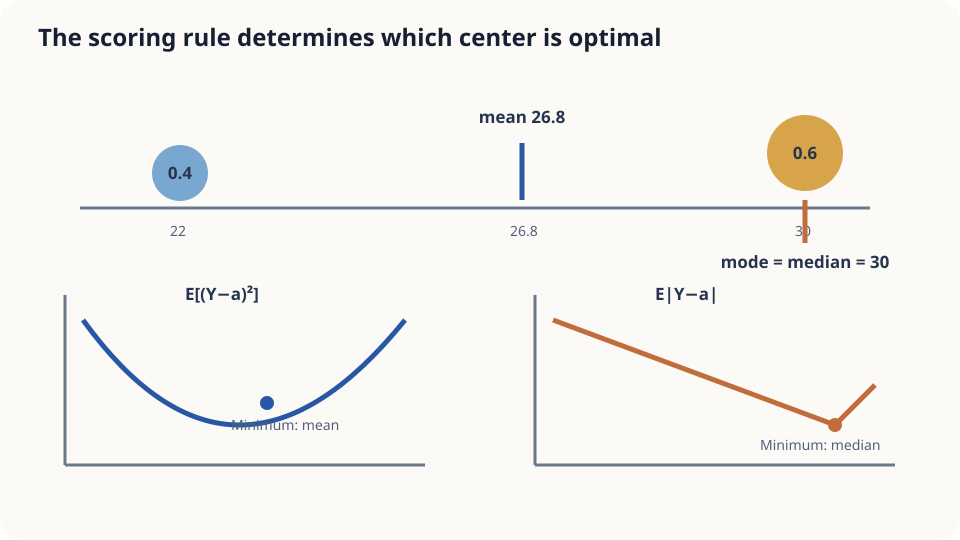

import Objectives from '../../../components/Objectives.astro';
import Prereq from '../../../components/Prereq.astro';
import Question from '../../../components/Question.astro';
import Answer from '../../../components/Answer.astro';
import QuizBlock from '../../../components/QuizBlock.astro';
import Option from '../../../components/Option.astro';
import Explanation from '../../../components/Explanation.astro';
import Details from '../../../components/Details.astro';
import Bridge from '../../../components/Bridge.astro';
import UsedBy from '../../../components/UsedBy.astro';
import Ref from '../../../components/Ref.astro';

# Which Temperature Should We Forecast? MSE Selects the Conditional Mean

<Objectives title="After reading, you can">
- **Prove the squared-error optimum is the conditional mean** and identify the residual error.
- **Relate different losses to different statistics:** means, medians, and quantiles.
- **Test the result on a bimodal forecast**, including its moment and model-family assumptions.
</Objectives>

<Prereq items={frontmatter.prereqs} />

## Only one number can be announced

A weather presenter announces tomorrow's high temperature. Performance is measured by mean squared forecast error.

Tomorrow will be 30 degrees with probability 0.6 or 22 with probability 0.4. Intermediate temperatures are nearly impossible.

What should the presenter announce?

Thirty chooses the most probable outcome. An intermediate forecast compromises on distance. The scoring rule decides which is better.

We already defined conditional means; now prove their optimality for this particular loss.

<Question label="Discussion" id="Q1">
What are the random variables, the prediction strategy, and the optimization objective?

<Answer summary="Show the reasoning">
A single prediction error omits the strategy that chooses predictions from information.

$Y$ is tomorrow's temperature and $X$ the available weather information, drawn jointly across days.

A strategy is a function $g$, mapping each information state to an announced value.

Its long-run squared-error objective is

$$
\mathrm{MSE}(g)=\mathbb E\big[(Y-g(X))^2\big],
$$

The expectation is over joint observations. We optimize over functions, which can be solved by conditioning on each input.
</Answer>
</Question>

## Find the balance point

Place weights 0.6 at 30 and 0.4 at 22 on a ruler. Their balance point is 26.8, even though no weight sits there.

Squared distance chooses that center of mass. The most probable outcome instead chooses the heaviest point. These are different questions.

Absolute distance chooses a median, which in this example is 30.



*Figure: squared error selects the mean; absolute error selects a median.*

## Prove the conditional mean is optimal

Assume $\mathbb E[Y^2]<\infty$ and compare finite-risk strategies. Set $m(X)=\mathbb E[Y\mid X]$. Decompose the residual into unpredictable deviation and departure from the conditional mean, then expand:

$$
\mathbb E\big[(Y-g(X))^2\big]
=\mathbb E\big[(Y-m(X))^2\big]+\mathbb E\big[(m(X)-g(X))^2\big]+2\,\mathbb E\big[(Y-m(X))(m(X)-g(X))\big].
$$

Conditioning on $X$ makes $m(X)-g(X)$ known, while the other residual has conditional mean zero. The cross term therefore vanishes:

$$
\mathrm{MSE}(g)=\underbrace{\mathbb E[(Y-m(X))^2]}_{\text{independent of }g}
+\underbrace{\mathbb E[(m(X)-g(X))^2]}_{\text{nonnegative}}.
$$

The second term is minimized by $g=m$ almost surely. Values on zero-probability inputs do not affect risk. The minimum is $\mathbb E[\operatorname{Var}(Y\mid X)]$, which additional information cannot increase on average.

<Details label="Details" summary="Why do absolute and asymmetric losses select medians and quantiles?">
For fixed information, moving an absolute-error prediction right increases distances to outcomes on the left and decreases distances to those on the right. At a non-atomic optimum these balance; with atoms, the condition is $P(Y<a)\leq1/2\leq P(Y\leq a)$.

For underprediction cost $c_u$ and overprediction cost $c_o$, minimize $c_u(Y-a)_++c_o(a-Y)_+$. The optimum is a quantile at $\tau=c_u/(c_u+c_o)$, interpreted with the corresponding probability inequalities at atoms. Squared error is not a special case of this piecewise-linear loss.
</Details>

## Announce 26.8 or 30?

Under squared-error scoring,

| Forecast | Expected squared error |
|---|---|
| 30 | $0.4\times8^2=25.6$ |
| 26.8 | $0.6\times3.2^2+0.4\times4.8^2=15.36$ |
| 22 | $0.6\times8^2=38.4$ |

The mean reduces error by 40% relative to 30. Its being an unlikely actual outcome is irrelevant to squared-distance scoring. Choosing the most likely value implicitly answers a different, exact-hit question.

Under absolute error, 30 gives 3.2 while 26.8 gives 3.84. The same conditional law therefore supports different optimal forecasts under different scores.

The conditional law must be correct, the moment assumptions must hold, and the function family must be sufficiently expressive. A restricted model leaves a positive departure-from-mean term. Heavy tails can invalidate finite-MSE reasoning entirely.

## Simulate three thousand days

```python
import numpy as np
rng = np.random.default_rng(2); days = 3000
Y = np.where(rng.random(days) < 0.6, 30.0, 22.0)
grid = np.linspace(20, 32, 241)
mse = [((Y-a)**2).mean() for a in grid]
mae = [np.abs(Y-a).mean() for a in grid]
print("MSE optimum", grid[np.argmin(mse)], "MAE optimum", grid[np.argmin(mae)])
Z = 26 + 2*rng.standard_t(df=1, size=days)
for k in (100, 1000, 3000):
    print(k, "mean", Z[:k].mean(), "median", np.median(Z[:k]))
```

Finite simulation introduces sampling differences. The Cauchy example deliberately has neither a population mean nor variance, so the finite-MSE decomposition does not apply. Its sample median can still estimate a distributional center.

<iframe loading="lazy" src="/personal_website/notes/research_areas/mathematical-foundations/m1-probability/m1-2-2.en.html" class="demo-frame" title="Forecast values under squared, absolute, and quantile losses" style="height: 800px; width: 100%; border: none;"></iframe>

## Check your understanding

<QuizBlock id="m1-2-a">
Which delivery-time forecast minimizes conditional expected squared error?
<Option>The conditional median.</Option>
<Option correct>The conditional mean.</Option>
<Option>The conditional mode.</Option>
<Explanation>Different costs select different statistics. A penalty emphasizing late arrivals may call for an asymmetric quantile loss.</Explanation>
</QuizBlock>

<QuizBlock id="m1-2-b">
If the conditional median is earlier than the mean, what changes under absolute-error scoring?
<Option>The mean remains optimal.</Option>
<Option>The mode becomes optimal.</Option>
<Option correct>An optimal median forecast is earlier than the mean.</Option>
<Explanation>The stated ordering determines the direction of change; a vague skewness description alone does not establish every possible ordering.</Explanation>
</QuizBlock>

<QuizBlock id="m1-2-c">
Why does the cross term vanish?
<Option>Gaussianity.</Option>
<Option>Linearity of the predictor.</Option>
<Option correct>The residual has zero conditional mean and the predictor difference is known given $X$.</Option>
<Explanation>The proof needs finite second moments, not a Gaussian law or a linear function family.</Explanation>
</QuizBlock>

<UsedBy slug={frontmatter.slug} />

<Bridge to="math-bayes-posterior">
Loss determines the best point forecast. We still need the conditional weights themselves: after an observation, how much weight should each possible hidden truth receive? Bayes' rule supplies them.
</Bridge>

## References

1. Grimmett, G., Stirzaker, D. *Probability and Random Processes*, 3rd ed. Oxford University Press 2001.
2. Bishop, C. M. [*Pattern Recognition and Machine Learning.*](https://www.microsoft.com/en-us/research/publication/pattern-recognition-machine-learning/) Springer 2006, Ch. 1.5.5.
3. Gneiting, T. [*Making and Evaluating Point Forecasts.*](https://doi.org/10.1198/jasa.2011.r10138) JASA 2011.
