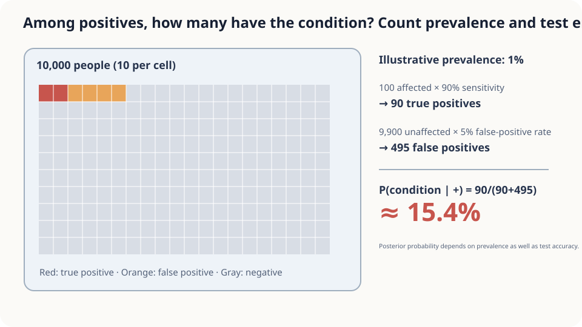

import Objectives from '../../../components/Objectives.astro';
import Prereq from '../../../components/Prereq.astro';
import Question from '../../../components/Question.astro';
import Answer from '../../../components/Answer.astro';
import QuizBlock from '../../../components/QuizBlock.astro';
import Option from '../../../components/Option.astro';
import Explanation from '../../../components/Explanation.astro';
import Details from '../../../components/Details.astro';
import Try from '../../../components/Try.astro';
import Bridge from '../../../components/Bridge.astro';
import UsedBy from '../../../components/UsedBy.astro';
import Ref from '../../../components/Ref.astro';

# A Positive Test: Bayes' Rule and the Posterior

<Objectives title="After reading, you can">
- **Identify prior, likelihood, and posterior**, calculating a hypothetical test example using natural frequencies.
- **Use posterior probabilities as conditional-average weights** and derive a Gaussian posterior.
- **Check population and conditional-independence assumptions**, especially for repeated observations.
</Objectives>

<Prereq items={frontmatter.prereqs} />

## A positive result

Consider a hypothetical population with prevalence 1%, sensitivity 95%, and specificity 95%. A randomly selected person tests positive. These numbers illustrate probability, not an actual diagnostic test.

What fraction of positive results correspond to the condition?

Sensitivity conditions on the true condition; our question conditions on the observed result. Count positives from both possible sources to reverse the conditioning.

<Question label="Discussion" id="Q1">
Which probabilities are given, and which one do we want?

<Answer summary="Show the reasoning">
The different 95% figures describe different conditional populations.

Let $D$ indicate whether the condition is present and $T$ denote the test result.

- Prior prevalence: $P(D=1)=0.01$.
- Sensitivity: $P(T=+\mid D=1)=0.95$.
- Specificity: $P(T=-\mid D=0)=0.95$, so the false-positive rate is 0.05.

We want $P(D=1\mid T=+)$.

Reversing a conditional changes its denominator. Positive results include false positives from a much larger negative population. The prior is therefore essential.
</Answer>
</Question>

## Line up ten thousand people

Use counts first.

Expected counts are 100 with the condition and 9900 without it.

They produce 95 true positives and 495 false positives.

Among the 590 positive results, the true-positive fraction is

$$
\frac{95}{590}\approx16\%.
$$

The low base rate makes false positives numerous despite the modest false-positive rate. Ignoring prevalence confuses the test's conditional behavior with the composition of positive results.



*Figure: prevalence and likelihood jointly determine posterior probabilities.*

## Turn counting into Bayes' rule

The multiplication and addition of counts generalize to

$$
P(D\mid T)=\frac{P(T\mid D)\,P(D)}{P(T)},\qquad P(T)=\sum_{d}P(T\mid D=d)\,P(D=d).
$$

- **Prior:** probabilities before observing the test.
- **Likelihood:** probability of the observed result under a possible truth.
- **Posterior:** updated probabilities after observing it.

The marginal result probability normalizes the products. This is often summarized as posterior proportional to likelihood times prior.

Numerically the desired probability is $0.0095/(0.0095+0.0495)\approx0.161$.

<Details label="Details" summary="Odds form: evidence multiplies prior odds">
Taking a ratio cancels the marginal normalizer:

$$
\frac{P(D=1\mid+)}{P(D=0\mid+)}
=\frac{P(+\mid D=1)}{P(+\mid D=0)}\frac{P(D=1)}{P(D=0)}
=\frac{19}{99}.
$$

A positive observation multiplies prior odds by likelihood ratio 19. A second conditionally independent positive multiplies by 19 again, giving probability about 0.785. The independence is conditional on the hidden state.
</Details>

**Posterior probabilities are weights.** They specify how to average functions of hidden truths after an observation. In a continuous model, $p(x\mid y)\propto p(y\mid x)p(x)$ and $\mathbb E[X\mid Y=y]=\int xp(x\mid y)dx$.

## What if the hidden truth is a number?

A continuous unknown, such as an uncorrupted measurement, has a posterior density. A tractable example uses a Gaussian prior and linear Gaussian observation:

$$
p(x)=\mathcal N\big(x;\ \mu_0,\ \sigma_0^2\big),\qquad
p(y\mid x)=\mathcal N\big(y;\ a x,\ \sigma^2\big).
$$

The prior centers the unknown near $\mu_0$; observation equals a scaled truth plus noise. The evidence is constant with respect to the unknown during square completion.

<Try label="Try it" summary="Complete the square to find posterior mean and variance">
Multiply the prior and likelihood densities and collect terms involving $x$:

$$
p(x\mid y)\ \propto\ \exp\!\Big[-\frac{(y-ax)^2}{2\sigma^2}-\frac{(x-\mu_0)^2}{2\sigma_0^2}\Big].
$$

The quadratic precision is $a^2/\sigma^2+1/\sigma_0^2$, and the linear coefficient is $ay/\sigma^2+\mu_0/\sigma_0^2$. Completing the square identifies the Gaussian parameters.

We multiply **densities**, not Gaussian random variables. Their quadratic exponents combine into another normalizable quadratic exponent here; products of Gaussian random variables need not be Gaussian.
</Try>

The posterior is

$$
p(x\mid y)=\mathcal N\big(x;\ \mu_{\text{post}},\ \sigma_{\text{post}}^2\big),\qquad
\frac{1}{\sigma_{\text{post}}^2}=\frac{a^2}{\sigma^2}+\frac{1}{\sigma_0^2},\qquad
\mu_{\text{post}}=\sigma_{\text{post}}^2\Big(\frac{a\,y}{\sigma^2}+\frac{\mu_0}{\sigma_0^2}\Big).
$$

Its variance does not depend on the observed value $y$ in this linear Gaussian model. Prior and observation precisions add; an informative observation reduces uncertainty.

For $a=1$, its mean is the precision-weighted average

$$
\mu_{\text{post}}=\frac{\sigma_0^{-2}}{\sigma^{-2}+\sigma_0^{-2}}\,\mu_0+\frac{\sigma^{-2}}{\sigma^{-2}+\sigma_0^{-2}}\,y .
$$

This is the same inverse-variance weighting as the two-scale example, with the prior acting as one source of information.

## When might the intuitive percentage agree?

The hypothetical example gives about 16%, rather than 95%. With equal sensitivity and specificity, a balanced prior would instead give 95%; that is not the prior here.

Keeping likelihoods fixed while changing prevalence gives

- At 10% prevalence, about 68%.
- At 30% prevalence, about 89%.

A posterior cannot be inferred from test accuracy alone or by transferring a prior between unrelated populations. These illustrative numbers do not establish an individual's medical status.

Repeated evidence requires a joint model. Multiplying the same likelihood ratio assumes conditional independence given truth. Perfectly copied results add no information; partial dependence must be handled through $P(T_2\mid T_1,D)$.

## Simulate the hypothetical population

```python
import numpy as np
rng = np.random.default_rng(3); n = 1_000_000
def screen(prev, sens=0.95, spec=0.95, second=None):
    sick = rng.random(n) < prev
    pos1 = np.where(sick, rng.random(n) < sens, rng.random(n) < 1-spec)
    if second is None: return sick[pos1].mean()
    if second == "indep":
        pos2 = np.where(sick, rng.random(n) < sens, rng.random(n) < 1-spec)
    else:
        pos2 = np.where(sick, rng.random(n) < sens, pos1)
    return sick[pos1 & pos2].mean()
for prev in (0.01, 0.10, 0.30):
    print(prev, screen(prev))
print("conditional independence", screen(0.01, second="indep"))
print("dependent errors", screen(0.01, second="corr"))
```

The single-result frequencies approach the calculated values. The constructed dependence keeps false positives unchanged across tests while allowing true positives to be missed again, yielding a very different repeated-test posterior. This is one particular joint model, not a universal rule for repeated tests.

<iframe loading="lazy" src="/personal_website/notes/research_areas/mathematical-foundations/m1-probability/m1-3-2.en.html" class="demo-frame" title="Bayesian updating with prevalence and repeated observations" style="height: 760px; width: 100%; border: none;"></iframe>

## Check your understanding

<QuizBlock id="m1-3-a">
Spam prevalence is 20%, detection rate 99%, and false-positive rate 1%. What is the chance a flagged message is spam?
<Option>Exactly 99%.</Option>
<Option correct>About $0.198/0.206=96\%$.</Option>
<Option>20%.</Option>
<Explanation>The posterior combines the prior with both likelihoods.</Explanation>
</QuizBlock>

<QuizBlock id="m1-3-b">
How should a second positive observation be handled?
<Option>Always multiply by the same likelihood ratio.</Option>
<Option>Always discard it as redundant.</Option>
<Option correct>Use conditional independence if justified; otherwise use the joint observation model.</Option>
<Explanation>Dependence is neither necessarily absent nor necessarily complete.</Explanation>
</QuizBlock>

<QuizBlock id="m1-3-c">
In what sense is the posterior a set of weights?
<Option>It lies between prior and likelihood numerically.</Option>
<Option correct>It weights possible hidden truths when calculating conditional expectations.</Option>
<Option>It is their arithmetic average.</Option>
<Explanation>Bayes multiplies and normalizes. Posterior weights then support expectations of hidden quantities.</Explanation>
</QuizBlock>

<UsedBy slug={frontmatter.slug} />

<Bridge to="math-tweedie">
We can obtain posterior weights and average possible truths. With additive Gaussian observation noise, can that mean be expressed as a direct correction to the observed value? Next we differentiate the observation density to find it.
</Bridge>

## References

1. Grimmett, G., Stirzaker, D. *Probability and Random Processes*, 3rd ed. Oxford University Press 2001.
2. Gigerenzer, G., Hoffrage, U. [*How to Improve Bayesian Reasoning Without Instruction: Frequency Formats.*](https://doi.org/10.1037/0033-295X.102.4.684) Psychological Review 1995.
3. Blitzstein, J. K., Hwang, J. [*Introduction to Probability*, 2nd ed.](https://probabilitybook.net) CRC Press 2019, Ch. 2.
