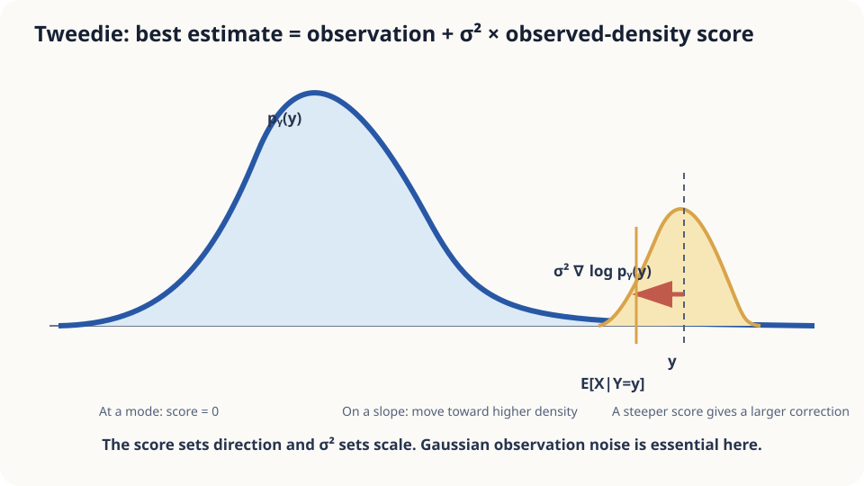

import Objectives from '../../../components/Objectives.astro';
import Prereq from '../../../components/Prereq.astro';
import Question from '../../../components/Question.astro';
import Answer from '../../../components/Answer.astro';
import QuizBlock from '../../../components/QuizBlock.astro';
import Option from '../../../components/Option.astro';
import Explanation from '../../../components/Explanation.astro';
import Details from '../../../components/Details.astro';
import Bridge from '../../../components/Bridge.astro';
import UsedBy from '../../../components/UsedBy.astro';
import Ref from '../../../components/Ref.astro';

# Denoising as a Posterior Mean: Tweedie's Formula

<Objectives title="After reading, you can">
- **Identify posterior-mean denoising** as the squared-error optimum.
- **Derive Tweedie's identity** using Gaussian differentiation, Bayes' rule, and differentiation under an integral.
- **Check noise and population assumptions**, separating the exact identity from estimated scores.
</Objectives>

<Prereq items={frontmatter.prereqs} />

## The scale reads 72.3

A randomly selected student's weight follows a known class distribution, approximately Gaussian with mean 62 kg and standard deviation 8 kg. An unbiased scale adds independent Gaussian noise of standard deviation 1 kg.

The displayed reading is 72.3 kg.

What is the best squared-error estimate of the actual weight?

Symmetric noise makes readings unbiased given a true value. Reversing the conditioning still requires the prior: different clean origins occur at different rates.

Could the observed-reading distribution provide the posterior mean without explicitly evaluating every posterior weight?

<Question label="Discussion" id="Q1">
What is random, which loss defines the best estimate, and how does the population enter?

<Answer summary="Show the reasoning">
Zero-mean noise identifies $\mathbb E[Y\mid X]=X$, not the reversed expectation we need.

Random selection gives a clean value $X$ with prior $p_X$. The reading is $Y=X+\sigma\varepsilon$, with independent standard-Gaussian $\varepsilon$.

Squared-error prediction selects $\mathbb E[X\mid Y=y]$, the average clean origin among readings compatible with $y$.

Near the high reading, lighter compatible origins may be more common than heavier ones. Posterior reweighting then shifts the estimate toward the population center.
</Answer>
</Question>

## Stand on the slope of a density

Imagine people randomly displaced left or right. At the observed position, their possible origins must be weighted by both displacement probability and original population density.

For the Gaussian class example, more compatible people originate on the lighter side, shifting the posterior center below the displayed reading.

The exact correction uses the **observed density $p_Y$**, not the clean density $p_X$. Noise has already smoothed the population before this slope is calculated.



*Figure: the correction is the observed score multiplied by noise variance.*

## Connect three tools to derive Tweedie's identity

Assume independent Gaussian additive noise with $\sigma>0$, existing conditional means, and conditions permitting differentiation under the integral. The observed density is

$$
p_Y(y)=\int p_X(x)\,\varphi_\sigma(y-x)\,dx,\qquad \varphi_\sigma(u)=\frac{1}{\sqrt{2\pi}\sigma}e^{-u^2/(2\sigma^2)} .
$$

Differentiate in three steps.

**First, differentiate under the integral** over clean origins:

$$
p_Y'(y)=\int p_X(x)\,\partial_y\varphi_\sigma(y-x)\,dx .
$$

**Second, differentiate the Gaussian kernel.** Its derivative is the kernel times $-(y-x)/\sigma^2$:

$$
\sigma^2\,p_Y'(y)=\int(x-y)\,p_X(x)\varphi_\sigma(y-x)\,dx=\int x\,p_X(x)\varphi_\sigma(y-x)\,dx\;-\;y\,p_Y(y).
$$

**Third, divide by the marginal and use Bayes' rule.** The normalized integrand becomes posterior weighting:

$$
\sigma^2\,\frac{p_Y'(y)}{p_Y(y)}=\int x\,p(x\mid y)\,dx-y=\mathbb E[X\mid Y=y]-y .
$$

Rearranging gives **Tweedie's formula**:

$$
\boxed{\ \mathbb E[X\mid Y=y]=y+\sigma^2\,\frac{d}{dy}\log p_Y(y)\ }
$$

For isotropic vector noise, replace the scalar derivative by a gradient.

The estimate equals observation plus noise variance times the observed log-density slope. Its direction, magnitude, and noise dependence each have a separate role.

<Details label="Details" summary="Why the observed marginal and its score are useful">
The identity needs the observed marginal score without separately reconstructing the clean prior. This connects to empirical Bayes [1,2]. Estimating a score from data still introduces error; a noisy histogram is not an exact score.

A positive constant normalizer cancels from the log gradient. Shape accuracy, particularly derivative accuracy, remains necessary.
</Details>

## Calculate the correction

For $X\sim\mathcal N(62,64)$ and unit noise, the observed variance is 65 and its score is $-(y-62)/65$. Thus

$$
\mathbb E[X\mid Y=72.3]=72.3-1\times\frac{10.3}{65}=72.3-0.16=72.14\ \text{kg}.
$$

With noise standard deviation 3, observed variance becomes 73. The correction is $-9(10.3)/73\approx-1.27$ kg, giving about 71.03 kg.

Zero marginal score makes the correction zero at that point, including a symmetric center. Increasing noise also changes the observed score, so the total correction need not scale solely as $\sigma^2$.

The identity assumes the correct independent Gaussian noise model and scale, the relevant source population, and squared-error loss for posterior-mean optimality. Using another population's observed density can give the wrong inference.

## Simulate noisy observations

```python
import numpy as np
rng = np.random.default_rng(4); n = 2_000_000
def run(noise, sigma=1.0, ys=(66.0, 72.3, 78.0)):
    X = rng.normal(62, 8, n)
    if noise == "gauss": eps = rng.normal(0, 1, n)
    else: eps = np.where(rng.random(n) < 0.95, rng.normal(0, 1, n), rng.normal(0, 10, n))
    Y = X + sigma*eps
    emp = [X[np.abs(Y-y)<0.1].mean() for y in ys]
    hist, edges = np.histogram(Y, bins=350, range=(30, 100), density=True)
    c = 0.5*(edges[1:] + edges[:-1])
    dlogp = np.gradient(np.log(hist + 1e-12), c)
    estimate = np.array(ys) + sigma**2*np.interp(ys, c, dlogp)
    print(noise, sigma, "conditional bins", np.round(emp, 2), "score estimate", np.round(estimate, 2))
run("gauss", 1.0); run("gauss", 3.0); run("glitch", 1.0)
```

Gaussian cases should approximately match posterior bin averages, with finite-sample and histogram-derivative error. The glitch mixture violates the single-Gaussian noise assumption, so the same correction need not match its true posterior mean.

<iframe loading="lazy" src="/personal_website/notes/research_areas/mathematical-foundations/m1-probability/m1-4-2.en.html" class="demo-frame" title="Tweedie correction under different priors and noise models" style="height: 880px; width: 100%; border: none;"></iframe>

## Check your understanding

<QuizBlock id="m1-4-a">
Under a stable Gaussian measurement model, why can an extreme leaderboard score overestimate underlying skill?
<Option>Selection proves players became lazy.</Option>
<Option correct>Selection favors positive noise as well as skill, and posterior inference can shrink an extreme reading toward denser regions.</Option>
<Option>The scoring system must be broken.</Option>
<Explanation>This is a model-based regression-to-the-mean explanation, not a universal claim about every ranking or changing population.</Explanation>
</QuizBlock>

<QuizBlock id="m1-4-b">
Which derivation step specifically uses Gaussian noise?
<Option>Bayes' rule itself.</Option>
<Option correct>The kernel log derivative being linear in the residual.</Option>
<Option>Every valid exchange of differentiation and integration.</Option>
<Explanation>The linear residual is what turns the integral into posterior mean minus observation.</Explanation>
</QuizBlock>

<QuizBlock id="m1-4-c">
What happens if we use a student-population marginal for a visitor drawn from a different population?
<Option>The formula automatically detects the mismatch.</Option>
<Option>It is necessarily the visitor's optimal estimate.</Option>
<Option correct>It computes inference for the wrong joint law and can shrink toward the wrong population.</Option>
<Explanation>Using only the observed marginal does not mean any population's marginal is interchangeable.</Explanation>
</QuizBlock>

<UsedBy slug={frontmatter.slug} />

<Bridge to="math-vector-field-ode">
Gaussian differentiation and Bayes' rule convert an observed score into a posterior correction. A direction is still not a complete motion rule. Next we ask how a field of arrows defines a trajectory through time.
</Bridge>

## References

1. Robbins, H. *An Empirical Bayes Approach to Statistics.* Proceedings of the Third Berkeley Symposium on Mathematical Statistics and Probability, Vol. 1, 1956.
2. Efron, B. [*Tweedie's Formula and Selection Bias.*](https://doi.org/10.1198/jasa.2011.tm11181) Journal of the American Statistical Association 2011.
3. Stein, C. M. [*Estimation of the Mean of a Multivariate Normal Distribution.*](https://doi.org/10.1214/aos/1176345632) Annals of Statistics 1981.
