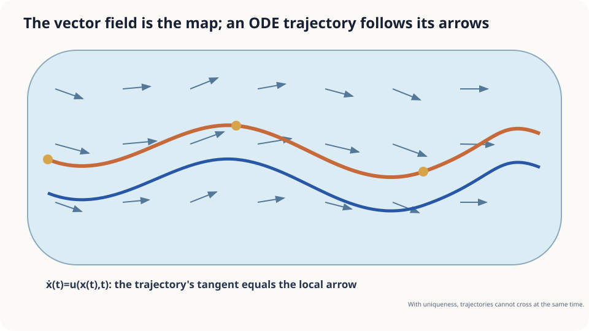

import Objectives from '../../../components/Objectives.astro';
import Prereq from '../../../components/Prereq.astro';
import Question from '../../../components/Question.astro';
import Answer from '../../../components/Answer.astro';
import QuizBlock from '../../../components/QuizBlock.astro';
import Option from '../../../components/Option.astro';
import Explanation from '../../../components/Explanation.astro';
import Details from '../../../components/Details.astro';
import Bridge from '../../../components/Bridge.astro';
import Ref from '../../../components/Ref.astro';
import UsedBy from '../../../components/UsedBy.astro';

# Arrows on a River: Vector Fields and ODEs

<Objectives title="After reading, you can">
- **Define a vector field and its ODE trajectories**, stating sufficient existence and uniqueness assumptions.
- **Derive same-time non-crossing from uniqueness.**
- **Distinguish an exact trajectory from numerical stepping**, including failures of the assumptions.
</Objectives>

<Prereq items={frontmatter.prereqs} />

## A river and a leaf

A river map gives velocity at every location and time over the next minute. One present-time snapshot alone would not suffice if the current changes later.

Where will a leaf released now be in one minute?

Following local arrows seems natural. Does the rule determine one trajectory, including for two leaves released at the same state and time?

<Question label="Discussion" id="Q1">
What mathematical objects describe the current map, leaf position, and arrow-following rule?

<Answer summary="Show the reasoning">
Make the arrows into a function.

A **vector field** $v(x,t)$ assigns each location and time a direction and speed. A field independent of time is autonomous.

The leaf position is a curve $x(t)$ with a specified initial point.

Following the current means its derivative equals the field at its present position:

$$
\dot x(t)=v\big(x(t),t\big),\qquad x(0)=x_0 .
$$

This is an **ordinary differential equation** with an initial condition. Given deterministic dynamics and a fixed start, no random variable is required in this model.
</Answer>
</Question>

## One map, one route?

Imagine moving a pen along local arrows, repeatedly checking at its new location. In the continuous limit its drawn line is a candidate trajectory.

One arrow per input is not alone enough for uniqueness. Even continuity can be insufficient; nearby arrows need suitable spatial regularity.



*Figure: a trajectory's derivative matches the local field.*

## Existence, uniqueness, and non-crossing

An initial-value problem seeks a differentiable curve satisfying $\dot x(t)=v(x(t),t)$ and $x(0)=x_0$. The curve is its solution or trajectory.

**Picard–Lindelöf.** Continuous time dependence and local spatial Lipschitz regularity give a unique local solution. Suitable linear-growth bounds permit extension over the full finite interval.

The Lipschitz inequality bounds output differences by input distance. Bounded spatial Jacobians suffice. In integral form, repeatedly replacing a guessed curve by $x_0+\int v(x(s),s)ds$ contracts differences on a short interval with $hL<1$, motivating the theorem.

**Consequence.** Two solutions meeting at the same time must coincide throughout their common interval under forward and backward uniqueness.

Treat the meeting state and time as a new initial condition. Both curves solve that problem, and uniqueness identifies them. Reversing time retains the required regularity.

This forbids meeting and then separating at the same time. Spatial routes may overlap at different times. In an autonomous field, time-shifted solutions visiting the same point trace the same orbit where defined.

<Details label="Details" summary="Non-uniqueness: a continuous field need not be Lipschitz">
For $\dot x=x^{1/3}$ and $x(0)=0$, both $x(t)=0$ and $x(t)=(2t/3)^{3/2}$ solve the equation for nonnegative time. Waiting at zero before taking the latter branch gives more solutions. The field is not Lipschitz near zero.

Local uniqueness also does not prevent finite-time escape. For $\dot x=x^2$ with positive initial value, $x(t)=1/(1/x_0-t)$ diverges at $1/x_0$. Local Lipschitz regularity guarantees local, rather than unlimited, existence.
</Details>

## State the conditions behind the intuitive route

Under existence and uniqueness, the map and start determine the endpoint. A computer's finite-step polygon is only an approximation and needs a convergent numerical method.

A large Lipschitz constant can permit uniqueness while worsening sensitivity bounds. Failure of a sufficient Lipschitz condition alone does not prove non-uniqueness; the explicit example demonstrates it separately.

## Release a leaf numerically

The simplest stepping rule repeatedly updates position by time interval times current velocity:

```python
import numpy as np
def u(x, t):
    return np.array([1.0, 0.5*np.cos(x[0])])
def drift(x0, T=60.0, h=0.1):
    x, t = np.array(x0, float), 0.0
    while t < T - 1e-12:
        dt = min(h, T-t)
        x = x + dt*u(x, t); t += dt
    return x
print(drift([0.0, 0.0]))
```

For the given start the exact solution is $(t,0.5\sin t)$. Compare numerical endpoints while refining the step; the following numerical-analysis notes explain the convergence rate.

<iframe loading="lazy" src="/personal_website/notes/research_areas/mathematical-foundations/m2-deterministic-dynamics/m2-0-1.en.html" class="demo-frame" title="Lipschitz and non-Lipschitz leaf dynamics" style="height: 800px; width: 100%; border: none;"></iframe>

## Check your understanding

<QuizBlock id="m2-0-a">
A fully known regular wind field carries a balloon. Which statement fits this model?
<Option correct>Its position solves an ODE; different routes cannot meet at the same state and time and then separate.</Option>
<Option>The model must be random because real wind can be turbulent.</Option>
<Option>Present position alone determines the future without the field.</Option>
<Explanation>Random real-world effects are outside the stated deterministic model. Same-time uniqueness does not forbid spatial visits at different times.</Explanation>
</QuizBlock>

<QuizBlock id="m2-0-b">
For $v=(1,\operatorname{sign}(y)\sqrt{|y|})$, what happens from $y=0$?
<Option>The Lipschitz theorem guarantees one route.</Option>
<Option>Leaves must split in opposite directions.</Option>
<Option correct>The theorem's hypothesis fails, and this example has several valid trajectories.</Option>
<Explanation>Both remaining at zero and following $y=t^2/4$ are possible, among other branches.</Explanation>
</QuizBlock>

<QuizBlock id="m2-0-c">
Two autonomous unique solutions visit the same spatial point at different times. What follows?
<Option>Their original clocks must agree.</Option>
<Option correct>After aligning visit times, they follow the same orbit.</Option>
<Option>They can choose different futures from that aligned state.</Option>
<Explanation>An autonomous field does not depend on the absolute clock, so uniqueness applies after a time shift.</Explanation>
</QuizBlock>

<UsedBy slug={frontmatter.slug} />

<Bridge to="math-pushforward-flow-map">
A regular field determines one leaf's trajectory. What happens to the distribution when we release many leaves at once? Next we transport an entire probability law.
</Bridge>

## References

1. Strogatz, S. H. *Nonlinear Dynamics and Chaos: With Applications to Physics, Biology, Chemistry, and Engineering.* Westview Press, 2nd ed., 2015.
2. Hirsch, M. W., Smale, S., Devaney, R. L. *Differential Equations, Dynamical Systems, and an Introduction to Chaos.* Academic Press, 3rd ed., 2013.
3. Hairer, E., Nørsett, S. P., Wanner, G. [*Solving Ordinary Differential Equations I: Nonstiff Problems.*](https://doi.org/10.1007/978-3-540-78862-1) Springer, 2nd ed., 1993.
