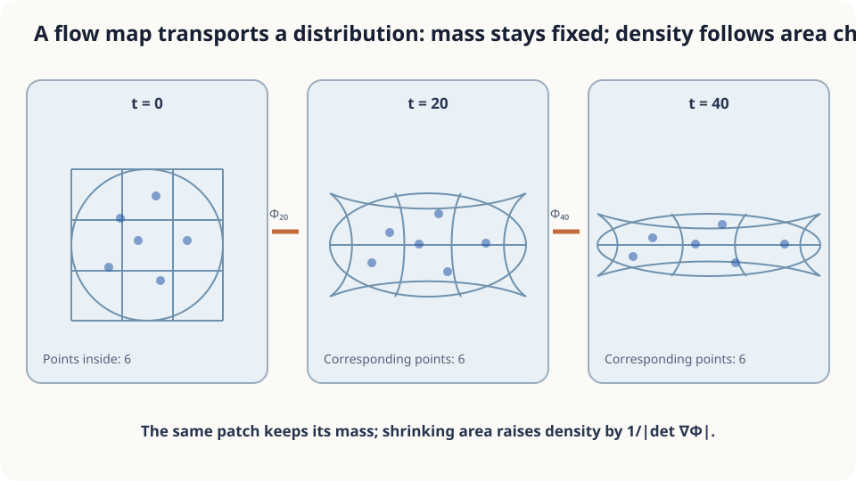

import Objectives from '../../../components/Objectives.astro';
import Prereq from '../../../components/Prereq.astro';
import Question from '../../../components/Question.astro';
import Answer from '../../../components/Answer.astro';
import QuizBlock from '../../../components/QuizBlock.astro';
import Option from '../../../components/Option.astro';
import Explanation from '../../../components/Explanation.astro';
import Details from '../../../components/Details.astro';
import Bridge from '../../../components/Bridge.astro';
import Ref from '../../../components/Ref.astro';
import UsedBy from '../../../components/UsedBy.astro';

# From One Leaf to a Cloud: Flow Maps and Pushforwards

<Objectives title="After reading, you can">
- Define the flow map $\Phi_t$ and explain its invertibility under suitable ODE assumptions.
- Express distribution transport as $p_t=(\Phi_t)_\#p_0$ and derive its density by change of variables.
- Compare particle histograms with density formulas, including their assumptions and errors.
</Objectives>

<Prereq items={frontmatter.prereqs} />

## A thousand leaves

<Ref to="math-vector-field-ode"/> followed one leaf: the velocity field and initial position determine its endpoint.

Now scatter a thousand leaves beneath a bridge, densely near the center and sparsely near the edges. Where will they concentrate a minute later?

All follow the same field, but faster flow stretches the cloud and converging flow compresses it. **Can the map from starting points to endpoints determine the transported density?** We now follow a distribution.

<Question label="Discussion" id="Q1">
What mathematical objects describe the initial and final clouds? How do they relate to one endpoint $x(60)$?

<Answer summary="Show the reasoning">
The thousand positions are samples. Their initial density $p_0$ describes the probability of landing at each location.

The initial position is a random variable $X_0\sim p_0$; the leaves are independent samples.

Each subsequent trajectory is deterministic. Package the ODE solution into a function:

$$
\Phi_t(x_0)=\text{the position reached from }x_0\text{ under }v\text{ at time }t.
$$

The **flow map** $\Phi_t:\mathbb R^d\to\mathbb R^d$ records the endpoint for every starting point, rather than a single trajectory.

The final cloud has the law $p_t$ of $X_t=\Phi_t(X_0)$. Previously we evaluated one input; now we transport the whole distribution. This **pushforward** is written $p_t=(\Phi_t)_\#p_0$.
</Answer>
</Question>

## Deforming jelly

Imagine the cloud as soft jelly. Faster flow ahead stretches it, spreading the same leaves over more area. Converging flow compresses it and raises density.

Under a regular, uniquely solvable flow, distinct starting points cannot merge, and continuous dependence prevents tearing. Each transported piece keeps its probability mass while its volume changes. **Density changes inversely with local volume.**



*Each small piece retains its points; the Jacobian measures its volume change.*

## flow map、pushforward、change of variables

**Flow-map properties.** Assume existence and uniqueness, with solutions defined over the required forward and backward intervals. From <Ref to="math-vector-field-ode"/>:

1. $\Phi_0=\mathrm{id}$. Continuous dependence bounds endpoint differences by $e^{Lt}$ times the initial difference; see Grönwall's inequality in <Ref to="math-euler-error"/>.
2. **Invertibility:** if $\Phi_t(a)=\Phi_t(b)$, backward uniqueness gives $a=b$. The inverse follows the reversed field $-v(x,t-s)$ for $t$ time units. With sufficient smoothness, the map and inverse are differentiable: a **diffeomorphism**.
3. For a time-independent field, $\Phi_{s+t}=\Phi_s\circ\Phi_t$.

**Pushforward.** For a measurable map $\Phi$, the law $\Phi_\#p_0$ is obtained by sampling $X_0\sim p_0$ and applying $\Phi$. For every measurable region $A$:

$$
(\Phi_\#p_0)(A)\;=\;p_0\big(\Phi^{-1}(A)\big)
$$

The probability of arriving in $A$ equals the probability of starting in its preimage. Invertibility is unnecessary.

**Density by change of variables.** Suppose $p_0$ has a density and $\Phi_t$ is a diffeomorphism with nonzero Jacobian determinant. Then:

$$
p_t(y)\;=\;p_0\big(\Phi_t^{-1}(y)\big)\;\Big|\det\nabla\Phi_t^{-1}(y)\Big|
\;=\;\frac{p_0(x)}{\big|\det\nabla\Phi_t(x)\big|}\,,\qquad x=\Phi_t^{-1}(y).
$$

For a small box $A$ near $y$, its preimage near $x$ has volume approximately $|\det\nabla\Phi_t^{-1}(y)|\operatorname{vol}(A)$. Equal probabilities give $p_t(y)\operatorname{vol}(A)\approx p_0(x)|\det\nabla\Phi_t^{-1}(y)|\operatorname{vol}(A)$. Cancel the volume and take the local limit. $\square$

The determinant $|\det\nabla\Phi_t|$ is precisely the jelly's local volume expansion factor.

<Details label="Details" summary="A complete example: xdot = −x with a standard Gaussian start">
The flow is Φ_t(x)=e^(−t)x, with inverse e^t y and inverse derivative e^t. Thus p_t(y)=p₀(e^t y)e^t=(2π)^(−1/2)e^t exp(−e^(2t)y²/2), the density of N(0,e^(−2t)). The cloud narrows toward zero. The factor e^t compensates for the shrinking width, keeping total probability one. The next note derives the same answer from a density equation.
</Details>

## What the intuition leaves out

Volume does not determine shape: a determinant-one shear changes a square into a parallelogram. For smooth flows, $\nabla\cdot v=0$ preserves volume. In general, each material piece retains mass while its density varies inversely with volume.

A pushforward only requires a chosen measurable map. The single-inverse density formula needs stronger assumptions. A many-to-one map needs another treatment; collapsing positive mass to a point can produce an atom without an ordinary density. Nonunique ODEs require selecting a solution before defining a flow map.

## Count leaves or evaluate a formula?

For a fixed region, the sampled proportion from $N$ independent particles has error typically $O(N^{-1/2})$. Histograms also introduce binning error. Change of variables avoids sampling error, but numerical inverse flows and Jacobians can still introduce error.

```python
import numpy as np
t, N = 1.0, 1000
x0 = np.random.randn(N)
xt = np.exp(-t) * x0  # Exact flow for xdot = -x
ys = np.linspace(-2, 2, 200)
p_formula = np.exp(t) * np.exp(-(np.exp(t)*ys)**2/2) / np.sqrt(2*np.pi)
hist, edges = np.histogram(xt, bins=40, range=(-2, 2), density=True)
# Compare the histogram with p_formula; reduce N to 100 to see sampling noise.
```

<iframe loading="lazy" src="/personal_website/notes/research_areas/mathematical-foundations/m2-deterministic-dynamics/m2-1-1.en.html" class="demo-frame" title="Pushforward: particle histogram and transformed density" style="height: 850px; width: 100%; border: none;"></iframe>

## Check your understanding

<QuizBlock id="m2-1-a">
An invertible geometric transformation warps a photograph's coordinates. Which tool relates its original and transformed spatial densities?
<Option>ODE existence and uniqueness.</Option>
<Option correct>Change of variables: divide the original density by the absolute forward Jacobian determinant at its preimage.</Option>
<Option>The divergence of a vector field.</Option>
<Explanation>The map is already given, so change of variables applies directly. Divergence describes an instantaneous volume-change rate for an evolving flow.</Explanation>
</QuizBlock>

<QuizBlock id="m2-1-b">
A chosen measurable map sends distinct starting points to the same endpoint. What follows?
<Option>The pushforward is undefined.</Option>
<Option correct>The pushforward remains defined, but the single-inverse density formula does not apply; a collapse may even create atoms.</Option>
<Option>Only the Jacobian becomes larger.</Option>
<Explanation>Preimages define a pushforward without invertibility. A many-to-one map has no global single inverse. Folding can require summing contributions from several preimages; collapsing positive mass to a point produces an atom. Noninjectivity alone does not imply a zero Jacobian everywhere.</Explanation>
</QuizBlock>

<QuizBlock id="m2-1-c">
For $v(x,y)=(-y,x)$ and $p_0=\mathcal N(0,I)$, what is $p_t$?
<Option>A narrowing Gaussian.</Option>
<Option>A widening Gaussian.</Option>
<Option correct>Still $\mathcal N(0,I)$: rotation preserves volume and this density is rotationally symmetric.</Option>
<Explanation>Every particle moves, but rotating the density leaves it unchanged. Particle motion and distribution evolution are different objects.</Explanation>
</QuizBlock>

<UsedBy slug={frontmatter.slug} />

<Bridge to="math-continuity-equation">
The flow map transports every starting point, and its pushforward transports the distribution. The density formula requires the map and its Jacobian. Next we derive an equation for density directly, without first computing the full flow map.
</Bridge>

## References

1. Hirsch, M. W., Smale, S., Devaney, R. L. *Differential Equations, Dynamical Systems, and an Introduction to Chaos.* Academic Press, 3rd ed., 2013.
2. Villani, C. *Topics in Optimal Transportation.* AMS Graduate Studies in Mathematics 58, 2003.
3. Grimmett, G., Stirzaker, D. *Probability and Random Processes.* Oxford University Press, 3rd ed., 2001.
