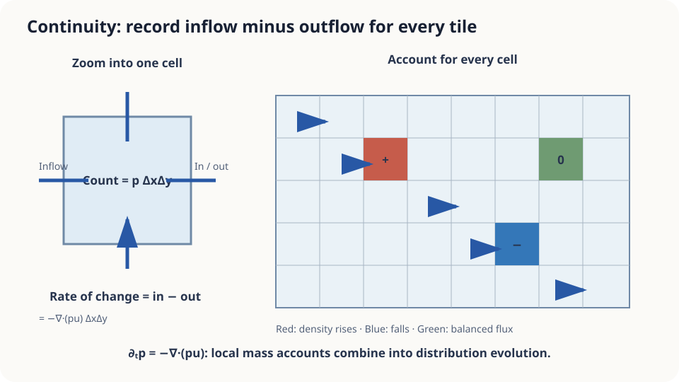

import Objectives from '../../../components/Objectives.astro';
import Prereq from '../../../components/Prereq.astro';
import Question from '../../../components/Question.astro';
import Answer from '../../../components/Answer.astro';
import QuizBlock from '../../../components/QuizBlock.astro';
import Option from '../../../components/Option.astro';
import Explanation from '../../../components/Explanation.astro';
import Details from '../../../components/Details.astro';
import Bridge from '../../../components/Bridge.astro';
import Ref from '../../../components/Ref.astro';
import UsedBy from '../../../components/UsedBy.astro';

# Change in the Crowd = Inflow − Outflow: The Continuity Equation

<Objectives title="After reading, you can">
- Derive $\partial_t p+\nabla\cdot(pu)=0$ from local mass balance and interpret each term.
- Relate the continuity equation to a pushforward, distinguishing an evolution rule from its computed solution.
- Identify the assumptions and boundary information required to predict a crowd's density; verify a one-dimensional example.
</Objectives>

<Prereq items={frontmatter.prereqs} />

## Back to the station

<Ref to="math-divergence"/> counted net flow through a station's gates. Integrating divergence gives the total outward flux.

Now consider the entire concourse: people walk toward platforms, exits, or ticket machines. Suppose we know their velocity at every position and time, together with the current crowd density. **Where will the crowd concentrate ten minutes later?**

<Ref to="math-pushforward-flow-map"/> followed every person and transported the distribution. Alternatively, watch a fixed floor tile: how much enters and leaves? Can these local counts describe density evolution directly?

<Question label="Discussion" id="Q1">
Apply “change = inflow − outflow” to one square floor tile. Which quantities determine the crossings?

<Answer summary="Show the reasoning">
Count people crossing its edges, then express those counts using density and velocity.

The number on a tile is approximately density times area. Across an edge, the crossing rate is density times the normal velocity component times edge length. The vector **flux** is $pv$, mass per unit boundary length per unit time in two dimensions.

Net horizontal inflow is $(pu_1)_{\mathrm{left}}-(pu_1)_{\mathrm{right}}$, times edge length; similarly vertically. For a small tile, these differences give net inflow

$$
\begin{aligned}
&-[\partial_x(pu_1)+\partial_y(pu_2)]\,\Delta A\\
&\qquad=-\nabla\cdot(pu)\,\Delta A.
\end{aligned}
$$

Thus the tile's density changes at minus the divergence of its flux. If a randomly chosen person's position is the random variable, $p(x,t)$ is the density we want to evolve.
</Answer>
</Question>

## A bookkeeper on every tile

Imagine a bookkeeper on each tile, recording crossings without knowing anyone's origin or destination.

Their local accounts jointly describe the distribution. This replaces the **Lagrangian** view, following particles, with the **Eulerian** view, observing fixed locations. The previous flow map and the continuity equation describe the same transport from these two viewpoints.



*Local density changes equal inflow minus outflow; all local accounts together evolve the distribution.*

## Derive it on one box

Let $p$ be density, $v$ velocity, and $J=pv$ flux. A fixed region $B$ contains mass $\int_B p\,dx$. With no internal sources or sinks, its mass can change only through boundary crossings:

$$
\frac{d}{dt}\int_B p\,dx\;=\;-\oint_{\partial B} p\,v\cdot n\,dS\;=\;-\int_B \nabla\cdot(pv)\,dx .
$$

The first equality expresses conservation: the normal $n$ points outward, hence the minus sign. The second uses the divergence theorem. Since $B$ is fixed, differentiating under the integral gives $\int_B\partial_t p\,dx$, provided the required regularity holds. Thus every region $B$ satisfies

$$
\int_B\Big[\partial_t p+\nabla\cdot(pv)\Big]dx=0 .
$$

A continuous function whose integral vanishes on every small region is zero everywhere. Therefore

$$
\boxed{\;\partial_t p+\nabla\cdot(p\,v)=0\;}
$$

This is the **continuity equation**: density changes at minus the flux divergence. Outward spreading lowers density; inward convergence raises it. $\square$

This is a **partial differential equation** in space and time. Initial density, velocity, and appropriate boundary conditions define an evolution problem; obtaining its solution may still require numerical approximation.

**Connection to pushforwards.** Under suitable Lipschitz and existence assumptions, the solution is $(\Phi_t)_\#p_0$ [3, Chapter 8]. For $\dot x=-x$ and $p_0=\mathcal N(0,1)$, the earlier result $p_t=\mathcal N(0,e^{-2t})$ satisfies $\partial_t p+\partial_x(-xp)=0$ directly.

<Details label="Details" summary="Check a Gaussian with variance σ²=e^(−2t) and velocity −x">
Write p=(2πσ²)^(−1/2)exp(−x²/(2σ²)). Then ∂ₓp=−(x/σ²)p, so ∂ₓ(−xp)=(−1+x²/σ²)p. Also log p=−½log(2πσ²)−x²/(2σ²), hence ∂ₜlog p=−½(σ²)′/σ²+(x²/2)(σ²)′/σ⁴. Substituting (σ²)′=−2σ² gives ∂ₜp=(1−x²/σ²)p. The two contributions cancel exactly.

Along a trajectory, $\frac{d}{dt}p(x_t,t)=\partial_t p+v\cdot\nabla p$. Expanding $\nabla\cdot(pv)=v\cdot\nabla p+p\nabla\cdot v$ and dividing by positive density gives

$$
\frac{d}{dt}\log p(x_t,t)=-\nabla\cdot v(x_t,t).
$$

Following a particle, local expansion lowers the density around it. This is the differential form of the flow-map change-of-variables formula.
</Details>

## What conservation does and does not determine

The pointwise derivation assumes sufficient smoothness and valid exchanges of derivatives and integrals. Integral or weak formulations extend conservation to less regular settings. In an open station, total mass inside also depends on the boundary flux.

A density path $p_t$ does **not uniquely determine velocity**. If $v$ satisfies the equation and $\nabla\cdot(pw)=0$, then $v+w$ does too:

$$
\partial_t p+\nabla\cdot\big(p(v+w)\big)=\underbrace{\partial_t p+\nabla\cdot(pu)}_{=0}+\underbrace{\nabla\cdot(pw)}_{=0}=0 .
$$

For a rotationally symmetric Gaussian, $w(x,y)=(-y,x)$ has both $w\cdot\nabla p=0$ and $\nabla\cdot w=0$, so $\nabla\cdot(pw)=0$. Moving along level sets alone would not establish the flux condition. Different trajectories can therefore share the same marginal distributions.

## Compute it, then test its limits

A conservative upwind discretization approximates $\partial_t p+\partial_x(pu)=0$. For $v=-x$ and a standard Gaussian start, compare against the exact Gaussian:

```python
import numpy as np
x = np.linspace(-4, 4, 801)
dx = x[1] - x[0]
dt = 0.002
p = np.exp(-x**2 / 2) / np.sqrt(2 * np.pi)
u_face = -(x[:-1] + x[1:]) / 2
for _ in range(int(1.0 / dt)):
    flux = np.zeros(len(p) + 1)  # Zero boundary flux on the truncated domain
    flux[1:-1] = np.where(u_face >= 0, u_face * p[:-1], u_face * p[1:])
    p -= dt * np.diff(flux) / dx
s2 = np.exp(-2.0)
exact = np.exp(-x**2 / (2*s2)) / np.sqrt(2*np.pi*s2)
print(np.abs(p - exact).max())
```

The finite domain introduces a small truncation error; the example imposes zero boundary flux. Refining space also requires a stable time step, here $\max|u|\,dt/dx\le1$. With discontinuous $v=\operatorname{sign}(x)$, outward motion leaves a central gap. Ordinary derivatives fail at the discontinuity, requiring a weak formulation and a conservative numerical treatment.

<iframe loading="lazy" src="/personal_website/notes/research_areas/mathematical-foundations/m2-deterministic-dynamics/m2-2-1.en.html" class="demo-frame" title="Continuity equation: following particles and observing cells" style="height: 800px; width: 100%; border: none;"></iframe>

## Check your understanding

<QuizBlock id="m2-2-a">
You know traffic speed everywhere and the current number of cars per kilometer. How can you directly predict future traffic density?
<Option>Solve a separate ODE for every car, then count them.</Option>
<Option>Compute the velocity's Jacobian determinant.</Option>
<Option correct>Solve $\partial_t p+\partial_x(pu)=0$, where $pu$ is traffic flux.</Option>
<Explanation>Particle tracking is possible but requires individual starting points. Conservation evolves density directly. If speed itself depends on density, the equation becomes nonlinear while retaining its conservation form.</Explanation>
</QuizBlock>

<QuizBlock id="m2-2-b">
People can leave through the concourse boundary. How does the equation describe the total number inside?
<Option>It handles exits automatically because divergence must become negative there.</Option>
<Option correct>Total mass changes by net boundary flux; specify appropriate open-boundary conditions.</Option>
<Option>The equation necessarily diverges.</Option>
<Explanation>Integrating gives $\frac{d}{dt}\int_B p=-\int_{\partial B}pu\cdot n\,dS$. Positive outward flux reduces interior mass without violating local conservation. Total mass is constant only when the net boundary flux vanishes.</Explanation>
</QuizBlock>

<QuizBlock id="m2-2-c">
Two velocity fields differ by $w$, with $\nabla\cdot(p_t w)=0$ at all times. Starting from $p_0$, what can happen?
<Option>Different trajectories necessarily imply different densities.</Option>
<Option>The flow maps must be identical.</Option>
<Option correct>Under the corresponding uniqueness assumptions, the densities agree although individual trajectories can differ.</Option>
<Explanation>Adding $w$ leaves the density equation unchanged. A flow map still follows the particular velocity, so it can change even when the marginal law does not.</Explanation>
</QuizBlock>

<UsedBy slug={frontmatter.slug} />

<Bridge to="math-euler-error">
We can now distinguish trajectory evolution from distribution evolution. A computer updates directions at discrete times: how far can those missed changes move its final answer? The next note studies this numerical error.
</Bridge>

## References

1. Evans, L. C. *Partial Differential Equations.* AMS Graduate Studies in Mathematics 19, 2nd ed., 2010.
2. Villani, C. *Topics in Optimal Transportation.* AMS Graduate Studies in Mathematics 58, 2003.
3. Ambrosio, L., Gigli, N., Savaré, G. [*Gradient Flows in Metric Spaces and in the Space of Probability Measures.*](https://doi.org/10.1007/978-3-7643-8722-8) Birkhäuser, 2nd ed., 2008..）
