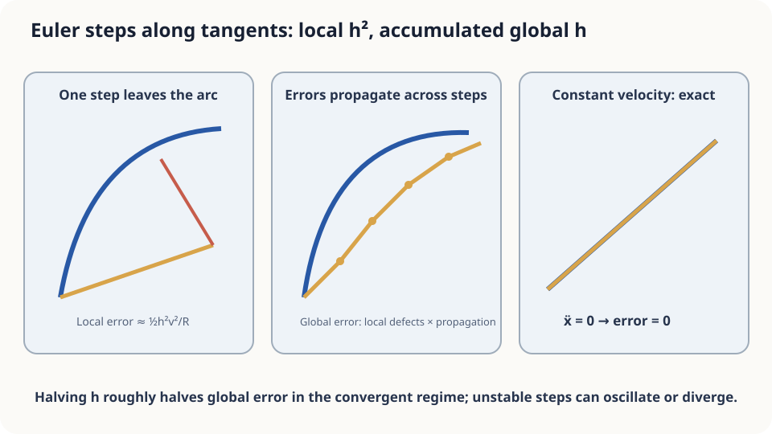

import Objectives from '../../../components/Objectives.astro';
import Prereq from '../../../components/Prereq.astro';
import Question from '../../../components/Question.astro';
import Answer from '../../../components/Answer.astro';
import QuizBlock from '../../../components/QuizBlock.astro';
import Option from '../../../components/Option.astro';
import Explanation from '../../../components/Explanation.astro';
import Details from '../../../components/Details.astro';
import Bridge from '../../../components/Bridge.astro';
import Ref from '../../../components/Ref.astro';
import UsedBy from '../../../components/UsedBy.astro';

# Navigation Updates Every 30 Seconds: Euler's Method and Its Error

<Objectives title="After reading, you can">
- Express infrequent direction updates as Euler steps and identify the missed acceleration.
- Derive $e_{k+1}\le(1+hL)e_k+\|r_k\|$ using the triangle inequality and Lipschitz continuity.
- Derive $e_N\le h e^{LT}\int_0^T\|a_t(x_t)\|dt$ and distinguish bounds, actual errors, and numerical stability.
</Objectives>

<Prereq items={frontmatter.prereqs} />

## A bend and a navigation system saving power

You drive at 60 km/h around a quarter-circle bend of radius 2 km. Your navigation system checks velocity only every **30 seconds**, then extrapolates straight ahead at that velocity until the next check.

After about 3.1 km and just over three minutes, how far is its estimated position from yours? What if the road is straight?

Infrequent updates miss turns, but they also miss acceleration and braking along a straight road. **How does more frequent updating reduce error?** Separate the change missed this step from propagation of the previous position error.

<Question label="Discussion" id="Q1">
Which objects represent the true and approximate positions? Write the update and the quantity we want to bound.

<Answer summary="Show the reasoning">
The true position satisfies $\frac{dx_t}{dt}=v_t(x_t)$. Let $t_k=kh$ and denote the estimate by $\hat x_{t_k}$. It evaluates velocity at the approximate position:

$$
\hat x_{t_{k+1}}=\hat x_{t_k}+h\,v_{t_k}(\hat x_{t_k}).
$$

This is **Euler's method**. With matching initial positions, the endpoint error is $e_N=\|x_T-\hat x_T\|$. There is no sampling randomness here: this is ODE discretization error.
</Answer>
</Question>

## A tangent leaves the circle

One Euler step moves 500 m along the tangent: 30 seconds times 16.7 m/s. The exact motion follows the arc, so the approximate endpoint lies outside the circle. This discrepancy, starting from the exact point, is the **local error**.

The next step starts from an already displaced point and reads a different velocity. Error therefore combines **new local defects** with **propagated earlier errors**, which may amplify.

Constant-velocity straight motion is exact for Euler. A straight path with changing speed still has error.



*Local error is second order; accumulated global error is first order. Constant velocity gives zero error.*

## One-step defects and accumulated error

Assume sufficient smoothness and define acceleration along the exact trajectory:

$$
a_t(x_t):=\frac{d}{dt}v_t(x_t)
=\partial_t v_t(x_t)+\nabla_xv_t(x_t)\,v_t(x_t).
$$

By the chain rule in <Ref to="math-total-derivative"/>, velocity changes both explicitly with time and because the particle moves through the field. Acceleration includes turning, speeding up, and slowing down; it is not geometric curvature.

**One step.** Exact displacement integrates velocity. Express the change from its initial value by integrating acceleration:

$$
\begin{aligned}
x_{t_{k+1}}&=x_{t_k}+h\,v_{t_k}(x_{t_k})+r_k,\\
r_k&=\int_{t_k}^{t_{k+1}}\!\big(v_s(x_s)-v_{t_k}(x_{t_k})\big)\,ds\\
&=\int_{t_k}^{t_{k+1}}(t_{k+1}-r)\,a_r(x_r)\,dr.
\end{aligned}
$$

The last equality exchanges integration order. Thus $\|r_k\|\le h^2M_k/2$, where $M_k=\sup_{[t_k,t_{k+1}]}\|a_t(x_t)\|$. The vector integral remainder avoids assuming a common Taylor intermediate point for all components.

**Propagating old errors.** Subtract the Euler update from the exact update:

$$
x_{t_{k+1}}-\hat x_{t_{k+1}}
=(x_{t_k}-\hat x_{t_k})
+h\big(v_{t_k}(x_{t_k})-v_{t_k}(\hat x_{t_k})\big)+r_k.
$$

Set $e_k=\|x_{t_k}-\hat x_{t_k}\|$ and apply the triangle inequality:

$$
e_{k+1}\le e_k
+h\|v_{t_k}(x_{t_k})-v_{t_k}(\hat x_{t_k})\|+\|r_k\|.
$$

If $v_t$ is $L$-Lipschitz in position, the middle term is bounded by $hLe_k$, giving

$$
e_{k+1}\le(1+hL)e_k+\|r_k\|.
$$

These terms represent the old displacement, the velocity difference caused by that displacement, and the new local defect. Starting from $e_0=0$, expand the recurrence:

$$
e_N\le\sum_{k=0}^{N-1}(1+hL)^{N-1-k}\|r_k\|
\le e^{LT}\sum_{k=0}^{N-1}\|r_k\|.
$$

Using $t_{k+1}-r\le h$ inside each remainder gives the bound

$$
\boxed{e_N\le h e^{LT}\int_0^T\|a_t(x_t)\|\,dt.}
$$

With a common acceleration bound $M$, the local bounds also yield $e_N\le e^{LT}ThM/2$. Both establish first-order convergence as $h$ shrinks. A halved bound does not imply the actual error halves exactly; $e^{LT}$ is a worst-case propagation estimate.

<Details label="Details" summary="Continuous Grönwall inequality and a short proof">
If φ(t)≥0 and φ(t)≤A+L∫₀ᵗφ(s)ds, then φ(t)≤Ae^(Lt). Set Ψ(t)=A+L∫₀ᵗφ. Since Ψ′=Lφ≤LΨ, the derivative of Ψe^(−Lt) is nonpositive. Hence φ≤Ψ≤Ae^(Lt). □
For two trajectories initially separated by δ, their distance satisfies this inequality with A=δ. Their separation is at most δe^(Lt). The discrete recurrence replaces the integral by a sum and the exponential step factor by 1+hL.
</Details>

## Correct intuition, different numbers

On the circular arc, speed $c=16.7$ m/s and radius $R=2000$ m give $\|a_t\|=c^2/R\approx0.139$ m/s² over about 188 seconds. The factor $hTM/2$ is about 390 m, before the field's Lipschitz propagation factor. This is a conservative bound, not an endpoint-error prediction.

The code computes actual errors for this field. It adjusts the effective step to end exactly at $T$, so a displayed 30 seconds is approximate. The theory identifies controlling quantities; the specified field and solver determine the numerical answer.

Reducing the interval from 30 to 10 seconds reduces error by roughly three, rather than nine, in this smooth small-step regime: global order one differs from local order two.

Remember that $\ddot x$ is acceleration. Speed changes on a straight road also cause error, now along the road rather than sideways.

## Run it, then make the step too large

```python
import numpy as np
R, v = 2000.0, 60/3.6
T = (np.pi/2)*R/v  # Time for a quarter circle
def u(x):
    r = np.hypot(*x)
    return v*np.array([-x[1], x[0]])/r
def euler(h):
    N = int(round(T/h))
    x = np.array([R, 0.0])
    for _ in range(N):
        x = x + (T/N)*u(x)
    return np.linalg.norm(x - np.array([0.0, R]))
for h in [30, 10, 3, 1]:
    print(h, round(euler(h)))
# Errors scale approximately linearly with h in the small-step regime.
```

**Stability** asks another question. For $\dot x=-kx$ with $k>0$, the exact solution decays, while Euler multiplies by $1-hk$. Its magnitude is below one when $0<hk<2$, equals one at $hk=2$, and exceeds one for $hk>2$. Check this actual amplification factor; the conservative $(1+hL)$ bound alone does not decide stability.

<iframe loading="lazy" src="/personal_website/notes/research_areas/mathematical-foundations/m2-deterministic-dynamics/m2-3-1.en.html" class="demo-frame" title="Euler: step size, curvature, speed, and stability" style="height: 800px; width: 100%; border: none;"></iframe>

## Check your understanding

<QuizBlock id="m2-3-a">
A robot estimates position by reading velocity every half-second and extrapolating at constant velocity. Which motion gives the most accurate estimate?
<Option>Slow motion along a winding path.</Option>
<Option correct>Constant-speed straight motion, even if fast.</Option>
<Option>Fast motion around a small circle.</Option>
<Explanation>The bound involves integrated acceleration. Constant velocity makes it zero. Circular acceleration is speed squared divided by radius; low speed alone does not guarantee the smallest error.</Explanation>
</QuizBlock>

<QuizBlock id="m2-3-b">
Reducing the update interval from 30 to 10 seconds changes endpoint error from about 486 to 161 m. What is a reasonable expectation at one second?
<Option correct>About 16 m: first-order global error scales approximately with $h$.</Option>
<Option>About 1.6 m: global error scales with $h^2$.</Option>
<Option>Exactly zero once updates are frequent enough.</Option>
<Explanation>A local $O(h^2)$ defect occurs over $T/h$ steps, leading to global $O(h)$ under the stated assumptions. First-order scaling is asymptotic, not an exact formula at every step size.</Explanation>
</QuizBlock>

<QuizBlock id="m2-3-c">
What does $L$ control in $h e^{LT}\int\|a_t(x_t)\|dt$?
<Option>The local acceleration term alone.</Option>
<Option>Nothing beyond ODE existence and uniqueness.</Option>
<Option correct>The velocity difference between displaced positions and the resulting error-propagation bound; it does not alone determine numerical instability.</Option>
<Explanation>Acceleration controls the local remainder. Lipschitz continuity bounds how reading the field at the wrong position affects the next update. Stability still requires examining the actual numerical amplification.</Explanation>
</QuizBlock>

<UsedBy slug={frontmatter.slug} />

<Bridge to="math-higher-order">
Euler misses velocity changes within a step. Smaller steps help but require more evaluations. Can another velocity evaluation within the same step capture that change and improve accuracy under the same evaluation budget?
</Bridge>

## References

1. Hairer, E., Nørsett, S. P., Wanner, G. [*Solving Ordinary Differential Equations I: Nonstiff Problems.*](https://doi.org/10.1007/978-3-540-78862-1) Springer, 2nd ed., 1993.
2. Butcher, J. C. [*Numerical Methods for Ordinary Differential Equations.*](https://doi.org/10.1002/9781119121534) Wiley, 3rd ed., 2016.
3. Grönwall, T. H. [*Note on the Derivatives with Respect to a Parameter of the Solutions of a System of Differential Equations.*](https://doi.org/10.2307/1967124) Annals of Mathematics 20(4), 1919.
