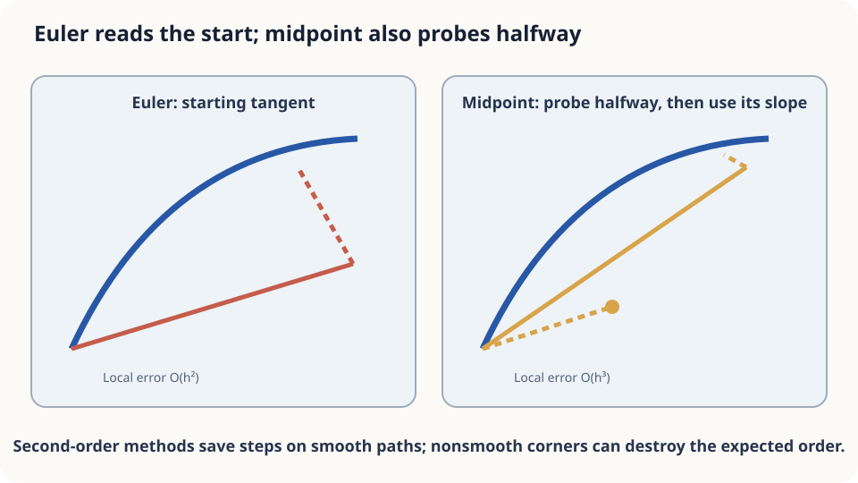

import Objectives from '../../../components/Objectives.astro';
import Prereq from '../../../components/Prereq.astro';
import Question from '../../../components/Question.astro';
import Answer from '../../../components/Answer.astro';
import QuizBlock from '../../../components/QuizBlock.astro';
import Option from '../../../components/Option.astro';
import Explanation from '../../../components/Explanation.astro';
import Details from '../../../components/Details.astro';
import Bridge from '../../../components/Bridge.astro';
import Ref from '../../../components/Ref.astro';
import UsedBy from '../../../components/UsedBy.astro';

# One More Look Halfway Through: Higher-Order Methods

<Objectives title="After reading, you can">
- Write Heun and midpoint updates and derive their $O(h^3)$ local and $O(h^2)$ global errors.
- Compare accuracy under the same number of velocity evaluations, including per-step costs.
- Explain the smoothness and budget assumptions behind higher-order improvements and test a small simulation.
</Objectives>

<Prereq items={frontmatter.prereqs} />

## The same bend, one extra reading

In <Ref to="math-euler-error"/>, infrequent navigation updates gave an endpoint error near 486 m on a quarter-circle of radius 2 km. Updating every 10 rather than 30 seconds reduced it to about 161 m, at three times the evaluation cost.

Euler treats velocity as constant over each step, like a rectangle under a curve. An endpoint estimate suggests a trapezoid; a midpoint estimate suggests a velocity closer to the step average. **Can this extra reading recover the acceleration term Euler missed?**

<Question label="Discussion" id="Q1">
How do we write a midpoint reading as an update, and what comparison fairly accounts for its cost?

<Answer summary="Show the reasoning">
First predict a midpoint with a half Euler step, evaluate velocity there, then take a full step **from the original position** using that velocity:

$$
k_1=v(x_n,t_n),\qquad k_2=v\!\big(x_n+\tfrac{h}{2}k_1,\;t_n+\tfrac h2\big),\qquad x_{n+1}=x_n+h\,k_2 .
$$

This is **explicit midpoint**. **Heun's method** instead predicts an endpoint with Euler and averages the velocities at the original and predicted positions:

$$
k_1=v(x_n,t_n),\qquad k_2=v(x_n+h\,k_1,\;t_n+h),\qquad x_{n+1}=x_n+\tfrac h2(k_1+k_2).
$$

Euler uses the initial velocity, midpoint uses the predicted midpoint velocity, and Heun averages the two endpoint evaluations.

Compare equal **numbers of function evaluations (NFE)**. Euler costs one per step; Heun and midpoint cost two. For example, over a three-minute interval, twelve Euler steps of 15 seconds and six midpoint steps of 30 seconds both cost twelve evaluations.
</Answer>
</Question>

## Tangent versus chord

On a circular arc, Euler follows the initial tangent and misses the exact endpoint by $O(h^2)$ locally.

The exact midpoint tangent is parallel to the chord and better approximates net displacement. But numerical midpoint uses a **predicted** midpoint, and its endpoint need not lie exactly on the circle. Taylor expansion must verify the improvement suggested by this picture.



*An extra field evaluation provides second-order accuracy on smooth problems.*

## Match the quadratic term

Assume sufficient smoothness and bounded relevant derivatives. Starting from the exact position, the acceleration defined previously gives

$$
x_{t+h}=x_t+h v_t(x_t)+\tfrac{h^2}{2}a_t(x_t)+O(h^3).
$$

**Heun first.** The predicted endpoint is $\tilde x_{t+h}=x_t+hv_t(x_t)$. Expand in both position and time:

$$
\begin{aligned}
v_{t+h}(\tilde x_{t+h})
&=v_t(x_t)+h\partial_t v_t(x_t)
+h\nabla_xv_t(x_t)\,v_t(x_t)+O(h^2)\\
&=v_t(x_t)+h a_t(x_t)+O(h^2).
\end{aligned}
$$

The average velocity is consequently $v_t(x_t)+\frac h2a_t(x_t)+O(h^2)$. Multiplying by $h$ gives

$$
x_t+\tfrac h2\big(v_t(x_t)+v_{t+h}(\tilde x_{t+h})\big)
=x_t+h v_t(x_t)+\tfrac{h^2}{2}a_t(x_t)+O(h^3).
$$

This matches the exact solution through the quadratic term. At the predicted half-step, midpoint likewise evaluates $v_t(x_t)+\frac h2a_t(x_t)+O(h^2)$ and matches the same terms.

**Global error.** The propagation argument from <Ref to="math-euler-error"/> now accumulates $O(h^3)$ local defects over $T/h$ steps, giving $O(h^2)$ globally. Halving $h$ therefore reduces the leading error by approximately four, compared with two for Euler.

Under appropriate consistency and stability assumptions, local error $O(h^{p+1})$ leads to global error $O(h^p)$: **order $p$**. Euler has order one; Heun and midpoint have order two. Classical RK4 has order four and uses four evaluations per step [1,2].

<Details label="Details" summary="The numerical integration view when velocity depends only on time">
If v=v(t), the solution integrates v over the step. Euler uses the left rectangle h·v(t), with leading exact-minus-numerical error (h²/2)v′. Midpoint uses h·v(t+h/2); expansion about the midpoint m cancels odd powers, leaving leading exact-minus-numerical error (h³/24)v″(m). Heun uses the trapezoid (h/2)[v(t)+v(t+h)], whose numerical-minus-exact error is (h³/12)v″(m). These are leading terms in the time-only case. Position dependence introduces additional terms, so these constants do not generally predict the ratio of ODE solver errors.
</Details>

## When does the extra reading help?

For the smooth bend, midpoint at roughly 30-second steps gives about 7 m error and Heun about 23 m, far below the more expensive 10-second Euler estimate. The extra evaluation cancels a leading error term, changing its order rather than merely halving its coefficient.

The benefit depends on several conditions:

- **Smoothness:** bounded derivatives justify the remainder estimates. Discontinuities or corners require separate analysis, sometimes including event location.
- **Budget:** with $E$ evaluations, second-order error behaves like $C_2(2T/E)^2$, while Euler behaves like $C_1T/E$. The asymptotic $E^{-2}$ improvement need not dominate at extremely coarse steps or tiny budgets.
- **Stability:** higher order does not permit arbitrary step sizes. For $\dot x=-kx$, both methods have amplification $1-hk+(hk)^2/2$, whose decay interval on the negative real axis is still $0<hk<2$.

## Compare equal evaluation budgets

```python
import numpy as np
R, v = 2000.0, 60/3.6
T = (np.pi/2)*R/v
def u(x):
    r = np.hypot(*x)
    return v*np.array([-x[1], x[0]])/r
def run(method, nfe):
    steps = nfe if method == 'euler' else nfe//2
    h = T/steps
    x = np.array([R, 0.0])
    for _ in range(steps):
        k1 = u(x)
        if method == 'euler':
            x = x + h*k1
        else:
            x = x + h*u(x + 0.5*h*k1)
    return np.linalg.norm(x - np.array([0.0, R]))
for nfe in [12, 38, 126]:
    print(nfe, round(run('euler', nfe)), round(run('midpoint', nfe), 1))
# Compare errors using exactly the same evaluation budget.
```

On this smooth example, midpoint is substantially more accurate at equal NFE, with an increasing advantage as the budget grows. A path with an unresolved right-angle corner violates the smoothness assumptions: the crossing step can incur an $O(h)$ defect and sharply reduce the advantage. The exact result depends on how the corner and crossing event are modeled.

<iframe loading="lazy" src="/personal_website/notes/research_areas/mathematical-foundations/m2-deterministic-dynamics/m2-4-1.en.html" class="demo-frame" title="Fixed NFE: Euler and midpoint on smooth paths and corners" style="height: 800px; width: 100%; border: none;"></iframe>

## Check your understanding

<QuizBlock id="m2-4-a">
Each velocity evaluation in a weather model costs one minute, with an hour available. Which claim is most reasonable?
<Option>Sixty Euler steps must be best because they give the most steps.</Option>
<Option>Fifteen RK4 steps must be best because higher order always wins.</Option>
<Option correct>The answer depends on smoothness and whether sixty evaluations reach the method's useful accuracy regime.</Option>
<Explanation>Compare total evaluations while accounting for order, constants, stability, and smoothness. Neither step count nor formal order alone decides accuracy.</Explanation>
</QuizBlock>

<QuizBlock id="m2-4-b">
Midpoint helps much less on a city route than a smooth highway. What is a plausible explanation?
<Option correct>Sharp turns violate the Taylor assumptions, so steps crossing unresolved corners can lose the expected order.</Option>
<Option>Slow speed prevents midpoint from making corrections.</Option>
<Option>Midpoint works only for time-independent fields.</Option>
<Explanation>Both time-dependent and autonomous smooth fields admit second-order midpoint integration. Corners can invalidate that proof; the actual convergence rate depends on the nonsmooth model and event treatment.</Explanation>
</QuizBlock>

<QuizBlock id="m2-4-c">
Why are Heun and midpoint both second order?
<Option>Two evaluations automatically imply order two.</Option>
<Option correct>Their expansions match the exact solution through $h^2$, with the first possible mismatch at $h^3$.</Option>
<Option>Both evaluate velocity at the endpoint.</Option>
<Explanation>Extra evaluations are a means to satisfy order conditions, not a guarantee. A poorly chosen two-evaluation method can remain first order, and midpoint does not evaluate at the endpoint.</Explanation>
</QuizBlock>

<UsedBy slug={frontmatter.slug} />

<Bridge to="math-random-walk-brownian">
An extra evaluation captures terms Euler misses, but we are still approximating a deterministic ODE. If unpredictable perturbations occur at every small interval, identical starting points may follow different paths. The next unit builds that description from random left-or-right steps.
</Bridge>

## References

1. Hairer, E., Nørsett, S. P., Wanner, G. [*Solving Ordinary Differential Equations I: Nonstiff Problems.*](https://doi.org/10.1007/978-3-540-78862-1) Springer, 2nd ed., 1993.
2. Butcher, J. C. [*Numerical Methods for Ordinary Differential Equations.*](https://doi.org/10.1002/9781119121534) Wiley, 3rd ed., 2016.
