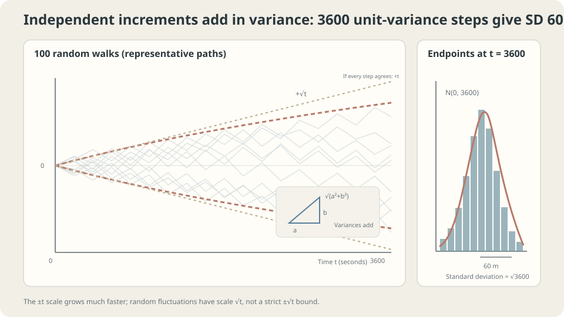

import Objectives from '../../../components/Objectives.astro';
import Prereq from '../../../components/Prereq.astro';
import Question from '../../../components/Question.astro';
import Answer from '../../../components/Answer.astro';
import QuizBlock from '../../../components/QuizBlock.astro';
import Option from '../../../components/Option.astro';
import Explanation from '../../../components/Explanation.astro';
import VizPlan from '../../../components/VizPlan.astro';
import Details from '../../../components/Details.astro';
import Bridge from '../../../components/Bridge.astro';
import Ref from '../../../components/Ref.astro';
import UsedBy from '../../../components/UsedBy.astro';

# Where Is the Walker After an Hour? From Random Walks to Brownian Motion

<Objectives title="After reading, you can">
- Compute a centered random walk's mean and variance and explain the vanishing cross terms.
- State Brownian motion's properties and justify the $\sqrt h$ increment scale.
- Check the independence and finite-variance assumptions using simulations and counterexamples.
</Objectives>

<Prereq items={frontmatter.prereqs} />

## A long street and an unsteady walker

A walker starts under a streetlight and independently steps one meter left or right each second, with equal probabilities. How far from the streetlight is the walker after an hour?

The steps can cancel, but not perfectly every time. Mean position is zero, yet the cloud of possible positions spreads. **Which quantity captures typical distance, and how does it grow with time?**

<Question label="Discussion" id="Q1">
Define each step and the final position. Why is average position insufficient to describe distance?

<Answer summary="Show the reasoning">
Symmetry makes average position zero; that does not mean every walker stays at the streetlight.

Let independent $\xi_i\in\{-1,+1\}$ have equal probabilities. After an hour, the position is

$$
S_n=\xi_1+\xi_2+\cdots+\xi_n,\qquad n=3600 .
$$

The sum $S_n$ defines a **random walk**. Its spread is measured by $\operatorname{Var}(S_n)=\mathbb E[S_n^2]$, since its mean is zero. The square root is the **root-mean-square (RMS) distance**, rather than mean signed position.

We therefore need the growth of $\operatorname{Var}(S_n)$ with $n$.
</Answer>
</Question>

## Directions cancel; variances add

Split the hour into two independent halves. The second half neither pushes outward nor pulls inward on average. The two displacement magnitudes do not simply add or cancel: their squared RMS distances add, like the squared sides of a right triangle.

The steps are not literally perpendicular; their expected cross terms vanish. The RMS distance after 3600 steps is 60 m. This differs from mean absolute distance, approximately $60\sqrt{2/\pi}\approx48$ m under a Gaussian approximation.



*Independent finite-variance steps spread on a square-root scale; the endpoint standard deviation after 3600 steps is 60.*

## Adding variances and taking the limit

**Theorem.** Independent centered increments with variance $\sigma^2$ satisfy $\mathbb E[S_n]=0$ and $\operatorname{Var}(S_n)=n\sigma^2$.

Expand the square:

$$
\mathbb E[S_n^2]=\mathbb E\Big[\sum_i\xi_i^2+\sum_{i\ne j}\xi_i\xi_j\Big]=\sum_i\mathbb E[\xi_i^2]+\sum_{i\ne j}\mathbb E[\xi_i]\,\mathbb E[\xi_j]=n\sigma^2+0 .
$$

Independence factors $\mathbb E[\xi_i\xi_j]$ into the product of means, which is zero. All cross terms disappear. $\square$

Thus RMS distance is $\sigma\sqrt n$. For iid steps with finite variance, the central limit theorem gives $S_n/\sqrt n\Rightarrow\mathcal N(0,\sigma^2)$. This is a limiting result for possibly non-Gaussian increments; independence and individual finite variances alone do not establish this iid version.

**Brownian limit.** Take a step of size $\delta$ every $h$ seconds. At time $t$, variance is $\delta^2t/h$. A finite, nonzero limit requires $\delta^2/h$ to stay constant. Set $\delta=\sqrt h$. The limiting process $W_t$ has these properties:

1. $W_0=0$ and $W_t\sim\mathcal N(0,t)$.
2. Independent stationary increments: $W_t-W_s\sim\mathcal N(0,t-s)$, independent of the past up to $s$.
3. Continuous sample paths.

This is **Brownian motion**, also called the Wiener process [3]. Over time $h$, its increment is $\sqrt h\,\varepsilon$ with $\varepsilon\sim\mathcal N(0,1)$, the basis of the next note's SDE simulation.

<Details label="Details" summary="Why steps of size h disappear and constant-size steps explode">
With t/h steps of size δ, variance is δ²t/h. Setting δ=h gives ht→0; constant δ gives variance tending to infinity; δ=√h gives variance t. The square-root scale warns against interpreting an increment divided by h as ordinary velocity. Almost-sure nowhere differentiability is a separate theorem [3], not proved by this scaling observation. We therefore use increments and stochastic integrals.
</Details>

## Zero mean does not mean returning every time

A zero mean and RMS distance 60 m coexist because left and right displacements cancel across walkers. Rare individuals may travel much farther; one distant outcome does not prove correlation.

For correlated steps, recalculate cross terms. In the specific stationary model that preserves direction with probability $(1+\rho)/2$, lag-$k$ covariance is $\sigma^2\rho^k$. For fixed $|\rho|<1$ and large $n$, variance is approximately $n\sigma^2(1+\rho)/(1-\rho)$. Merely specifying adjacent correlation does not imply this entire covariance structure. Infinite-variance steps invalidate the RMS calculation.

<Details label="Details" summary="Variance for persistent ±1 steps">
Start with a symmetric direction and keep it with probability (1+ρ)/2 each step. Then E[ξᵢξᵢ₊ₖ]=ρ^k, so Var(Sₙ)=n+2Σₖ₌₁ⁿ⁻¹(n−k)ρ^k, asymptotically n(1+ρ)/(1−ρ) for fixed |ρ| less than one. Positive persistence increases the coefficient; negative persistence decreases it. At ρ=1, every step keeps its direction and variance is n²; this boundary case must be distinguished from the fixed-ρ large-n limit.
</Details>

## Simulate, then break the assumptions

```python
import numpy as np
rng = np.random.default_rng(0)
def walk(n=3600, rho=0.0, trials=5000):
    keep = rng.random((trials, n)) < (1+rho)/2
    flips = np.where(keep, 1, -1)
    flips[:, 0] = 1
    steps = rng.choice([-1, 1], trials)[:, None] * np.cumprod(flips, axis=1)
    return np.sqrt(np.mean(steps.sum(axis=1)**2))
for rho in [0.0, 0.5, 0.9]:
    print(rho, round(walk(rho=rho)), round(60*np.sqrt((1+rho)/(1-rho))))
# Compare simulated RMS distances with the large-n prediction.
```

Independence gives RMS near 60. Persistence increases it by approximately $\sqrt{(1+\rho)/(1-\rho)}$, while multiplying $n$ by four roughly doubles it for fixed $\rho$. Cauchy steps have no variance: empirical RMS becomes unstable as trials increase, and neither the finite-variance formula nor this Gaussian limit applies.

<iframe loading="lazy" src="/personal_website/notes/research_areas/mathematical-foundations/m3-stochastic-dynamics/m3-0-1.en.html" class="demo-frame" title="Square-root-time spreading: step size, correlation, and heavy tails" style="height: 820px; width: 100%; border: none;"></iframe>

## Check your understanding

<QuizBlock id="m3-0-a">
Sum 250 independent centered sensor errors, each with standard deviation one. What is the sum's RMS error?
<Option>250.</Option>
<Option correct>About 16, because variances add.</Option>
<Option>About one, because signs cancel.</Option>
<Explanation>The sum has standard deviation $\sqrt{250}$. The average, a different quantity, has standard deviation $1/\sqrt{250}$.</Explanation>
</QuizBlock>

<QuizBlock id="m3-0-b">
In the specified persistent-step model with $\rho=0.9$, what is the RMS distance after 3600 steps?
<Option>Still 60 m.</Option>
<Option>3600 m.</Option>
<Option correct>Approximately 260 m: square-root scaling remains, with an enlarged coefficient.</Option>
<Explanation>Lag covariances contribute to variance. Fixed persistence below one leaves large-n variance proportional to n. At ρ=0.9, direction flips with probability 0.05 each step; it is not permanently fixed.</Explanation>
</QuizBlock>

<QuizBlock id="m3-0-c">
With a Brownian simulation step $h=0.001$, which random increment should be added?
<Option>$h\varepsilon$.</Option>
<Option correct>$\sqrt h\varepsilon$, for independent standard Gaussian $\varepsilon$.</Option>
<Option>Unscaled $\varepsilon$.</Option>
<Explanation>After $t/h$ steps, these choices give variance $ht$, $t$, and $t/h$, respectively. Only the square-root scale preserves the intended Brownian variance.</Explanation>
</QuizBlock>

<UsedBy slug={frontmatter.slug} />

<Bridge to="math-sde">
Adding independent variances explains square-root spreading and Brownian increments $\sqrt h\varepsilon$. Next add this random component to a deterministic river flow and ask how to simulate a leaf's motion.
</Bridge>

## References

1. Grimmett, G., Stirzaker, D. *Probability and Random Processes.* Oxford University Press, 3rd ed., 2001.
2. Feller, W. *An Introduction to Probability Theory and Its Applications, Vol. 1.* Wiley, 3rd ed., 1968.
3. Mörters, P., Peres, Y. [*Brownian Motion.*](https://doi.org/10.1017/CBO9780511750489) Cambridge University Press, 2010.
4. Einstein, A. [*Über die von der molekularkinetischen Theorie der Wärme geforderte Bewegung von in ruhenden Flüssigkeiten suspendierten Teilchen.*](https://doi.org/10.1002/andp.19053220806) Annalen der Physik 17, 1905.
