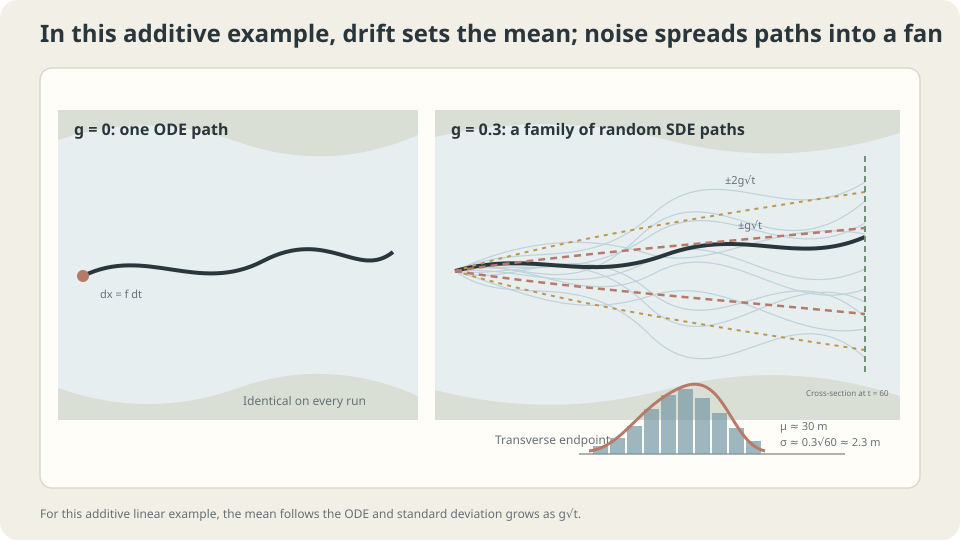

import Objectives from '../../../components/Objectives.astro';
import Prereq from '../../../components/Prereq.astro';
import Question from '../../../components/Question.astro';
import Answer from '../../../components/Answer.astro';
import QuizBlock from '../../../components/QuizBlock.astro';
import Option from '../../../components/Option.astro';
import Explanation from '../../../components/Explanation.astro';
import VizPlan from '../../../components/VizPlan.astro';
import Details from '../../../components/Details.astro';
import Bridge from '../../../components/Bridge.astro';
import Ref from '../../../components/Ref.astro';
import UsedBy from '../../../components/UsedBy.astro';

# Flow Plus Fluctuations: Stochastic Differential Equations

<Objectives title="After reading, you can">
- Interpret $dx=f(x,t)dt+g(t)dW_t$ through drift increments $fh$ and noise increments $g\sqrt h\varepsilon$.
- Write Euler–Maruyama and distinguish a process, a realization, and a marginal law.
- State the Brownian and position-independent-noise assumptions and test the increment scaling.
</Objectives>

<Prereq items={frontmatter.prereqs} />

## The same river, now with fluctuations

Return to the river in <Ref to="math-vector-field-ode"/>. A steady current carries a leaf downstream at 0.5 m/s, while small random fluctuations push it unpredictably.

Where is a leaf released beneath the bridge one minute later?

Drift moves it downstream, but identical starting points can now yield different paths. **How can one rule combine these motions?** Drift displacement scales as $h$, while Brownian perturbations scale as $\sqrt h$.

<Question label="Discussion" id="Q1">
What represents the current and the fluctuations? Is the position after a minute a number or a random variable? How should we modify the ODE?

<Answer summary="Show the reasoning">
Writing ordinary velocity plus noise is misleading: Brownian paths are not ordinarily differentiable. Use **increments** instead.

Over a short interval, the ODE gives displacement approximately $f(x,t)h$. Add $g$ times the independent Brownian increment $W_{t+h}-W_t\sim\mathcal N(0,h)$:

$$
x(t+h)-x(t)\;\approx\;f(x,t)\,h\;+\;g(t)\,\big(W_{t+h}-W_t\big).
$$

The infinitesimal notation is

$$
dx_t=f(x_t,t)\,dt+g(t)\,dW_t .
$$

This is a **stochastic differential equation (SDE)**, with **drift** $f$ and **diffusion coefficient** $g$. Its solution is a random process. Fixing one Brownian realization gives one trajectory; $x_{60}$ is a random variable at one time, and its marginal law is not the whole process.
</Answer>
</Question>

## A trajectory becomes a fan

For constant $f=c$ and $g$, paths spread around $x_0+ct$ with standard deviation $g\sqrt t$. This is a special case: a restoring drift can prevent variance from increasing indefinitely.

Generally the solution is not an ODE solution plus Brownian motion. Random displacement changes the drift subsequently encountered. Under appropriate integrability, $\frac{d}{dt}\mathbb E[x_t]=\mathbb E[f(x_t,t)]$, generally different from $f(\mathbb E[x_t],t)$.



*For constant drift and diffusion, the center translates and the standard deviation grows as $g\sqrt t$.*

## Read the increments and simulate them

Under appropriate existence, uniqueness, and convergence assumptions, a small step admits the approximation

$$
x_{t+h}\approx x_t+f(x_t,t)h+g(t)\sqrt h\varepsilon_t,\qquad \varepsilon_t\sim\mathcal N(0,I)\text{ independently}.
$$

This **Euler–Maruyama approximation** is not an exact finite-step equality. The Itô equation is defined by $x_t=x_0+\int_0^t f(x_s,s)ds+\int_0^t g(s)dW_s$ [1,3]. We first interpret its increments; convergence comes later.

**Euler–Maruyama.** Turn the approximation into an update:

$$
x_{n+1}=x_n+h\,f(x_n,t_n)+g(t_n)\sqrt h\,\varepsilon_n .
$$

It adds noise to Euler's method from <Ref to="math-euler-error"/> and reduces to Euler when $g\equiv0$.

**Check the scale.** For constant $g$, $N=T/h$ independent noise increments sum to $\sum_n g\sqrt h\varepsilon_n$. Their variances add:

$$
\mathrm{Var}\Big(\sum_{n=0}^{N-1}g\sqrt h\,\varepsilon_n\Big)=N\,g^2h=g^2T .
$$

The total is independent of $h$. Replacing $\sqrt h$ with $h$ gives variance $g^2hT\to0$, converging to a different, noiseless model rather than approximating the intended Brownian perturbation. $\square$

**An exact check.** For constant $f=c$ and $g$, summing the increments gives $x_T=x_0+cT+gW_T$, hence

$$
x_T\sim\mathcal N\big(x_0+cT,\;g^2T\big).
$$

With $x_0=0$, $c=0.5$, $g=0.3$, and $T=60$, the mean is 30 m and the standard deviation is $0.3\sqrt{60}\approx2.3$ m.

<Details label="Details" summary="What the increment interpretation leaves implicit">
Evaluating noise intensity at each step's start corresponds to the Itô convention. For deterministic time-dependent g, ordinary endpoint choices agree in the limit under suitable regularity. With state-dependent g(x), Itô and Stratonovich conventions differ: in one dimension their drift conversion contains ½g∂ₓg. A properly defined midpoint interpretation yields Stratonovich, rather than merely changing notation. This unit focuses on g=g(t), avoiding that distinction. Rigorous convergence also needs proof; see <Ref to="math-weak-strong-convergence"/> and [4].
</Details>

## Put numbers on the uncertainty

In this example, the mean is 30 m downstream and about 95% of endpoints lie within approximately $30\pm4.6$ m. The uncertainty comes from $g\sqrt T$, the square-root law in <Ref to="math-random-walk-brownian"/>.

This model assumes independent Gaussian Brownian increments with variance proportional to elapsed time, and position-independent $g$. Real eddies can have temporal correlation and spatially varying intensity. Those require a different effective model or explicit state-dependent coefficients; the size and direction of the discrepancy must be analyzed rather than assumed.

## Simulate the correct and incorrect scales

```python
import numpy as np
rng = np.random.default_rng(0)
def em(f, g, x0, T, h, trials=20000, noise_scale='sqrt'):
    x = np.full(trials, x0)
    N = int(round(T/h))
    for n in range(N):
        eps = rng.standard_normal(trials)
        step = np.sqrt(h) if noise_scale == 'sqrt' else h
        x = x + h*f(x) + g*step*eps
    return x
for h in [1.0, 0.1, 0.01]:
    ok = em(lambda x: 0.5, 0.3, 0.0, 60.0, h)
    bad = em(lambda x: 0.5, 0.3, 0.0, 60.0, h, noise_scale='h')
    print(h, round(ok.mean(),2), round(ok.std(),2), '| h-scaled std:', round(bad.std(),3))
# Correct scale: mean near 30 and standard deviation near 2.32 at every h.
```

Square-root scaling matches the exact Gaussian. With stationary correlated AR(1) increments and fixed $0<\rho<1$, the discrete noise is not independent Brownian noise. A suitable limit can introduce an effective variance factor $(1+\rho)/(1-\rho)$; changing correlation time with $h$ requires additional analysis.

<iframe loading="lazy" src="/personal_website/notes/research_areas/mathematical-foundations/m3-stochastic-dynamics/m3-1-1.en.html" class="demo-frame" title="Euler–Maruyama: noise scaling and stochastic trajectories" style="height: 840px; width: 100%; border: none;"></iframe>

## Check your understanding

<QuizBlock id="m3-1-a">
A quantity decreases at constant speed $c>0$ and experiences Brownian fluctuations. Which model describes its distribution after time $T$?
<Option>An ODE alone.</Option>
<Option correct>$dx=-c\,dt+g\,dW$.</Option>
<Option>A centered random walk alone.</Option>
<Explanation>The endpoint law is $\mathcal N(x_0-cT,g^2T)$. An ODE misses the spread; a centered walk misses the drift.</Explanation>
</QuizBlock>

<QuizBlock id="m3-1-b">
An implementation uses `x += h*f(x) + g*h*eps`. Its distribution narrows as $h$ decreases. Why?
<Option>Greater numerical accuracy always concentrates the distribution.</Option>
<Option correct>The noise scaling is wrong for Brownian motion: accumulated variance is $g^2hT$, which vanishes.</Option>
<Option>The random generator must be broken.</Option>
<Explanation>The intended SDE requires $g\sqrt h\varepsilon$. Refining its approximation should preserve nonzero Brownian spread, not remove it.</Explanation>
</QuizBlock>

<QuizBlock id="m3-1-c">
If $g$ depends on position, what does evaluating $g(x_n)$ at the step's start specify?
<Option>There is no interpretation to specify.</Option>
<Option>The method necessarily diverges.</Option>
<Option correct>The Itô convention. A Stratonovich interpretation generally represents a different drift unless converted appropriately.</Option>
<Explanation>State-dependent diffusion introduces the drift-conversion term $\tfrac12g\partial_xg$ in one dimension. The choice defines the model; it does not by itself imply numerical divergence.</Explanation>
</QuizBlock>

<UsedBy slug={frontmatter.slug} />

<Bridge to="math-fokker-planck">
We have a stochastic motion rule for each leaf. To describe an entire cloud's density, return to continuity-equation bookkeeping and derive the extra flux caused by noise.
</Bridge>

## References

1. Särkkä, S., Solin, A. [*Applied Stochastic Differential Equations.*](https://users.aalto.fi/~ssarkka/pub/sde_book.pdf) Cambridge University Press, 2019.
2. Higham, D. J. [*An Algorithmic Introduction to Numerical Simulation of Stochastic Differential Equations.*](https://doi.org/10.1137/S0036144500378302) SIAM Review 43(3), 2001.
3. Øksendal, B. [*Stochastic Differential Equations: An Introduction with Applications.*](https://doi.org/10.1007/978-3-642-14394-6) Springer, 6th ed., 2003.
4. Kloeden, P. E., Platen, E. [*Numerical Solution of Stochastic Differential Equations.*](https://doi.org/10.1007/978-3-662-12616-5) Springer, 1992.
