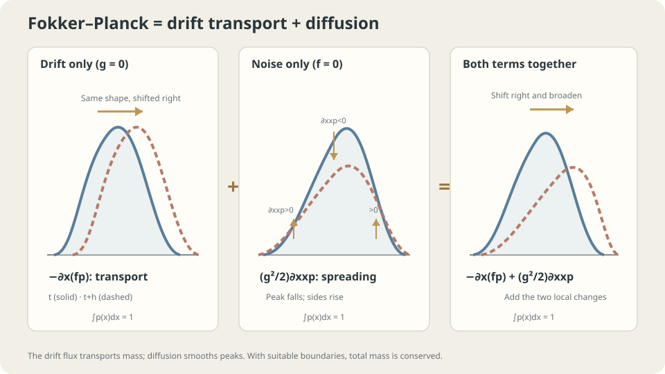

import Objectives from '../../../components/Objectives.astro';
import Prereq from '../../../components/Prereq.astro';
import Question from '../../../components/Question.astro';
import Answer from '../../../components/Answer.astro';
import QuizBlock from '../../../components/QuizBlock.astro';
import Option from '../../../components/Option.astro';
import Explanation from '../../../components/Explanation.astro';
import VizPlan from '../../../components/VizPlan.astro';
import Details from '../../../components/Details.astro';
import Bridge from '../../../components/Bridge.astro';
import Ref from '../../../components/Ref.astro';
import UsedBy from '../../../components/UsedBy.astro';

# A Thousand Leaves in a Noisy River: The Fokker–Planck Equation

<Objectives title="After reading, you can">
- Derive and interpret $\partial_tp=-\nabla\cdot(fp)+\tfrac{g^2}{2}\Delta p$.
- Verify $\mathcal N(0,t)$ for Brownian motion by substitution and check its initial law.
- Distinguish the Brownian SDE, finite-step simulation, and diffusion limit under scalar position-independent $g(t)$.
</Objectives>

<Prereq items={frontmatter.prereqs} />

## Many leaves, now with fluctuations

<Ref to="math-continuity-equation"/> evolved a cloud under deterministic transport. <Ref to="math-sde"/> added fluctuations to individual paths. We now combine those descriptions.

Release a thousand leaves beneath a bridge into a river with both current and random fluctuations. How does their distribution evolve?

Even symmetric random crossings create **net flux** when adjacent cells contain different numbers of leaves. A crowded cell sends more walkers to its sparse neighbor than return. What term does this add to density bookkeeping?

<Question label="Discussion" id="Q1">
What represents the cloud's law, and how does random motion modify inflow-minus-outflow accounting?

<Answer summary="Show the reasoning">
The leaves sample $p_0$ and independently follow $dx=fdt+gdW$. Their positions at time 60 sample $p_{60}$. We want an equation for $p(x,t)$.

Drift contributes $-\nabla\cdot(fp)$. Random crossings also conserve mass, but their imbalance depends on neighboring densities. The difference between a value and its neighbors' average is governed by second derivatives: peaks lose mass and troughs gain it.

Thus expect a drift term plus a multiple of the **Laplacian** $\Delta p=\nabla\cdot\nabla p$, the sum of second spatial derivatives. We still need its coefficient.
</Answer>
</Question>

## Dye in moving water

Think of a drop of dye. Current transports and deforms it; diffusion spreads it and lowers concentration near its peak. Total dye remains constant in a closed system.

Both effects contribute at first order in elapsed time. A short-step expansion lets their leading contributions add; it does not imply that two arbitrary finite-time evolution operators commute.



*Transport contributes first spatial derivatives; diffusion contributes second derivatives. Both conserve probability with suitable boundary behavior.*

## Compute the two contributions

First take one dimension with $f=0$ and constant noise intensity over a short step. Adding $g\sqrt h\varepsilon$ convolves the old density with $\mathcal N(0,g^2h)$:

$$
p(x,t+h)=\mathbb E_\varepsilon\big[p(x-g\sqrt h\,\varepsilon,\,t)\big].
$$

Taylor-expand $p(x-y)$ to second order and average over standard Gaussian $\varepsilon$. Its zero mean removes the linear term; unit variance determines the quadratic term:

$$
p(x,t+h)=p-\,g\sqrt h\,\mathbb E[\varepsilon]\,\partial_xp+\tfrac{g^2h}{2}\,\mathbb E[\varepsilon^2]\,\partial_{xx}p+O(h^{3/2})
=p+\tfrac{g^2h}{2}\,\partial_{xx}p+O(h^{3/2}).
$$

Subtract $p$, divide by $h$, and take the limit to obtain $\partial_tp=(g^2/2)\partial_{xx}p$. The diffusion coefficient is therefore $g^2/2$. $\square$

Drift alone gives $\partial_tp=-\partial_x(fp)$ by <Ref to="math-continuity-equation"/>. Adding the two first-order time contributions gives

$$
\boxed{\partial_tp=-\partial_x(fp)+\tfrac{g^2}{2}\partial_{xx}p},\qquad
\text{in }d\text{ dimensions: }\partial_tp=-\nabla\cdot(fp)+\tfrac{g^2}{2}\Delta p.
$$

This is the **Fokker–Planck equation**, also called the forward Kolmogorov equation [1–4]. It evolves the SDE's marginal density directly, just as the continuity equation describes deterministic transport.

**Verify a candidate.** Solving a PDE can be difficult; substituting a proposed solution is often straightforward. For Brownian motion, $f=0$, $g=1$, and an origin start, test $p_t=\mathcal N(0,t)$:

$$
p=\frac{1}{\sqrt{2\pi t}}e^{-x^2/2t},\qquad
\partial_xp=-\frac{x}{t}\,p,\qquad
\partial_{xx}p=\Big(-\frac1t+\frac{x^2}{t^2}\Big)p,\qquad
\partial_tp=\Big(-\frac{1}{2t}+\frac{x^2}{2t^2}\Big)p .
$$

The right side is $\tfrac12\partial_{xx}p=(-\tfrac1{2t}+\tfrac{x^2}{2t^2})p=\partial_tp$ for $t>0$. As $t\to0$, this Gaussian converges weakly to $\delta_0$, matching the initial law. The PDE alone would not specify the intended solution without initial and applicable boundary conditions.

<Details label="Details" summary="Constant drift: verify N(ct,g²t) from an origin start">
Let m=ct, s=g²t, and p=(2πs)^(−1/2)exp(−(x−m)²/(2s)). Then ∂ₓp=−(x−m)p/s and ∂ₓₓp=[−1/s+(x−m)²/s²]p. Differentiating log p with m′=c and s′=g² yields ∂ₜp=[−g²/(2s)+c(x−m)/s+g²(x−m)²/(2s²)]p. The drift term supplies c(x−m)p/s and diffusion supplies the other two terms. Their sum equals ∂ₜp.

For positive smooth density and position-independent g, (g²/2)Δp=∇·[p(g²/2)∇log p]. Thus the same density equation can be written ∂ₜp+∇·(pu)=0 with u=f−(g²/2)∇log p. Under suitable existence and uniqueness conditions, an ODE with this velocity can share the SDE's marginal laws, while having different trajectories and temporal couplings.
</Details>

## What the width formula assumes

Constant drift gives variance $g^2t$. General drift can compress or expand the cloud: in one dimension, $\frac d{dt}\operatorname{Var}(x_t)=2\operatorname{Cov}(x_t,f(x_t,t))+g(t)^2$, under suitable integrability. Diffusion smooths locally without guaranteeing a unimodal combined distribution.

A restoring drift can balance diffusion and produce equilibrium. That is the next note's question, <Ref to="math-langevin"/>.

Here $g(t)$ is a scalar independent of position, with independent equal-intensity Brownian coordinates. State-dependent Itô diffusion instead contributes $\tfrac12\partial_{xx}(g^2p)$ in one dimension. Non-Gaussian iid small steps can share a diffusion limit under appropriate conditions; their finite-step increments are still not Brownian increments.

## Compare a histogram and change the noise

```python
import numpy as np
rng = np.random.default_rng(0)
c, g, T, h = .5, .3, 60., .1
x = np.zeros(20000)
for _ in range(int(T/h)):
    x += h*c+g*np.sqrt(h)*rng.standard_normal(x.size)
hist, edges = np.histogram(x,bins=60,density=True)
mid = .5*(edges[1:]+edges[:-1])
p_theory = np.exp(-(mid-c*T)**2/(2*g**2*T))/np.sqrt(2*np.pi*g**2*T)
print(np.abs(hist-p_theory).max())
# Try Cauchy increments: their infinite variance invalidates this derivation.
```

Compare against $\mathcal N(cT,g^2T)$. Cauchy increments require a different scaling and evolution equation; repeated $\sqrt h$-scaled Cauchy steps do not converge to this fixed-scale Brownian model.

<iframe loading="lazy" src="/personal_website/notes/research_areas/mathematical-foundations/m3-stochastic-dynamics/m3-2-1.en.html" class="demo-frame" title="Fokker–Planck: particle histograms and density evolution" style="height: 880px; width: 100%; border: none;"></iframe>

*Equal-variance uniform increments agree with Gaussian increments in an appropriate diffusion limit. At finite step size, their increment distributions still differ.*

## Check your understanding

<QuizBlock id="m3-2-a">
A drop of ink spreads in still water. Which idealized density equation captures this?
<Option>Drift transport alone with zero velocity.</Option>
<Option correct>The heat-equation case $\partial_tp=(g^2/2)\Delta p$.</Option>
<Option>A deterministic ODE for each molecule under this Brownian model.</Option>
<Explanation>With no drift, transport alone predicts no change. Random molecular motion supplies the diffusion term and linear-in-time variance growth in the unbounded constant-coefficient model.</Explanation>
</QuizBlock>

<QuizBlock id="m3-2-b">
Does $p_t=\mathcal N(0,t^2)$ satisfy $\partial_tp=\tfrac12\partial_{xx}p$ for all $t>0$?
<Option>Yes: any Gaussian works.</Option>
<Option correct>No: differentiating its variance introduces $2t$, so the two sides do not agree for all times.</Option>
<Option>Yes, after setting constant $g=2$.</Option>
<Explanation>Constant diffusion intensity gives variance growing linearly in time. Changing a constant coefficient cannot turn that dependence into quadratic growth.</Explanation>
</QuizBlock>

<QuizBlock id="m3-2-c">
Replace Gaussian simulation increments by independent uniform increments on $[-\sqrt3,\sqrt3]$, keeping the factor $g\sqrt h$. What happens?
<Option>The diffusion limit necessarily fails.</Option>
<Option>The limiting coefficient must change.</Option>
<Option correct>Under the usual diffusion-limit conditions, the same limiting equation holds, although finite-step laws differ.</Option>
<Explanation>Zero mean and unit variance match the leading generator terms; suitable higher-moment or related conditions control the remainder. This argument does not cover arbitrary infinite-variance increments.</Explanation>
</QuizBlock>

<UsedBy slug={frontmatter.slug} />

<Bridge to="math-langevin">
We can evolve density under both transport and diffusion. If drift pulls toward low potential while noise spreads particles, can their effects balance? Next find a stationary distribution and distinguish its existence from actually reaching it.
</Bridge>

## References

1. Särkkä, S., Solin, A. [*Applied Stochastic Differential Equations.*](https://users.aalto.fi/~ssarkka/pub/sde_book.pdf) Cambridge University Press, 2019.
2. Pavliotis, G. A. [*Stochastic Processes and Applications: Diffusion Processes, the Fokker–Planck and Langevin Equations.*](https://doi.org/10.1007/978-1-4939-1323-7) Springer, 2014.
3. Risken, H. [*The Fokker–Planck Equation: Methods of Solution and Applications.*](https://doi.org/10.1007/978-3-642-61544-3) Springer, 2nd ed., 1989.
4. Gardiner, C. *Stochastic Methods: A Handbook for the Natural and Social Sciences.* Springer, 4th ed., 2009.
