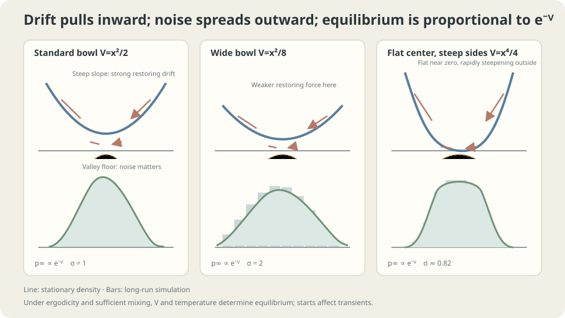

import Objectives from '../../../components/Objectives.astro';
import Prereq from '../../../components/Prereq.astro';
import Question from '../../../components/Question.astro';
import Answer from '../../../components/Answer.astro';
import QuizBlock from '../../../components/QuizBlock.astro';
import Option from '../../../components/Option.astro';
import Explanation from '../../../components/Explanation.astro';
import VizPlan from '../../../components/VizPlan.astro';
import Details from '../../../components/Details.astro';
import Bridge from '../../../components/Bridge.astro';
import Ref from '../../../components/Ref.astro';
import UsedBy from '../../../components/UsedBy.astro';

# Random Walkers in a Valley: Langevin Dynamics and Stationarity

<Objectives title="After reading, you can">
- Interpret $dx=-\nabla Vdt+\sqrt2dW_t$ as restoring drift plus diffusion.
- Verify $e^{-V}/Z$ in Fokker–Planck and distinguish stationarity from attraction.
- Test finite-time mixing and finite-step bias, stating the assumptions behind equilibrium claims.
</Objectives>

<Prereq items={frontmatter.prereqs} />

## A valley and a thousand lost walkers

A thousand walkers start together on one side of a foggy valley. Their motion is random but biased downhill, more strongly on steeper slopes.

Where are they an hour later? How would a wider valley, or a flat-bottomed valley with steep sides, change the result?

Downhill motion concentrates walkers; noise spreads them. **Can these effects maintain a fixed density without freezing the walkers?** First find a law with balanced flux, then ask whether other initial laws approach it.

<Question label="Discussion" id="Q1">
Represent terrain, downhill preference, random motion, and the proposed long-time distribution mathematically.

<Answer summary="Show the reasoning">
Let $V(x)$ be height or **potential**. The negative gradient $-\nabla V(x)$ points steeply downhill, with magnitude determined by slope, so it supplies the drift.

Add the noise from <Ref to="math-sde"/>:

$$
dx_t=-\nabla V(x_t)\,dt+\sqrt2\,dW_t .
$$

This is **overdamped Langevin dynamics**. The conventional coefficient $\sqrt2$ simplifies equilibrium. More generally use $\sqrt{2\tau}$, with temperature or noise intensity $\tau$.

A **stationary distribution** stays unchanged when used as the initial law. Individual particles still move. Existence, uniqueness, and convergence from other starting laws require separate arguments.
</Answer>
</Question>

## Restoring drift versus spreading

In a confining single valley, drift pulls toward lower potential while diffusion spreads the density, as described by <Ref to="math-fokker-planck"/>.

A cloud high on a slope first moves downhill. Near the bottom, weaker drift lets noise broaden it, while particles reaching steep slopes are pulled back. Under suitable ergodicity conditions, these effects reach a balance that eventually forgets the starting law.

Widening the potential horizontally weakens its slopes and widens its equilibrium density correspondingly. A narrow valley concentrates it. A flat bottom and rapidly rising sides instead produce a flatter center and thinner tails.



*Negative potential gradient pulls inward; noise spreads mass. Their zero-flux balance has density proportional to $e^{-V}$.*

## Substitute the candidate into Fokker–Planck

Here $f=-\nabla V$ and $g=\sqrt2$, giving

$$
\partial_tp=\nabla\cdot(p\,\nabla V)+\Delta p=\nabla\cdot\big(p\,\nabla V+\nabla p\big).
$$

Stationarity requires a zero right-hand side. Guess $p_\infty=e^{-V}/Z$, assuming $Z=\int e^{-V}dx$ is finite. In one dimension:

$$
\partial_xp_\infty=-V'\,p_\infty
\quad\Longrightarrow\quad
p_\infty V'+\partial_xp_\infty=p_\infty V'-V'p_\infty=0 .
$$

The expression inside the spatial derivative vanishes pointwise, so its derivative vanishes and $\partial_tp_\infty=0$. $\square$

The actual probability flux is $J=-p\nabla V-\nabla p$, because $\partial_tp=-\nabla\cdot J$. The displayed expression is $-J$; both vanish for the candidate. Appropriate boundary behavior is also required.

**Will it be reached?** Nonexplosion, ergodicity, and related conditions must be checked separately. Finite $Z$ normalizes the candidate but does not imply exponential convergence. Roberts and Tweedie [2] analyze relevant tail conditions. The quadratic case is directly solvable.

For $V=x^2/2$, equilibrium is $\mathcal N(0,1)$. Widening to $V=x^2/8$ gives $\mathcal N(0,4)$; $V=x^2$ gives standard deviation $1/\sqrt2$. For $V=x^4/4$, the density is proportional to $e^{-x^4/4}$, with a flatter center, thinner tails, and standard deviation about $0.82$. At temperature $\tau>0$, the candidate becomes $e^{-V/\tau}/Z_\tau$.

<Details label="Details" summary="Exact finite-step bias for V=x²/2">
Euler–Maruyama gives xₙ₊₁=(1−h)xₙ+√(2h)εₙ. A stationary variance s must satisfy s=(1−h)²s+2h, so s=1/(1−h/2). This requires 0 less than h less than 2. Variances are approximately 1.05 at h=0.1, 1.33 at h=0.5, and 2 at h=1. At h≥2 no finite stationary variance exists. The bias here is O(h); nonlinear explicit Euler chains need their own stability and invariant-measure analysis [2].
</Details>

## How long is long enough?

If enough time has passed and the required convergence conditions hold, the cloud approaches the equilibrium shaped by $V$. The formula quantifies the intuitive widening effect, but it does not tell us that one hour is sufficient.

Two distinct limitations matter:

- **Finite time:** a double-well potential can trap walkers on one side. In the appropriate barrier-crossing regime, escape times have an Arrhenius factor of order $e^{\Delta V/\tau}$, with further prefactors and assumptions. A stationary two-well law need not be well represented by a short simulation.
- **Finite step:** even a stable numerical chain can have a biased stationary law. The quadratic variance above is $1/(1-h/2)$, while nonlinear problems need separate checks. Stability alone does not establish negligible bias.

## Separate mixing and discretization effects

```python
import numpy as np
rng = np.random.default_rng(0)
def langevin(gradV,x0,T,h,n=20000):
    x = np.full(n,x0,float)
    for _ in range(int(T/h)):
        x = x-h*gradV(x)+np.sqrt(2*h)*rng.standard_normal(n)
    return x
x = langevin(lambda x:x,3.,20.,.01)
print(x.mean(),x.var())
for h in [.1,.5,1.]:
    print(h,langevin(lambda x:x,3.,20.,h).var(),1/(1-h/2))
# An explicit scheme for a quartic double well requires extra stability checks.
xb = langevin(lambda x:32*x*(x**2-1),-1.,20.,.01)
print('finite:',np.isfinite(xb).all(),'right-well fraction:',(xb>0).mean())
# Compare smaller h as well as longer T before attributing a mismatch to mixing.
```

The quadratic example should match the predicted finite-step variance after sufficient relaxation. A double well can retain strong initial-side bias at short times, but its explicit nonlinear discretization can also fail. Check finite values, refine the step, and compare the scheme before interpreting a histogram as evidence of slow mixing alone.

<iframe loading="lazy" src="/personal_website/notes/research_areas/mathematical-foundations/m3-stochastic-dynamics/m3-3-1.en.html" class="demo-frame" title="Langevin dynamics: potentials, mixing times, and step-size bias" style="height: 880px; width: 100%; border: none;"></iframe>

## Check your understanding

<QuizBlock id="m3-3-a">
In an ideal constant-temperature model with potential $V(z)=mgz$ for $z\ge0$ and a reflecting ground boundary, what is the equilibrium height density?
<Option>Uniform.</Option>
<Option>All mass on the ground.</Option>
<Option correct>Proportional to $e^{-mgz/\tau}$.</Option>
<Explanation>Drift and diffusion balance in the Boltzmann density. Constant gravitational force gives an exponential profile; larger temperature increases the height scale.</Explanation>
</QuizBlock>

<QuizBlock id="m3-3-b">
Assume continuous Langevin converges and numerical errors are checked. Almost no walkers cross from the left to the right well during a finite run. What is plausible?
<Option>The stationary law must depend on the starting point.</Option>
<Option correct>A high barrier causes a long mixing time, so the run is too short.</Option>
<Option>The stationary-density formula proves the time step is too large.</Option>
<Explanation>Barrier crossing can be exponentially slow in barrier height divided by temperature in the appropriate regime. Without numerical checks, discretization remains another possible cause.</Explanation>
</QuizBlock>

<QuizBlock id="m3-3-c">
For $V=x^2/2$, remove the noise. What happens to a starting law with finite second moment?
<Option correct>$x_t=e^{-t}x_0$ converges to zero and its law to $\delta_0$.</Option>
<Option>It remains the positive-temperature equilibrium $e^{-V}/Z$.</Option>
<Option>It spreads randomly across the valley.</Option>
<Explanation>This quadratic deterministic flow is explicit. General nonconvex gradient flows may reach different minima. Removing noise before taking the long-time limit is not automatically equivalent to taking a zero-temperature limit of equilibrium laws.</Explanation>
</QuizBlock>

<UsedBy slug={frontmatter.slug} />

<Bridge to="math-weak-strong-convergence">
Zero flux verifies equilibrium, but finite time and finite steps can both cause discrepancies. When calling an SDE solver accurate, are we comparing trajectories driven by the same noise or statistics of their distributions?
</Bridge>

## References

1. Pavliotis, G. A. [*Stochastic Processes and Applications: Diffusion Processes, the Fokker–Planck and Langevin Equations.*](https://doi.org/10.1007/978-1-4939-1323-7) Springer, 2014.
2. Roberts, G. O., Tweedie, R. L. [*Exponential Convergence of Langevin Distributions and Their Discrete Approximations.*](https://doi.org/10.2307/3318418) Bernoulli 2(4), 1996.
3. Gardiner, C. *Stochastic Methods: A Handbook for the Natural and Social Sciences.* Springer, 4th ed., 2009.
4. Särkkä, S., Solin, A. [*Applied Stochastic Differential Equations.*](https://users.aalto.fi/~ssarkka/pub/sde_book.pdf) Cambridge University Press, 2019.
