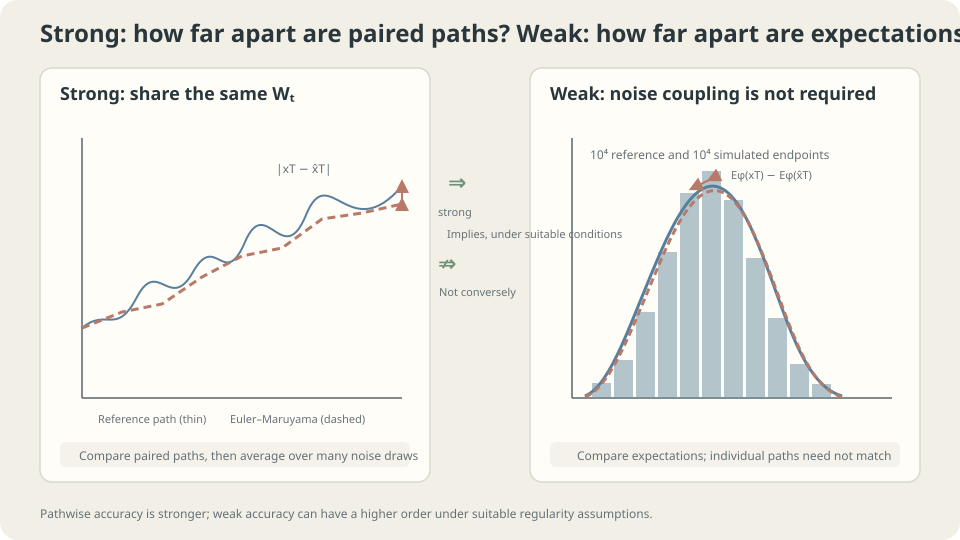

import Objectives from '../../../components/Objectives.astro';
import Prereq from '../../../components/Prereq.astro';
import Question from '../../../components/Question.astro';
import Answer from '../../../components/Answer.astro';
import QuizBlock from '../../../components/QuizBlock.astro';
import Option from '../../../components/Option.astro';
import Explanation from '../../../components/Explanation.astro';
import VizPlan from '../../../components/VizPlan.astro';
import Details from '../../../components/Details.astro';
import Bridge from '../../../components/Bridge.astro';
import Ref from '../../../components/Ref.astro';
import UsedBy from '../../../components/UsedBy.astro';

# Matching Paths or Matching Statistics: Strong and Weak Convergence

<Objectives title="After reading, you can">
- Define strong endpoint error under shared noise and weak error for a specified test function.
- Explain Euler–Maruyama's general strong order $1/2$ and weak order one under their respective assumptions.
- Choose an appropriate error measure, recognize additive-noise improvements, and separate discretization from Monte Carlo uncertainty.
</Objectives>

<Prereq items={frontmatter.prereqs} />

## A hundred simulated price paths

You simulate a stock-price SDE using daily Euler–Maruyama updates for one year. Someone asks whether the simulation is accurate.

A hundred plausible-looking curves do not settle that question. Two different requirements are possible:

1. **Match corresponding paths:** under a specified Brownian realization, the approximation should remain close to the exact solution driven by that same realization.
2. **Match terminal statistics:** means, variances, or event probabilities should be close, without requiring individual paths to match.

Like comparing trips, we can compare matched travelers or just their endpoint distributions. **Does one numerical method have the same error rate under these two comparisons?** Define the measures before deciding the computational budget.

<Question label="Discussion" id="Q1">
What does “the same random outcomes” mean for an SDE, and which quantities do the two requirements compare?

<Answer summary="Show the reasoning">
It means a **shared Brownian path** $W_t$. The exact endpoint $x_T$ and approximation $\hat x_T^{(h)}$ use that same realization, with the numerical method observing its grid increments. This specifies a coupling under which pathwise subtraction is meaningful.

**Strong error** averages the endpoint distance under this coupling:

$$
e_{\text{strong}}(h)=\mathbb E\big[\,|x_T-\hat x^{(h)}_T|\,\big].
$$

**Weak error** compares expectations of a chosen statistic. Whether simulations share noise does not change its definition:

$$
e_{\text{weak}}(h)=\big|\,\mathbb E[\varphi(x_T)]-\mathbb E[\varphi(\hat x^{(h)}_T)]\,\big|,
$$

Test functions include $\varphi(x)=x$ for a mean and $x^2$ for a second moment, subject to moment assumptions. Smooth approximations can represent threshold events, introducing an additional approximation. A weak-order theorem controls a specified test-function class, not every possible distributional discrepancy.

For $K$-Lipschitz $\varphi$, $e_{\mathrm{weak}}\le K e_{\mathrm{strong}}$, by moving absolute value inside expectation and applying Lipschitz continuity. Unbounded or discontinuous functions require further conditions. Conversely, identical marginals do not ensure closeness under the same-noise coupling.
</Answer>
</Question>

## Two measuring sticks

Imagine two reviewers inspecting the simulation.

One overlays every approximate path on its corresponding exact path and averages endpoint distances: the **strong** comparison.

The other ignores pairings and compares endpoint distributions through statistics or histograms: the **weak** viewpoint. A histogram is an illustration, not the formal smooth-test-function definition.

Pathwise distances retain both signs of random deviations. Taking expectations first can cancel zero-mean terms, suggesting a better weak rate in some settings. Distinct rates are not universal for all equations and statistics.



*Strong error uses a shared-noise coupling; weak error compares expectations under marginal laws.*

## One method, two orders

ODE Euler has first-order global error. For general SDEs, Euler–Maruyama instead has the usual guarantees [1,2]:

$$
e_{\text{strong}}(h)\le C\,h^{1/2},\qquad e_{\text{weak}}(h)\le C'\,h^{1} .
$$

These require appropriate Lipschitz, growth, and moment assumptions; weak order one additionally needs smoothness of coefficients and test functions. They are guarantees, not exact rates in every example. Additive noise can improve strong order, and some statistics can have zero bias.

Consider multiplicative noise $dx=\sigma x\,dW_t$. Euler–Maruyama gives $\hat x_{t+h}=\hat x_t(1+\sigma\Delta W)$. The exact Itô solution gives $x_{t+h}=x_t\exp(\sigma\Delta W-\tfrac12\sigma^2h)$. Expand:

$$
x_{t+h}=x_t\Big(1+\sigma\Delta W+\tfrac12\sigma^2\big[(\Delta W)^2-h\big]+\dots\Big).
$$

The first omitted term is $\tfrac12\sigma^2x_t[(\Delta W)^2-h]$. Measure it in two ways:

- **Strong:** $(\Delta W)^2-h$ has standard deviation $\sqrt2h$. Weighted by the current state, these terms are not iid, but have conditional mean zero. Appropriate martingale second-moment and propagation estimates lead to global $O(\sqrt h)$.
- **Weak:** the leading omitted term has mean zero. For suitable smooth statistics, the remaining local bias is $O(h^2)$, accumulating to global $O(h)$.

The leading random defect matters pathwise but cancels at first order in the expectation calculation. The full rate proofs also control propagation and remainders.

<Details label="Details" summary="General coefficients and the missing Milstein term">
For scalar dx=f(x)dt+g(x)dW, the next Itô–Taylor term is ½g(x)g′(x)[(ΔW)²−h]. Including it gives the scalar Milstein method, with strong order one under suitable assumptions.

Its local L² magnitude is O(h). Martingale accumulation and propagation estimates give the general square-root global rate. With additive noise, g′=0 removes this term; sufficiently regular drift and other assumptions can then yield strong order one.

For weak analysis, define $u(t,x)=\mathbb E[\varphi(x_T)\mid x_t=x]$ and use the backward Kolmogorov equation. Suitable regularity yields local $O(h^2)$ and global $O(h)$ expectation errors [1,4]. An indicator violates the smooth-test-function premise; its rate needs separate analysis and is not automatically one half.
</Details>

## Which comparison does the application need?

The accuracy question depends on what the simulation is used for:

- For terminal means or moments, inspect the corresponding weak bias. A rate alone does not determine whether a daily step is accurate enough, because its constant also matters.
- For approximation under a prescribed common Brownian path, inspect strong error. This mathematical coupling does not ask the simulator to predict the real world's next random realization.

Sampling often emphasizes distributional accuracy, but matching one mean does not establish an entire law. Distances such as Wasserstein can also be useful, sometimes bounded through strong couplings. Choose the measure from the goal.

Indicator statistics require separate weak-rate analysis. Sharing noise can also reduce variance in estimates of weak differences, though shared noise is not part of the weak-error definition.

## Measure the two slopes

```python
import numpy as np
rng = np.random.default_rng(1)
sigma, T, M = 1., 1., 20000
W_fine = np.cumsum(np.sqrt(1/4096)*rng.standard_normal((M,4096)),axis=1)
x_true = np.exp(sigma*W_fine[:,-1]-.5*sigma**2*T)
for h in [1/16,1/64,1/256]:
    k = int(4096*h)
    dW = np.diff(np.concatenate([np.zeros((M,1)),W_fine[:,k-1::k]],axis=1),axis=1)
    x_em = np.prod(1+sigma*dW,axis=1)
    strong = np.abs(x_em-x_true).mean()
    weak_exact = abs((1+sigma**2*h)**(T/h)-np.exp(sigma**2*T))
    weak_mc = abs((x_em**2).mean()-np.exp(sigma**2*T))
    print(h,strong,weak_exact,weak_mc)
# The exact endpoint uses the same Brownian terminal value, not a fine Euler path.
# Strong estimates contain sampling uncertainty; weak_exact is analytic for x².
```

Reducing $h$ by four should roughly halve the strong error and quarter the analytic weak bias. For $\varphi=x^2$, $\mathbb E[\hat x_T^2]=(1+\sigma^2h)^{T/h}$ while the exact moment is $e^{\sigma^2T}$. Log–log slopes approach one half and one, respectively.

The empirical weak estimate may fluctuate more than its discretization bias. At these parameters, the standard deviation of $x_T^2$ is about 20, giving sampling uncertainty around $20/\sqrt{20000}\approx0.14$. More steps do not remove that Monte Carlo error.

Why not use $\varphi=x$? Here Euler–Maruyama preserves $\mathbb E[\hat x_T]=1$ exactly for every grid, so its mean has zero weak bias and cannot reveal the expected nonzero slope.

Try the indicator $\mathbb1[x>1]$, but do not assume a rate without analysis. Independently sampling the two Brownian paths also destroys the specified strong comparison: even two exact independent endpoints can be far apart.

<iframe loading="lazy" src="/personal_website/notes/research_areas/mathematical-foundations/m3-stochastic-dynamics/m3-4-1.en.html" class="demo-frame" title="Strong and weak convergence orders" style="height: 820px; width: 100%; border: none;"></iframe>

## Check your understanding

<QuizBlock id="m3-4-a">
A forecast publishes only the simulated probability of temperature exceeding 30 degrees. Which error directly measures discretization bias in this output?
<Option>Strong error, because each path must predict tomorrow exactly.</Option>
<Option correct>Weak error for the threshold indicator, with its own rate analysis.</Option>
<Option>Both definitions must always be imposed as separate application requirements.</Option>
<Explanation>The output is a statistic of a marginal distribution. Smoothing the indicator may enable a smooth-function argument but adds smoothing bias. Monte Carlo uncertainty is another error source.</Explanation>
</QuizBlock>

<QuizBlock id="m3-4-b">
Replace multiplicative noise by $dx=-xdt+dW$. Under the relevant regularity assumptions, what strong rate can Euler–Maruyama attain?
<Option>Always only order one half.</Option>
<Option correct>Order one: constant diffusion removes the leading $gg'$ correction.</Option>
<Option>Zero error at every finite step.</Option>
<Explanation>The additive-noise correction vanishes, but the drift is still discretized. This linear smooth example improves the rate without making Euler exact.</Explanation>
</QuizBlock>

<QuizBlock id="m3-4-c">
Discretization bias is much smaller than Monte Carlo uncertainty. How should you usually improve the final estimate under a limited budget?
<Option>Declare the simulation exact.</Option>
<Option>Keep reducing the step until bias is identically zero.</Option>
<Option correct>Increase independent path count or reduce estimator variance, rather than spending all resources on smaller steps.</Option>
<Explanation>Bias shrinks with step size; sampling error typically scales as $M^{-1/2}$ for finite-variance independent samples. Distinguish path count $M$ from time-step count $N=T/h$.</Explanation>
</QuizBlock>

<UsedBy slug={frontmatter.slug} />

<Bridge to="math-markov-chain">
We can now separate pathwise approximation, distributional-statistic bias, and Monte Carlo uncertainty. Next replace continuous positions with finitely many states: can a table of one-step weather probabilities predict the distribution many days later?
</Bridge>

## References

1. Kloeden, P. E., Platen, E. [*Numerical Solution of Stochastic Differential Equations.*](https://doi.org/10.1007/978-3-662-12616-5) Springer, 1992.
2. Higham, D. J. [*An Algorithmic Introduction to Numerical Simulation of Stochastic Differential Equations.*](https://doi.org/10.1137/S0036144500378302) SIAM Review 43(3), 2001.
3. Särkkä, S., Solin, A. [*Applied Stochastic Differential Equations.*](https://users.aalto.fi/~ssarkka/pub/sde_book.pdf) Cambridge University Press, 2019.
4. Milstein, G. N., Tretyakov, M. V. [*Stochastic Numerics for Mathematical Physics.*](https://doi.org/10.1007/978-3-662-10063-9) Springer, 2004.
