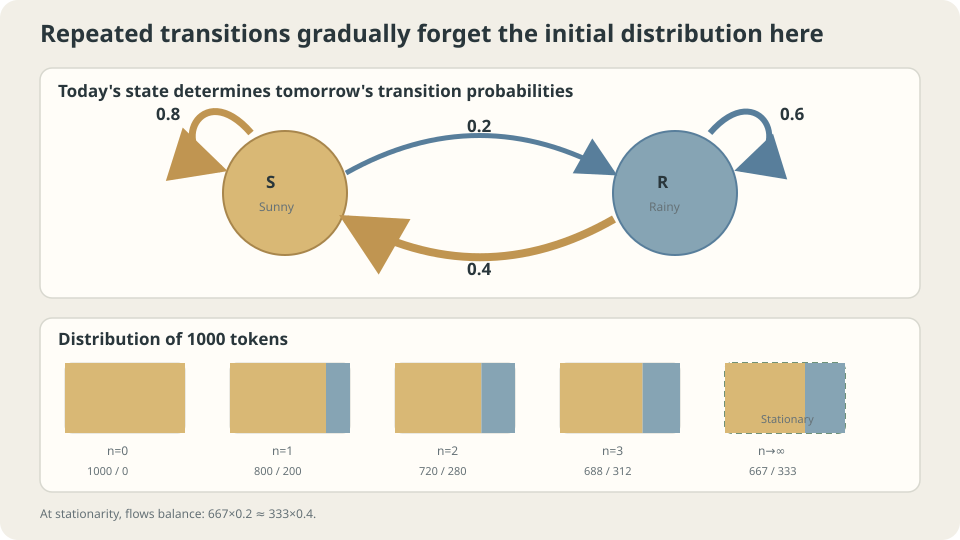

import Objectives from '../../../components/Objectives.astro';
import Prereq from '../../../components/Prereq.astro';
import Question from '../../../components/Question.astro';
import Answer from '../../../components/Answer.astro';
import QuizBlock from '../../../components/QuizBlock.astro';
import Option from '../../../components/Option.astro';
import Explanation from '../../../components/Explanation.astro';
import VizPlan from '../../../components/VizPlan.astro';
import Details from '../../../components/Details.astro';
import Bridge from '../../../components/Bridge.astro';
import Ref from '../../../components/Ref.astro';
import UsedBy from '../../../components/UsedBy.astro';

# Tomorrow Depends on Today: Markov Chains and Transition Matrices

<Objectives title="After reading, you can">
- Define a transition matrix and compute $p_n=p_0P^n$.
- Solve a two-state stationary distribution and state conditions for convergence toward it.
- Check the Markov and time-homogeneity assumptions and verify predictions by simulation.
</Objectives>

<Prereq items={frontmatter.prereqs} />

## Start with a weather record

A city's records suggest an 80% chance of sunshine after a sunny day and a 40% chance after a rainy day. Ignore seasons and earlier history for now.

Treat these as fixed daily rules depending only on today's weather. Starting sunny, ask:

1. What is the probability that all three following days are sunny?
2. What is the probability that day 100 is sunny? How much does today's state still matter?

The first event follows one path. The second includes paths that become rainy and return to sunshine. **How can we sum all intermediate possibilities?** Propagate a distribution through a transition table.

<Question label="Discussion" id="Q1">
Define the random variables, the requested probabilities, and the “today alone” assumption.

<Answer summary="Show the reasoning">
Let $X_n\in\{\mathrm S,\mathrm R\}$ denote day $n$'s weather. The sequence is a **stochastic process**.

The “today alone” assumption is

$$
\Pr(X_{n+1}=y\mid X_n=x,\ X_{n-1},\dots,X_0)=\Pr(X_{n+1}=y\mid X_n=x).
$$

Given the current state, further past information does not change the next-state law: the **Markov property**. A separate assumption, **time homogeneity**, says these conditional transition probabilities do not depend on the day index.

The first question asks $\Pr(X_1=X_2=X_3=\mathrm S\mid X_0=\mathrm S)$; the second asks $\Pr(X_{100}=\mathrm S\mid X_0=\mathrm S)$. The initial law and one-step rules determine both under these assumptions.
</Answer>
</Question>

## Tokens moving between two squares

A token on the sunny square stays with probability 0.8; on the rainy square it stays with probability 0.6. The rule does not track how long it has occupied that square.

Start a thousand independent tokens on sunshine. About 800 remain after one step. Next, about $640+80=720$ occupy sunshine. Repeated updating approaches a fixed allocation. We want both that allocation and the rate of approach.



*This chain approaches a stationary distribution; convergence is a property to check, not a consequence of every transition matrix.*

## Write the picture as a matrix

Rows represent today; columns represent tomorrow:

$$
P=\begin{pmatrix} P(\text{S},\text{S}) & P(\text{S},\text{R})\\ P(\text{R},\text{S}) & P(\text{R},\text{R})\end{pmatrix}
=\begin{pmatrix}0.8&0.2\\0.4&0.6\end{pmatrix},\qquad P(x,y)=\Pr(X_{n+1}=y\mid X_n=x).
$$

A **transition matrix** has nonnegative entries and each row sums to one. Such a matrix is row-stochastic.

Represent the current law by a **row vector** $p_0=(\Pr(X_0=\mathrm S),\Pr(X_0=\mathrm R))$. Then

$$
p_1(y)=\sum_x p_0(x)\,P(x,y)\quad\Longleftrightarrow\quad p_1=p_0P .
$$

This is total probability over today's possible states. Repeating the update gives

$$
p_n=p_0P^n .
$$

Matrix multiplication sums intermediate paths: $P^2(x,y)=\sum_zP(x,z)P(z,y)$. This **Chapman–Kolmogorov** identity composes transitions.

For three consecutive sunny days, the Markov property gives

$$
\Pr(X_1=X_2=X_3=\text{S}\mid X_0=\text{S})=P(\text{S},\text{S})^3=0.8^3=0.512 .
$$

The product relies on the state containing sufficient history. If a long sunny run changes tomorrow's probability, the two-state rule no longer suffices.

### An unchanged allocation

A probability row vector $\pi$ satisfying

$$
\pi P=\pi,\qquad \sum_x\pi(x)=1,
$$

is **stationary**. Here $0.8\pi_{\mathrm S}+0.4\pi_{\mathrm R}=\pi_{\mathrm S}$ becomes $0.2\pi_{\mathrm S}=0.4\pi_{\mathrm R}$: equal flows in both directions. Together with normalization this gives

$$
\pi=\Big(\tfrac23,\tfrac13\Big).
$$

A stationary law is a nonnegative normalized left eigenvector with eigenvalue one. Every finite stochastic matrix has at least one stationary law; irreducibility makes it unique.

### How quickly is today forgotten?

Let $d_n=p_n(\mathrm S)-2/3$. Since $p_{n+1}(\mathrm S)=0.4p_n(\mathrm S)+0.4$, we obtain

$$
d_{n+1}=0.4\,d_n\quad\Longrightarrow\quad p_n(\text{S})=\tfrac23+\Big(p_0(\text{S})-\tfrac23\Big)\,0.4^{\,n}.
$$

Starting sunny, this gives $p_1(\mathrm S)=2/3+(1/3)0.4=0.8$. The factor $0.4$ is the second eigenvalue. Initial-state influence shrinks by that factor daily, becoming extremely small by day 100.

The answer is extremely close to $2/3$, rather than one half or 0.8. Long-run proportions balance both transition directions: $\pi_{\mathrm S}/\pi_{\mathrm R}=0.4/0.2=2$.

<Details label="Details" summary="General convergence and spectral qualifications">
A finite irreducible aperiodic chain has a unique stationary law and converges to it from every initial distribution [1,3]. The two-state error here is exactly proportional to 0.4^n. General matrices can have Jordan-block polynomial factors. If all nontrivial eigenvalues have modulus at most r less than one, any ρ strictly between r and one permits a bound Cρ·ρ^n. Diagonalizable, especially reversible, chains admit more direct spectral bounds.

The ergodic theorem also says a single long trajectory's visit fraction converges almost surely to its stationary probability. This is why many independent tokens and one long record estimate the same proportion.
</Details>

## Revisit the two questions

Three consecutive sunny days have probability $0.512$. Day 100 has probability $2/3+(1/3)0.4^{100}$ from a sunny start. Finite-time dependence is tiny rather than exactly absent.

Seasonal rules require time-varying transition matrices. History dependence requires augmenting the state. Periodicity can prevent convergence despite stationarity: deterministic alternation has stationary law $(1/2,1/2)$, but a pure initial state alternates forever.

## Try it

Check the consecutive-event probability, long-run proportion $2/3$, and daily contraction factor $0.4$. Then introduce a history-dependent rule.

```python
import numpy as np
rng = np.random.default_rng(0)
P = np.array([[.8,.2],[.4,.6]])
N, x = 200000, 0
path = np.empty(N,dtype=int)
for n in range(N):
    x = rng.choice(2,p=P[x])
    path[n] = x
print('long-run sunny fraction:',(path==0).mean())
p = np.array([1.,0.])
for n in range(1,6):
    p = p@P
    print(n,p[0],p[0]-2/3)
```

<iframe loading="lazy" src="/personal_website/notes/research_areas/mathematical-foundations/m4-markov-chains/m4-0-1.en.html" class="demo-frame" title="Markov chains: stationary distributions and mixing" style="height: 820px; width: 100%; border: none;"></iframe>

## Check your understanding

<QuizBlock id="m4-0-a">
A finite irreducible homogeneous chain models page visits. How do you obtain long-run visit proportions?
<Option>Take the diagonal of $P^3$.</Option>
<Option>Normalize self-transition probabilities.</Option>
<Option correct>Solve $\pi P=\pi$ and normalize.</Option>
<Explanation>These are per-step visit proportions. If dwell times vary, time proportions additionally depend on mean dwell times.</Explanation>
</QuizBlock>

<QuizBlock id="m4-0-b">
For $P=\begin{pmatrix}0&1\\1&0\end{pmatrix}$ and $p_0=(1,0)$, which is correct?
<Option correct>$(1/2,1/2)$ is stationary, but $p_n$ does not converge to it.</Option>
<Option>No stationary distribution exists.</Option>
<Option>The distribution converges, only slowly.</Option>
<Explanation>The second eigenvalue is −1, so alternation never decays. Aperiodicity is needed for convergence from arbitrary initial laws.</Explanation>
</QuizBlock>

<QuizBlock id="m4-0-c">
After three consecutive sunny days, rain probability rises from 0.2 to 0.5. Can today's weather alone support the original predictions?
<Option>Yes: memory averages out.</Option>
<Option correct>No: include run length in the state or specify its conditional distribution.</Option>
<Option>Only the short-term answer changes; the stationary law cannot change.</Option>
<Explanation>The current sunny state does not determine the relevant next-step probability without the missing run history. Both short- and long-run predictions can change.</Explanation>
</QuizBlock>

<UsedBy slug={frontmatter.slug} />

<Bridge to="math-absorbing-state">
Transition matrices evolve distributions. If one state cannot be left, the final location may be obvious while the time to reach it remains unknown. Next study first arrival and expected absorption time.
</Bridge>

## References

1. Norris, J. R. [*Markov Chains.*](https://www.statslab.cam.ac.uk/~james/Markov/) Cambridge University Press, 1997.
2. Grimmett, G., Stirzaker, D. *Probability and Random Processes*, 3rd ed. Oxford University Press, 2001.
3. Levin, D. A., Peres, Y. [*Markov Chains and Mixing Times*](https://pages.uoregon.edu/dlevin/MARKOV/), 2nd ed. AMS, 2017.
