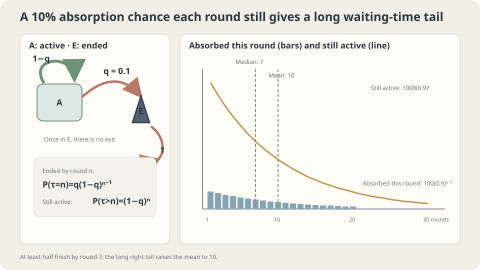

import Objectives from '../../../components/Objectives.astro';
import Prereq from '../../../components/Prereq.astro';
import Question from '../../../components/Question.astro';
import Answer from '../../../components/Answer.astro';
import QuizBlock from '../../../components/QuizBlock.astro';
import Option from '../../../components/Option.astro';
import Explanation from '../../../components/Explanation.astro';
import VizPlan from '../../../components/VizPlan.astro';
import Details from '../../../components/Details.astro';
import Bridge from '../../../components/Bridge.astro';
import Ref from '../../../components/Ref.astro';
import UsedBy from '../../../components/UsedBy.astro';

# No Way Back: Absorbing States and Absorption Times

<Objectives title="After reading, you can">
- Recognize $P(x,x)=1$ and distinguish absorption from guaranteed eventual arrival.
- Derive first-step equations and the geometric mean $1/q$.
- Compare lifetime summaries and check constant-hazard and no-return assumptions.
</Objectives>

<Prereq items={frontmatter.prereqs} />

## A game that ends by itself

After each round, a ten-sided die ends a single-player game on zero. Otherwise another round begins. There is no revival within that game.

Knowing that the game eventually ends leaves several questions:

1. How many rounds does a game last on average?
2. After surviving twenty rounds, how many additional rounds remain on average?
3. By which round have at least half the games ended?

Identical fresh dice suggest the next-round chance does not depend on elapsed rounds. But computing a mean and computing a halfway probability are different tasks. Define the ending time as a random variable first.

<Question label="Discussion" id="Q1">
Which Markov states are sufficient, and which random variable represents game length?

<Answer summary="Show the reasoning">
Use two states: alive $\mathrm A$ and ended $\mathrm E$. Round number is the time index, rather than necessary state information for this fixed-hazard model:

$$
P=\begin{pmatrix}P(\mathrm A,\mathrm A)&P(\mathrm A,\mathrm E)\\P(\mathrm E,\mathrm A)&P(\mathrm E,\mathrm E)\end{pmatrix}
=\begin{pmatrix}1-q&q\\0&1\end{pmatrix},\qquad q=0.1 .
$$

The row $(0,1)$ makes $\mathrm E$ **absorbing**, meaning $P(\mathrm E,\mathrm E)=1$. For $q>0$, $\mathrm A$ is transient. Other states in a general chain need not all be transient merely because an absorbing state exists.

Define $\tau=\min\{n\ge1:X_n=\mathrm E\}$. The questions ask for $\mathbb E[\tau]$, $\mathbb E[\tau-20\mid\tau>20]$, and a median of $\tau$: different summaries of one random variable.
</Answer>
</Question>

## Tokens falling into a pit

Start a thousand tokens alive. About a hundred fall into the ended-state pit in round one, ninety more in round two, and so on. The number falling decreases while the fraction of survivors falling stays at one tenth.

A surviving token faces the same next-round rule regardless of its age. Twenty completed rounds do not consume a quota: expected remaining lifetime is still ten. This is memorylessness, not compensation for earlier luck.



*A constant hazard gives a geometric tail. Its median is seven rounds; rare long games raise its mean to ten.*

## Turn the picture into equations

### A geometrically decaying tail

Surviving $n$ rounds requires avoiding the ending outcome each time:

$$
\Pr(\tau>n)=(1-q)^n,\qquad \Pr(\tau=n)=(1-q)^{n-1}q .
$$

This is a **geometric distribution**, counting trials through the first success, where success means ending. Equivalently, $P^n(\mathrm A,\mathrm A)=(1-q)^n$.

### Expected time by first-step analysis

Let $m$ be expected remaining rounds. Spend one round, then end with probability $q$ or return to the same future problem with probability $1-q$:

$$
m=1+q\cdot0+(1-q)\,m\quad\Longrightarrow\quad m=\frac1q=10 .
$$

This is **first-step analysis**. For each transient state $x$, expected absorption time satisfies

$$
m(x)=1+\sum_{y\ \text{transient}}P(x,y)\,m(y),
$$

The unknown expectations form a linear system. The Markov property makes the remaining future depend only on the next state. Distribution propagation looks forward; this recursion propagates future expectations backward.

### Median and variance

For $q=0.1$, the smallest $n$ with $(1-q)^n\le1/2$ is seven. Thus at least half end by the seventh round. Variance is 90 and standard deviation about 9.5. The right tail raises the mean above the median.

<Details label="Details" summary="Several transient states and the fundamental matrix">
Partition $P=\begin{pmatrix}Q&R\\0&I\end{pmatrix}$. For a finite absorbing chain whose transient states all reach absorption, $\sum_{n\ge0}Q^n=(I-Q)^{-1}=N$. Entry $N(x,y)$ counts expected visits to transient state $y$ from $x$, before absorption. Thus $m=N\mathbb1$, equivalently solving $m=\mathbb1+Qm$.

For a two-level game, suppose level one stays with probability 0.4, advances with 0.5, and ends with 0.1. Level two stays with 0.8 and ends with 0.2. Then $m_2=1+0.8m_2=5$ and $m_1=1+0.4m_1+0.5m_2$, giving $m_1=3.5/0.6\approx5.83$ [3].
</Details>

### Why stationarity is less informative here

The only stationary law in this two-state example is $(0,1)$. It identifies the final state without answering how long arrival takes. Absorption breaks irreducibility; hitting times and route probabilities become more informative questions.

## Revisit the lifetime questions

With constant hazard $q=0.1$ and no return, mean lifetime is ten, remaining mean after twenty surviving rounds is ten, and median lifetime is seven. The identity $\Pr(\tau>20+k\mid\tau>20)=(1-q)^k$ explains the unchanged remaining law.

If hazard increases with age, memorylessness fails. Nondecreasing hazards starting at $q_1$ give lifetime no longer on average than the constant-$q_1$ model. If the ended state returns with probability $r>0$, it is no longer absorbing; its long-run share becomes $q/(q+r)$. First hitting time still makes sense separately.

## Try it

```python
import numpy as np
rng = np.random.default_rng(0)
q, T = .1, 100000
tau = rng.geometric(q,size=T)
print('mean, median, std:',tau.mean(),np.median(tau),tau.std())
print('remaining after 20:',(tau[tau>20]-20).mean())
def play():
    n = 1
    while rng.random()>=min(1,.1+.02*(n-1)):
        n += 1
    return n
tau2 = np.array([play() for _ in range(T)])
print('increasing hazard:',tau2.mean(), 'remaining after 5:',(tau2[tau2>5]-5).mean())
```

<iframe loading="lazy" src="/personal_website/notes/research_areas/mathematical-foundations/m4-markov-chains/m4-1-1.en.html" class="demo-frame" title="Absorption times: geometric distributions and memorylessness" style="height: 820px; width: 100%; border: none;"></iframe>

## Check your understanding

<QuizBlock id="m4-1-a">
Subscribers cancel independently each month with fixed probability 0.05 and never return. What gives expected subscription length?
<Option>The stationary active proportion.</Option>
<Option correct>First-step analysis: $1/0.05=20$ months.</Option>
<Option>The twelve-step survival probability alone.</Option>
<Explanation>Permanent cancellation is absorbing. Stationarity puts all mass there; twelve-month survival is another useful statistic, not mean lifetime.</Explanation>
</QuizBlock>

<QuizBlock id="m4-1-b">
After surviving thirty rounds at constant ending probability 0.1, is ending more likely next round because luck is running out?
<Option>Yes: thirty-round survival was unlikely.</Option>
<Option>Yes: exceeding the mean requires compensation.</Option>
<Option correct>No: the conditional next-round probability remains 0.1.</Option>
<Explanation>The probability of reaching this point before the game began differs from the future conditional on having reached it. The model has no compensation mechanism.</Explanation>
</QuizBlock>

<QuizBlock id="m4-1-c">
The ended state now returns to play with probability 0.3 per step. What changes?
<Option>Permanent absorption takes $1/(0.1\times0.7)$ steps.</Option>
<Option>The ended state remains absorbing.</Option>
<Option correct>It is no longer absorbing. Its stationary share is $0.1/(0.1+0.3)=0.25$, while the first hitting time from active still has mean ten.</Option>
<Explanation>Distinguish permanent absorption, first arrival, and lengths of active episodes. Returning transitions change stationarity without changing the first trip into the ended state.</Explanation>
</QuizBlock>

<UsedBy slug={frontmatter.slug} />

<Bridge to="math-ctmc">
First-step analysis spends one round and then considers the remaining future. But phones can ring at any instant. Next replace per-round probabilities with rates per unit time.
</Bridge>

## References

1. Norris, J. R. [*Markov Chains.*](https://www.statslab.cam.ac.uk/~james/Markov/) Cambridge University Press, 1997.
2. Grimmett, G., Stirzaker, D. *Probability and Random Processes*, 3rd ed. Oxford University Press, 2001.
3. Kemeny, J. G., Snell, J. L. *Finite Markov Chains.* Springer, 1976.
