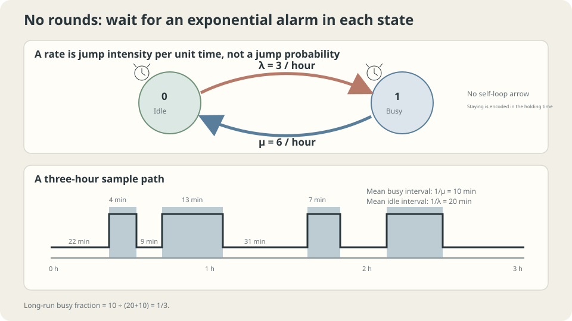

import Objectives from '../../../components/Objectives.astro';
import Prereq from '../../../components/Prereq.astro';
import Question from '../../../components/Question.astro';
import Answer from '../../../components/Answer.astro';
import QuizBlock from '../../../components/QuizBlock.astro';
import Option from '../../../components/Option.astro';
import Explanation from '../../../components/Explanation.astro';
import VizPlan from '../../../components/VizPlan.astro';
import Details from '../../../components/Details.astro';
import Bridge from '../../../components/Bridge.astro';
import Ref from '../../../components/Ref.astro';
import UsedBy from '../../../components/UsedBy.astro';

# The Phone Can Ring Anytime: Continuous-Time Markov Chains

<Objectives title="After reading, you can">
- Distinguish rates from probabilities and define a generator with zero row sums.
- Derive $P(t)=e^{tR}$ and $\dot p_t=p_tR$ and solve a two-state example.
- Check memorylessness and time-homogeneity assumptions when computing long-run occupancy.
</Objectives>

<Prereq items={frontmatter.prereqs} />

## One operator, one phone line

Calls arrive at an average of three per hour; a call lasts ten minutes on average. Calls arriving while the line is busy are rejected rather than queued.

What fraction of time is the operator busy?

Multiplying three calls by ten minutes counts rejected calls as served. Model arrivals as a Poisson process with rate $\lambda=3$ per hour and independent exponential service times with rate $\mu=6$. These distributional assumptions do not follow from the means alone.

<Question label="Discussion" id="Q1">
What are the states? If three per hour is not a probability, how does it determine a short-time transition?

<Answer summary="Show the reasoning">
Let $X_t$ be idle (0) or busy (1), with continuous time measured in hours.

A **rate** is a short-time probability slope. For Poisson arrivals, one event in $\Delta t$ has probability $\lambda\Delta t+O(\Delta t^2)$ and multiple events have probability $O(\Delta t^2)$. A rate may exceed one. The service rate $\mu$ is conditional on being busy, not the unconditional number completed each hour.

For small $\Delta t$, transitions are approximately $\begin{pmatrix}1-\lambda\Delta t&\lambda\Delta t\\\mu\Delta t&1-\mu\Delta t\end{pmatrix}$. This approximation can fail at large intervals. The interval-independent object is its derivative at zero: the rate matrix.
</Answer>
</Question>

## Memoryless alarms

A token in the idle square waits for an exponential alarm of rate three, then moves to busy. There it waits for an alarm of rate six, then returns. Each alarm's remaining law does not depend on time already waited.

Rates describe short-time slopes rather than a chosen round length. They determine holding times and destinations on departure.



*Rates determine exponential holding times; long-run occupancy reflects the mean durations of the two parts of a cycle.*

## Write the generator

### From short-time probabilities to rates

Express the short-time matrix as

$$
P(\Delta t)\approx I+R\,\Delta t,\qquad
R=\begin{pmatrix}-\lambda&\lambda\\ \mu&-\mu\end{pmatrix}=\begin{pmatrix}-3&3\\6&-6\end{pmatrix}.
$$

The **rate matrix**, or **generator**, has $R(x,y)\ge0$ off the diagonal and $R(x,x)=-\sum_{y\ne x}R(x,y)$. Row sums are zero, reflecting probability conservation. Formally $R=\lim_{\Delta t\to0}[P(\Delta t)-I]/\Delta t$.

### Evolve for a finite interval

Time-homogeneous Markov transitions compose by $P(t+s)=P(t)P(s)$. Subdivide time and take the limit:

$$
P(t)=\lim_{n\to\infty}\Big(I+\frac{tR}{n}\Big)^{n}=e^{tR}\equiv\sum_{k\ge0}\frac{(tR)^k}{k!}.
$$

This is the matrix analogue of the exponential limit. Differentiating also gives

$$
\frac{d}{dt}P(t)=\lim_{\Delta t\to0}\frac{P(t)P(\Delta t)-P(t)}{\Delta t}=P(t)\,R,\qquad P(0)=I,
$$

The resulting linear matrix ODE has solution $e^{tR}$.

### The forward equation

For row-vector initial law $p_0$, $p_t=p_0P(t)$ satisfies

$$
\dot p_t=p_tR\quad\Longleftrightarrow\quad
\dot p_t(y)=\sum_{x\ne y}\Big[p_t(x)R(x,y)-p_t(y)R(y,x)\Big].
$$

Expanding the diagonal term shows that each state's change equals inflow minus outflow. This is the **forward equation**, also called the master equation.

It parallels <Ref to="math-fokker-planck"/> on a finite state space. Probability conservation follows from $\frac d{dt}\sum_y p_t(y)=p_tR\mathbb1=0$.

### Solve the two-state example

Busy probability satisfies $\dot p_t(1)=\lambda-(\lambda+\mu)p_t(1)$, giving

$$
p_t(1)=\frac{\lambda}{\lambda+\mu}+\Big(p_0(1)-\frac{\lambda}{\lambda+\mu}\Big)e^{-(\lambda+\mu)t}.
$$

The stationary law solves $\pi R=0$, or $\pi(0)\lambda=\pi(1)\mu$:

$$
\pi(1)=\frac{\lambda}{\lambda+\mu}=\frac{3}{3+6}=\frac13 .
$$

Busy occupancy is one third, not one half. Initial-state influence decays on time scale $1/(\lambda+\mu)=1/9$ hour, about seven minutes. The nonzero generator eigenvalue supplies the exponential decay rate.

<Details label="Details" summary="Exact transitions, holding times, and oversized Euler steps">
Let Π have every row equal to π. Then $R\Pi=\Pi R=0$ and $R^2=-(\lambda+\mu)R$, so $e^{tR}=\Pi+e^{-(\lambda+\mu)t}(I-\Pi)$. It equals I at zero, tends to Π, and has derivative R at zero.

The probability of staying in state $x$ beyond time $t$ is $e^{-|R(x,x)|t}$. Holding times are exponential with mean $1/|R(x,x)|$, the continuous analogue of geometric memorylessness.

The Euler approximation $I+R\Delta t$ is stochastic only if its diagonal entries stay nonnegative: here $\Delta t\le1/6$ hour. At half an hour it gives invalid probabilities. The exact matrix $e^{tR}$ remains stochastic for every $t\ge0$.
</Details>

## Why the naive one-half answer fails

Only idle-line arrivals are accepted, at rate $\lambda\pi(0)=3\times2/3=2$ per hour. Two ten-minute calls occupy twenty minutes, giving one third. A queue would require different states; the offered load one half is not the occupancy of this loss system.

With Poisson arrivals and independent finite-mean nonexponential service, the renewal-cycle busy fraction remains $\mathbb E[S]/(1/\lambda+\mathbb E[S])$. But idle/busy alone is generally no longer this CTMC, and transient probabilities and residual service times change. Time-varying arrival rates also require a time-dependent analysis.

## Try it

```python
import numpy as np
rng = np.random.default_rng(0)
lam, mu, T = 3., 6., 20000.
t, x, busy = 0., 0, 0.
while t<T:
    stay = rng.exponential(1/lam if x==0 else 1/mu)
    busy += min(stay,T-t)*x  # Truncate the final holding interval.
    t += stay
    x = 1-x
print('busy fraction:',busy/T)
# Fixed ten-minute service preserves long-run occupancy but loses memorylessness.
```

<iframe loading="lazy" src="/personal_website/notes/research_areas/mathematical-foundations/m4-markov-chains/m4-2-1.en.html" class="demo-frame" title="CTMC rates, holding times, and time discretization" style="height: 820px; width: 100%; border: none;"></iframe>

## Check your understanding

<QuizBlock id="m4-2-a">
Independent exponential up and repair times average ten and two hours. Which model gives availability and transient state probabilities?
<Option>One-hour Euler transitions are exactly the continuous-time transitions.</Option>
<Option correct>A two-state CTMC with rates $1/10$ and $1/2$, giving stationary availability $5/6$.</Option>
<Option>Availability is $1-2/10=0.8$.</Option>
<Explanation>A valid $I+hR$ shares stationary laws with R, but its finite-time powers only approximate $e^{nhR}$. Exact stationarity does not imply exact transient transitions.</Explanation>
</QuizBlock>

<QuizBlock id="m4-2-b">
What does $R\mathbb1=0$ establish for the forward equation?
<Option>Convergence to equilibrium.</Option>
<Option>All holding-time properties without further assumptions.</Option>
<Option correct>Total probability conservation.</Option>
<Explanation>Multiplying $\dot p=pR$ by the all-ones column gives a zero total derivative. Convergence requires additional conditions.</Explanation>
</QuizBlock>

<QuizBlock id="m4-2-c">
Replace exponential service by fixed ten-minute calls while keeping Poisson arrivals. What changes?
<Option>The long-run busy fraction must change.</Option>
<Option correct>The busy fraction remains one third, but the remaining service time is no longer memoryless.</Option>
<Option>Nothing changes.</Option>
<Explanation>The renewal occupancy ratio depends on mean cycle lengths. Conditional remaining time depends on the service distribution: after eight minutes of a fixed ten-minute call, only two remain.</Explanation>
</QuizBlock>

<UsedBy slug={frontmatter.slug} />

<Bridge to="math-time-reversal">
Rates evolve distributions forward. Given the current state, inferring the previous state requires another rule. Next reverse the movie and derive that rule using Bayes.
</Bridge>

## References

1. Norris, J. R. [*Markov Chains.*](https://www.statslab.cam.ac.uk/~james/Markov/) Cambridge University Press, 1997.
2. Grimmett, G., Stirzaker, D. *Probability and Random Processes*, 3rd ed. Oxford University Press, 2001.
3. Anderson, W. J. *Continuous-Time Markov Chains: An Applications-Oriented Approach.* Springer, 1991.
