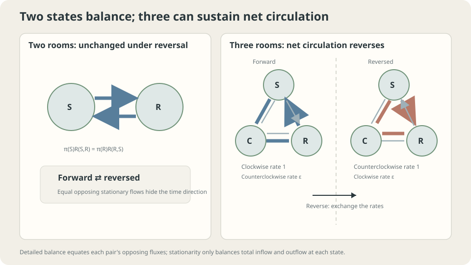

import Objectives from '../../../components/Objectives.astro';
import Prereq from '../../../components/Prereq.astro';
import Question from '../../../components/Question.astro';
import Answer from '../../../components/Answer.astro';
import QuizBlock from '../../../components/QuizBlock.astro';
import Option from '../../../components/Option.astro';
import Explanation from '../../../components/Explanation.astro';
import VizPlan from '../../../components/VizPlan.astro';
import Details from '../../../components/Details.astro';
import Bridge from '../../../components/Bridge.astro';
import Ref from '../../../components/Ref.astro';
import UsedBy from '../../../components/UsedBy.astro';

# Can You Detect a Reversed Movie? Time Reversal and Probability Ratios

<Objectives title="After reading, you can">
- Derive $\hat R_t(x,y)=R(y,x)p_t(y)/p_t(x)$ and explain the ratio.
- State detailed balance and test reversibility in two- and three-state examples.
- Distinguish stationary time-reversal symmetry from nonstationary initial effects and finite-record uncertainty.
</Objectives>

<Prereq items={frontmatter.prereqs} />

## A record without timestamps

A weather record contains sunny, cloudy, and rainy states with transition times, but no dates or sun positions. **Can you tell whether it runs forward or backward?** Model it as a finite-state CTMC and compare transition laws.

Consider two questions:

1. What statistical evidence could reveal the direction?
2. Would your answer change if there were only sunny and rainy states?

Randomness does not imply time symmetry. A preference for sunny→cloudy→rainy→sunny reverses under playback. **Given the current state, where was the process just before?** This is another Bayes question.

<Question label="Discussion" id="Q1">
For $Y_s=X_{T-s}$, is the reversed process Markov, and what are its rates?

<Answer summary="Show the reasoning">
Under the usual finite-state setting, time reversal remains Markov. Conditional on the present, past and future are independent, a symmetric statement in their roles.

The rates generally change. Forward rates describe the next state; reverse rates infer the previous state from the present. Bayes weights each possible origin by its prior probability and likelihood of reaching the observation, then normalizes. We need the short-time slope of that posterior.
</Answer>
</Question>

## Rooms and circulation

Imagine people moving between sunny and rainy rooms. Reversing the movie exchanges the directions of each crossing. At stationary two-room balance, both flows agree, leaving the same statistical law.

With three rooms, balanced total inflow and outflow can coexist with a preferred cycle. Reversal changes that circulation direction. Two states cannot support such a cyclic current; three can.



*Stationary two-state flow balances pairwise; three states can maintain a directed circulation.*

## Derive the reverse rule

### Bayes over a short interval

Let $p_t$ be the law of a finite-state CTMC. Restrict to $p_t(x)>0$ and distinct $x,y$. Ask for the probability that $X_t=y$ given $X_{t+dt}=x$:

$$
\Pr(X_t=y\mid X_{t+dt}=x)
=\frac{\Pr(X_{t+dt}=x\mid X_t=y)\;p_t(y)}{p_{t+dt}(x)}
\approx\frac{R(y,x)\,dt\;p_t(y)}{p_t(x)} .
$$

Use

$$
\Pr(X_{t+dt}=x\mid X_t=y)=R(y,x)dt+o(dt)
$$

and $p_{t+dt}(x)\to p_t(x)$. Divide by $dt$ to obtain

$$
\boxed{\;\hat R_t(x,y)=R(y,x)\,\frac{p_t(y)}{p_t(x)}\;}\qquad(x\ne y),
$$

Choose diagonal entries so rows sum to zero. The numerator combines the forward likelihood rate $R(y,x)$ and origin prior $p_t(y)$; the denominator $p_t(x)$ is the limiting evidence. Reversal needs both transition tendencies and the current population allocation.

The subscript $t$ refers to **forward time**. Under reverse clock $s$, the generator is $\hat R_{T-s}$. It usually varies with time even if $R$ is constant. Do not divide by zero-probability states; support and endpoint behavior require care.

### When is reversal statistically invisible?

At stationarity $p_t=\pi$, reverse rates are time-independent. Equality with the forward rates requires

$$
\pi(x)R(x,y)=\pi(y)R(y,x)\quad\text{for every }x\ne y.
$$

This is **detailed balance**; the stationary process is **reversible**. It balances every pair, stronger than global balance $\pi R=0$, which only balances each state's total inflow and outflow.

**Two states:** the sole independent stationary balance equation is already detailed balance. A stationary two-state CTMC and its reversal therefore have identical path laws. This concerns statistical laws, not deterministic identification of a particular observed segment.

**Three-state cycle:** set clockwise rates to one and counterclockwise rates to $\varepsilon$. Symmetry gives uniform $\pi$. Reversal transposes off-diagonal rates, exchanging the two tendencies. At $\varepsilon=1$, detailed balance holds; for small positive $\varepsilon$, counts of directed transitions can reveal a statistical preference.

<Details label="Details" summary="Reversed marginals, discrete-time reversal, and a cycle criterion">
Set $q_s=p_{T-s}$ and $t=T-s$. Substituting reverse rates into $(q_s\hat R_t)(y)$ gives

$$
\begin{aligned}
(q_s\hat R_t)(y)
&=\sum_{x\ne y}[p_t(y)R(y,x)-p_t(x)R(x,y)]\\
&=-\dot p_t(y)=\dot q_s(y).
\end{aligned}
$$

Thus the reversed forward equation moves the marginal law backward as required.

In discrete time, Bayes gives $\hat P_n(x,y)=P(y,x)p_n(y)/p_{n+1}(x)$. At stationarity it becomes $\pi(y)P(y,x)/\pi(x)$, and detailed balance is $\pi(x)P(x,y)=\pi(y)P(y,x)$.

Kolmogorov's criterion characterizes reversibility of an irreducible chain by equality of forward and reverse rate products around every cycle. For the triangle, these products are one and $\varepsilon^3$, agreeing only at $\varepsilon=1$ [1].
</Details>

## Revisit the intuition

“Random looks random backward” is insufficient. Stationary reversibility makes the laws exactly equal, while a stationary circulation can break that symmetry. Long holding times alone do not establish a direction of time.

Stationarity matters. A reversible generator started away from equilibrium can have time-dependent reverse rates. For sunny→rainy rate 0.2, rainy→sunny rate 0.4, and an all-sunny start, $p_t(\mathrm R)=\tfrac13(1-e^{-0.6t})$. The reverse rainy→sunny rate is $0.2p_t(\mathrm S)/p_t(\mathrm R)$, behaving like $1/t$ near zero. Reversed paths must return to the prescribed sunny start. This gives distributional direction information without guaranteeing identification from one short record.

## Try it

```python
import numpy as np
rng = np.random.default_rng(0)
eps, T = .2, 200000
R = np.array([[-(1+eps),1,eps],[eps,-(1+eps),1],[1,eps,-(1+eps)]])
x, path = 0, []
for _ in range(T):
    rates = R[x].copy()
    rates[x] = 0
    x = rng.choice(3,p=rates/rates.sum())
    path.append(x)
path = np.array(path)
cw = np.mean((path[1:]-path[:-1])%3==1)
print('clockwise fraction, forward and reversed:',cw,1-cw)
# Equal exit rates make jump counts especially simple here.
```

<iframe loading="lazy" src="/personal_website/notes/research_areas/mathematical-foundations/m4-markov-chains/m4-3-1.en.html" class="demo-frame" title="Time reversal: circulation and nonstationary initial laws" style="height: 860px; width: 100%; border: none;"></iframe>

## Check your understanding

<QuizBlock id="m4-3-a">
A stationary finite birth–death chain models queue length, with nearest-neighbor transitions and suitable endpoint rules. Can its path law reveal playback direction?
<Option>Yes: upward and downward stretches reveal direction.</Option>
<Option correct>No: stationary flow on a line satisfies pairwise detailed balance.</Option>
<Option>Yes, always, with enough observations.</Option>
<Explanation>Across each edge, stationarity balances crossings in both directions. Without a directed circulation, the reversible path law is invariant under playback reversal.</Explanation>
</QuizBlock>

<QuizBlock id="m4-3-b">
Why does reverse rate contain $p_t(y)/p_t(x)$?
<Option>Time units are inverted.</Option>
<Option>The formula is defined only at stationarity.</Option>
<Option correct>Bayes weights the origin prior by the forward likelihood and divides by current-state evidence.</Option>
<Explanation>The ratio is a conditional-inference correction. Stationarity makes it time-independent but is not required for the local formula on positive-probability states.</Explanation>
</QuizBlock>

<QuizBlock id="m4-3-c">
A reversible three-state generator starts far from equilibrium. Can forward and reversed finite-horizon path laws differ?
<Option>No: detailed balance covers every initial law.</Option>
<Option correct>Yes: nonstationary marginals give time-dependent reverse rates, although a short record may not reveal them reliably.</Option>
<Option>No finite record can contain any statistical information.</Option>
<Explanation>Detailed balance yields symmetry of the stationary path law. It does not remove endpoint information from a specially initialized process.</Explanation>
</QuizBlock>

<UsedBy slug={frontmatter.slug} />

<Bridge to="math-jensen">
Reversing rates required weighting possible origins by their probabilities. Expectations have appeared repeatedly, but applying a function before or after averaging usually differs. Next develop the inequality that makes that difference precise.
</Bridge>

## References

1. Kelly, F. P. [*Reversibility and Stochastic Networks.*](https://www.statslab.cam.ac.uk/~frank/BOOKS/kelly_book.html) Wiley, 1979.
2. Norris, J. R. [*Markov Chains.*](https://www.statslab.cam.ac.uk/~james/Markov/) Cambridge University Press, 1997.
3. Levin, D. A., Peres, Y. [*Markov Chains and Mixing Times*](https://pages.uoregon.edu/dlevin/MARKOV/), 2nd ed. AMS, 2017.
