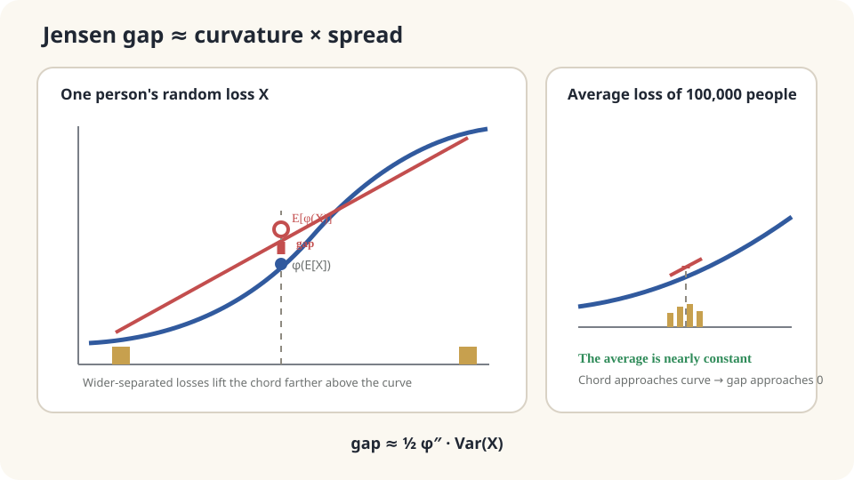

import Objectives from '../../../components/Objectives.astro';
import Prereq from '../../../components/Prereq.astro';
import Question from '../../../components/Question.astro';
import Answer from '../../../components/Answer.astro';
import QuizBlock from '../../../components/QuizBlock.astro';
import Option from '../../../components/Option.astro';
import Explanation from '../../../components/Explanation.astro';
import VizPlan from '../../../components/VizPlan.astro';
import Details from '../../../components/Details.astro';
import Bridge from '../../../components/Bridge.astro';
import Ref from '../../../components/Ref.astro';
import UsedBy from '../../../components/UsedBy.astro';

# Why Insurance Can Make Sense: Convexity and Jensen's Inequality

<Objectives title="After reading, you can">
- Define convexity and state Jensen's inequality with equality conditions.
- Explain how curvature and spread determine the Jensen gap.
- Apply the correct inequality direction while checking domains, moments, and what is actually being compared.
</Objectives>

<Prereq items={frontmatter.prereqs} />

## Why pay more than the average loss?

In a simplified mathematical insurance model, a yearly loss is 200,000 with probability 0.02 and zero otherwise. A premium of 6,000 fully covers it. The expected loss is 4,000, below the premium.

Yet a certain expense of 6,000 may have less impact than an occasional sudden loss of 200,000. **Are we comparing amounts or their consequences?** Represent the consequence by a function first.

<Question label="Discussion" id="Q1">
Define the random loss and its consequence. Which quantity does comparing the premium with mean loss omit?

<Answer summary="Show the reasoning">
Let annual loss $X$ equal 200,000 with probability 0.02 and zero otherwise, so $\mathbb E[X]=4000$.

Comparing money alone implicitly values it linearly. Instead let $\varphi(x)$ describe the disutility of losing $x$. Large losses can be disproportionately painful if they require borrowing or selling essential assets.

Then compare certain disutility $\varphi(6000)$ with uninsured expected disutility $\mathbb E[\varphi(X)]=0.98\varphi(0)+0.02\varphi(200000)$.

The omitted distinction is between $\mathbb E[\varphi(X)]$ and $\varphi(\mathbb E[X])$. Nonlinear consequences do not commute with averaging.
</Answer>
</Question>

## A chord above a curve

Increasing marginal disutility produces an upward-bending, bowl-like curve.

Join its points at losses zero and 200,000. The chord at 4,000, two percent of the way across, has height $\mathbb E[\varphi(X)]$. The curve itself has height $\varphi(\mathbb E[X])$.

For a convex curve, the chord lies above it. This gives $\mathbb E[\varphi(X)]\ge\varphi(\mathbb E[X])$. Their vertical separation is the **Jensen gap**.

This compares an uncertain loss with a certain loss of 4,000. To justify the actual premium, separately check $\varphi(6000)\le\mathbb E[\varphi(X)]$. Jensen alone does not establish that comparison.

Pooling independent identical losses reduces variance of the per-person mean to $\operatorname{Var}(X)/n$. This does not guarantee an insurer's profit; dependence, costs, and coverage terms also matter.



*The Jensen gap depends jointly on curvature and the input distribution.*

## Convexity and Jensen

A function $\varphi$ on a convex domain is **convex** if, for any $a,b$ and $\lambda\in[0,1]$,

$$
\varphi\big(\lambda a+(1-\lambda)b\big)\;\le\;\lambda\,\varphi(a)+(1-\lambda)\,\varphi(b).
$$

The left side is a curve value; the right side is the chord value. For twice-differentiable functions on an interval, convexity is equivalent to $\varphi''\ge0$. Examples include $x^2$, $e^x$, and $-\log x$ on their domains. Logarithm and square root are **concave**, reversing the shape.

**Jensen's inequality:** for convex $\varphi$ under appropriate integrability,

$$
\boxed{\;\varphi\big(\mathbb E[X]\big)\;\le\;\mathbb E\big[\varphi(X)\big].\;}
$$

**Proof.** Let $m=\mathbb E[X]$ lie inside the domain and choose a supporting line $\ell(x)=\varphi(m)+c(x-m)$ below the curve. If differentiable, $c=\varphi'(m)$. Taking expectations gives

$$
\mathbb E[\varphi(X)]\;\ge\;\mathbb E[\ell(X)]=\varphi(m)+c\,\big(\mathbb E[X]-m\big)=\varphi(m).\qquad\square
$$

Only the supporting-line inequality and linearity of expectation were needed. Two-point convexity is the special case of Jensen for a two-valued variable.

Equality requires $\varphi(X)=\ell(X)$ almost surely. For **strictly convex** $\varphi$, the supporting line meets the curve only at $m$, so equality holds exactly when $X$ is almost surely constant.

For a concentrated variable, expand to second order around $m$ and average. The linear term vanishes:

$$
\mathbb E[\varphi(X)]-\varphi(\mathbb E[X])\;\approx\;\tfrac12\,\varphi''(m)\,\mathrm{Var}(X).
$$

This is a local approximation requiring control of higher-order remainders. If the entire relevant interval satisfies $0\le m_2\le\varphi''\le M_2$, Taylor's integral remainder instead gives rigorous bounds:

$$
\frac{m_2}{2}\mathrm{Var}(X)\le \mathbb E[\varphi(X)]-\varphi(\mathbb E[X])\le\frac{M_2}{2}\mathrm{Var}(X).
$$

Variance alone does not order arbitrary Jensen gaps. Curvature and distributional shape also matter.

<Details label="Details" summary="Concavity and conditional Jensen">
For concave φ, φ(E[X])≥E[φ(X)]. For example, independent repeated returns of +50% or −50% have zero arithmetic mean but expected log growth ½(log1.5+log0.5)≈−0.144. Under the corresponding iid model, long-run multiplicative growth differs sharply from the arithmetic average. This is a mathematical illustration of nonlinear averaging.

Conditionally, $\varphi(\mathbb E[X\mid Y])\le\mathbb E[\varphi(X)\mid Y]$ almost surely, under appropriate integrability. Apply the supporting-line argument after fixing the available information.
</Details>

## Return to the premium

The actual comparison is $\varphi(6000)$ versus expected uninsured disutility. Once $\varphi$ is chosen, calculate both. Jensen explains the averaging distinction; it does not choose a person's preferences.

Check the assumptions:

- **Convexity on the relevant domain:** a capped or nonconvex consequence function need not obey the same direction. Its shape alone still does not settle every premium comparison.
- **Defined expectations:** heavy tails can make a mean infinite or an expression undefined, so ordinary finite-gap reasoning cannot be applied unchanged.

## Simulate, then reverse the curvature

```python
import numpy as np
rng = np.random.default_rng(0)
loss = np.where(rng.random(200000)<.02,200000.,0.)
phi = lambda x:-np.log1p(-x/250000)
print('mean loss:',loss.mean())
print('premium disutility and expected loss disutility:',phi(6000.),phi(loss).mean())
pool = loss.reshape(2,100000).mean(1)
print('pooled means and empirical gap:',pool,phi(pool).mean()-phi(pool.mean()))
phi_c = np.sqrt
print('concave comparison:',phi_c(4000.),phi_c(loss).mean())
```

For this chosen convex function, the premium's disutility is smaller than expected uninsured disutility. Large independent pools have much more concentrated per-person means. With $\sqrt x$, the Jensen direction reverses: $\sqrt{4000}\approx63.2$, while $0.02\sqrt{200000}\approx8.9$. Preference and premium comparisons still require the actual two costs.

<iframe loading="lazy" src="/personal_website/notes/research_areas/mathematical-foundations/m5-optimization/m5-0-1.en.html" class="demo-frame" title="Jensen gap: curvature and spread" style="height: 900px; width: 100%; border: none;"></iframe>

**Vary curvature, spread, and pool size to compare $\mathbb E[\varphi(X)]$ with $\varphi(\mathbb E[X])$.**

## Check your understanding

<QuizBlock id="m5-0-a">
Positive iid wealth multipliers are 1.5 or 0.5 with equal probabilities. Under log satisfaction, how does equal splitting across a hundred such outcomes compare with one outcome?
<Option>Equal expected wealth implies equal expected log wealth.</Option>
<Option correct>Equal splitting has at least as much expected log wealth by concavity applied to each realized set, then expectation.</Option>
<Option>The single outcome must be better because it can gain 50%.</Option>
<Explanation>$\log(\frac1{100}\sum_iW_i)\ge\frac1{100}\sum_i\log W_i$. Taking expectations compares against the common single-outcome expectation. Positive wealth keeps logarithms defined; arbitrary ruin probabilities need separate treatment.</Explanation>
</QuizBlock>

<QuizBlock id="m5-0-b">
For strictly convex $\varphi$, when does equality in Jensen hold under the stated assumptions?
<Option>Whenever the law is symmetric.</Option>
<Option>Whenever the mean is zero.</Option>
<Option correct>When $X$ is almost surely constant.</Option>
<Explanation>The nonnegative gap from the supporting line has zero expectation only if it vanishes almost surely. Strict convexity restricts that to the contact point.</Explanation>
</QuizBlock>

<QuizBlock id="m5-0-c">
A uniformly sampled day's waiting time is $T(N)$, convex in its random customer count. How does $T(\mathbb E[N])$ compare with $\mathbb E[T(N)]$?
<Option correct>It is no larger; averaging counts first can understate average waiting.</Option>
<Option>They always agree.</Option>
<Option>It is larger.</Option>
<Explanation>Jensen gives the direction, strictly under suitable strict convexity and nonconstant counts. Sampling a customer rather than a day changes the weighting and therefore the expectation.</Explanation>
</QuizBlock>

<UsedBy slug={frontmatter.slug} />

<Bridge to="math-kl">
We can distinguish applying a function before and after averaging. Apply this to convex $-\log$: how much extra expected log loss results from using the wrong probability table? That difference is KL divergence.
</Bridge>

## References

1. Boyd, S., Vandenberghe, L. [*Convex Optimization.*](https://web.stanford.edu/~boyd/cvxbook/) Cambridge University Press, 2004.
2. Jensen, J. L. W. V. [*Sur les fonctions convexes et les inégalités entre les valeurs moyennes.*](https://doi.org/10.1007/BF02418571) Acta Mathematica 30, 1906.
3. Cover, T. M., Thomas, J. A. [*Elements of Information Theory.*](https://doi.org/10.1002/047174882X) Wiley, 2nd ed., 2006.
4. Grimmett, G., Stirzaker, D. *Probability and Random Processes.* Oxford University Press, 3rd ed., 2001.
