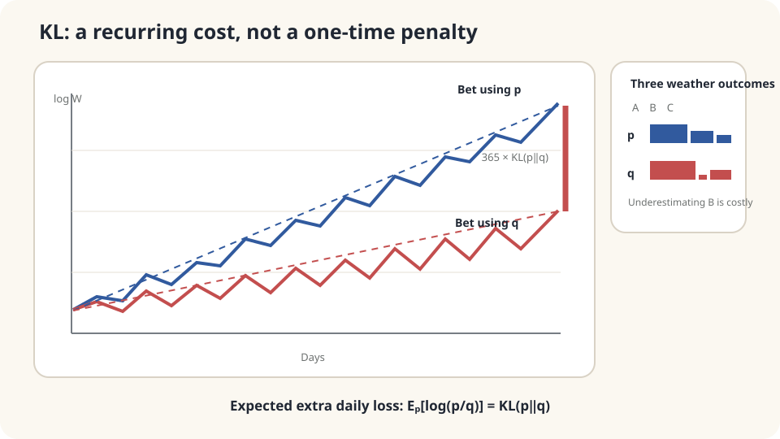

import Objectives from '../../../components/Objectives.astro';
import Prereq from '../../../components/Prereq.astro';
import Question from '../../../components/Question.astro';
import Answer from '../../../components/Answer.astro';
import QuizBlock from '../../../components/QuizBlock.astro';
import Option from '../../../components/Option.astro';
import Explanation from '../../../components/Explanation.astro';
import VizPlan from '../../../components/VizPlan.astro';
import Details from '../../../components/Details.astro';
import Bridge from '../../../components/Bridge.astro';
import Ref from '../../../components/Ref.astro';
import UsedBy from '../../../components/UsedBy.astro';

# The Cost of a Wrong Probability Table: KL Divergence and Cross-Entropy

<Objectives title="After reading, you can">
- Define $\mathrm{KL}(p\|q)$ as an expectation under the true law.
- Prove nonnegativity and derive cross-entropy = entropy + KL.
- Choose the direction of KL according to which distribution supplies observations and identify costly support errors.
</Objectives>

<Prereq items={frontmatter.prereqs} />

## A wrong weather table

Consider a mathematical betting model with sunny, rainy, and cloudy outcomes. A bookmaker's positive table $b$ sets payout multipliers $1/b(x)$. Each participant allocates all wealth among outcomes.

This is a probability illustration. If someone believes table $q$, allocating in proportions $q$ maximizes expected log wealth under that belief [3]. But actual outcomes follow another table $p$.

Compare two people observing the same outcomes, using allocations $p$ and $q$. Wealth multiplies, so logarithms turn the accumulated comparison into a sum.

<Question label="Discussion" id="Q1">
Define daily outcomes and wealth updates. Which quantity measures the cost of using the wrong table?

<Answer summary="Show the reasoning">
Let iid $X_t\sim p$. Allocating by $q$ multiplies wealth by $q(X_t)/b(X_t)$ each day. Under integrability,

$$
W_n=W_0\prod_{t=1}^n\frac{q(X_t)}{b(X_t)},\qquad
\frac1n\log\frac{W_n}{W_0}=\frac1n\sum_{t=1}^n\log\frac{q(X_t)}{b(X_t)}
\longrightarrow\mathbb E_p\!\left[\log\frac{q(X)}{b(X)}\right].
$$

The logarithm turns compounding into addition. The expectation is under **true outcome law $p$**, regardless of the participant's belief.

Subtract this expected log growth from that obtained with allocation $p$:

$$
\mathbb E_p\!\left[\log\frac{p(X)}{b(X)}\right]-\mathbb E_p\!\left[\log\frac{q(X)}{b(X)}\right]
=\mathbb E_p\!\left[\log\frac{p(X)}{q(X)}\right].
$$

The common payout table cancels. Expected annual log-wealth difference is 365 times this value; a realized year still fluctuates.
</Answer>
</Question>

## A small expected cost each day

On a logarithmic wealth plot, both realized paths fluctuate, but their expected slopes differ by a fixed amount.

The expected gap grows linearly. The actual gap need not increase by the same amount every day, or even increase every day.



*Realized log differences fluctuate; their expectation accumulates at rate $\mathrm{KL}(p\|q)$.*

## KL, nonnegativity, and cross-entropy

For distributions on the same sample space, define **Kullback–Leibler divergence**:

$$
\mathrm{KL}(p\,\|\,q)=\sum_x p(x)\log\frac{p(x)}{q(x)}=\mathbb E_{X\sim p}\Big[\log\frac{p(X)}{q(X)}\Big].
$$

Use an integral for densities. A zero-$p$ term contributes zero; positive $p$ where $q=0$ gives infinite KL. Interpret it as excess expected log cost when observations follow $p$ but predictions use $q$ [2].

**Nonnegativity.** Write KL as $-\mathbb E_p[\log(q/p)]$. Convexity of $-\log$ and Jensen give

$$
-\mathbb E_p\Big[\log\frac{q(X)}{p(X)}\Big]\ge-\log\sum_{x:p(x)>0}q(x)\ge-\log1=0.\qquad\square
$$

Equality in Jensen requires $q/p$ constant on the support of $p$; equality in the normalization step requires no extra $q$ mass outside it. Together they give $p=q$. KL vanishes exactly for identical laws, but is not a metric.

**Entropy and cross-entropy.** Split the log ratio:

$$
\mathrm{KL}(p\,\|\,q)=\underbrace{\mathbb E_p[-\log q(X)]}_{H(p,q)\ \text{cross-entropy}}-\underbrace{\mathbb E_p[-\log p(X)]}_{H(p)\ \text{entropy}}.
$$

When these quantities are finite, cross-entropy is the correct-table cost plus excess cost. For fixed $p$, minimizing it is equivalent to minimizing KL. Differential entropy for continuous densities can be negative and has a different interpretation from discrete entropy.

**Asymmetry matters:** generally $\mathrm{KL}(p\|q)\ne\mathrm{KL}(q\|p)$.

- If $p(x)>0$ remains fixed while $q(x)\to0$, the contribution grows without bound: a true event is severely underpredicted.
- If $p(x)=0$, its direct contribution vanishes. Allocating $q$ mass there still removes mass from other outcomes and can increase the total cost.

Reversing the arguments changes the averaging law. $\mathrm{KL}(q\|p)$ is infinite when $q$ places positive mass where $p=0$. This direction treats errors differently; neither direction is universally the larger number.

<Details label="Details" summary="Not a metric, but additive for independent products">
KL is asymmetric and does not satisfy a metric triangle inequality. For independent product laws, $\mathrm{KL}(p_1p_2\|q_1q_2)=\mathrm{KL}(p_1\|q_1)+\mathrm{KL}(p_2\|q_2)$: split the logarithm and take expectations.

Pinsker's inequality with natural logarithms gives KL(p‖q)≥½‖p−q‖₁². Thus small KL controls every event-probability difference. The converse fails: small total variation can coexist with infinite KL through a support mismatch.
</Details>

## Quantify the asymmetry

For $p=(0.5,0.3,0.2)$ and $q=(0.6,0.1,0.3)$, calculate

$$
\mathrm{KL}(p\|q)=0.5\log\frac{0.5}{0.6}+0.3\log\frac{0.3}{0.1}+0.2\log\frac{0.2}{0.3}\approx0.158\ \text{nats per day}.
$$

The annual expected log gap is about 57.4 nats. This is neither a deterministic wealth ratio nor the logarithm of an expected wealth ratio. Individual summands can be negative; only the total is guaranteed nonnegative.

Swapping the two tables gives approximately $0.121$, rather than $0.158$. The same absolute probability discrepancy can have different log costs depending on the true law.

The long-run sample-average statement assumes fixed iid outcomes and an integrable log ratio. Keeping some wealth unallocated changes the multiplier and does not simply scale KL by the allocated fraction.

## Simulate a year and nearly remove an outcome

```python
import numpy as np
rng = np.random.default_rng(0)
p = np.array([.5,.3,.2])
q = np.array([.6,.1,.3])
kl = lambda a,b:np.sum(a*np.log(a/b))
print(kl(p,q),kl(q,p))
x = rng.choice(3,size=(2000,365),p=p)
gap = np.log(p[x]).sum(1)-np.log(q[x]).sum(1)
print('daily mean and annualized fluctuation:',gap.mean()/365,gap.std()/365)
q_bad = np.array([.7,1e-6,.3-1e-6])
print('near-zero rainy probability:',kl(p,q_bad))
```

The simulated daily expected gap approaches $0.158$, with finite-year fluctuations. Making rainy probability $10^{-6}$ raises KL to about 3.5 nats per observation. The formula identifies which underpredicted events dominate the cost.

<iframe loading="lazy" src="/personal_website/notes/research_areas/mathematical-foundations/m5-optimization/m5-1-1.en.html" class="demo-frame" title="KL divergence: contributions and direction" style="height: 900px; width: 100%; border: none;"></iframe>

**Change $q$ and exchange the two arguments to inspect the costly errors.**

## Check your understanding

<QuizBlock id="m5-1-a">
An empirical table gives a storm frequency 0.008 and hail frequency zero. The model assigns 0.001 and 0.05. Which direct empirical KL contribution is larger?
<Option>Hail, because its probability is overestimated.</Option>
<Option correct>The storm term, about $0.008\log8$; the zero-frequency hail term contributes zero directly.</Option>
<Option>They are equal.</Option>
<Explanation>Mass assigned to hail still reduces other probabilities through normalization. No hail observations in one year do not prove the true probability is zero.</Explanation>
</QuizBlock>

<QuizBlock id="m5-1-b">
A stationary Markov chain has marginal $p$ each day. Both predictors ignore history and use fixed tables $p$ and $q$. What is the expected log gap over $n$ days?
<Option correct>$n\mathrm{KL}(p\|q)$ by linearity of expectation.</Option>
<Option>Dependence necessarily makes it larger.</Option>
<Option>Zero because dependence makes outcomes predictable.</Option>
<Explanation>Independence is unnecessary for this expected sum with fixed marginals. Comparing against a predictor that uses history requires conditional laws; convergence of realized averages needs further assumptions such as ergodicity.</Explanation>
</QuizBlock>

<QuizBlock id="m5-1-c">
Why train with cross-entropy instead of explicitly calculating data-to-model KL?
<Option>Cross-entropy is symmetric.</Option>
<Option>The objectives are unrelated.</Option>
<Option correct>They differ by parameter-independent data entropy, while expected model log loss can be estimated from samples.</Option>
<Explanation>Sampling data suffices to average $-\log q_\theta(X)$. Evaluating the unknown data density is unnecessary for the parameter optimization.</Explanation>
</QuizBlock>

<UsedBy slug={frontmatter.slug} />

<Bridge to="math-ema">
KL measures expected log cost for fixed tables. When the quantity being estimated itself changes, can the latest noisy observation be trusted? Next study how EMA trades noise reduction for delay.
</Bridge>

## References

1. Cover, T. M., Thomas, J. A. [*Elements of Information Theory.*](https://doi.org/10.1002/047174882X) Wiley, 2nd ed., 2006.、
2. Kullback, S., Leibler, R. A. [*On Information and Sufficiency.*](https://doi.org/10.1214/aoms/1177729694) Annals of Mathematical Statistics 22(1), 1951.
3. Kelly, J. L. [*A New Interpretation of Information Rate.*](https://doi.org/10.1002/j.1538-7305.1956.tb03809.x) Bell System Technical Journal 35(4), 1956.
4. MacKay, D. J. C. [*Information Theory, Inference, and Learning Algorithms.*](https://www.inference.org.uk/itprnn/book.html) Cambridge University Press, 2003.
