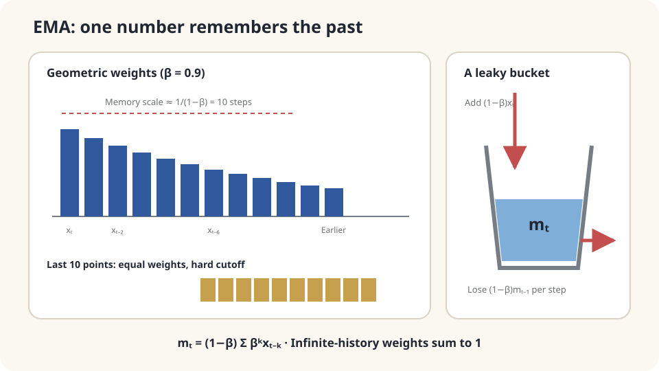

import Objectives from '../../../components/Objectives.astro';
import Prereq from '../../../components/Prereq.astro';
import Question from '../../../components/Question.astro';
import Answer from '../../../components/Answer.astro';
import QuizBlock from '../../../components/QuizBlock.astro';
import Option from '../../../components/Option.astro';
import Explanation from '../../../components/Explanation.astro';
import VizPlan from '../../../components/VizPlan.astro';
import Details from '../../../components/Details.astro';
import Bridge from '../../../components/Bridge.astro';
import Ref from '../../../components/Ref.astro';
import UsedBy from '../../../components/UsedBy.astro';

# Tracking a Moving Dog: EMA, Moving Targets, and Stop-Gradient

<Objectives title="After reading, you can">
- Expand EMA into geometric weights and calculate stationary noise variance and tracking lag.
- Explain why self-defined targets can admit trivial solutions, distinguishing stop-gradient from slow targets.
- Choose smoothing based on signal speed and noise, checking initialization and modeling assumptions.
</Objectives>

<Prereq items={frontmatter.prereqs} />

## A dog that will not stand still

A tracker reports a running dog's position each second, with independent errors of standard deviation about three meters. You want its current position.

Following each reading makes the estimate jump. Averaging ten seconds reduces noise but includes positions the dog left long ago, causing delay.

**Can old observations lose influence gradually without storing the entire history?**

<Question label="Discussion" id="Q1">
Define true position, noisy observation, and a recursive rule controlling memory.

<Answer summary="Show the reasoning">
Let $\mu_t$ be true position and $x_t=\mu_t+\varepsilon_t$, with independent centered noise of variance $\sigma^2$. We want an estimate close to the moving signal without inheriting all observation noise.

Instead of a stored window, keep one state:

$$
m_t=\beta\,m_{t-1}+(1-\beta)\,x_t,\qquad\beta\in[0,1).
$$

This **exponential moving average (EMA)** mixes the previous estimate and latest observation in proportions $\beta$ and $1-\beta$. At $\beta=0$ it follows the latest reading; near one it changes slowly.
</Answer>
</Question>

## A leaking bucket

Each update retains fraction $\beta$ of the old state and adds $(1-\beta)x_t$. An observation's weight decays geometrically with age, with no hard cutoff.

At $\beta=0.9$, a contribution retains about 35% of its original weight after ten updates; at $0.99$, memory is much longer. The rough time scale is $1/(1-\beta)$ updates. Unlike a sliding window, storage remains constant.



*A single recursive state encodes geometrically weighted history.*

## One coefficient, two costs

Expand the recursion:

$$
m_t=\beta^t m_0+(1-\beta)\sum_{k=0}^{t-1}\beta^k x_{t-k}.
$$

The first term retains initialization. Only after $\beta^t$ becomes small do the infinite-history formulas apply. The stationary weighted mean age is $\beta/(1-\beta)$, approximately $1/(1-\beta)$ only near one.

By linearity, the stationary estimate separates into weighted signal $(1-\beta)\sum_{k\ge0}\beta^k\mu_{t-k}$ and weighted noise $(1-\beta)\sum_{k\ge0}\beta^k\varepsilon_{t-k}$.

**Noise:** independence makes the variance the sum of squared weights times $\sigma^2$:

$$
\operatorname{Var}(\text{noise})=\sigma^2(1-\beta)^2\sum_{k\ge0}\beta^{2k}
=\sigma^2\frac{1-\beta}{1+\beta}.
$$

At $\beta=0.9$, standard deviation is about $0.23\sigma$, reducing three meters to roughly 0.7 m.

**Lag:** for constant velocity $v$, $\mu_{t-k}=\mu_t-vk$. The weighted signal is $\mu_t-v\beta/(1-\beta)$. With $v=2$ m per update and $\beta=0.9$, the estimate lags by 18 m.

These effects oppose each other:

$$
\underbrace{\sigma^2\frac{1-\beta}{1+\beta}}_{\text{noise variance decreases with }\beta}
\quad\text{and}\quad
\underbrace{\left(v\frac{\beta}{1-\beta}\right)^2}_{\text{squared lag increases with }\beta}.
$$

For this model, faster signals favor smaller $\beta$ and noisier observations favor larger $\beta$. Minimize their sum for the intended use; no coefficient is universally optimal. The ratio $v/\sigma$ determines the stationary tradeoff.

<Details label="Details" summary="Initialization, Adam correction, and averaging iterates">
Starting at m₀=0 gives observation weights summing to 1−β^t. For a constant-mean signal, dividing by this quantity removes the initialization shrinkage: Adam's bias correction [3]. This does not generally remove tracking bias for a changing mean.

Parameters can also be averaged to reduce fluctuations. The classical Polyak–Juditsky analysis concerns arithmetic averaging of iterates, not every fixed-coefficient EMA setup [2].
</Details>

## A different issue: chasing your own output

The dog's true position does not respond to the estimate. Now consider targets defined by the estimator itself.

A **bootstrap** target uses predictions to define training targets. Examples include Q-learning targets involving a next-state value estimate and self-supervised consistency between different views, such as BYOL [4].

If the only demand is equal outputs, a constant function can attain zero loss without distinguishing inputs. Not every bootstrap objective has this degeneracy: rewards or other constraints can restrict solutions.

Two mechanisms address different aspects of this feedback:

1. **Stop-gradient:** $\|f_\theta(a)-\mathrm{sg}[f(b)]\|^2$ treats the target branch as constant during differentiation, preventing that branch from moving through this gradient.
2. **Slow target:** use EMA parameters $\bar\theta_t=\beta\bar\theta_{t-1}+(1-\beta)\theta_t$. Deliberate lag creates a slower reference. Periodically copied target networks, as in DQN [5], provide another update schedule.

Stop-gradient determines this update's differentiation path; EMA determines target-parameter dynamics. Neither alone universally excludes collapse. Full systems such as BYOL include additional structure whose combined behavior needs analysis.

## Put numbers on the tradeoff

For $v=2$ and $\sigma=3$, scanning the stationary MSE gives an optimum near $\beta=0.35$: lag about 1.1 m and noise standard deviation about 2.1 m. A stationary signal favors increasingly long averaging in this ideal independent-noise model, with finite-time initialization still relevant.

The formulas assume approximately constant signal velocity, independent centered noise, and an external target. Turns invalidate the constant-velocity lag expression; systematic measurement bias persists. Self-defined targets introduce the separate feedback issue above.

## Simulate a turn and a trivial target

```python
import numpy as np
rng = np.random.default_rng(0)
T, v, sigma = 200, 2., 3.
mu = v*np.arange(T)
x = mu+sigma*rng.standard_normal(T)
def ema(x,beta):
    m = np.empty_like(x)
    m[0] = x[0]
    for t in range(1,len(x)):
        m[t] = beta*m[t-1]+(1-beta)*x[t]
    return m
for beta in [0.,.5,.9]:
    err = ema(x,beta)[50:]-mu[50:]
    print(beta,err.mean(),err.std(),-v*beta/(1-beta),sigma*np.sqrt((1-beta)/(1+beta)))
mu2 = np.where(np.arange(T)<100,mu,2*mu[100]-mu)
m = ema(mu2+sigma*rng.standard_normal(T),.9)
print('turn error:',np.abs(m-mu2)[100:130].max())
theta = 5.
for _ in range(100):
    target = theta
    theta -= .1*2*(theta-target)
print('identical prediction and target:',theta)
```

The constant-velocity estimates agree approximately with theoretical lag and noise. After reversal, a transient develops before the lag approaches its new sign; the steady formula is not an instantaneous description at the turn. The final scalar example has zero loss and zero update at every value, illustrating that self-agreement alone teaches nothing, regardless of stopping the target gradient.

<iframe loading="lazy" src="/personal_website/notes/research_areas/mathematical-foundations/m5-optimization/m5-2-1.en.html" class="demo-frame" title="EMA smoothing, lag, and moving targets" style="height: 900px; width: 100%; border: none;"></iframe>

**Vary $\beta$, signal speed, and noise to inspect smoothing versus delay.**

## Check your understanding

<QuizBlock id="m5-2-a">
A network-speed display fluctuates too much, but must still track changes. What is a useful option?
<Option>Always show only the latest reading.</Option>
<Option correct>Use EMA with a coefficient chosen for the update interval and acceptable delay.</Option>
<Option>Average every reading since startup.</Option>
<Explanation>A fixed EMA has a finite typical memory scale. An all-history arithmetic mean corresponds to time-varying coefficients and becomes progressively less responsive.</Explanation>
</QuizBlock>

<QuizBlock id="m5-2-b">
Every tracker reading has a fixed +2 m bias. What does EMA do?
<Option>Remove the bias by averaging.</Option>
<Option correct>Retain it asymptotically; smoothing independent fluctuations does not calibrate systematic error.</Option>
<Option>Amplify it by $1/(1-\beta)$.</Option>
<Explanation>With the same initialization, adding two to every observation shifts the finite-time EMA by $2(1-\beta^t)$, tending to two.</Explanation>
</QuizBlock>

<QuizBlock id="m5-2-c">
Change a bootstrap target's EMA coefficient from 0.99 to 0.5. What can be concluded directly?
<Option>Training must improve.</Option>
<Option>Only noise changes, not the target time scale.</Option>
<Option correct>The target follows faster with less smoothing; its effect on training requires the full system and experiments.</Option>
<Explanation>A coefficient alone proves neither collapse nor successful optimization. It changes one component of the target dynamics.</Explanation>
</QuizBlock>

<UsedBy slug={frontmatter.slug} />

<Bridge to="math-generator-gradient">
EMA trades smoothing for delay; stop-gradient controls differentiation paths. Next consider a generator that transforms noise into samples without necessarily exposing their density. How can its parameters be updated toward a target distribution?
</Bridge>

## References

1. Brown, R. G. *Smoothing, Forecasting and Prediction of Discrete Time Series.* Prentice-Hall, 1963.
2. Polyak, B. T., Juditsky, A. B. [*Acceleration of Stochastic Approximation by Averaging.*](https://doi.org/10.1137/0330046) SIAM Journal on Control and Optimization 30(4), 1992.
3. Kingma, D. P., Ba, J. [*Adam: A Method for Stochastic Optimization.*](https://arxiv.org/abs/1412.6980) ICLR 2015.
4. Grill, J.-B. et al. [*Bootstrap Your Own Latent: A New Approach to Self-Supervised Learning.*](https://arxiv.org/abs/2006.07733) NeurIPS 2020.
5. Mnih, V. et al. [*Human-level Control through Deep Reinforcement Learning.*](https://doi.org/10.1038/nature14236) Nature 518, 2015.
