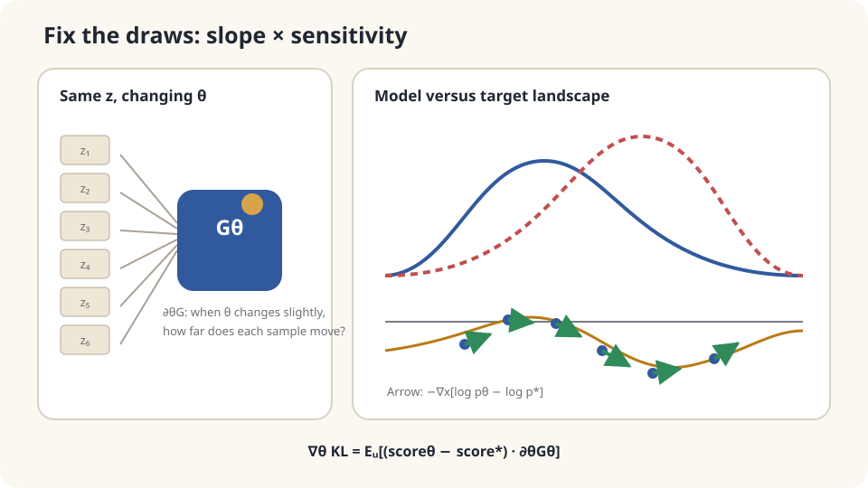

import Objectives from '../../../components/Objectives.astro';
import Prereq from '../../../components/Prereq.astro';
import Question from '../../../components/Question.astro';
import Answer from '../../../components/Answer.astro';
import QuizBlock from '../../../components/QuizBlock.astro';
import Option from '../../../components/Option.astro';
import Explanation from '../../../components/Explanation.astro';
import VizPlan from '../../../components/VizPlan.astro';
import Details from '../../../components/Details.astro';
import Bridge from '../../../components/Bridge.astro';
import Ref from '../../../components/Ref.astro';
import UsedBy from '../../../components/UsedBy.astro';

# Adjusting a Sample-Producing Machine: Differentiating a Generator

<Objectives title="After reading, you can">
- Express samples as $x=G_\theta(z)$ with a parameter-independent noise law.
- Derive the KL parameter gradient and identify the zero-mean term at fixed sample position.
- Determine which generator derivatives and distribution scores must be known or estimated.
</Objectives>

<Prereq items={frontmatter.prereqs} />

## A machine turning noise into products

A differentiable program transforms noise $z$ into products $x=G_\theta(z)$. We know the noise and program, but may not know the output density $p_\theta$.

We want the whole output distribution to match a target $p^*$, rather than making every product identical. Which parameter update improves that match?

Fixing the same noise and changing parameters reveals how samples move. **Can those movements give the gradient of a distributional discrepancy?**

<Question label="Discussion" id="Q1">
How does the output law depend on parameters, and what makes direct differentiation difficult?

<Answer summary="Show the reasoning">
The output law is the pushforward of fixed $p_z$ through $G_\theta$. Compare it with the target using

$$
L(\theta)=\mathrm{KL}(p_\theta\,\|\,p^*)=\mathbb E_{x\sim p_\theta}\big[\log p_\theta(x)-\log p^*(x)\big].
$$

This direction, $\mathrm{KL}(p_\theta\|p^*)$, penalizes generated mass placed where the target density is too small. The choice also affects treatment of missing modes.

Both the sampling law and $\log p_\theta$ depend on parameters. A black-box sampler does not reveal how individual samples move. Reparameterization provides that path, though it is not the only gradient-estimation method.

Write the expectation over fixed noise $z\sim p_z$, then place all sampling dependence in a differentiable $G_\theta$. This is **reparameterization**.
</Answer>
</Question>

## Fix the random draws and adjust the machine

Imagine pre-drawing $z_1,\ldots,z_N$. For fixed parameters each output is now deterministic. The derivative $\partial_\theta G_\theta(z_i)$ describes how a parameter change moves sample $i$.

At each sample, the spatial slope of $\log p_\theta(x)-\log p^*(x)$ describes the local mismatch. Pulling this slope back through the generator derivative converts a sample-space direction into a parameter gradient. The density itself also depends explicitly on parameters, so we must account for that term too.

The resulting expression averages spatial score differences multiplied by parameter sensitivities. The following derivation explains why an additional term vanishes in expectation.



*Fixed noise exposes sample motion; generator derivatives convert spatial scores into parameter updates.*

## Derive it in one dimension

First use scalar samples and parameters. Assume differentiable $G_\theta$, suitable smooth densities, finite KL, and justified exchanges of derivatives and integrals. The support must be parameter-independent or moving-boundary contributions correctly handled. Then

$$
L(\theta)=\mathbb E_{z}\Big[\log p_\theta\big(G_\theta(z)\big)-\log p^*\big(G_\theta(z)\big)\Big].
$$

Differentiate inside the fixed-noise expectation. Parameters occur both through $G_\theta$ and explicitly in the model-density index:

$$
\partial_\theta L=\mathbb E_z\!\left[
\underbrace{(\partial_x\log p_\theta-\partial_x\log p^*)(G_\theta(z))\,\partial_\theta G_\theta(z)}_{A:\ \text{spatial slope times sensitivity}}
+\underbrace{(\partial_\theta\log p_\theta)(G_\theta(z))}_{B:\ \text{explicit density dependence}}
\right].
$$

Term $B$ differentiates the density parameter **at fixed $x$**, not along the generated sample path. Under the regularity assumptions its expectation is zero:

$$
\mathbb E_z\big[\partial_\theta\log p_\theta(G_\theta(z))\big]=\mathbb E_{x\sim p_\theta}\big[\partial_\theta\log p_\theta(x)\big]=\int p_\theta\,\frac{\partial_\theta p_\theta}{p_\theta}\,dx=\partial_\theta\!\int p_\theta\,dx=\partial_\theta1=0.
$$

Changing the variable name from $G_\theta(z)$ to $x$ gives the first equality; differentiating normalization gives the final zero. Therefore

$$
\boxed{\;\partial_\theta\,\mathrm{KL}(p_\theta\|p^*)=\mathbb E_{z}\Big[\big(\partial_x\log p_\theta(x)-\partial_x\log p^*(x)\big)\Big|_{x=G_\theta(z)}\cdot\partial_\theta G_\theta(z)\Big].\;}
$$

For $d$-dimensional samples and $m$ parameters, $J_\theta G\in\mathbb R^{d\times m}$ gives $\nabla_\theta L=\mathbb E_z[(J_\theta G)^\top(s_\theta-s^*)]$, where $s=\nabla_x\log p$. The result has parameter dimension $m$.

A **spatial score** $\nabla_x\log p$ points toward increasing log density. An $x$-independent normalizer disappears under this derivative, but is not thereby calculated. The generator supplies the Jacobian; model and target distributions supply the scores.

<Details label="Details" summary="Zero-mean terms and estimator variance">
Another identity is the parameter-score estimator $\partial_\theta\mathbb E_{p_\theta}[f]=\mathbb E_{p_\theta}[f\partial_\theta\log p_\theta]$ for parameter-independent f under appropriate assumptions. Its parameter derivative differs from the spatial score above and can handle discrete outcomes. There is no universal variance ordering against pathwise estimators [3].

Removing zero-mean $B$ preserves unbiasedness. It does not universally reduce variance, since

$$
\begin{aligned}
\operatorname{Var}(A+B)
&=\operatorname{Var}(A)+\operatorname{Var}(B)\\
&\quad+2\operatorname{Cov}(A,B).
\end{aligned}
$$

At exact model-target equality, $A$ vanishes samplewise, so removing $B$ eliminates this noise source [4].
</Details>

## What information does the formula need?

At each generated sample, obtain three quantities:

1. **Generator Jacobian:** available through differentiation of the program.
2. **Target spatial score:** analytic if the target density is known; target samples alone do not directly supply it. Score estimation is another learning problem [5].
3. **Model spatial score:** knowing a generator does not generally expose its density or score. An invertible generator may permit change of variables; a general generator may require estimation or may not even induce an ambient-space density.

Two scores do not necessarily require two additional neural networks: analytic expressions and other estimators may exist. Bypassing normalizers in spatial derivatives does not evaluate likelihoods or KL values.

Check differentiable sample paths, score accuracy at generated locations, and the KL direction. Discrete outputs need other estimators or relaxations. Reverse KL can tolerate missing target modes, so a mode-coverage goal may call for a different discrepancy.

## A Gaussian calculation with and without the extra term

Let $G_\theta(z)=\theta+z$, $z\sim\mathcal N(0,1)$, and $p^*=\mathcal N(5,1)$. KL is $(\theta-5)^2/2$. Spatial scores are $-(x-\theta)$ and $-(x-5)$, whose difference is exactly $\theta-5$ for every sample. Generator sensitivity is one, so $A$ has no sampling variation here.

```python
import numpy as np
rng = np.random.default_rng(0)
theta, target, lr = 0., 5., .1
for step in range(60):
    z = rng.standard_normal(256)
    x = theta+z
    score_model = -(x-theta)
    score_target = -(x-target)
    grad_A = np.mean(score_model-score_target)
    grad_B = np.mean(x-theta)  # Parameter derivative at fixed x; mean zero.
    theta -= lr*grad_A
    if step%15==0:
        print(step,theta,grad_A,grad_B)
print(theta)
```

The update approaches five. Each batch's $A$ equals the exact gradient, while $B$ fluctuates with mean zero. Including $B$ would add noise in this example; that observation does not establish a universal variance comparison.

Estimated scores can be inaccurate in sparse tails. Nonlinearity alone does not imply no analytic density: $\theta+|z|$ has a shifted half-normal law, but its moving support invalidates the simple zero-mean proof without boundary treatment. A low-dimensional latent mapped into higher dimensions can induce a singular law, making the displayed density-based KL undefined or infinite.

<iframe loading="lazy" src="/personal_website/notes/research_areas/mathematical-foundations/m5-optimization/m5-3-1.en.html" class="demo-frame" title="Generator gradients from score differences" style="height: 900px; width: 100%; border: none;"></iframe>

**Switch generators and target information to inspect how score differences move parameters.**

## Check your understanding

<QuizBlock id="m5-3-a">
A generator outputs discrete product IDs using an argmax. Can the displayed pathwise formula be applied directly?
<Option>Yes: argmax is an ordinary differentiable sample path.</Option>
<Option correct>No: use an appropriate parameter-score estimator or a justified continuous relaxation.</Option>
<Option>Changing KL alone makes argmax differentiable.</Option>
<Explanation>Discrete jumps are not the smooth sample motions assumed here. Argmax derivatives miss how probabilities change at decision boundaries.</Explanation>
</QuizBlock>

<QuizBlock id="m5-3-b">
What happens if term $B$ remains in the estimator?
<Option>It necessarily biases the gradient.</Option>
<Option correct>It remains unbiased under the assumptions, but changes variance; in the Gaussian example it adds noise.</Option>
<Option>It never matters because autodiff always removes it.</Option>
<Explanation>Zero expectation establishes unbiasedness, not variance ordering. The covariance with the other term matters.</Explanation>
</QuizBlock>

<QuizBlock id="m5-3-c">
Only two hundred target samples are available. The fitted generator matches the center but misses the tails. What should be investigated?
<Option>Only learning rate.</Option>
<Option>Reparameterization automatically fails in tails.</Option>
<Option correct>Check sparse-tail score estimates together with capacity, convergence, and optimization.</Option>
<Explanation>The endpoint mismatch suggests checks, not a unique diagnosis. Compare an analytic toy, score quality, and training stability.</Explanation>
</QuizBlock>

<UsedBy slug={frontmatter.slug} />

<Bridge to="math-warehouse-ot">
Fixed noise connects sample motion to parameter gradients, given densities, scores, and regularity. Next compare distributions through a different question: what is the least cost of moving one arrangement of goods into another?
</Bridge>

## References

1. Kingma, D. P., Welling, M. [*Auto-Encoding Variational Bayes.*](https://arxiv.org/abs/1312.6114) ICLR 2014.
2. Rezende, D. J., Mohamed, S., Wierstra, D. [*Stochastic Backpropagation and Approximate Inference in Deep Generative Models.*](https://arxiv.org/abs/1401.4082) ICML 2014.
3. Mohamed, S., Rosca, M., Figurnov, M., Mnih, A. [*Monte Carlo Gradient Estimation in Machine Learning.*](https://arxiv.org/abs/1906.10652) JMLR 21, 2020.
4. Roeder, G., Wu, Y., Duvenaud, D. [*Sticking the Landing: Simple, Lower-Variance Gradient Estimators for Variational Inference.*](https://arxiv.org/abs/1703.09194) NeurIPS 2017.
5. Hyvärinen, A. [*Estimation of Non-Normalized Statistical Models by Score Matching.*](https://jmlr.org/papers/v6/hyvarinen05a.html) JMLR 6, 2005.
