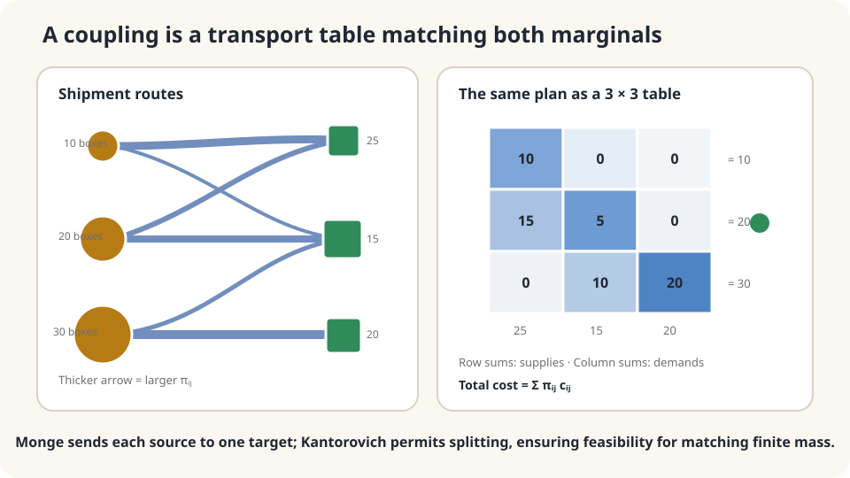

import Objectives from '../../../components/Objectives.astro';
import Prereq from '../../../components/Prereq.astro';
import Question from '../../../components/Question.astro';
import Answer from '../../../components/Answer.astro';
import QuizBlock from '../../../components/QuizBlock.astro';
import Option from '../../../components/Option.astro';
import Explanation from '../../../components/Explanation.astro';
import VizPlan from '../../../components/VizPlan.astro';
import Details from '../../../components/Details.astro';
import Bridge from '../../../components/Bridge.astro';
import Ref from '../../../components/Ref.astro';
import UsedBy from '../../../components/UsedBy.astro';

# Moving Goods Between Warehouses: Monge, Kantorovich, and Couplings

<Objectives title="After reading, you can">
- Formulate map-based Monge transport and table-based Kantorovich transport.
- Define a coupling as a joint law with specified marginals and distinguish feasibility from optimality.
- Solve a small transport problem while checking linear-cost and divisibility assumptions.
</Objectives>

<Prereq items={frontmatter.prereqs} />

## Three warehouses and three stores

Warehouses hold 10, 20, and 30 boxes. Stores need 25, 15, and 20. Total supply and demand both equal sixty. Matrix $c_{ij}$ records per-box route costs.

Decide how much to send along each route to minimize total cost.

Sending each warehouse's entire stock to one store cannot meet these demands. **Should a warehouse be allowed to supply several stores?** This replaces choosing one destination with allocating quantities across routes.

For these amounts, even allowing several whole warehouses to share a destination cannot produce all required totals. The no-splitting map problem is infeasible; allowing split shipments changes that.

<Question label="Discussion" id="Q1">
What represents a plan, which constraints make it feasible, and how is cost computed?

<Answer summary="Show the reasoning">
A map $T(i)$ sends all source mass $a_i$ to destination $T(i)$. Feasibility requires $\sum_{i:T(i)=j}a_i=b_j$; cost is $\sum_i a_ic_{i,T(i)}$. This is **Monge's** map formulation [5]. A feasible map need not exist.

**Kantorovich** instead uses nonnegative quantities $\pi_{ij}$ on routes, satisfying

$$
\sum_j\pi_{ij}=a_i\quad\text{(send all supply)},\qquad
\sum_i\pi_{ij}=b_j\quad\text{(meet all demand)}.
$$

Minimize $\sum_{ij}\pi_{ij}c_{ij}$ [4]. Equal positive total mass gives a feasible proportional plan $\pi_{ij}=a_ib_j/60$, though it need not be cheapest.

After dividing by sixty, supply and demand are probability laws and $\pi$ is a **joint distribution** with those two marginals: a **coupling**. A transport plan and a coupling are the same mathematical object here.
</Answer>
</Question>

## A table satisfying both margins

Fill a table with nonnegative numbers whose row totals equal supply and column totals equal demand. Each cell has a unit cost. Among feasible fillings, choose the cheapest.

A map is the special case with one nonzero destination per positive-supply row. General couplings allow several, making the finite balanced problem feasible even when no map works.



*Nonnegative row and column constraints define feasible couplings.*

## The Kantorovich problem

For finite nonnegative masses $a,b$ with equal total and finite cost matrix $c$, define

$$
\boxed{\;\mathrm{OT}(a,b)=\min_{\pi\in\Pi(a,b)}\ \sum_{i,j}\pi_{ij}\,c_{ij},\qquad
\Pi(a,b)=\Big\{\pi\ge0:\ \sum_j\pi_{ij}=a_i,\ \sum_i\pi_{ij}=b_j\Big\}.\;}
$$

The set $\Pi(a,b)$ contains all feasible couplings. Three observations follow:

1. The objective and constraints form a **linear program**.
2. For positive total mass, $ab^\top/\sum_i a_i$ is feasible. Entries are bounded by $\min(a_i,b_j)$, so the compact feasible polytope has an optimum. Zero total mass is trivial.
3. An optimum can be chosen at a vertex, with at most $m+n-1$ nonzero entries. Other optimal mixtures need not be this sparse.

For continuous laws $\mu,\nu$, a coupling is a joint measure on pairs $(x,y)$ with these marginals; minimize $\int c(x,y)d\pi$. A Monge plan is concentrated on a graph $y=T(x)$. General existence results require cost and measure assumptions beyond the finite argument.

<Details label="Details" summary="When do Monge and Kantorovich agree?">
Every feasible map defines a coupling, so relaxing to couplings cannot increase minimum cost. Conversely, maps can be infeasible or more expensive.

For equal unit supplies and demands, the Birkhoff–von Neumann theorem gives permutation-matrix vertices: an optimal assignment exists, solvable by assignment algorithms. For quadratic cost in Euclidean space, Brenier's theorem gives a unique map-induced optimal coupling when the source is absolutely continuous and both laws have finite second moments [1,2]. Merely having no atoms is insufficient in higher dimensions.

The unequal discrete masses in this example have no feasible Monge map but do have feasible Kantorovich plans.
</Details>

## Compute the plan

Use the per-box cost table

$$
c=\begin{pmatrix}4&6&9\\5&3&8\\7&5&2\end{pmatrix},\qquad a=(10,20,30),\qquad b=(25,15,20).
$$

Rows are warehouses and columns stores. One optimum sends 10 boxes from source one to store one; source two sends 5 to store one and 15 to store two; source three sends 10 to store one and 20 to store three. Cost is $10(4)+5(5)+15(3)+10(7)+20(2)=220$. A different five-route optimum also costs 220, so the optimal value need not identify a unique plan.

Choosing each store's cheapest source ignores capacity and can be infeasible. Proportional splitting is feasible but costs about 317. The optimal plan saves roughly thirty percent.

The selected optimum uses five routes. Vertex sparsity guarantees that such a sparse optimum can be chosen; it does not optimize route count as a separate objective.

This assumes fixed linear per-unit costs and divisible mass. Individual boxes can instead be treated as units when demands are integral; requiring an entire warehouse's stock to stay together is a stronger constraint. Indivisible objects and fixed route charges need the corresponding discrete formulation.

## Solve it, then use unit objects

```python
import numpy as np
from scipy.optimize import linprog
a = np.array([10,20,30.])
b = np.array([25,15,20.])
c = np.array([[4,6,9],[5,3,8],[7,5,2.]])
m,n = c.shape
A_eq = np.zeros((m+n,m*n))
for i in range(m): A_eq[i,i*n:(i+1)*n] = 1
for j in range(n): A_eq[m+j,j::n] = 1
res = linprog(c.ravel(),A_eq=A_eq,b_eq=np.r_[a,b],bounds=(0,None))
assert res.success
print(res.x.reshape(m,n),res.fun)
print('proportional cost:',(np.outer(a,b)/a.sum()*c).sum())
res2 = linprog(c.ravel(),A_eq=A_eq,b_eq=np.ones(m+n),bounds=(0,None))
print('unit-mass optimum:',res2.x.reshape(m,n),res2.fun)
```

With one unit per source and destination, an optimal permutation costs $4+3+2=9$. Integrality guarantees existence of such an optimum, not that every possible optimal fractional mixture is itself a permutation.

<iframe loading="lazy" src="/personal_website/notes/research_areas/mathematical-foundations/m6-optimal-transport/m6-0-1.en.html" class="demo-frame" title="Transport tables and minimum-cost couplings" style="height: 900px; width: 100%; border: none;"></iframe>

**Change supplies, demands, and route costs while checking both margins.**

## Check your understanding

<QuizBlock id="m6-0-a">
Assign forty students to four advisers with ten places each, minimizing additive mismatch costs. Which statement is correct?
<Option correct>The transport LP has an integral optimal vertex, so an unsplit assignment can be selected.</Option>
<Option>Kantorovich cannot represent this problem.</Option>
<Option>Transport applies only to physical goods.</Option>
<Explanation>Integer supply and demand give integral vertices. Optimal fractional mixtures can still exist when several vertices tie, so choose an integral optimum for the actual assignment.</Explanation>
</QuizBlock>

<QuizBlock id="m6-0-b">
Each used route has a fixed charge of 100 plus per-box cost. Does simply adding 100 to every unit cost model this?
<Option>Yes.</Option>
<Option correct>No: fixed route activation costs require a different formulation, typically mixed integer.</Option>
<Option>Fixed charges make every optimum a Monge map.</Option>
<Explanation>The cost is $\sum_{ij}(100\mathbb1[\pi_{ij}>0]+c_{ij}\pi_{ij})$. Charging 100 per box is a different objective.</Explanation>
</QuizBlock>

<QuizBlock id="m6-0-c">
What is a coupling of continuous population laws $\mu,\nu$?
<Option>Necessarily a deterministic map.</Option>
<Option correct>A joint probability measure with marginals $\mu,\nu$, possibly without a joint density.</Option>
<Option>Only their independent product.</Option>
<Explanation>Maps induce special couplings. The independent product is another valid coupling, not the definition of all couplings.</Explanation>
</QuizBlock>

<UsedBy slug={frontmatter.slug} />

<Bridge to="math-w2">
A finite balanced transport problem with finite costs has an optimum. Can this minimum cost become a distance between distributions, and how does the choice of cost affect what it measures?
</Bridge>

## References

1. Villani, C. [*Optimal Transport: Old and New.*](https://doi.org/10.1007/978-3-540-71050-9) Springer, 2009.
2. Peyré, G., Cuturi, M. [*Computational Optimal Transport.*](https://arxiv.org/abs/1803.00567) Foundations and Trends in Machine Learning 11(5–6), 2019.
3. Santambrogio, F. [*Optimal Transport for Applied Mathematicians.*](https://doi.org/10.1007/978-3-319-20828-2) Birkhäuser, 2015.
4. Kantorovich, L. V. [*On the Translocation of Masses.*](https://doi.org/10.1007/s10958-006-0049-2) Doklady Akademii Nauk SSSR 37, 1942.
5. Monge, G. *Mémoire sur la théorie des déblais et des remblais.* Histoire de l'Académie Royale des Sciences de Paris, 1781.
