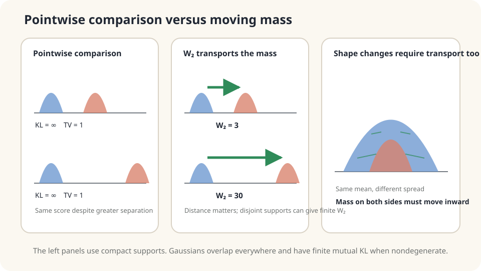

import Objectives from '../../../components/Objectives.astro';
import Prereq from '../../../components/Prereq.astro';
import Question from '../../../components/Question.astro';
import Answer from '../../../components/Answer.astro';
import QuizBlock from '../../../components/QuizBlock.astro';
import Option from '../../../components/Option.astro';
import Explanation from '../../../components/Explanation.astro';
import VizPlan from '../../../components/VizPlan.astro';
import Details from '../../../components/Details.astro';
import Bridge from '../../../components/Bridge.astro';
import Ref from '../../../components/Ref.astro';
import UsedBy from '../../../components/UsedBy.astro';

# How Far Apart Are Two Population Maps? The W₂ Distance

<Objectives title="After reading, you can">
- Define $W_2$ through minimum mean squared displacement and explain its square root.
- Contrast geometric transport with KL and total variation under finite-moment assumptions.
- Construct coupling upper bounds and verify a Gaussian example without confusing empirical and population laws.
</Objectives>

<Prereq items={frontmatter.prereqs} />

## Two population maps

Compare population densities in the same region in 1990 and 2020. Much of the population has shifted from the old center to a new district. How can one number describe the change?

Pointwise KL can be infinite when the later population occupies previously zero-density land. In disjoint-support examples, it does not distinguish a nearby destination from a very distant one.

If displacement scale matters, **put travel distance into the definition**. A coupling already records which origin supplies which destination.

<Question label="Discussion" id="Q1">
Why do pointwise density comparisons miss travel distance, and what additional object is needed?

<Answer summary="Show the reasoning">
KL and total variation compare $p(x)$ with $q(x)$ at the same location, then aggregate. They do not explicitly pair mass at $x$ with mass at another $y$ using the ground distance $\|x-y\|$.

A coupling $\pi$ supplies that pairing. Its mean squared displacement is $\mathbb E_\pi\|X-Y\|^2$. Minimize over all legal pairings:

$$
W_2(\mu,\nu)^2=\min_{\pi\in\Pi(\mu,\nu)}\ \mathbb E_{(x,y)\sim\pi}\big[\|x-y\|^2\big].
$$

The square root is the **2-Wasserstein distance**: the smallest root-mean-square displacement required to transform one law into the other.
</Answer>
</Question>

## Two piles of sand

A pointwise comparison inspects pile heights at each location. Transport instead asks how far each portion of sand must move, while preserving the total mass and target shape.

For finite-second-moment laws, even disjoint supports have finite $W_2$. A pure translation by $a$ gives exactly $W_2=\|a\|$, so spatial separation remains visible after overlap disappears.



*Transport retains information about ground distance when supports separate.*

## What does W₂ measure?

For probability laws on $\mathbb R^d$ with finite second moments, define

$$
\boxed{\;W_2(\mu,\nu)=\Big(\min_{\pi\in\Pi(\mu,\nu)}\int\|x-y\|^2\,d\pi(x,y)\Big)^{1/2}.\;}
$$

Replacing squared displacement by its $p$th power and taking the $p$th root gives $W_p$ for $p\ge1$ under the corresponding moment conditions.

**Every coupling gives an upper bound.** Since the definition minimizes over plans,

$$
W_2(\mu,\nu)^2\le\mathbb E_\pi\|X-Y\|^2\qquad\text{for every }\pi\in\Pi(\mu,\nu).
$$

Independence gives $W_2^2\le\mathbb E\|X\|^2+\mathbb E\|Y\|^2-2\mathbb EX\cdot\mathbb EY$. A map pushing $\mu$ to $\nu$ gives $W_2^2\le\mathbb E_\mu\|X-T(X)\|^2$. Any valid joint sampling mechanism supplies a coupling; its RMS displacement bounds the distance, whether optimal or not.

**A genuine metric:** nonnegative, zero exactly for equal laws, symmetric, and satisfying the triangle inequality. Symmetry swaps the coupling coordinates. Gluing couplings and applying the $L^2$ triangle inequality proves the remaining property below.

**Translation and Gaussian shape:** a translation by $a$ has distance $\|a\|$. For Gaussian laws, the closed form is

$$
W_2^2=\|m_1-m_2\|^2+\mathrm{tr}\Big(\Sigma_1+\Sigma_2-2\big(\Sigma_2^{1/2}\Sigma_1\Sigma_2^{1/2}\big)^{1/2}\Big),
$$

In one dimension this reduces to $(m_1-m_2)^2+(\sigma_1-\sigma_2)^2$: squared mean difference plus squared **standard-deviation** difference, not variance difference.

<Details label="Details" summary="Gluing and convergence of distributions">
Glue optimal couplings (X,Y) and (Y,Z) into a triple law with their shared middle marginal. Then

$$
\begin{aligned}
W_2(\mu,\rho)&\le\|X-Z\|_{L^2}\\
&\le\|X-Y\|_{L^2}+\|Y-Z\|_{L^2}\\
&=W_2(\mu,\nu)+W_2(\nu,\rho).
\end{aligned}
$$

The first step uses a feasible coupling upper bound; the second is Minkowski's inequality. In finite tables, glue via π₁₂(i,j)π₂₃(j,k)/ν(j) on positive middle masses.

On a fixed bounded region, $W_2$ convergence is equivalent to weak convergence. On unbounded spaces, second-moment control is also needed. For $K$-Lipschitz $f$, $|\mathbb E_\mu f-\mathbb E_\nu f|\le K W_2(\mu,\nu)$.

Bounding $W_2$ by KL requires assumptions on the reference law. Standard Gaussian reference $\mu$ gives $W_2(\nu,\mu)^2\le2\mathrm{KL}(\nu\|\mu)$. A strongly log-concave reference with potential curvature at least $\kappa>0$ gives constant $2/\kappa$ under the relevant conditions. Do not apply constant two to arbitrary log-concave laws.
</Details>

## Use geometry and bounds together

For a translated population profile, transport distance records whether the move was one kilometer or a hundred. Pointwise divergences can miss that distinction once supports are disjoint. General shape changes need not scale so simply.

You can bracket the answer: mean separation gives $W_2\ge\|\mathbb EX-\mathbb EY\|$, while a **feasible** plan gives an RMS upper bound. A geographically plausible mapping is insufficient unless it actually produces the target marginal.

Transport sees shape as well as location, through the redistribution it requires. Finite-second-moment laws form its usual finite-distance domain. Switching to $W_1$ still requires checking first moments; it is not an automatic remedy for arbitrary heavy tails.

## Compare Gaussian and empirical distances

```python
import numpy as np
from scipy.optimize import linprog
rng = np.random.default_rng(0)
m1,s1,m2,s2 = 0.,1.,3.,2.
print('population Gaussian W2:',np.sqrt((m1-m2)**2+(s1-s2)**2))
x = np.sort(rng.normal(m1,s1,60))
y = np.sort(rng.normal(m2,s2,60))
C = (x[:,None]-y[None,:])**2
A = np.zeros((120,3600))
for i in range(60): A[i,i*60:(i+1)*60] = 1
for j in range(60): A[60+j,j::60] = 1
res = linprog(C.ravel(),A_eq=A,b_eq=np.ones(120)/60,bounds=(0,None))
assert res.success
print('empirical LP W2:',np.sqrt(res.fun))
print('empirical independent upper bound:',np.sqrt(C.mean()))
print('empirical sorted W2:',np.sqrt(np.mean((x-y)**2)))
```

The Gaussian population value is $\sqrt{10}$. LP and sorting agree for the two empirical laws, but need not equal that population value. The empirical independent coupling bounds the empirical distance, not automatically the population distance. Atomic disjoint samples yield infinite KL; smoothed or parametric density models are different objects.

<iframe loading="lazy" src="/personal_website/notes/research_areas/mathematical-foundations/m6-optimal-transport/m6-1-1.en.html" class="demo-frame" title="W2, KL, total variation, and coupling bounds" style="height: 900px; width: 100%; border: none;"></iframe>

**Move and rescale distributions, then switch couplings to inspect distance and cost bounds.**

## Check your understanding

<QuizBlock id="m6-1-a">
Which discrepancy explicitly penalizes farther movement between feature distributions?
<Option>KL.</Option>
<Option correct>$W_2$, provided the feature-space ground distance represents the differences of interest.</Option>
<Option>Total variation.</Option>
<Explanation>Transport explicitly includes distance between locations. The usefulness of its geometry depends on the chosen feature representation and metric.</Explanation>
</QuizBlock>

<QuizBlock id="m6-1-b">
A map sends $\mu$ exactly to $\nu$ and has expected squared displacement four. What follows?
<Option>$W_2=2$ necessarily.</Option>
<Option correct>$W_2\le2$; equality needs optimality.</Option>
<Option>No information is available without solving OT.</Option>
<Explanation>A feasible map supplies a coupling. Taking the square root of its cost gives an upper bound, not automatically the minimum.</Explanation>
</QuizBlock>

<QuizBlock id="m6-1-c">
Two nondegenerate one-dimensional Gaussians share a mean but differ in standard deviation. What is their W₂ distance?
<Option>Zero.</Option>
<Option correct>$|\sigma_1-\sigma_2|$.</Option>
<Option>Their KL must also be zero.</Option>
<Explanation>Changing width requires moving mass. Equal means remove only the location term; distinct laws still have positive discrepancy.</Explanation>
</QuizBlock>

<UsedBy slug={frontmatter.slug} />

<Bridge to="math-monotone-1d">
W₂ is minimum quadratic transport cost followed by a square root, and every coupling gives a bound. Why did sorted matching achieve the exact empirical optimum? Next compare two routes before and after exchanging destinations.
</Bridge>

## References

1. Villani, C. [*Optimal Transport: Old and New.*](https://doi.org/10.1007/978-3-540-71050-9) Springer, 2009.
2. Peyré, G., Cuturi, M. [*Computational Optimal Transport.*](https://arxiv.org/abs/1803.00567) Foundations and Trends in Machine Learning 11(5–6), 2019.
3. Santambrogio, F. [*Optimal Transport for Applied Mathematicians.*](https://doi.org/10.1007/978-3-319-20828-2) Birkhäuser, 2015.
4. Ambrosio, L., Gigli, N., Savaré, G. [*Gradient Flows in Metric Spaces and in the Space of Probability Measures.*](https://doi.org/10.1007/978-3-7643-8722-8) Birkhäuser, 2nd ed., 2008.
