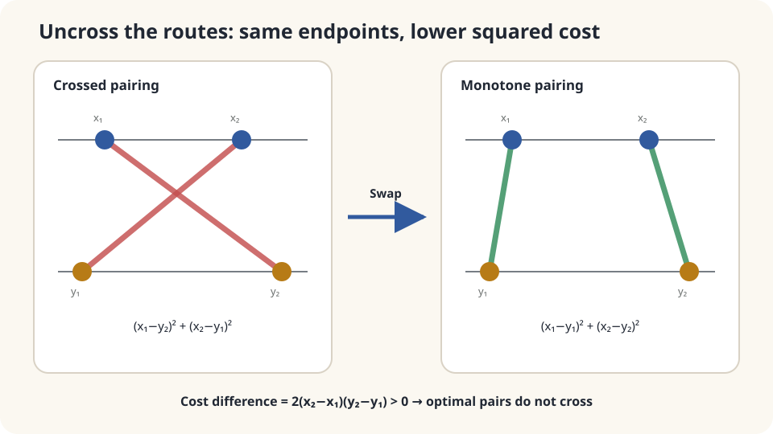

import Objectives from '../../../components/Objectives.astro';
import Prereq from '../../../components/Prereq.astro';
import Question from '../../../components/Question.astro';
import Answer from '../../../components/Answer.astro';
import QuizBlock from '../../../components/QuizBlock.astro';
import Option from '../../../components/Option.astro';
import Explanation from '../../../components/Explanation.astro';
import VizPlan from '../../../components/VizPlan.astro';
import Details from '../../../components/Details.astro';
import Bridge from '../../../components/Bridge.astro';
import Ref from '../../../components/Ref.astro';
import UsedBy from '../../../components/UsedBy.astro';

# Uncross the Routes: One-Dimensional Monotonicity and Brenier's Theorem

<Objectives title="After reading, you can">
- Prove that reversing two ordered destinations raises quadratic transport cost.
- Define quantile coupling and its $W_2$ formula, distinguishing a coupling from a deterministic map.
- State the assumptions of the one-dimensional assignment result and the higher-dimensional Brenier theorem.
</Objectives>

<Prereq items={frontmatter.prereqs} />

## Warehouses and stores along one street

Four warehouses and four stores lie on a line, each supplying or demanding one unit. Route cost is squared distance. How should they be paired?

Write ordered positions $x_1<x_2<x_3<x_4$ and $y_1<y_2<y_3<y_4$. There are 24 permutations.

Ordered matching looks plausible, but choosing each source's nearest store can conflict with demand. **Compare total cost, not one route in isolation.** Exchanging two reversed destinations avoids enumerating every permutation.

<Question label="Discussion" id="Q1">
Define a matching and an inversion. How could an exchange disprove optimality?

<Answer summary="Show the reasoning">
A permutation $\sigma$ assigns source $i$ to destination $\sigma(i)$, with cost $\sum_i(x_i-y_{\sigma(i)})^2$.

An inversion occurs when $x_i<x_j$ but $y_{\sigma(i)}>y_{\sigma(j)}$: the ordered sources have reversed destinations.

Exchange those destinations. If cost strictly decreases, any inverted permutation is suboptimal, leaving ordered matching as the unique candidate under strict endpoint ordering.

This argument is local to two routes and preserves all other assignments, so it applies at any problem size.
</Answer>
</Question>

## Uncross a pair

Replace $x_1\to y_2$ and $x_2\to y_1$ by $x_1\to y_1$ and $x_2\to y_2$ for ordered endpoints.

Supply and demand remain unchanged. Rather than guessing which individual route shortens, compare the sum of squared distances by direct expansion.



*Strictly ordered sources and destinations make the cost improvement strict.*

## Exchange two routes, then extend to distributions

**Lemma.** If $x_1<x_2$ and $y_1<y_2$, then

$$
(x_1-y_1)^2+(x_2-y_2)^2\;<\;(x_1-y_2)^2+(x_2-y_1)^2 .
$$

**Proof.** Expanding cancels all squared endpoint terms, leaving

$$
-2x_1y_1-2x_2y_2\;<\;-2x_1y_2-2x_2y_1
\iff x_1y_2+x_2y_1<x_1y_1+x_2y_2
\iff 0<(x_2-x_1)(y_2-y_1).\qquad\square
$$

Both endpoint gaps are positive. The cost saving is exactly $2(x_2-x_1)(y_2-y_1)$. $\square$

**Assignment theorem:** for strictly ordered sources and destinations with equal unit weights and squared-distance cost, the unique optimal permutation is the identity.

Every nonidentity permutation has an inversion. The lemma strictly improves it by exchanging that pair. Therefore no nonidentity permutation is optimal. $\square$

One source being unusually close to a different-ranked store is no exception: the remaining destinations must also be assigned, and an inversion admits improvement.

**General laws on the line:** define generalized quantile $F^{-1}(u)=\inf\{x:F(x)\ge u\}$. With $U$ uniform on $(0,1)$, $(X,Y)=(F_\mu^{-1}(U),F_\nu^{-1}(U))$ is the optimal quantile coupling. Finite second moments give the cost formula below. For atomless source law, the displayed map is available almost everywhere:

$$
\boxed{\;T(x)=F_\nu^{-1}\big(F_\mu(x)\big),\qquad
W_2(\mu,\nu)^2=\int_0^1\big(F_\mu^{-1}(u)-F_\nu^{-1}(u)\big)^2\,du.\;}
$$

The map is nondecreasing, the continuous form of ordered matching. Equal-sized empirical samples need only sorting, costing $O(n\log n)$ rather than a general transport solve.

<Details label="Details" summary="Higher dimensions: what Brenier's theorem says">
In higher dimensions, literal line crossings are not the right criterion. Exchanging two pairs in an optimal quadratic plan gives ⟨x₂−x₁,y₂−y₁⟩≥0. This is the two-point part of cyclical monotonicity; full cyclical monotonicity includes every finite cycle and is stronger.

Brenier's theorem requires finite second moments and a source absolutely continuous with respect to Lebesgue measure. The optimal coupling is induced by $T=\nabla\varphi$ for convex $\varphi$, uniquely $\mu$-almost everywhere. Atomlessness alone does not substitute for absolute continuity in higher dimensions [2].

The one-dimensional increasing rearrangement thus has a higher-dimensional counterpart in a convex gradient map. The two-point exchange condition alone does not prove that theorem; see [1,2].
</Details>

## What makes sorting optimal?

Under the stated strict ordering, equal weights, and quadratic cost, ordered assignment is optimal without exceptions. The proof compares pairs of routes rather than isolated nearest-neighbor choices.

Check the assumptions:

- **Cost:** convex displacement costs retain an ordered optimum; strict convexity with the appropriate monotone distance cost gives strict exchange conclusions. Absolute distance can have ties. Concave distance costs can favor crossings, but do not universally require complete reversal.
- **Dimension:** higher-dimensional map results need the Brenier assumptions; sorting one coordinate is insufficient.
- **Weights:** unequal weights require coupling language and possible splitting. The one-dimensional quantile formula still applies under finite second moments.

## Enumerate every permutation, then change the cost

```python
import numpy as np
import itertools
x = np.array([0.,1.,2.5,4.])
y = np.array([5.,6.,6.2,9.])
def cost(sig,p=2):
    return np.sum(np.abs(x-y[list(sig)])**p)
perms = list(itertools.permutations(range(4)))
best = min(perms,key=cost)
print('quadratic:',best,cost(best),sorted(cost(s) for s in perms)[:3])
rng = np.random.default_rng(0)
a = np.sort(rng.normal(0,1,5000))
b = np.sort(rng.normal(3,2,5000))
print('empirical and population W2:',np.sqrt(np.mean((a-b)**2)),np.sqrt(10))
print('concave:',min(perms,key=lambda s:cost(s,p=.5)))
costs1 = [cost(s,p=1) for s in perms]
print('linear ties:',sum(abs(c-min(costs1))<1e-9 for c in costs1))
```

Quadratic cost selects the ordered permutation uniquely. In this configuration all sources lie left of all stores, so linear costs tie for every permutation, while square-root distance selects reverse order. The latter is a particular concave-cost example, not a universal reversal theorem. Sorted empirical Gaussian samples approximate the population distance subject to sampling error.

<iframe loading="lazy" src="/personal_website/notes/research_areas/mathematical-foundations/m6-optimal-transport/m6-2-1.en.html" class="demo-frame" title="One-dimensional monotone transport" style="height: 900px; width: 100%; border: none;"></iframe>

**Move endpoints, vary the cost power, and exchange inverted routes.**

## Check your understanding

<QuizBlock id="m6-2-a">
How can you compute W₂ between two equal-weight sets of a hundred real numbers?
<Option>A general LP is necessary.</Option>
<Option correct>Sort each set, average the squared rankwise differences, and take the square root.</Option>
<Option>Only subtract their means.</Option>
<Explanation>Quantile matching is optimal on the line. Mean separation is only a lower bound and misses shape differences.</Explanation>
</QuizBlock>

<QuizBlock id="m6-2-b">
Distance cost becomes concave because long journeys receive a discount. Must an optimal assignment remain ordered?
<Option>Yes: ordering is independent of cost.</Option>
<Option correct>No: the convex-cost exchange conclusion no longer applies, and crossing can help.</Option>
<Option>Every optimum must be completely reversed.</Option>
<Explanation>Cost shape matters. Concavity can favor an unequal long-and-short combination over moderate routes, but actual endpoint geometry still determines the optimum.</Explanation>
</QuizBlock>

<QuizBlock id="m6-2-c">
Which describes the higher-dimensional quadratic optimal map under the appropriate assumptions?
<Option>Send every point to its nearest target, ignoring target mass.</Option>
<Option>Sort by one coordinate.</Option>
<Option correct>With an absolutely continuous source and finite second moments, $T=\nabla\varphi$ for convex $\varphi$.</Option>
<Explanation>Nearest-neighbor rules can violate marginals. A one-coordinate order misses geometry, and two-point monotonicity alone is weaker than the full theorem.</Explanation>
</QuizBlock>

<UsedBy slug={frontmatter.slug} />

<Bridge to="math-large-scale-ot">
Sorting solves one-dimensional quadratic transport; Brenier describes higher-dimensional map structure under stronger assumptions. Higher dimensions offer no comparable universal sorting shortcut. Next examine entropy regularization and minibatch pairing when the full transport problem is too large.
</Bridge>

## References

1. Villani, C. [*Optimal Transport: Old and New.*](https://doi.org/10.1007/978-3-540-71050-9) Springer, 2009.
2. Brenier, Y. [*Polar Factorization and Monotone Rearrangement of Vector-Valued Functions.*](https://doi.org/10.1002/cpa.3160440402) Communications on Pure and Applied Mathematics 44(4), 1991.
3. Santambrogio, F. [*Optimal Transport for Applied Mathematicians.*](https://doi.org/10.1007/978-3-319-20828-2) Birkhäuser, 2015.
4. Peyré, G., Cuturi, M. [*Computational Optimal Transport.*](https://arxiv.org/abs/1803.00567) Foundations and Trends in Machine Learning 11(5–6), 2019.
