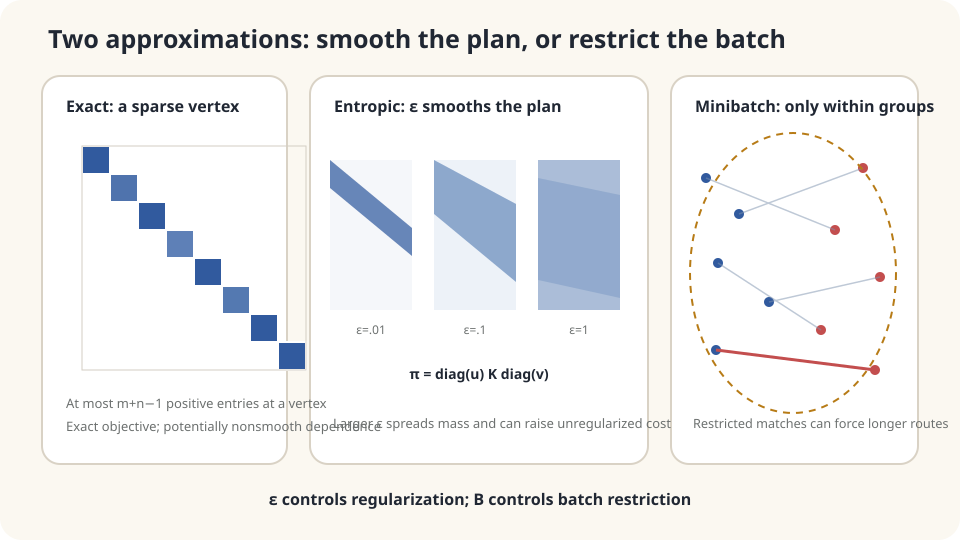

import Objectives from '../../../components/Objectives.astro';
import Prereq from '../../../components/Prereq.astro';
import Question from '../../../components/Question.astro';
import Answer from '../../../components/Answer.astro';
import QuizBlock from '../../../components/QuizBlock.astro';
import Option from '../../../components/Option.astro';
import Explanation from '../../../components/Explanation.astro';
import VizPlan from '../../../components/VizPlan.astro';
import Details from '../../../components/Details.astro';
import Bridge from '../../../components/Bridge.astro';
import Ref from '../../../components/Ref.astro';
import UsedBy from '../../../components/UsedBy.astro';

# Fifty Thousand Warehouses: Sinkhorn and Minibatch Approximations

<Objectives title="After reading, you can">
- Derive the scaling form $\pi=\operatorname{diag}(u)K\operatorname{diag}(v)$ and alternating marginal updates.
- Explain entropy regularization's effect on cost and spreading, including both limiting regimes.
- Compare expected minibatch squared transport cost with population OT without making per-batch or square-root claims.
</Objectives>

<Prereq items={frontmatter.prereqs} />

## A table with 2.5 billion entries

Three-by-three transport needs nine entries. Fifty thousand by fifty thousand needs $2.5\times10^9$, about 20 GB for one double-precision matrix alone. Solver costs depend on the algorithm and structure; no single cubic complexity describes every transport LP.

Such sizes arise with image features, customers, or particles. Exact dense computation can become impractical.

We can modify the objective to favor diffuse plans, or restrict each solve to a small sample. **What changes in each approach, and how does its result compare with the original cost?**

<Question label="Discussion" id="Q1">
How can computational convenience enter the optimization objective? What quantity does minibatch transport estimate?

<Answer summary="Show the reasoning">
One modification rewards entropy $H(\pi)=-\sum_{ij}\pi_{ij}\log\pi_{ij}$, encouraging dispersed mass rather than concentration:

$$
\min_{\pi\in\Pi(a,b)}\ \sum_{ij}\pi_{ij}c_{ij}\;-\;\varepsilon\,H(\pi),\qquad\varepsilon>0 .
$$

This is **entropic optimal transport**. Positive $\varepsilon$ trades original transport cost against entropy. The raw transport cost of its feasible solution cannot be below the unregularized optimum.

Minibatch OT samples $B$ sources and $B$ targets and solves their empirical problem. Compare $\mathbb E[W_2^2(\hat\mu_B,\hat\nu_B)]$ with population $W_2^2(\mu,\nu)$. The expected squared cost is no smaller; individual batches can be lower, and taking a square root does not preserve this proof.
</Answer>
</Question>

## Smooth the objective or restrict the endpoints

A finite transport LP admits a vertex optimum with at most $m+n-1$ positive entries, though not every optimum is a vertex. Dense data representation can remain expensive despite that sparsity.

With positive marginals, finite costs, and $\varepsilon>0$, the entropy-regularized optimum is unique and strictly positive on the allowed full table. It has kernel $K_{ij}=e^{-c_{ij}/\varepsilon}$ with diagonal scalings on both sides. Alternating row and column normalization finds those scalings.

Minibatches make each table smaller but restrict available partners. Missing nearby destinations in a sampled batch can force longer routes. This is a different source of error from entropy regularization.



*Regularization strength and batch size alter different aspects of the coupling.*

## Sinkhorn

**Optimal-plan shape.** Introduce row and column Lagrange multipliers and differentiate each entry:

$$
c_{ij}+\varepsilon(\log\pi_{ij}+1)-f_i-g_j=0
\quad\Longrightarrow\quad
\pi_{ij}=\underbrace{e^{(f_i-\varepsilon)/\varepsilon}}_{u_i}\;\underbrace{e^{-c_{ij}/\varepsilon}}_{K_{ij}}\;\underbrace{e^{g_j/\varepsilon}}_{v_j},
$$

The multipliers give positive factors $u,v$, so $\pi=\operatorname{diag}(u)K\operatorname{diag}(v)$. Only $m+n$ scaling factors remain unknown, though storing and multiplying the kernel can still require $mn$ work.

**Sinkhorn updates.** Enforce the two marginal constraints alternately:

$$
u_i=\frac{a_i}{(Kv)_i}\quad\text{for row sums }a,\qquad
v_j=\frac{b_j}{(K^\top u)_j}\quad\text{for column sums }b.
$$

Update $u$ with $v$ fixed, then $v$ with $u$ fixed. For strictly positive kernels and marginals, Sinkhorn–Knopp scaling converges [3], with reciprocal scale freedom in $u,v$. Cuturi [1] applied it to entropic OT. Each dense iteration costs $O(mn)$; iteration count depends on the problem, regularization, and tolerance.

For unit total mass, $\varepsilon\to\infty$ favors the independent coupling $ab^\top$. As $\varepsilon\to0$, solutions approach the unregularized optimal set, selecting by entropy when relevant. Small regularization can slow convergence and cause numerical underflow; larger regularization often eases computation but does not supply a universal runtime guarantee.

**Raw cost bias:** a feasible $\pi_\varepsilon$ satisfies $\langle\pi_\varepsilon,c\rangle\ge\langle\pi^*,c\rangle$ by definition of the exact optimum. Comparing regularized objectives also gives $H(\pi_\varepsilon)\ge H(\pi^*)$. Distinguish this raw cost from the objective that subtracts entropy.

<Details label="Details" summary="Log-domain updates, finite bias bounds, and Sinkhorn divergence">
Direct exponentiation can underflow at small ε. Set f=εlogu and g=εlogv. A row update is fᵢ=εlogaᵢ−εlogΣⱼexp((gⱼ−cᵢⱼ)/ε), evaluated with log-sum-exp. Columns update analogously.

For a finite unit-mass table, optimality gives

$$
\begin{aligned}
0\le\langle\pi_\varepsilon-\pi^*,c\rangle
&\le\varepsilon[H(\pi_\varepsilon)-H(\pi^*)]\\
&\le\varepsilon\log(mn).
\end{aligned}
$$

This is a finite-problem bound, not a universal continuous-law rate.

The **Sinkhorn divergence** subtracts self terms:

$$
\begin{aligned}
S_\varepsilon(\mu,\nu)
&=\mathrm{OT}_\varepsilon(\mu,\nu)\\
&\quad-\tfrac12\mathrm{OT}_\varepsilon(\mu,\mu)\\
&\quad-\tfrac12\mathrm{OT}_\varepsilon(\nu,\nu).
\end{aligned}
$$

Use one consistent definition of the **regularized optimal value**, not raw transport costs mixed with regularized values. Equality on identical laws follows by cancellation; further properties need cost and kernel assumptions [5].
</Details>

## Minibatch bias

Sample empirical laws $\hat\mu_B,\hat\nu_B$ from the two populations and solve their quadratic OT problems. Two statements matter.

**Expected squared cost:** the optimal transport value is jointly convex in its marginals, because mixtures of feasible plans remain feasible for mixture marginals. Since empirical marginals are unbiased as measures, Jensen gives

$$
\mathbb E\big[W_2^2(\hat\mu_B,\hat\nu_B)\big]\;\ge\;W_2^2\big(\mathbb E\hat\mu_B,\mathbb E\hat\nu_B\big)=W_2^2(\mu,\nu).
$$

For identical continuous populations, population distance is zero while independent finite empirical sets usually differ. Rates depend on dimension, moments, and regularity; there is no universal $B^{-1/d}$ formula [2,4].

**Average pairing:** $\bar\pi_B=\mathbb E[\pi_B^*]$ has population marginals and is a valid population coupling. Its expected cost bounds population OT from above. At $B=1$, independent sampling gives exactly the independent coupling. Large-batch cost convergence needs moment conditions; convergence toward a specified optimizer also requires conditions such as uniqueness.

Both approaches can create less concentrated pairings than an exact map, but minibatch spreading has no universal entropy ordering against every population optimum. Their common cost conclusions also differ: entropic raw cost is bounded for each feasible solve, whereas the population minibatch comparison is an expectation statement.

## Choose according to the task

Dense Sinkhorn retains an $m\times n$ kernel or equivalent block computations. Minibatches need $B^2$ pairwise storage but introduce sampling effects and within-batch restrictions. Memory, solver accuracy, and intended use determine the tradeoff.

Ask whether the goal is a distance estimate or training pairs. The two approximations can be combined; neither is universally best or the only large-scale option.

Check both marginal residuals and avoid underflow. Positive kernels have the stated scaling guarantee; merely having no entirely zero row or column is insufficient for arbitrary sparse kernels. For minibatches, state the sampling scheme and keep expected squared cost distinct from individual outcomes and expected unsquared distance.

## Compare three computations on a smaller problem

```python
import numpy as np
from scipy.special import logsumexp
from scipy.optimize import linear_sum_assignment
rng = np.random.default_rng(0)
n,d = 2000,2
X = rng.normal(0,1,(n,d))
Y = rng.normal(0,1,(n,d))@np.diag([2,.5])+np.array([3,0])
print('population W2 squared:',10.25)
C = ((X[:,None,:]-Y[None,:,:])**2).sum(-1)
r,c = linear_sum_assignment(C)
print('full empirical OT:',C[r,c].mean())
def sinkhorn_log(C,eps,iters=1000):
    m,n = C.shape
    loga,logb = np.full(m,-np.log(m)),np.full(n,-np.log(n))
    f,g = np.zeros(m),np.zeros(n)
    for _ in range(iters):
        f = eps*(loga-logsumexp((g[None,:]-C)/eps,axis=1))
        g = eps*(logb-logsumexp((f[:,None]-C)/eps,axis=0))
    logP = (f[:,None]+g[None,:]-C)/eps
    P = np.exp(logP)
    entropy = -np.sum(P[P>0]*logP[P>0])
    residual = max(np.abs(P.sum(1)-np.exp(loga)).sum(),np.abs(P.sum(0)-np.exp(logb)).sum())
    return (P*C).sum(),entropy,residual
for eps in [.05,.2,1.,5.]:
    print('epsilon, cost, entropy, residual:',eps,*sinkhorn_log(C,eps))
def minibatch_w2(C,B,reps=200):
    vals = []
    for _ in range(reps):
        i = rng.choice(C.shape[0],B,replace=False)
        j = rng.choice(C.shape[1],B,replace=False)
        S = C[np.ix_(i,j)]
        r,c = linear_sum_assignment(S)
        vals.append(S[r,c].mean())
    return np.mean(vals)
for B in [8,32,128,512]:
    print('batch:',B,minibatch_w2(C,B))
Y2 = rng.normal(0,1,(n,d))
C2 = ((X[:,None,:]-Y2[None,:,:])**2).sum(-1)
for B in [8,512]:
    print('same population:',B,minibatch_w2(C2,B,50))
```

Compare population Gaussian cost 10.25 with the full empirical assignment, regularized costs, and minibatch averages. A particular empirical sample can lie above or below the population value; upward bias is an expected squared-cost claim. The displayed subset sampling is conditional on fixed empirical laws, so its expected-cost comparison can also be made against their full empirical optimum.

At small $\varepsilon$, too few iterations may give a raw cost below exact empirical OT because the approximate matrix has not satisfied both margins. This does not contradict the feasible-coupling bound. Inspect residuals, continue iterations, and use an appropriate stopping criterion before interpreting costs.

For identical populations, independent empirical samples still give positive costs, especially at small batch sizes. This is sampling and minibatch bias rather than a proof the populations differ. Direct-domain kernels at very small regularization can also underflow and break updates; log-domain arithmetic addresses that separate numerical issue.

<iframe loading="lazy" src="/personal_website/notes/research_areas/mathematical-foundations/m6-optimal-transport/m6-3-1.en.html" class="demo-frame" title="Sinkhorn regularization and minibatch size" style="height: 900px; width: 100%; border: none;"></iframe>

**Inspect coupling, cost, entropy, and marginal residuals as each approximation updates.**

## Check your understanding

<QuizBlock id="m6-3-a">
Entropic transport of a point cloud to itself gives positive raw cost. What can explain this?
<Option>It must be a bug.</Option>
<Option correct>Positive regularization spreads mass off the diagonal; distinguish this raw self-cost from a consistently defined debiased Sinkhorn divergence.</Option>
<Option>Regularization is necessarily too small.</Option>
<Explanation>For distinct points, positive marginals, and finite costs, the entropic plan can have positive off-diagonal transport. Standard debiasing subtracts self **regularized optimal values**, not an arbitrary mixture of raw and regularized costs.</Explanation>
</QuizBlock>

<QuizBlock id="m6-3-b">
A training loop needs pairings from a million-example dataset at every update. Which option is practical among these?
<Option>Solve a dense full-data LP every update.</Option>
<Option correct>Solve assignments within manageable minibatches, recognizing that they are batch-optimal rather than population-optimal.</Option>
<Option>Always run full-data Sinkhorn with vanishing regularization.</Option>
<Explanation>Pairwise batch storage is $O(B^2)$; solve time depends on the method, commonly cubic for assignment algorithms. Other large-scale methods also exist.</Explanation>
</QuizBlock>

<QuizBlock id="m6-3-c">
What endpoints arise from infinite regularization in a finite problem and from independently sampled batches of size one?
<Option>Both give exact OT.</Option>
<Option correct>Both give independent coupling.</Option>
<Option>Only the batch method becomes independent.</Option>
<Explanation>The shared independent endpoint does not imply that intermediate couplings lie on the same interpolation line. Recovering exact population limits needs the appropriate separate assumptions.</Explanation>
</QuizBlock>

<UsedBy slug={frontmatter.slug} />

<Bridge>
Entropy regularization changes the objective; minibatching restricts available partners. Both turn expensive transport calculations into usable approximations with distinct biases and numerical checks.

Mathematical Foundations closes with a reusable habit: formulate the concrete question, state the assumptions behind the formula, and test where they fail. Use each note's Used By links to revisit the necessary tool when another course needs it.
</Bridge>

## References

1. Cuturi, M. [*Sinkhorn Distances: Lightspeed Computation of Optimal Transport.*](https://arxiv.org/abs/1306.0895) NeurIPS 2013.
2. Peyré, G., Cuturi, M. [*Computational Optimal Transport.*](https://arxiv.org/abs/1803.00567) Foundations and Trends in Machine Learning 11(5–6), 2019.
3. Sinkhorn, R., Knopp, P. [*Concerning Nonnegative Matrices and Doubly Stochastic Matrices.*](https://doi.org/10.2140/pjm.1967.21.343) Pacific Journal of Mathematics 21(2), 1967.
4. Fatras, K., Zine, Y., Flamary, R., Gribonval, R., Courty, N. [*Learning with Minibatch Wasserstein: Asymptotic and Gradient Properties.*](https://arxiv.org/abs/1910.04091) AISTATS 2020.
5. Genevay, A., Peyré, G., Cuturi, M. [*Learning Generative Models with Sinkhorn Divergences.*](https://arxiv.org/abs/1706.00292) AISTATS 2018.
